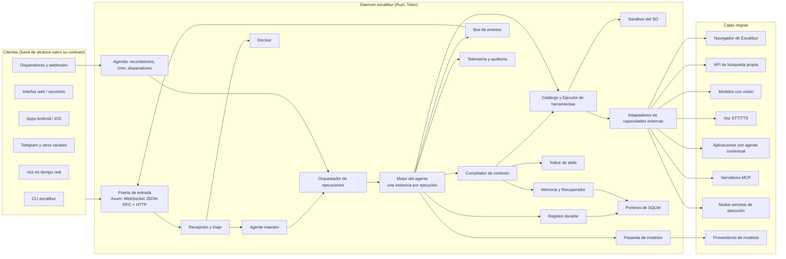
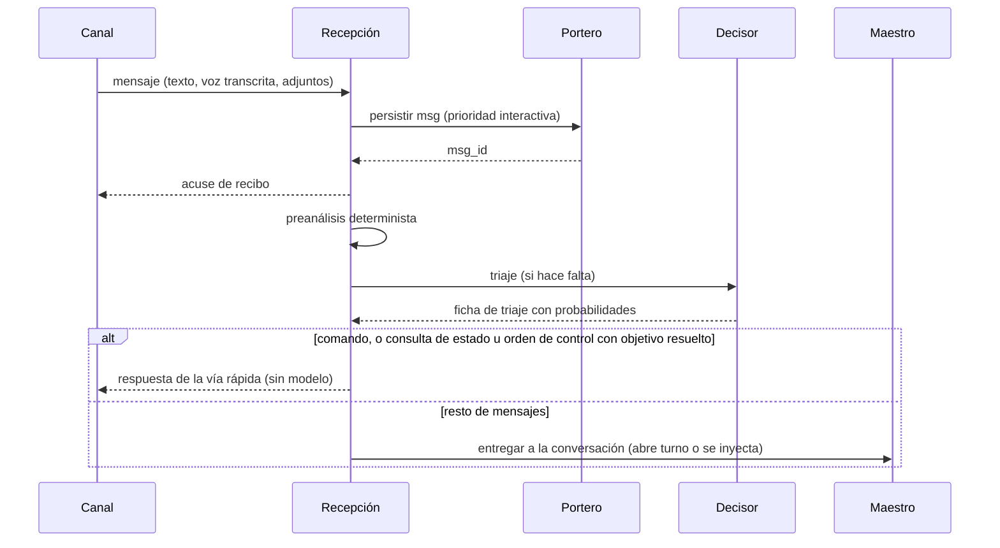
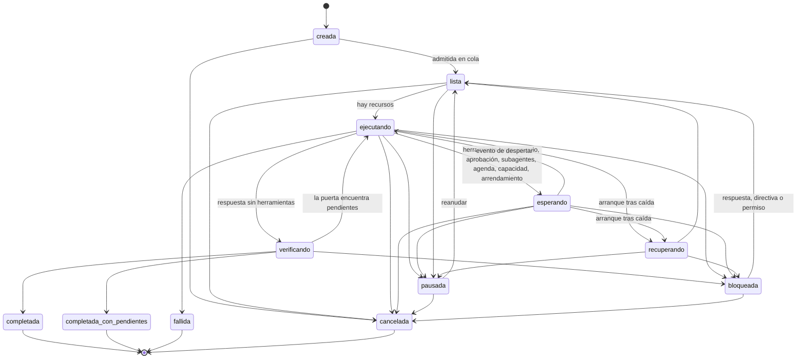
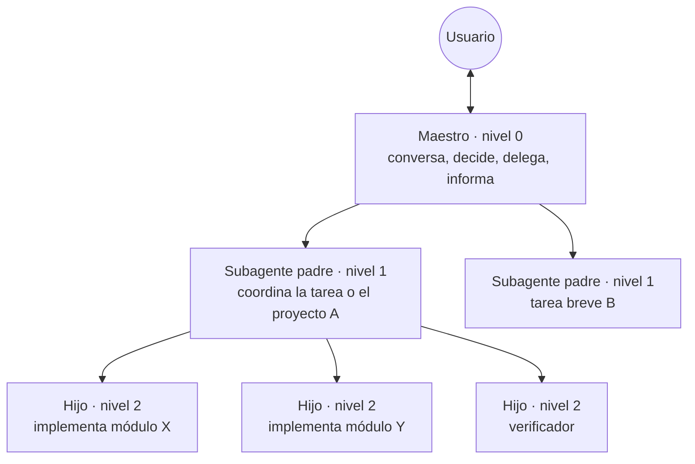
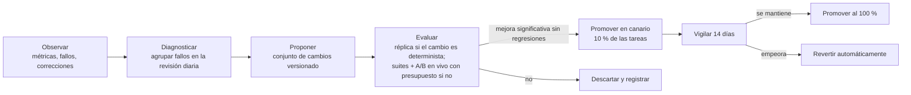

# Excalibur — Arquitectura del arnés y sus algoritmos

> Documento de arquitectura del **arnés** de Excalibur: el núcleo que recibe solicitudes, conversa, planifica, ejecuta herramientas, coordina subagentes, recuerda, construye el contexto de cada llamada al modelo, verifica y se recupera de fallos. Fecha de la investigación que lo fundamenta: 2026-10-28. Documento de partida: `anotaciones.md`.

---

## 0. Cómo leer este documento

**Qué cubre.** El arnés y sus algoritmos: datos, procesos, ciclos, decisiones deterministas y decisiones que requieren modelos, errores, interrupciones, concurrencia y evaluación. Cada capacidad tiene su sección con responsabilidades, entradas y salidas, estado y almacenamiento, algoritmo, errores y comportamiento ante interrupciones.

**Qué no cubre.** La interfaz visual (web, móvil, 2D, voz como interfaz), la tienda, y el interior del navegador, del buscador propio y de las aplicaciones con interfaz propia (hoja de cálculo, modelado 3D, editor de vídeo, aula de cursos, etc.). Para todas ellas el arnés define **contratos**: operaciones, entradas, salidas y estados que necesita para integrarlas (sección 14). El usuario desarrollará el navegador; aquí es una caja negra.

**Convenciones.**

- **[E]** marca un hecho verificado en una fuente (repositorio con commit, documentación oficial, paper con sección o tabla). La clave entre corchetes, por ejemplo [Codex] o [SkillsBench], remite a la sección 28.
- **[I]** marca una inferencia propia que influye en una decisión.
- Los nombres de herramientas, skills, crates y campos de datos están en inglés (requisito de las anotaciones); el resto del documento está en español.
- Los valores numéricos por defecto son **valores iniciales a calibrar** con la evaluación de la sección 23; están reunidos en el apéndice B.
- Cada sección funcional (3 a 26) termina con un apartado **Pruebas de verificación**: describe, en texto, qué debe probar el agente de programación, el resultado esperado y la evidencia a conservar. Todo se verifica contra el backend; la interfaz visual queda fuera de alcance. El apéndice E relaciona cada hito con sus pruebas.
- "Ejecución" (*run*) es una instancia de un agente trabajando en un encargo concreto; "ámbito" (*scope*) es el espacio de datos al que pertenece algo (general, proyecto, conversación, tarea).

**Mapa rápido de las áreas de las anotaciones.** El apéndice C relaciona cada área y cada requisito con la sección que lo resuelve. Algunos requisitos proceden del inventario de capacidades de **Fénix**, un proyecto anterior del usuario cuyo inventario se incorporó como requisitos de Excalibur. Se citan por su número de origen (11, 32–45, 48, 49), y el apéndice C.1 recoge el título de cada uno, de modo que no hace falta consultar otro documento.

| Área de las anotaciones | Secciones |
|---|---|
| Cosas críticas (plataformas, embeddings, decisor, compactación a 500 000 tokens, métricas desde la v1, evaluación) | 3, 10, 11, 19, 22, 23, 25 |
| Tarea y planificación | 6, 7, 8 |
| Agentes y subagentes | 5, 15, 16, 17, 18 |
| Memoria y gestión del contexto | 9, 10, 11 |
| Skills y aprendizaje | 12, 24 |
| Herramientas principales y software | 13, 16 |
| Interfaz (solo su lado del arnés: disponibilidad, API, métricas) | 3.5, 5, 22 |
| Dispositivos y herramientas secundarias; navegador y búsqueda; documentos | 14, 10.9 |
| Automatización y programación de tareas | 21 |
| Permisos, identidad, seguridad, sandboxes, equipos | 20 |
| Tienda (solo instalación, creación y publicación con permiso) | 12.8, 13.9, 20.9 |
| Cuándo se activa cada mecanismo | Apéndice D |
| Orden de implementación y evaluación posterior a la implementación | Apéndices E y F |

---

## 1. Qué es el arnés de Excalibur

Excalibur es un asistente personal de IA y un arnés de programación. El arnés es un **proceso residente escrito en Rust** (el *daemon* `excalibur`) que:

1. Recibe mensajes de cualquier canal (CLI, interfaz web, aplicaciones móviles, Telegram, voz, disparadores) y los persiste antes de hacer nada más.
2. Mantiene un **agente maestro** por usuario que conversa y atiende mientras el trabajo avanza en segundo plano. Su disponibilidad se apoya en mecanismos con límites declarados, no en una garantía absoluta (5.3).
3. Convierte las peticiones en **tareas con requisitos, criterios de aceptación y evidencias**, planifica y delega en **subagentes padre e hijos** (profundidad máxima de tres niveles contando al maestro).
4. Ejecuta herramientas dentro de **sandboxes del sistema operativo**, con permisos explícitos y un registro durable que permite **retomar el trabajo tras caídas o reinicios** sin duplicar efectos.
5. Recuerda: memoria general, memoria por proyecto, documentos de identidad, notas, historial de mensajes y acciones, con búsqueda léxica, semántica, temporal y relacional.
6. Construye cada llamada al modelo con un **compilador de contexto** por capas que aprovecha la caché de entrada de los proveedores y mantiene el contexto activo pequeño.
7. Verifica con **comprobaciones ejecutables** antes de dar algo por terminado, detecta bucles, aplica límites y mide RAM, tokens, costo, llamadas y tiempo por tarea desde la primera versión.

El objetivo de diseño es la **máxima calidad con modelos económicos**. La literatura y el código de las referencias apuntan a un mismo conjunto de palancas, y toda la arquitectura se organiza a su alrededor: estado fuera del modelo, contexto pequeño y estable, pocas herramientas bien diseñadas, verificación ejecutable, aprendizaje solo con evidencia y decisiones baratas resueltas por código o por modelos de decisión. La superioridad frente a Codex, OpenCode, Antigravity, Muse Code, Grok Build/Grok Bot, dots, OpenClaw, Hermes Agent, OpenHuman y GBrain es una **meta que se mide** con el protocolo de la sección 23, no un resultado.

---

## 2. Principios de diseño

Cada principio tiene una consecuencia concreta en la arquitectura y una razón con evidencia.

**P1. El estado vive en la base de datos; el contexto es una proyección.** Planes, requisitos, criterios, evidencias, instrucciones, memoria y progreso se guardan en SQLite. Lo que ve el modelo en cada llamada se compila desde ahí. Consecuencia: compactar, reiniciar, delegar o cambiar de modelo no pierde el trabajo. Razón: los fallos recurrentes de Codex tras compactar (el agente "olvida sus ediciones" o vuelve a una tarea antigua) [E][Codex, issues #5957, #11315]; la práctica de Anthropic para agentes de larga duración externaliza el estado en artefactos duraderos y arranca sesiones nuevas desde ellos [E][Anthropic-LR].

**P2. Primero determinista; modelo solo para juicio.** Todo lo que el código puede decidir lo decide el código: resolver a qué proyecto pertenece un archivo, saber si una evidencia está desactualizada, detectar bucles, calcular presupuestos, ordenar el contexto, decidir cuándo compactar, reintentar, reconciliar tras un reinicio. Los modelos se usan para interpretar lenguaje, planificar, resumir lo que el código no sabe, extraer hechos y juzgar cuando no existe una comprobación ejecutable. La tabla 2.1 detalla la frontera.

**P3. Verificación ejecutable antes que autoevaluación.** La autocorrección sin señal externa reduce la precisión (hasta −37,7 puntos) [E][Huang]; los jueces LLM pequeños rinden en torno al azar al juzgar código [E][JudgeBench]; las ganancias probadas para modelos baratos vienen de tests, compiladores y ejecución [E][S*][Agentless]. Consecuencia: la puerta de finalización exige evidencias producidas por comprobaciones.

**P4. Contexto pequeño y prefijo estable.** La longitud efectiva de contexto de los modelos baratos es mucho menor que su ventana anunciada (GPT-4o-mini por debajo de 1K en NoLiMa) [E][NoLiMa]; enmascarar observaciones antiguas iguala o supera al resumen con LLM y reduce el costo en torno al 50 % [E][ComplexityTrap]; todos los proveedores cachean por coincidencia exacta de prefijo en el orden herramientas → sistema → mensajes [E][Caching]. Consecuencia: compilador por capas, deltas en lugar de reescrituras, enmascarado por lotes y compactación como último recurso.

**P5. El interlocutor es ligero y nunca ejecuta trabajo largo.** El agente maestro solo usa herramientas rápidas y delega todo lo demás. Consecuencia: su disponibilidad no depende de la duración de las tareas (sección 5).

**P6. Ámbitos aislados por construcción.** Cada fila de memoria, tarea o evidencia pertenece a un ámbito y toda consulta exige un conjunto de ámbitos; el filtro se aplica en SQL, no en el prompt.

**P7. Aprender solo detrás de evidencia.** Las skills curadas mejoran mucho a modelos pequeños, pero las autogeneradas sin filtro empeoran en promedio (−1,3 puntos) [E][SkillsBench]; los sistemas automejorables pueden manipular sus propias métricas [E][DGM]. Consecuencia: toda skill, memoria o ajuste aprendido pasa por cuarentena, evaluación A/B en réplica y versión con reversión; los evaluadores son inmutables para el agente.

**P8. Pocas herramientas, bien diseñadas.** La precisión de selección cae al crecer el catálogo, sobre todo en modelos pequeños (Qwen2.5-1.5B: de 55,2 a 29,5 con 20 herramientas) [E][Tool-DC]; un visor de 100 líneas, búsquedas resumidas y un editor que rechaza ediciones con errores de sintaxis valen varios puntos [E][SWE-agent]. Consecuencia: núcleo fijo pequeño, herramientas de dominio cargadas bajo demanda sin romper la caché.

**P9. Presupuestos explícitos en todo.** Cada ejecución tiene límites de pasos, tokens, costo, tiempo, procesos y RAM, y cada árbol de tareas reparte su presupuesto.

**P10. La frontera de seguridad es el sistema operativo.** Las heurísticas dentro del proceso (aprobaciones, redacción, filtros) ayudan, pero la única frontera fiable frente a un modelo manipulado es el sandbox del SO; Hermes lo declara explícitamente [E][Hermes, SECURITY.md] y los incidentes de Antigravity (borrado de una unidad en modo Turbo, exfiltración de `.env` por inyección) lo confirman [E][Antigravity-incidentes].

### 2.1 Qué es determinista y qué requiere modelo

| Mecanismo | Determinista (código) | Modelo de decisión (barato, calibrado) | LLM |
|---|---|---|---|
| Recepción y persistencia de mensajes | Siempre | — | — |
| Comandos explícitos, referencias a IDs, rutas, URL, fechas | Siempre | — | — |
| Clasificar el tipo de solicitud y su ámbito | Reglas cuando bastan | Primera opción | Si la confianza es baja (dentro del turno del maestro, sin llamada extra) |
| Decidir preguntar o suponer | Reglas de irreversibilidad y datos obligatorios | Probabilidad de ambigüedad material | Formular las preguntas |
| Resolver archivo → proyecto | Siempre (prefijo más largo) | — | — |
| Extraer requisitos y criterios | — | — | Siempre (con plantilla) |
| Estado de criterios, frescura de evidencias | Siempre | — | — |
| Contrastar el resultado con la petición original | — | — | Una llamada barata en tareas grandes |
| Orden y contenido de las capas de contexto | Siempre | Ranking de skills y herramientas sugeridas | — |
| Disparo de enmascarado y compactación | Siempre | — | Resumen de lo que el código no sabe |
| Recuperación de memoria | Fusión, filtros, frescura, empaquetado | Desempate en banda ambigua | Reescritura solo si no hay resultados |
| Admisión de recuerdos | Duplicados exactos y casi exactos | Banda de similitud ambigua | Extracción de hechos candidatos |
| Detección de bucles | Firmas y ciclos | Juicio de atasco tras muchos pasos | — |
| Riesgo de un comando | Parser y reglas | Comandos desconocidos | Explicación de la solicitud de permiso |
| Reintentos, reconciliación tras reinicio, agenda | Siempre | — | — |
| Consultas de estado y órdenes de control (pausar, reanudar, cancelar) con objetivo resuelto | Siempre (vía rápida, 6.1) | Clasificar el mensaje y resolver el objetivo cuando no es un comando | — |
| Prioridad de una directiva | Intersección de recursos con el área afectada | ¿La instrucción prohíbe la acción en curso? | — |
| A quién y por qué canal avisar | Siempre (5.4) | ¿Merece aviso inmediato? | Redacción de avisos compuestos |
| Selección de tests impactados | Grafo de código | — | — |
| Planificar y replanificar | Validación del grafo (acíclico, referencias) | — | Propuesta de plan y de cambios |
| Aprendizaje de skills | Detección de repetición, A/B, promoción, reversión | — | Redacción del borrador |

---

## 3. Mapa general del sistema

### 3.1 Componentes



| Componente | Responsabilidad | Estado propio |
|---|---|---|
| Puerta de entrada | Autenticar clientes, exponer la API, difundir eventos, adaptar canales | Sesiones de clientes, cursores de eventos |
| Recepción y triaje | Normalizar, persistir, preanalizar de forma determinista, clasificar con el decisor | Ninguno (escribe mensajes y fichas) |
| Agente maestro | Conversar, decidir, delegar, informar | Turnos por conversación |
| Orquestador | Crear, programar, pausar, cancelar y recuperar ejecuciones; repartir recursos | Cola de ejecuciones listas |
| Motor del agente | El ciclo de pasos de cada ejecución | Estado de la ejecución (en RAM, respaldado por el registro) |
| Compilador de contexto | Construir cada solicitud al modelo por capas | Hashes de capas por ejecución |
| Memoria y Recuperador | Escribir, consolidar y recuperar recuerdos, documentos e historial | Tablas de memoria, índices FTS5 y vectoriales |
| Índice de skills | Descubrir, validar, agrupar, sugerir y cargar skills | Índice en RAM + caché en BD |
| Catálogo y Ejecutor de herramientas | Definiciones, validación, permisos, ejecución, normalización de salidas | Catálogo en RAM, sesiones de procesos |
| Sandbox | Aplicar perfiles de aislamiento por plataforma | Perfiles |
| Pasarela de modelos | Adaptadores de proveedores, prioridades, límites, reintentos, caché, costo | Colas por carril, contadores |
| Decisor | Preguntas acotadas con probabilidad calibrada | Umbrales calibrados |
| Agenda | Recordatorios, cron, disparadores de eventos, reanudaciones | Tabla de programaciones |
| Registro durable | Diario de cada ejecución para retomar sin duplicar efectos | Tabla `journal` |
| Porteros | Un escritor por archivo de base de datos, transacciones cortas | Cola de escrituras |
| Bus de eventos | Difusión en vivo y persistente de eventos | Secuencia de eventos |
| Telemetría y auditoría | Métricas por tarea, trazas, auditoría encadenada | `telemetry.db`, tabla `audit` |
| Adaptadores de capacidades | Contratos con navegador, búsqueda, visión, voz, apps, MCP, nodos | Manejadores de tareas durables |

### 3.2 Procesos

- **Un daemon por instalación** (normalmente uno por usuario del sistema operativo; en modo servidor atiende a varios principales, cada uno con sus datos aislados, 20.13), con un runtime Tokio multihilo. Todos los agentes de ese daemon son tareas asíncronas, no procesos: crear un subagente cuesta memoria del orden de su contexto, no de un proceso nuevo [I].
- **Procesos hijos solo para ejecutar herramientas** (comandos, scripts, servidores LSP, servidores MCP locales), siempre dentro del perfil de sandbox correspondiente, en su propio grupo de procesos, para poder matarlos en bloque.
- **Sidecar opcional de inferencia local** (embeddings, reranker, decisor local) cargado bajo demanda y descargado tras inactividad.
- **Modo embebido**: el mismo binario puede ejecutar `excalibur exec` sin daemon, con una base de datos efímera o persistente. Es el modo de evaluación (Terminal-Bench) y de integración continua.

La pila Tokio + Axum + `portable-pty` + SQLite tiene precedente de producción en el propio Codex (axum 0.8, portable-pty 0.9.0, sqlx con SQLite) [E][Codex]; se adopta Tokio y Axum. No hay cifras públicas fiables de RAM de esta pila; se medirán (sección 22).

**Protección del camino interactivo.** Tokio no tiene prioridades entre tareas, así que la prioridad se obtiene separando recursos:

- **Runtime interactivo** con un número pequeño y fijo de hilos (por defecto 2) para la puerta, la recepción, la vía rápida de comandos, los turnos del maestro, las lecturas de estado y el carril P0 de la pasarela. Ninguna ejecución de fondo, indexado o consolidación corre en él.
- **Runtime de trabajo** con el resto de núcleos para los motores de las ejecuciones, el orquestador y las herramientas integradas.
- **Trabajo de CPU intensivo** (embeddings locales, tree-sitter, compresión, cálculo de huellas) en un pool de bloqueo propio cuyos hilos bajan su prioridad del sistema operativo.
- **Procesos de herramientas con prioridad baja**:
  - en Linux, un cgroup v2 por ejecución con `cpu.weight` inferior al del daemon cuando el gestor de servicios delega el control de cgroups, y si no `nice` e `ioprio`;
  - en macOS, la política de segundo plano (`PRIO_DARWIN_BG`);
  - en Windows, la clase `BELOW_NORMAL_PRIORITY_CLASS` y el control de CPU del Job Object.

  Así, un compilador o una suite de tests que saturan la CPU no retrasan la recepción ni los turnos del maestro tanto como lo harían con la misma prioridad [I]. El efecto real se mide con la suite `avail` (23.5).
- **Aislamiento de pánicos**: el binario se compila con `panic=unwind`; cada turno, ejecución y adaptador es una tarea propia, y un pánico se captura en su límite (Tokio lo devuelve como error de la tarea), se registra y la tarea pasa a `fallida` sin tumbar el proceso. Un fallo en un hilo escritor de la base de datos sí es crítico: el daemon termina de forma controlada y lo reinicia el supervisor (25.2).

### 3.3 Perfiles de despliegue

| Perfil | Plataformas | Qué ejecuta | Límites |
|---|---|---|---|
| **Completo** | Linux, macOS, Windows (escritorio o servidor) | Todo el arnés, herramientas con procesos, sandbox del SO, LSP, inferencia local opcional | Los de la máquina |
| **Móvil conectado** | Android, iOS | Cliente de un daemon (propio o de un servidor) | Ninguno del lado del arnés |
| **Móvil local** | Android, iOS | Núcleo Rust embebido mediante UniFFI (bindings Kotlin/Swift): conversación, memoria, planificación, agenda, búsqueda y lectura web por HTTP, capacidades remotas; **sin ejecución de procesos arbitrarios** | Android no permite ejecutar binarios descargados en directorios escribibles (targetSdk ≥ 29) y desde el 31-08-2026 Play exige API 36; iOS prohíbe descargar o ejecutar funcionalidad nueva y suspende la app segundos después de pasar a segundo plano [E][Plataformas-móviles]. Las tareas con terminal o de larga duración se delegan a un **nodo remoto** si existe; si no, se pausan y se reanudan cuando la app vuelve a primer plano (en iOS 26, `BGContinuedProcessingTask` para continuar trabajo iniciado por el usuario) |
| **Evaluación** | Linux en contenedor | `excalibur exec` no interactivo con el perfil `eval` definido en [23.2](#232-terminal-bench-21-y-40-conexión-e-interacción): base de datos efímera, el contenedor es la frontera, solo las capacidades útiles para un episodio aislado | Los de la tarea |

En el perfil móvil local el usuario puede usar su propia clave de API y pagar solo el consumo: la pasarela de modelos funciona igual, con las claves en el llavero del dispositivo.

**Límites del perfil móvil local y cómo se compensan.**

- **Recordatorios**: con la aplicación suspendida no hay maestro activo, así que la Agenda delega cada recordatorio próximo en el planificador de notificaciones locales del sistema (notificaciones locales en iOS, alarmas en Android con los permisos de alarma exacta que exija la versión). Como el sistema limita cuántas notificaciones pendientes admite, se programan solo las más próximas y se reponen cada vez que la aplicación se abre.
- **Turnos y trabajo**: con la aplicación en segundo plano no se garantiza ningún turno del maestro ni avance de ejecuciones. En iOS solo el trabajo iniciado por el usuario puede continuar con `BGContinuedProcessingTask`; en Android, un servicio en primer plano con los límites de tiempo de su tipo [E][Plataformas-móviles]. Lo demás se pausa (`pausada`, motivo `platform`) y se reanuda al volver a primer plano.
- **Disponibilidad continua**: solo con un daemon (propio o de servidor) o un nodo remoto. El perfil local la ofrece mientras la aplicación está abierta.

**Nodos remotos.** Un daemon puede registrar otros dispositivos o servidores como **nodos de ejecución** que declaran capacidades (terminal, navegador, control de escritorio) y comandos permitidos, al estilo de los *nodes* de OpenClaw [E][OpenClaw]. El arnés trata un nodo como una capacidad externa más (sección 14), con autenticación por emparejamiento de dispositivo.

### 3.4 Organización en crates

| Crate | Contenido |
|---|---|
| `excalibur-types` | Identificadores, tipos de dominio, esquemas de eventos y del protocolo |
| `excalibur-store` | Porteros, pool de lectura, migraciones, almacén de blobs |
| `excalibur-journal` | Registro durable, reconciliación, reintentos |
| `excalibur-engine` | Motor del agente (ciclo de pasos), puerta de finalización, detector de bucles |
| `excalibur-orchestrator` | Ejecuciones, jerarquía de subagentes, buzones, directivas, recursos |
| `excalibur-context` | Compilador de contexto, enmascarado, compactación, conteo de tokens |
| `excalibur-memory` | Recuerdos, documentos de identidad, consolidación, Recuperador, biblioteca de documentos, grafo de código |
| `excalibur-skills` | Índice, validación de la especificación Agent Skills, selección, aprendizaje |
| `excalibur-tools` | Catálogo, ejecutor, herramientas integradas, terminal, edición, LSP, cliente MCP |
| `excalibur-sandbox` | Perfiles por plataforma (bubblewrap/seccomp/Landlock, Seatbelt, tokens restringidos de Windows) |
| `excalibur-models` | Pasarela de modelos, adaptadores, precios, decisor |
| `excalibur-agenda` | Recordatorios, cron con zona horaria, disparadores, workflows durables |
| `excalibur-security` | Políticas, aprobaciones, baúl de secretos, contenido no confiable, auditoría |
| `excalibur-capabilities` | Contratos y adaptadores de capacidades externas |
| `excalibur-telemetry` | Métricas, trazas OpenTelemetry, exportación ATIF |
| `excalibur-gateway` | API Axum, autenticación, canales |
| `excalibur-eval` | Arneses de evaluación, modo réplica, adaptador Harbor |
| `excalibur-cli` | Binario y comandos |
| `excalibur-ffi` | Bindings UniFFI para Android e iOS |

### 3.5 Superficie del arnés hacia los clientes

La interfaz visual queda fuera, pero el arnés define lo que cualquier cliente necesita:

- **API principal**: JSON-RPC 2.0 sobre WebSocket con autenticación por token en cabecera (nunca en la URL), más HTTP para subir y descargar blobs. Familias de métodos: `conversation.*` (enviar, suscribirse, historial), `run.*` (listar, consultar, pausar, reanudar, cancelar, redirigir), `task.*`, `project.*`, `memory.*` (consultar, corregir, ver procedencia), `skills.*`, `approval.respond`, `question.answer`, `metrics.query`, `files.list` (listado perezoso y paginado que respeta `.gitignore`, colapsa directorios pesados como `node_modules` y permite filtrar los archivos creados o modificados por el agente, a partir del historial de ediciones), `config.*`.
- **Eventos**: cada cliente se suscribe con un cursor y recibe eventos tipados (mensajes, progreso de ejecuciones, solicitudes de aprobación, avisos, métricas). Tras una desconexión reanuda desde su cursor.
- **Envío idempotente y bandeja de salida**: cada mensaje del cliente lleva un `client_msg_id` generado por el cliente. La puerta ignora duplicados con el mismo id y devuelve el `msg_id` ya asignado. Los clientes de Excalibur (CLI, web, móvil) guardan en una bandeja local lo no confirmado y lo reenvían al reconectar. Así no se pierde ni se duplica un mensaje durante una caída, un reinicio, una actualización o un corte de red.
- **Control de ejecuciones**: `run.pause`, `run.resume`, `run.interrupt`, `run.cancel` y `run.redirect`, con la misma semántica que la herramienta `subagent` (15.8), y `run.status` con la instantánea de 15.6.
- **CLI** (`excalibur`): `chat`, `exec`, `status`, `tasks`, `projects`, `memory`, `skills`, `approve`, `eval`, `daemon start|stop`, `install`, `update`.
- **ACP** (Agent Client Protocol de Zed, JSON-RPC por stdio): adaptador para que editores usen Excalibur como agente.
- **MCP**: Excalibur es cliente MCP (crate `rmcp` 3.x, especificación 2026-07-28) y puede exponerse como servidor MCP con herramientas de memoria y tareas.
- **Chat contextual de aplicaciones**: cada aplicación con interfaz propia abre una conversación ligada a su instancia (ámbito `app:<id>`), con un proveedor de contexto que el arnés consulta (sección 14.8).

### 3.6 Pruebas de verificación

Todas se hacen contra el backend (API, CLI o registros); ninguna depende de una interfaz visual.

| Prueba | Resultado esperado | Evidencia a conservar |
|---|---|---|
| Saturar el runtime de trabajo (8 ejecuciones y una compilación que ocupa todos los núcleos) y medir la confirmación de recepción y la vía rápida | La latencia del camino interactivo se mantiene dentro del umbral fijado en la suite `avail` ([23.5](#235-suite-propia-de-excalibur)) | Latencias p50/p95 con y sin carga; prioridades efectivas aplicadas |
| Leer la prioridad efectiva de un proceso de herramienta en cada plataforma, con y sin cgroups delegados | `cpu.weight` o `nice` e `ioprio` en Linux, `PRIO_DARWIN_BG` en macOS, `BELOW_NORMAL_PRIORITY_CLASS` y control de CPU del Job Object en Windows ([3.2](#32-procesos)) | Valores leídos del sistema operativo |
| Provocar un pánico en un turno, en una ejecución y en un adaptador; después, en un hilo escritor | Los tres primeros terminan en `fallida` sin tumbar el daemon; el del escritor provoca una salida controlada y el reinicio por el supervisor | Registro, estados finales, código de salida del proceso |
| Ejecutar la misma tarea con `excalibur exec` (BD efímera y persistente) y a través del daemon | Mismo estado final, mismos artefactos y trayectorias equivalentes | Informes de entrega y ATIF de ambos modos |
| Arrancar el perfil móvil local en emulador o simulador y suspender la aplicación con un recordatorio próximo | No se exponen herramientas de procesos; el recordatorio suena desde la notificación programada del sistema; las ejecuciones quedan `pausada(platform)` ([3.3](#33-perfiles-de-despliegue)) | Catálogo expuesto, registro de la notificación, estados |
| Reenviar un mensaje con el mismo `client_msg_id` tras una desconexión, y reconectar una suscripción con su cursor | Un solo `msg_id`; eventos sin huecos ni duplicados ([3.5](#35-superficie-del-arnés-hacia-los-clientes)) | Tabla `client_messages`, secuencia de eventos recibida |
| Enviar el token en la URL, desde un `Origin` no permitido y sin token en local | Las tres solicitudes se rechazan | Respuestas de la puerta, auditoría |
| `files.list` sobre un repositorio con un `node_modules` grande, filtrando por archivos del agente | Respuesta paginada en tiempo acotado; directorios pesados colapsados; el filtro coincide con `file_versions` | Tiempos, conteos, comparación con el historial |

---

## 4. Estado y almacenamiento

### 4.1 Decisión: SQLite embebido, con un escritor por archivo

Excalibur usa **SQLite** (vía `rusqlite` con SQLite enlazado estáticamente, FTS5 y `sqlite-vec` compilados dentro). La elección no se apoya en una supuesta menor RAM, sino en cuatro propiedades que el arnés necesita a la vez: es embebido y funciona igual en Linux, macOS, Windows, Android e iOS; cada base es un archivo que se respalda con `VACUUM INTO`; trae búsqueda léxica (FTS5, BM25) y admite búsqueda vectorial en la misma transacción que los datos; y su modelo de concurrencia (WAL: lectores ilimitados, un escritor) encaja con un único proceso que serializa escrituras cortas.

- **Postgres** no se usa: exige un servidor aparte, no existe en móvil y su ventaja (muchos escritores concurrentes que no pueden encolarse, datos por red, escala de terabytes) no aplica [E][SQLite-guía].
- **Turso** (reescritura de SQLite en Rust) tiene `BEGIN CONCURRENT` con aislamiento de instantánea, pero sigue antes de la 1.0 (0.8.0 publicada el 28-09-2026) y su propia documentación marca el MVCC como experimental, con un caso documentado de escritura confirmada que aún no es duradera [E][Turso]. La capa de almacenamiento expone una interfaz propia (`Store`) para que un cambio futuro quede localizado.

### 4.2 Archivos por usuario

Cada **principal** (usuario de Excalibur) tiene su directorio de datos. El aislamiento entre usuarios es físico: archivos distintos.

| Archivo | Contenido | Durabilidad |
|---|---|---|
| `excalibur.db` | Conversaciones, mensajes, proyectos, tareas, planes, requisitos, criterios, evidencias, instrucciones, ejecuciones, registro durable, buzones, aprobaciones, agenda, memoria, documentos de identidad, aristas del grafo, auditoría | `synchronous=FULL` (el registro durable exige que lo confirmado sobreviva a un corte de luz; en WAL, `NORMAL` puede perder las últimas confirmaciones [E][SQLite-WAL]) |
| `telemetry.db` | Eventos detallados, métricas, trazas | `synchronous=NORMAL` (perder los últimos eventos tras un corte es aceptable) |
| `projects/<id>/codegraph.db` | Grafo de código y documentos del proyecto | Reconstruible; `NORMAL` |
| `blobs/` | Almacén direccionado por contenido (`sha256/ab/cd…`, comprimido con zstd): salidas grandes de herramientas, capturas, originales de documentos, preimágenes de ediciones | Escritura atómica (temporal + `fsync` + renombrado) **antes** de confirmar la fila que lo referencia, para que ninguna fila apunte a un blob inexistente tras un corte; referencias contadas; recolección de basura diaria de blobs sin referencias y con más de 24 h |

### 4.3 El portero

El portero resuelve el requisito de las anotaciones: encolar escrituras concurrentes, ejecutarlas en transacciones cortas, permitir lecturas en paralelo con WAL y gestionar esperas y errores de bloqueo **sin serializar las tareas completas de los agentes**.

**Estructura.** Por cada archivo de base de datos hay:

- un **hilo escritor** dedicado con una conexión propia, alimentado por un canal acotado de comandos de escritura;
- un **pool de lectura** de *k* conexiones (por defecto `min(4, núcleos)`), usadas directamente por cualquier componente. Una de ellas queda reservada para el camino interactivo (recepción, vía rápida, `status`, turnos del maestro), para que las lecturas de fondo no lo hagan esperar.

**Algoritmo del escritor.**

1. Toma el primer comando de la cola de mayor prioridad disponible. Prioridades: `interactiva` (mensajes y turnos del maestro) > `registro` (diario de ejecuciones) > `normal` > `fondo` (consolidación, indexado).
2. Abre `BEGIN IMMEDIATE`, que adquiere el bloqueo de escritura al empezar. Nunca se usa una transacción diferida que lee y luego escribe: esa promoción falla con `SQLITE_BUSY` sin invocar al manejador de espera [E][SQLite-transacciones].
3. Agrupa más comandos en la misma transacción (*group commit*) mientras no supere 5 ms ni 200 operaciones, y siempre que pertenezcan a la misma prioridad o superior. Así un fsync cubre muchas escrituras.
4. Ejecuta cada comando; si uno falla por una restricción de datos, revierte hasta su punto de guardado (`SAVEPOINT` por comando) y continúa con los demás, de modo que un error ajeno no tumba la transacción de grupo.
5. Confirma, y responde a cada solicitante por su canal de respuesta con el resultado o el error tipado.

**Errores y esperas.**

| Situación | Tratamiento |
|---|---|
| `SQLITE_BUSY` por un proceso externo (copia de seguridad, herramienta del usuario) | `busy_timeout` de 5 s como red de seguridad y reintento con espera exponencial y jitter hasta 3 veces; después, error tipado al solicitante |
| Cola llena | El solicitante espera de forma asíncrona (contrapresión); las escrituras de `fondo` ceden el turno |
| Disco lleno (`SQLITE_FULL`) | Pausa las tareas de fondo, avisa al maestro, mantiene las escrituras interactivas mientras haya espacio |
| Corrupción detectada | Al arrancar tras una caída se ejecuta `PRAGMA quick_check`; si falla, se restaura la última copia diaria y se reconstruye lo reconstruible (índices, grafo de código) |
| Sistema de archivos de red | No se usa WAL (Codex fuerza `journal_mode=DELETE` en NFS por el mismo motivo [E][Codex]); se avisa de la degradación |

**Puntos de control del WAL.** Las lecturas largas impiden los *checkpoints* y hacen crecer el WAL sin límite [E][SQLite-WAL]. Por eso las transacciones de lectura son cortas (el Recuperador y el compilador leen y liberan), `wal_autocheckpoint` queda en su valor por defecto, el portero lanza `PRAGMA wal_checkpoint(PASSIVE)` cuando la cola está vacía y una vez al día `TRUNCATE` en la ventana de mantenimiento. Un vigilante alerta si el WAL supera 256 MiB.

**Memoria.** La caché de páginas se acota por conexión (`cache_size` de 8 MiB para el escritor y 2 MiB por lector). `mmap` está desactivado en móvil y es configurable en escritorio. Estas cifras son iniciales y se ajustan con las mediciones.

### 4.4 Identificadores

- **Internos**: ULID con prefijo de tipo (`prj_`, `cnv_`, `msg_`, `tsk_`, `run_`, `agt_`, `req_`, `crt_`, `chk_`, `evd_`, `mem_`, `skl_`, `job_`). Ordenables por tiempo y únicos sin coordinación.
- **Cortos y estables por proyecto**, para humanos y modelos: `T45` (tarea), `R12` (requisito), `C12.3` (criterio 3 del requisito 12), `M2` (hito). Se asignan con un contador por proyecto y no se reutilizan.
- Los modelos siempre ven los identificadores cortos o los ULID completos, nunca posiciones en listas, para que las referencias sobrevivan a la compactación.

### 4.5 Esquema lógico

El apéndice A recoge las tablas con sus columnas principales. Los grupos son:

- **Conversación**: `principals`, `conversations` (canal, ámbito activo, persona), `messages` (texto íntegro, adjuntos, idioma, marcas de tiempo en UTC con la zona del usuario).
- **Trabajo**: `projects`, `tasks`, `plans`, `plan_items`, `dependencies`, `milestones`, `requirements`, `criteria`, `checks`, `evidence`, `assumptions`, `decisions`, `instructions`, `project_log`.
- **Agentes**: `agent_profiles`, `agents`, `runs`, `journal`, `agent_messages` (buzones), `leases`, `approvals`, `questions`.
- **Memoria**: `memories`, `entities`, `relation_types`, `edges`, `identity_docs` y `doc_fragments`, `documents`, `doc_chunks`, índices FTS5 y tablas `vec0`.
- **Aprendizaje y herramientas**: `skills` (caché del índice), `skill_versions`, `skill_evals`, `tool_packages`, `routines`.
- **Agenda**: `schedules`, `reminders`, `triggers`, `workflows`, `workflow_runs`.
- **Seguridad**: `policy_rules`, `secrets_meta` (los valores van cifrados aparte), `audit`.
- **Archivos**: `file_versions` (historial de ediciones), `blob_refs`.

Un único **grafo de relaciones** (`edges`) conecta todo: requisito → criterio → comprobación → evidencia; tarea → requisito; decisión → tarea; recuerdo → entidad; acción → decisión. Cada arista tiene `layer` (`plan`, `memory`, `code`, `action`), tipo, ámbito, procedencia y fechas. Así el plan y la memoria comparten un grafo consultable, y el usuario puede corregirlo desde una interfaz.

### 4.6 Migraciones y copias

Las migraciones del esquema están embebidas en el binario, numeradas y transaccionales. Siguen el patrón **expandir y luego contraer**: una versión solo añade columnas o tablas compatibles, y la retirada de lo viejo llega en una versión posterior. Así el binario anterior sigue pudiendo leer la base si hay que revertir una actualización (25.3). Antes de cada actualización y una vez al día se hace `VACUUM INTO` a `backups/` (se conservan 7 diarias y 4 semanales). Restaurar es reemplazar archivos con el daemon detenido.

### 4.7 Retención y borrado a petición del usuario

| Dato | Retención por defecto |
|---|---|
| Mensajes, tareas, requisitos, evidencias, decisiones, memoria | Indefinida, salvo borrado del usuario |
| Registro durable de ejecuciones terminadas | 30 días completo; después se compacta en un blob comprimido con lo necesario para la trazabilidad (pasos, herramientas, resultados resumidos). Las respuestas del modelo se conservan solo en las ejecuciones marcadas para evaluación o réplica (23.6). Los episodios elegidos como candidatos o como conjunto de evaluación de skills (12.6) se marcan automáticamente para conservarse completos |
| Salidas de herramientas en blobs | 30 días tras terminar la ejecución, salvo las referenciadas por evidencias, documentos o memoria |
| Telemetría detallada | 90 días; agregados diarios, indefinidos |
| Instantáneas sombra y worktrees | Hasta que se cierra la tarea más 7 días |

**Borrado a petición.** La regla "nunca se destruye" de la memoria (10.3) se aplica a las actualizaciones automáticas, no al usuario.

- Cuando el usuario pide olvidar algo (un recuerdo, una conversación, un documento, un proyecto), el arnés **purga el contenido**: filas, fragmentos FTS5, vectores, blobs y copias en el registro durable y en la telemetría. Solo deja una lápida sin contenido (id, fecha, motivo) para que las referencias rotas se expliquen.
- Las copias de seguridad anteriores conservan el dato hasta que rotan (como máximo 4 semanas); el arnés lo informa al confirmar el borrado.
- Es una acción irreversible y pide confirmación (20.5).

### 4.8 Pruebas de verificación

| Prueba | Resultado esperado | Evidencia a conservar |
|---|---|---|
| Muchos escritores concurrentes de las cuatro prioridades y lecturas en paralelo ([4.3](#43-el-portero)) | Ninguna escritura falla por `SQLITE_BUSY` propio; las interactivas esperan como máximo un *group commit*; las lecturas no se bloquean | Latencias por prioridad, conteo de errores |
| Un proceso externo retiene la base más que `busy_timeout` | Reintentos y error tipado al solicitante; ningún comando aplicado a medias | Registro del portero, contenido de la base |
| Un comando de un lote viola una restricción | Solo ese comando se revierte (punto de guardado); el resto se confirma | Filas antes y después |
| Corte simulado (`kill -9` y, si es posible, máquina virtual con corte de disco) durante un *group commit* y durante la escritura de un blob | Lo confirmado persiste; ninguna fila apunta a un blob inexistente; `quick_check` pasa ([4.2](#42-archivos-por-usuario)) | Comparación de estado, informe de `quick_check` |
| Corromper una copia de la base y arrancar | Detección, restauración de la última copia y reconstrucción de índices y grafo | Registro del arranque |
| Lector largo con escrituras continuas | Alerta al superar 256 MiB de WAL; los puntos de control `PASSIVE` y `TRUNCATE` se ejecutan cuando corresponde | Tamaño del WAL en el tiempo, alertas |
| Llenar el disco | Se pausan las tareas de fondo; lo interactivo sigue mientras haya espacio; después, la puerta rechaza con error y el cliente conserva el mensaje ([5.3](#53-disponibilidad-del-maestro)) | Eventos, respuestas de la puerta, bandeja del cliente |
| Base en un sistema de archivos de red | Se usa `journal_mode=DELETE` y se avisa | Pragmas efectivos, aviso |
| Migrar con el binario N+1 y volver a abrir con el binario N ([4.6](#46-migraciones-y-copias)) | El binario N funciona sobre la base migrada; una migración que falla deja la base intacta | Versión del esquema, resultado de ambas aperturas |
| Purgar un recuerdo, una conversación y un documento ([4.7](#47-retención-y-borrado-a-petición-del-usuario)) | No quedan coincidencias del contenido en tablas, FTS5, vectores, blobs, registro ni telemetría; queda la lápida; el aviso sobre copias de seguridad aparece | Búsqueda exhaustiva del texto purgado, lápida |
| Borrar tareas y crear otras nuevas | Los identificadores cortos no se reutilizan ([4.4](#44-identificadores)) | Secuencia de códigos asignados |

---

## 5. Núcleo de ejecución y disponibilidad del agente maestro

### 5.1 Actores y colas

Cada componente es un actor Tokio con un buzón acotado. Los actores no comparten estado mutable; se comunican por mensajes y leen la base de datos con el pool de lectura.

- **Recepción**: una tarea por canal conectado.
- **Maestro**: un actor por principal que gestiona los turnos de todas sus conversaciones. Conversaciones distintas avanzan en paralelo; dentro de una conversación los turnos son secuenciales, con redirección (5.3).
- **Orquestador**: un actor por principal con la cola de ejecuciones listas.
- **Motor**: una tarea Tokio por ejecución activa; entre pasos no ocupa hilos.
- **Pasarela de modelos**: un actor por proveedor con carriles de prioridad.
- **Ejecutor de herramientas**: un pool con límite de procesos simultáneos (por defecto, el número de núcleos) y límite global de sesiones de terminal.

### 5.2 Prioridades y recursos

La pasarela de modelos tiene cuatro carriles: **P0** turnos del maestro, **P1** pasos de ejecuciones iniciadas por el usuario, **P2** ejecuciones programadas y de fondo, **P3** mantenimiento (consolidación, evaluación de skills). Para cada proveedor:

- Un cubo de tokens por solicitudes y por tokens por minuto, alimentado con los límites del proveedor y ajustado con las cabeceras de respuesta.
- **Reserva para P0**: siempre queda al menos un hueco de concurrencia y un 10 % del cupo por minuto para el maestro. Ninguna ejecución de fondo puede dejar al maestro sin turno.
- Un carril inferior solo toma un hueco si los superiores no tienen solicitudes esperando; los de P3 además ceden si el usuario está activo.

El orquestador admite ejecuciones según un presupuesto de recursos: RAM estimada por tipo de ejecución, procesos simultáneos y concurrencia de proveedor. Reparte de forma justa entre proyectos (*round robin* ponderado). Un **vigilante de RAM** mide cada segundo el RSS del daemon y de sus procesos hijos (cgroups v2 en Linux, Job Objects en Windows, `proc_pid_rusage` en macOS). Si se supera el umbral configurado:

1. deja de admitir ejecuciones nuevas (quedan `lista`, en cola);
2. descarga los modelos locales inactivos y apaga los servidores LSP sin uso;
3. pausa en su siguiente punto seguro las ejecuciones de menor prioridad (`pausada`, motivo `resource`), empezando por las de mantenimiento;
4. como último recurso, mata el proceso de herramienta más grande de la ejecución de menor prioridad e informa (el resultado de esa herramienta es un error "terminado por falta de memoria").

Hay **histéresis**: cuando el RSS se mantiene por debajo del 80 % del umbral durante 60 s, vuelve a admitir ejecuciones y reanuda una a una, por prioridad, las pausadas con motivo `resource`. Nunca reanuda las que pausó el usuario. Los turnos del maestro y la vía rápida no se pausan por esta causa; son pequeños en memoria.

### 5.3 Disponibilidad del maestro

Las anotaciones preguntan si el maestro estará siempre disponible o si habrá momentos en que esté ocupado y no pueda atender. El diseño separa tres cosas: que el **arnés reciba** el mensaje, que el **maestro responda** y que el **trabajo de fondo avance**. Para cada una hay mecanismos y límites declarados; ninguna se garantiza de forma absoluta.

**Mecanismos.**

1. **La recepción no espera al trabajo.** Un mensaje se persiste con prioridad interactiva y se confirma en milisegundos, sin esperar a ningún turno, ejecución o herramienta. El camino interactivo (recepción, puerta, maestro y lecturas de estado) corre en su propio runtime, separado del trabajo de fondo (3.2). Las excepciones están en "Límites".
2. **El maestro no ejecuta trabajo largo.** Su conjunto de herramientas solo contiene operaciones rápidas (lista exacta en 13.2): consultar y actualizar tareas, buscar en memoria, historial y biblioteca, delegar y controlar ejecuciones, consultar estado, responder, pedir permiso o aclaración, recordatorios, fecha y hora, configuración, cargar skills, una búsqueda web rápida y las herramientas diferidas marcadas como rápidas. Leer archivos, ejecutar comandos, editar, navegar o investigar se delega siempre en una ejecución (15.3). Así el turno del maestro dura lo que sus llamadas al modelo, no lo que dura el trabajo.
3. **Vía rápida determinista.** Los comandos explícitos y las consultas de estado o control con objetivo resuelto se atienden en la recepción sin llamar al modelo (6.1, tabla de comandos). Responden en milisegundos aunque el proveedor esté lento o caído.
4. **Mensajes durante un turno del maestro.**
   - Si llega un mensaje nuevo mientras el maestro genera una respuesta que aún no se ha mostrado y han pasado menos de 2 s, se cancela la generación y se reinicia con ambos mensajes. El prefijo está en caché, así que el costo extra es bajo.
   - En otro caso, el mensaje queda pendiente y se inyecta antes de la siguiente llamada del mismo turno o abre el turno siguiente. Es la semántica de "encolar e inyectar en el siguiente límite seguro" que usan Codex, Claude Code y OpenClaw [E][Steering].
   - Una orden de control (parar, pausar, cancelar) nunca espera al turno: la vía rápida la ejecuta en el acto.
5. **Conversaciones distintas** (por ejemplo, la web y Telegram) se atienden en paralelo: cada turno es una tarea propia del actor del maestro.
6. **Prioridad en la pasarela de modelos**: carril P0 con hueco y cupo reservados (5.2).
7. **Si el proveedor falla o está saturado**, el maestro cambia al modelo de respaldo de su rol (19.5). Si no hay ninguno, responde con un mensaje determinista ("recibido; no hay modelo disponible, lo atenderé en cuanto vuelva"), mantiene la cola y sigue atendiendo la vía rápida.
8. **Aislamiento de fallos**: cada turno y cada ejecución es una tarea Tokio independiente. Un pánico en una de ellas se captura en su límite, se registra y se informa, sin tumbar el daemon (3.2).

**Límites declarados.**

| Situación | Qué ocurre |
|---|---|
| Llamada al modelo en curso en una conversación | El maestro no "piensa" en otra cosa en esa conversación hasta que termina la llamada o se cancela (punto 4). La latencia de respuesta es la del modelo interlocutor más la espera de cupo del proveedor. No hay una cifra comprometida: se mide con la suite `avail` (23.5) |
| Turno largo del maestro | Hasta 8 pasos (6.2). Los mensajes nuevos se inyectan entre pasos |
| Proveedor caído y sin respaldo | Solo responden la vía rápida y el mensaje determinista; las respuestas en lenguaje natural esperan al proveedor |
| Saturación de CPU o RAM | El camino interactivo tiene prioridad de planificación y los procesos de herramientas corren con prioridad baja (3.2, 5.2), pero una máquina saturada puede añadir latencia |
| Disco lleno o base de datos no disponible | No se puede persistir: la puerta rechaza el mensaje con un error y el cliente lo conserva en su bandeja de salida para reenviarlo (3.5). Es la excepción explícita al punto 1 |
| Daemon caído, reiniciándose o actualizándose | No hay recepción. El supervisor del sistema operativo lo reinicia (25.2); los clientes reenvían lo pendiente al reconectar y los canales externos suelen conservar los mensajes durante un tiempo limitado (Telegram, por ejemplo, retiene las actualizaciones de un bot hasta 24 h [E][Telegram]) |
| Perfil móvil local en segundo plano | El sistema operativo suspende la aplicación; el maestro no responde hasta que vuelve a primer plano, salvo que haya un daemon o un nodo remoto (3.3) |

### 5.4 Avisos de las ejecuciones al maestro y al usuario

**Qué se avisa.** Cuando una ejecución termina, queda incompleta, se bloquea, necesita una respuesta o una aprobación, alcanza un hito, se pausa por recursos o se recupera tras un reinicio, deja un aviso en el buzón del maestro con su estado y un resumen textual de lo ocurrido y lo pendiente (15.5). Política configurable por usuario y por tarea:

| Clase | Ejemplos | Por defecto |
|---|---|---|
| **Urgente** | Necesita aprobación o respuesta, bloqueada, fallida, efecto incierto tras reinicio, presupuesto agotado | Siempre, en cuanto llega |
| **Normal** | Completada (con o sin pendientes), cancelada, pausada por recursos | Siempre, agrupada |
| **Informativa** | Hito, progreso | Solo si el usuario lo pidió o la tarea es N3 |

**Cuándo se entrega.**

- Los avisos **normales** se agrupan en ventanas de 5 s y se procesan en un turno propio cuando la conversación está libre.
- Los **urgentes** no esperan a que la conversación quede libre: si hay un turno en curso, se inyectan como contexto en su siguiente punto seguro y el maestro los menciona en su respuesta; si no lo hay, abren un turno inmediatamente.
- Los avisos simples (completada y verificada) se comunican con una plantilla, sin llamar al modelo; los compuestos o problemáticos pasan por un turno del maestro, que decide cómo contarlo.

**A dónde se entrega.** Cada tarea guarda su **conversación de origen** y su política de aviso (`tasks`, 8.2).

1. El aviso se publica siempre en la conversación de origen y queda en la tabla `notifications` (id, tarea, clase, contenido, canales intentados, estado de entrega, acuse).
2. Si el cliente de esa conversación no está conectado y el aviso es urgente o normal, se envía además por el **canal de avisos preferido** del usuario (por ejemplo Telegram o la notificación de la aplicación móvil).
3. Si el usuario está activo en otra conversación (actividad en los últimos 10 minutos), los avisos urgentes dejan allí una línea breve que enlaza con la de origen.
4. Las **horas de silencio** que configure el usuario retienen los avisos normales e informativos hasta su fin; los urgentes se entregan igual salvo que el usuario lo desactive.
5. Cada aviso tiene id: se entrega una sola vez por canal y queda marcado como leído cuando el usuario lo ve en cualquier canal, para no repetirlo en los demás.
6. Si no hay ningún canal disponible, el aviso queda pendiente y se entrega en la siguiente conexión.

### 5.5 Pruebas de verificación

| Prueba | Resultado esperado | Evidencia a conservar |
|---|---|---|
| Agotar el cupo del proveedor con ejecuciones de fondo y abrir un turno del maestro | El turno obtiene el hueco reservado de P0 ([5.2](#52-prioridades-y-recursos)) | Colas por carril, marcas de tiempo |
| Mensaje nuevo antes de 2 s sin salida mostrada, y otro después | El primero cancela y reinicia la generación con ambos mensajes; el segundo se inyecta en el siguiente punto seguro | Registro de turnos, llamadas al modelo |
| Dos conversaciones (web y Telegram) activas a la vez | Los turnos avanzan en paralelo y se conserva el orden dentro de cada conversación | Marcas de tiempo por conversación |
| Proveedor principal caído y sin respaldo | Mensaje determinista; la vía rápida sigue respondiendo; la cola se procesa al volver el proveedor | Respuestas, cero llamadas fallidas repetidas |
| Inyectar consumo de memoria por encima del umbral y bajarlo | Secuencia de 5.2 (no admitir, descargar, pausar por `resource`, matar como último recurso); la histéresis reanuda solo las pausadas por `resource`, nunca las del usuario | Muestras de RSS, transiciones de estado |
| Avisos urgente, normal e informativo con el cliente de origen conectado, desconectado, con el usuario activo en otra conversación y en horas de silencio | Entrega según 5.4: urgentes inmediatos e inyectados en el turno en curso, normales agrupados, canal preferido si el origen no está conectado, enlace en la otra conversación, sin duplicados entre canales, acuse único (suite `notify`) | Tabla `notifications`, mensajes por canal |
| Detener el daemon mientras el cliente envía mensajes y volver a arrancarlo | El cliente reenvía su bandeja; ningún mensaje se pierde ni se duplica | Bandeja del cliente, `client_messages` |

---

## 6. Recepción e interpretación de solicitudes

### 6.1 Canalización de entrada



1. **Normalizar.** El adaptador del canal produce un mensaje uniforme: texto, transcripción con marcas de tiempo si viene de voz, adjuntos como referencias a blobs (validados por el control de archivos de la sección 20.7), canal, remitente, mensaje al que responde, idioma detectado.
2. **Persistir** con prioridad interactiva y confirmar.
3. **Preanálisis determinista**, sin modelos:
   - comandos explícitos (`/stop`, `/status`, `/proyecto X`);
   - respuestas a solicitudes pendientes de aprobación o de aclaración (por vínculo de respuesta o por el estado de la conversación);
   - referencias a identificadores (`T45`, `R12`, ULID), rutas de archivos y URL;
   - menciones de proyectos, de agentes activos (nombre visible y alias) y de tareas abiertas (código corto y título) mediante un léxico en RAM (autómata Aho-Corasick), reconstruido al cambiar proyectos, agentes o tareas. Una mención ambigua (dos agentes con el mismo nombre, por ejemplo) devuelve todos los candidatos;
   - expresiones temporales ("mañana a las 5", "el martes que viene") interpretadas con la zona horaria del usuario;
   - tipo y tamaño de los adjuntos.
4. **Triaje.** Si el preanálisis no resuelve el caso, el **decisor** responde preguntas acotadas sobre el mensaje con el contexto mínimo (últimos mensajes, ejecuciones activas de la conversación, proyectos candidatos):
   - *tipo* ∈ {conversación, consulta de estado, acción rápida, tarea, corrección o redirección de un trabajo en curso, programación o recordatorio, instrucción de memoria ("recuerda que…"), configuración};
   - *ámbitos* ∈ candidatos (general y proyectos mencionados o activos);
   - *¿contiene instrucciones duraderas?* (restricciones, prohibiciones, formatos, preferencias), con los fragmentos literales;
   - *¿requiere aclaración?*
5. **Vía rápida o entrega.** Si el mensaje es un comando, o una consulta de estado o de control con objetivo resuelto sin ambigüedad (preanálisis más decisor con confianza alta), la recepción lo atiende sin modelo (tabla siguiente). En otro caso lo entrega al maestro: si la conversación tiene un turno en curso, el mensaje se inyecta en él (5.3); si no, abre un turno nuevo.

**Vía rápida determinista.**

| Entrada | Respuesta sin modelo |
|---|---|
| `/status [objetivo]`, o "qué está haciendo X" con X resuelto | Instantánea de 15.6 de X (o de todos los trabajos activos) traducida con plantilla |
| `/pause [objetivo]`, o "pausa X" / "detén X" / "para X" con X resuelto | Pausa X y su subárbol con interrupción inmediata (15.8) y confirma qué quedó pausado |
| `/resume [objetivo]`, o "sigue con X" | Reanuda lo que se pausó por esa orden |
| `/cancel [objetivo]`, o "cancela X" / "descarta X" | Pide confirmación de una línea (salvo autonomía A3) y cancela X y sus descendientes |
| `/stop` sin objetivo | Interrumpe el turno en curso del maestro en esa conversación; los trabajos siguen |
| `/stop all` o "para todo" | Pausa todas las ejecuciones del usuario con interrupción inmediata |
| `/approve`, `/deny`, respuesta a una pregunta pendiente | Resuelve la aprobación o la pregunta y despierta a la ejecución |
| `/project X` | Cambia el ámbito activo de la conversación |

Sin decisor configurado, la vía rápida solo cubre los comandos con barra y las llamadas a la API; el lenguaje natural pasa por el maestro. Si el objetivo es ambiguo, la vía rápida no adivina: responde con la lista de candidatos ("¿Lena (verificadora, gastos) o Lena (investigadora, tesis)?"). Las peticiones que mezclan control y contenido ("pausa X y cambia el requisito R4") ejecutan el control por la vía rápida y pasan el resto al maestro.

**Regla de costo.** El triaje nunca añade una llamada de LLM. O lo resuelve el decisor (cientos de milisegundos y una fracción de céntimo [E][Jev][Decider]) o, si no hay decisor configurado o su confianza queda por debajo del umbral, el resultado del preanálisis se entrega al maestro, que clasifica dentro de su propio turno.

### 6.2 El turno del maestro

El maestro recibe un contexto compacto (sección 11): sus instrucciones base, su identidad, las preferencias pertinentes del usuario, el contexto estable del ámbito activo, el historial reciente y el mensaje nuevo con su ficha de triaje. En la capa volátil L5 recibe una **tabla breve de trabajos**: las ejecuciones raíz activas de esa conversación con estado y progreso, una línea por cada otra tarea activa del usuario (hasta 10, por actividad reciente) y las aprobaciones y preguntas pendientes. Va en L5 porque cambia en cada turno y no debe romper la caché. Para cualquier detalle, el maestro usa `status`. Decide entre:

- responder directamente (conversación, consultas de memoria o de estado);
- crear o actualizar una tarea y lanzar una ejecución que la realice (sección 15);
- redirigir trabajos en curso (sección 15.7);
- programar un recordatorio o una tarea;
- pedir aclaración o permiso.

El turno del maestro tiene un límite de 8 pasos. Cada paso es una llamada al modelo seguida de herramientas rápidas.

### 6.3 Ficha de solicitud

Toda petición que se convierte en tarea genera una **ficha de solicitud**, que es la base del contrato de verificación:

| Campo | Contenido |
|---|---|
| `original` | Texto íntegro del mensaje o mensajes que la originan, con sus `msg_id` |
| `interpretation` | Qué se entendió, en una o dos frases |
| `requirements` | Requisitos extraídos (`R#`), cada uno con su tipo: funcional, no funcional o restricción |
| `criteria` | Criterios de aceptación observables por requisito (`C#.#`), con su método de verificación |
| `assumptions` | Suposiciones registradas, con su justificación |
| `open_questions` | Preguntas que quedaron abiertas y su respuesta por defecto |
| `pinned_instructions` | Instrucciones duraderas en texto literal |

En tareas pequeñas la ficha puede tener un solo requisito implícito ("hacer lo pedido") y un criterio sencillo. En proyectos se construye con las skills del grupo `planning`: `request-interview`, `idea-refinement`, `spec-writing`, `quality-criteria` y `task-breakdown` (12.5).

### 6.4 Preguntar o suponer

Pedir aclaraciones cuesta tiempo al usuario; suponer mal cuesta trabajo rehecho. Para cada duda se evalúa:

1. **¿Falta un dato obligatorio** sin valor por defecto razonable (destinatario, credencial, directorio objetivo, una decisión de negocio)? → preguntar.
2. **¿La acción es irreversible o visible fuera** (enviar, publicar, pagar, borrar, desplegar) y la duda afecta a ella? → preguntar.
3. **¿Hay varias interpretaciones plausibles con resultados materialmente distintos** y ninguna claramente más probable? El decisor estima la probabilidad de la interpretación principal; si es menor que 0,7 y rehacer cuesta más de unos minutos de trabajo del agente → preguntar.
4. En cualquier otro caso → **suponer**, registrar la suposición en la ficha (visible para el usuario en el resumen) y seguir.

Las preguntas se agrupan (como máximo 3 por mensaje), cada una con la opción que se tomará por defecto si el usuario no responde. Cada pregunta es:

- **bloqueante**, si nació de los puntos 1 o 2 (dato obligatorio o acción irreversible o externa): nunca se aplica su valor por defecto; la ejecución espera, sin consumir tokens, y se recuerda al usuario a las 24 h;
- **no bloqueante** en los demás casos: si el usuario no responde en 15 minutos y la ejecución no tiene otra cosa que hacer, se aplica el valor por defecto, se registra como suposición y se informa en el resumen.

Mientras espera una respuesta, la ejecución avanza en lo que no depende de ella; si todo depende de ella, queda en `esperando(usuario)` sin consumir tokens. Una respuesta posterior que contradiga una suposición se trata como una corrección (sección 15.7).

### 6.5 Modo no interactivo

`excalibur exec "<petición>" [--project DIR] [--autonomy NIVEL] [--output-schema ARCHIVO] [--json] [--budget-usd X] [--max-steps N] [--timeout S]` ejecuta una petición sin conversación:

- **No hay maestro ni conversación**: `exec` crea directamente una ejecución raíz de nivel 1 con el perfil de coordinador (puede crear hijos de nivel 2), con la ficha de solicitud construida a partir de la petición. Con `--profile eval` se aplican además las restricciones de [23.2](#232-terminal-bench-21-y-40-conexión-e-interacción).
- **Nunca pregunta.** Aplica la regla 6.4 siempre por la rama de suponer y elige la interpretación más conservadora. Si falta un dato obligatorio, termina con estado `bloqueado` y una explicación.
- **Las aprobaciones se resuelven por política declarada de antemano**: lo que no está autorizado se rechaza y el rechazo vuelve al agente como resultado de la herramienta, para que busque una alternativa. Es el mismo criterio de `codex exec`, que fuerza la política a "nunca" y rechaza las solicitudes de aprobación [E][Codex].
- **Salida**: flujo JSONL de eventos con `--json`, un resultado final validado contra el esquema si se pasa `--output-schema`, y la trayectoria en formato ATIF para evaluación.
- **Código de salida** según el estado final de la ejecución raíz (7.2): `0` `completada`; `2` `completada_con_pendientes`; `3` `bloqueada`; `4` `pausada` por presupuesto o tiempo; `5` `fallida`; `130` `cancelada` por señal del usuario; `1` error del propio arnés.

### 6.6 Voz en tiempo real

En modo voz el canal entrega segmentos de transcripción con detección de fin de turno. El maestro usa un perfil de estilo para voz (respuestas breves y naturales, sin listas largas, con la skill `voice-responses`) y su salida se envía en *streaming* a la síntesis. Si el usuario empieza a hablar mientras el agente responde (*barge-in*), el canal emite un evento de interrupción: se corta la síntesis, se cancela la generación en curso y lo dicho se trata como mensaje nuevo según 5.3. Los resultados extensos se dejan como mensaje escrito o artefacto y por voz solo se anuncian.

### 6.7 Pruebas de verificación

| Prueba | Resultado esperado | Evidencia a conservar |
|---|---|---|
| Corpus de mensajes con comandos, ID, rutas, URL, fechas relativas (incluidos cambios de horario de verano) y menciones de proyectos, agentes y tareas | El preanálisis produce exactamente los resultados esperados; las menciones ambiguas devuelven todos los candidatos ([6.1](#61-canalización-de-entrada)) | Salida del preanálisis por caso |
| Cada fila de la tabla de la vía rápida, con y sin decisor configurado | Respuesta sin ninguna llamada al modelo; objetivo ambiguo → lista de candidatos; mensaje mixto → control ejecutado y resto al maestro; sin decisor → solo comandos con barra | Telemetría con cero llamadas, respuestas |
| Contar llamadas al LLM por mensaje con decisor y sin él | El triaje nunca añade una llamada | Telemetría por mensaje |
| Casos de dato obligatorio, acción irreversible, ambigüedad material y caso trivial ([6.4](#64-preguntar-o-suponer)) | Pregunta o suposición según la regla; como máximo 3 preguntas; las bloqueantes nunca aplican su valor por defecto; las no bloqueantes lo aplican a los 15 min si no hay otro trabajo; recordatorio a las 24 h | Preguntas emitidas, suposiciones registradas, marcas de tiempo |
| Petición convertida en tarea | La ficha conserva el texto literal con sus `msg_id`, y cada requisito tiene al menos un criterio con método ([6.3](#63-ficha-de-solicitud)) | Ficha en la BD |
| `excalibur exec` sin dato obligatorio, con una aprobación no autorizada y con `--output-schema` ([6.5](#65-modo-no-interactivo)) | Nunca pregunta; `bloqueada` con código 3; el rechazo vuelve como resultado de herramienta; la salida final valida contra el esquema; cada estado final da su código | Códigos de salida, JSONL, ATIF |
| Interrupción por voz mientras se sintetiza una respuesta | Se corta la síntesis, se cancela la generación y lo dicho entra como mensaje nuevo ([6.6](#66-voz-en-tiempo-real)) | Eventos del canal de voz |

---

## 7. El ciclo del agente

### 7.1 Un único motor para todos los niveles

El maestro, los subagentes padre y los subagentes hijos usan el **mismo motor**. Los distingue su **perfil de rol**: herramientas disponibles, rol de modelo, presupuestos, perfil de contexto y permisos. Así se cumple el requisito de que los padres compartan motor y capacidades de coordinación con el maestro.

### 7.2 Estados de una ejecución



| Estado | Significado | ¿Consume tokens? | Salidas |
|---|---|---|---|
| `creada` | Registrada, aún no admitida | No | `lista`, `cancelada` |
| `lista` | En la cola del orquestador, esperando recursos o cupo; el estado muestra su posición | No | `ejecutando`, `pausada`, `cancelada` |
| `ejecutando` | Dentro del ciclo de pasos (7.3) | Sí | todas las de la tabla |
| `esperando(motivo)` | Motivos: `herramienta`, `usuario`, `aprobación`, `subagentes`, `agenda`, `capacidad`, `arrendamiento` | No | `ejecutando`, `pausada`, `bloqueada`, `cancelada`, `recuperando` |
| `verificando` | Evaluando la puerta de finalización (7.5); puede lanzar al verificador | Solo el contraste y el verificador | `ejecutando`, `completada`, `completada_con_pendientes`, `bloqueada` |
| `pausada(motivo)` | Detenida conservando todo su estado. Motivos: `usuario`, `padre` (pausa en cascada), `resource` (5.2), `budget` (presupuesto o tiempo agotados, 18.4), `platform` (móvil en segundo plano), `recovery` (17.3), `safe_mode` (17.3) | No | `lista`, `cancelada` |
| `bloqueada(motivo)` | Necesita una decisión que no puede tomar sola: bucle persistente, dato obligatorio ausente, permiso denegado de forma permanente, efecto incierto tras un reinicio, desacuerdo con el verificador | No | `lista`, `cancelada` |
| `recuperando` | Transitorio durante el arranque (17.3) | No | `lista`, `pausada`, `bloqueada` |
| `completada` | Terminal: puerta superada | — | — |
| `completada_con_pendientes` | Terminal: terminó con criterios sin cumplir, enumerados en el informe | — | — |
| `fallida` | Terminal: error irrecuperable del agente o de su entorno | — | — |
| `cancelada` | Terminal: cancelada por el usuario, por su padre o por una cancelación en cascada | — | — |

`pausada` y `bloqueada` **no son terminales**: conservan registro, contexto, plan y worktree, y se retoman donde quedaron.

**Eventos de despertar.** Una ejecución en `esperando` vuelve a `ejecutando` con cualquiera de estos eventos:

- resultado de la herramienta que esperaba;
- respuesta del usuario o decisión de una aprobación;
- `completion`, `question`, `blocked` o `report` de un hijo;
- **cualquier directiva**, sea cual sea su prioridad;
- vencimiento de un temporizador de la Agenda;
- actualización de una tarea durable de una capacidad;
- liberación del arrendamiento que esperaba.

Las órdenes de pausa y cancelación no necesitan despertar al agente: el orquestador cambia el estado directamente (15.8).

### 7.3 Algoritmo del paso

```text
función ejecutar(run):
  mientras verdadero:
    procesar_señales(run)            # cancelación, pausa, directivas del buzón
    si run.estado ≠ ejecutando: devolver
    comprobar_presupuestos(run)      # pasos, tokens, costo, tiempo, procesos
    si presupuesto casi agotado: run.modo_cierre = verdadero

    solicitud = compilador.construir(run)              # determinista (sección 11)
    registro.anotar(run, "model_request", hash(solicitud))
    respuesta = pasarela.llamar(run.rol, solicitud,
                                herramientas = run.modo_cierre ? ninguna_elegible : run.herramientas)
    registro.anotar(run, "model_response", respuesta)  # antes de ejecutar nada

    si respuesta.llamadas_a_herramientas:
      para lote en planificar_lotes(respuesta.llamadas):     # 7.4
        resultados = ejecutor.ejecutar(lote, run)            # cada una con intención y resultado en el registro
        run.historial.añadir(resultados)
      detector_bucles.observar(run, respuesta, resultados)   # sección 18.3
      continuar

    # el modelo respondió sin pedir herramientas
    informe = puerta_finalizacion.evaluar(run)               # 7.5, determinista
    si informe.ok: finalizar(run, completada); devolver
    si run.intentos_puerta < 2:
      run.intentos_puerta += 1
      run.inyectar_nota_volatil(informe.pendientes)          # qué falta y por qué
      continuar
    finalizar(run, estado_honesto(informe)); devolver        # completada_con_pendientes o bloqueada
```

**Modo cierre.** Cuando quedan menos del 10 % de los pasos o del presupuesto, la última llamada se hace sin herramientas elegibles: se conservan las definiciones en la solicitud para no romper la caché (OpenCode hace lo mismo con `toolChoice: "none"` [E][OpenCode]) y se pide un informe final con lo hecho y lo pendiente.

**Nota de continuación.** La herramienta `leave_continuation_note` guarda una nota breve con el siguiente paso o un contexto relevante. El compilador la coloca en la capa volátil de la siguiente llamada y la conserva a través de compactaciones y reinicios hasta que el agente la reemplace o la borre.

### 7.4 Paralelismo de herramientas dentro de un paso

Cada herramienta declara su clase de efecto y una función que extrae sus **claves de recurso** (rutas canónicas, identificador de sesión de terminal, cuenta externa).

- Las de solo lectura sin conflicto de recurso se ejecutan en paralelo.
- Las de escritura se serializan **por recurso**: dos ediciones del mismo archivo van en orden, pero ediciones de archivos distintos pueden ir en paralelo.
- Las exclusivas (operaciones de git sobre el árbol de trabajo, instalación de dependencias) se ejecutan solas.
- Los resultados se devuelven al modelo en el orden en que los pidió.

Codex usa el mismo esquema con un `RwLock` (lectura compartida para las herramientas paralelizables, escritura exclusiva para el resto) [E][Codex]; Excalibur lo afina por recurso para no serializar escrituras independientes.

### 7.5 Puerta de finalización

La puerta es **determinista** y se evalúa cada vez que el modelo da una respuesta final. Según el nivel de la tarea (8.1) comprueba:

1. **Criterios**: todos en `cumplido` con evidencia fresca (8.6), o en `no aplicable` con justificación registrada. Los `fallido` o `no verificado` bloquean.
2. **Tests del proyecto**: en proyectos de software, la lista de comprobaciones de la carpeta de tests se ejecutó completa con la versión actual del código y pasó (8.8).
3. **Subtareas y subagentes**: no quedan hijos en estados no terminales (`lista`, `ejecutando`, `esperando`, `pausada`, `bloqueada`) ni preguntas bloqueantes sin responder. Si un hijo está pausado o bloqueado, el padre debe decidir antes de cerrar: reanudarlo, cancelarlo o declarar la subtarea pendiente en su informe.
4. **Instrucciones**: el trabajo final se produjo con la última revisión de instrucciones (15.7); si hubo cambios después de una evidencia, esa evidencia se marca como desactualizada.
5. **Contraste con la petición original** (tareas grandes, una vez): una llamada barata del rol verificador recibe la petición literal, la lista de requisitos y el resumen del entregable, y responde, por cada parte de la petición, si está cubierta, y si algo pedido no quedó representado en los requisitos. Una omisión detectada se convierte en requisito nuevo y la tarea vuelve a ejecución.
6. **Verificación independiente** (tareas grandes): el subagente verificador de 8.7 ha emitido su veredicto.

**Cómo cuentan las evidencias que no son ejecutables.**

- Un criterio de método `inspection` admite una evidencia de tipo `juicio` (el modelo examinó el resultado). En N2 y N3, esa evidencia solo cuenta si el verificador independiente coincide, y el informe la marca como "verificado por juicio".
- Un criterio de código (`command`, `test`, `metric`) nunca se da por cumplido con un juicio.
- Un criterio `user_confirmation` no bloquea indefinidamente: cuando todo lo demás pasa, la ejecución pide la confirmación a través del maestro. Si no la recibe, termina como `completada_con_pendientes` con "pendiente de tu confirmación", y la confirmación posterior cierra el criterio sin rehacer el trabajo.

Si la puerta falla, el motor inyecta un informe compacto ("C3.2 sin evidencia; test `test_login` falló en el commit actual") y el agente continúa. Tras dos intentos fallidos la ejecución termina con un estado honesto: `completada_con_pendientes` (con la lista) o `bloqueada`. Nunca declara éxito sin las evidencias. Muse Code incorpora un mecanismo análogo, un comprobador que rechaza afirmaciones de "hecho" sin prueba [E][MuseCode-SDK].

### 7.6 Informe de entrega

Toda ejecución que se detiene emite un informe estructurado. Lo emite tanto al llegar a un estado terminal como al quedar `pausada` o `bloqueada`. Contiene: estado con su motivo (los de 7.2; "incompleta" designa en lenguaje sencillo una ejecución `pausada` por presupuesto, tiempo u orden, o `completada_con_pendientes`), resumen de lo ocurrido, entregables (referencias a archivos, documentos, mensajes), evidencias, archivos modificados, suposiciones, preguntas abiertas, pendientes y métricas (tokens, costo, tiempo, llamadas). Es lo que el padre o el maestro reciben y lo que se muestra al usuario en lenguaje sencillo.

### 7.7 Pruebas de verificación

| Prueba | Resultado esperado | Evidencia a conservar |
|---|---|---|
| Aplicar pausa, reanudación, cancelación, directiva y reinicio desde cada estado no terminal ([7.2](#72-estados-de-una-ejecución)) | Solo ocurren las transiciones de la tabla; las demás se rechazan con motivo | Registro `state_change` |
| Ejecución en `esperando` por cada motivo, sin evento y después con cada evento de despertar | Sin evento no hay llamadas al modelo; cada evento la devuelve a `ejecutando` | Telemetría, transiciones |
| Matar el proceso entre `model_response` y la ejecución de sus herramientas | Al reanudar no se repite la llamada al modelo y las herramientas se ejecutan una vez ([7.3](#73-algoritmo-del-paso)) | Registro, conteo de llamadas |
| Lote con lecturas, escrituras al mismo archivo, a archivos distintos y una herramienta exclusiva ([7.4](#74-paralelismo-de-herramientas-dentro-de-un-paso)) | Paralelismo y serialización por recurso correctos; resultados en el orden pedido | Marcas de tiempo por herramienta |
| Presupuesto por debajo del 10 % y después agotado | Última llamada sin herramientas elegibles y con el mismo hash de prefijo; informe final; `pausada(budget)` | Hash del prefijo, informe, estado |
| Puerta con criterio sin evidencia, evidencia desactualizada, test fallido, hijo pausado, revisión de instrucciones posterior, criterio `inspection` con juicio sin verificador y `user_confirmation` sin respuesta ([7.5](#75-puerta-de-finalización)) | En ningún caso termina `completada`; tras dos intentos, estado honesto; la confirmación posterior cierra el criterio sin rehacer | Informes de la puerta, estados finales |
| Pausar y bloquear una ejecución | Emite informe de entrega con todos los campos ([7.6](#76-informe-de-entrega)) | Informe |

---

## 8. Tareas y planificación

SQLite es la **fuente principal** de la planificación: no se usan archivos Markdown para planificar. Las consultas devuelven solo los campos y filas necesarios (8.10).

### 8.1 Niveles de trabajo

| Nivel | Cuándo | Qué se crea |
|---|---|---|
| **N0 Conversación** | Preguntas, charla, consultas de memoria o de estado | Solo mensajes |
| **N1 Tarea breve** | Acción acotada sin proyecto ("convierte este PDF", "busca vuelos", "renombra estas variables") | Una tarea en el ámbito general o en el del proyecto activo, con un plan micro temporal (lista de pasos) y un criterio sencillo. No exige proyecto ni memoria específica |
| **N2 Tarea de proyecto** | Trabajo dentro de un proyecto registrado | Tarea ligada a un paso del plan macro, con requisitos, criterios, comprobaciones y evidencias; plan micro creado cuando la tarea empieza |
| **N3 Iniciativa larga** | Trabajo de días o con varios hitos | Plan macro con hitos y dependencias, sesiones de trabajo sucesivas (17.6), verificación por hito |

**Promociones automáticas** (deterministas): N1 → N2 si la tarea toca archivos de un proyecto registrado o supera 15 pasos; N2 → N3 si la estimación supera un día, tiene más de un hito o el usuario lo pide. El usuario puede forzar el nivel.

### 8.2 Modelo de datos de la planificación

- `tasks`: la unidad de trabajo que pidió el usuario o que creó un plan. Campos: id y código corto `T#`, ámbito, nivel (N1–N3), ficha de solicitud (6.3), **conversación de origen** y política de aviso (5.4), ejecución raíz actual, presupuesto, estado y fechas.
- `plans`: id, ámbito, tipo (`macro` | `micro`), tarea dueña (para micro), versión, estado.
- `plan_items`: pasos de un plan, con id, código corto, plan, título, detalle, estado (`pendiente`, `en_progreso`, `bloqueado`, `hecho`, `cancelado`), prioridad, agente responsable, estimación y fechas. Un paso del plan macro puede tener una tarea asociada que lo realiza; los pasos de un plan micro son la lista de trabajo de una tarea.

**Estado de una tarea.** Se deriva de su ejecución raíz y no lo escribe el modelo:

| Estado de la tarea | Cuándo |
|---|---|
| `abierta` | Creada, sin ejecución activa todavía |
| `en_curso` | Su ejecución raíz está `lista`, `ejecutando`, `esperando` o `verificando` |
| `pausada` | Su ejecución raíz está `pausada` |
| `bloqueada` | Su ejecución raíz está `bloqueada` |
| `completada`, `completada_con_pendientes`, `fallida`, `cancelada` | Su ejecución raíz terminó en ese estado |

Una tarea terminada puede **reabrirse** a petición del usuario (por ejemplo, "rehazlo con la instrucción nueva"). Se crea una ejecución raíz nueva que parte del estado de la BD, y la anterior queda en el historial.
- `dependencies`: (desde, hasta, tipo `bloquea` | `informa`). El grafo se mantiene **acíclico**: cada inserción ejecuta una comprobación de ciclos (búsqueda en profundidad desde el destino) y se rechaza si crearía un ciclo.
- `milestones`: id, plan, título, criterios que lo cierran, fecha objetivo.
- `requirements`: id `R#`, ámbito, texto, mensaje de origen, tipo, prioridad (debe, debería, podría), estado (`propuesto`, `aceptado`, `retirado`), versión.
- `criteria`: id `C#.#`, requisito, enunciado observable, método (`command`, `test`, `inspection`, `metric`, `user_confirmation`), resultado esperado, **área de impacto** (patrones de rutas o recursos que, si cambian, invalidan su evidencia).
- `checks`: id, criterio, definición ejecutable (comando, test, script, sonda HTTP, aserción sobre un archivo o una instantánea del navegador), entorno.
- `evidence`: id, comprobación, ejecución, resultado (`pasa`, `falla`, `error`), salida (blob), marca de tiempo, **versión del código** (commit más hash del árbol de las rutas del área de impacto), huellas de archivos, llamada a herramienta que la produjo.
- `assumptions`, `decisions` (decisiones de arquitectura con motivo y alternativas descartadas), `project_log` (bitácora).

Todo se vincula en el grafo `edges`: requisito → criterio → comprobación → evidencia, tarea → requisito, decisión → tarea, evidencia → ejecución.

### 8.3 Estado de un criterio

Se calcula; no lo escribe el modelo:

```text
estado(criterio):
  e = última evidencia del criterio
  si no hay e:                          devolver no_verificado
  si no fresca(e):                      devolver no_verificado (desactualizada)
  si e.resultado = pasa:                devolver cumplido
  devolver fallido

fresca(e):
  para cada ruta r en área_impacto(criterio):
    si huella_actual(r) ≠ e.huellas[r]: devolver falso
  si cambió la revisión de instrucciones aplicable desde e: devolver falso
  devolver verdadero
```

Las huellas se obtienen de git cuando el proyecto lo usa (hash de árbol de las rutas, muy barato) o del historial local de ediciones. Un índice inverso ruta → criterios permite marcar como desactualizadas, en el momento de cada edición, las evidencias afectadas, sin recorrer todo el grafo. Las anotaciones piden detectar criterios sin comprobar, fallidos o con evidencia desactualizada: son tres consultas sobre esta tabla.

El **área de impacto** se infiere: rutas tocadas por las tareas que implementan el requisito, rutas declaradas por la comprobación y, con el grafo de código, módulos de los que dependen. El agente puede ajustarla con `task_db`.

### 8.4 Plan macro y planes micro

- **Plan macro por proyecto**: se crea al registrar un proyecto o al recibir un encargo grande. El rol planificador, con las skills `spec-writing` y `task-breakdown`, propone requisitos, criterios, pasos, dependencias e hitos como **operaciones estructuradas**. El arnés las valida (referencias existentes, grafo acíclico, cada requisito con al menos un criterio, cada criterio con método) antes de aplicarlas. En autonomía baja o en N3, el plan se presenta al usuario para su aprobación. Sus comentarios se convierten en directivas, al estilo de los comentarios sobre artefactos de Antigravity [E][Antigravity].
- **Plan micro**: solo cuando una tarea empieza y lo necesita. Es la lista de pasos de esa tarea, con su estado, mantenida por el agente con `task_db`. Al terminar la tarea queda archivado con ella.

Una herramienta de plan persistente inyectada en cada turno aportó +11,6 puntos a un modelo de 30B en un estudio de diseño de arneses, y sobre todo ahorro de costo en modelos fuertes [E][Harness-ablation]. Por eso el plan micro vigente se inyecta siempre en la capa de tarea, en forma compacta.

### 8.5 Consulta, modificación, pausa, cancelación y replanificación

| Operación | Semántica |
|---|---|
| Consultar | Instantánea desde la BD: árbol de tareas, estados, progreso (hechas/total), bloqueos, agente responsable, último informe. Sin llamar al modelo |
| Modificar | Nueva versión de los campos de la tarea; si hay una ejecución activa, se le envía una directiva (15.7) |
| Pausar | La ejecución raíz de la tarea y **todo su subárbol** pasan a `pausada` (motivo `usuario` en la raíz, `padre` en los descendientes): se cancela la llamada al modelo en curso, se interrumpen las herramientas interrumpibles y se espera a que terminen las que no lo son (15.8). El estado, el registro, los worktrees y los procesos de fondo declarados (por ejemplo, un servidor de desarrollo) se conservan; se liberan los arrendamientos |
| Reanudar | Vuelven a `lista` exactamente las ejecuciones que se pausaron con esa orden; el motor continúa desde el registro con una nota de reanudación |
| Cancelar | Se cancelan la ejecución y sus descendientes, de abajo arriba; se aplican compensaciones si existen (15.8); la tarea queda `cancelada` con informe. Pide una confirmación de una línea salvo en autonomía A3 |
| Replanificar | Ver algoritmo siguiente |

**Algoritmo de replanificación.**

1. **Disparadores**: una comprobación falla tras 3 intentos de corrección; cambia un requisito o una instrucción; aparece un bloqueo externo; una dependencia cambia de estado; el usuario lo pide.
2. **Subgrafo afectado** (determinista): descendientes en el grafo de dependencias de los nodos cambiados, más las tareas vinculadas a requisitos cambiados.
3. **Congelar** lo terminado que no esté invalidado.
4. **Propuesta**: el planificador recibe el subgrafo afectado, el motivo y el estado, y devuelve un diff de operaciones (añadir, quitar, reordenar, cambiar criterios).
5. **Validar** y aplicar como nueva versión del plan, conservando la anterior.
6. **Propagar**: directivas a las ejecuciones cuyas tareas cambiaron y aviso al maestro si el cambio altera plazos o alcance.

### 8.6 Evidencias y versión del código

Cada evidencia registra qué se ejecutó, en qué entorno, con qué resultado, sobre qué versión del código y con qué salida (en blob, consultable con `get_tool_output`). La versión es el commit y, si el árbol tiene cambios sin confirmar, el hash de esos cambios. El historial de evidencias de un criterio permite ver cuándo pasó a fallar y con qué cambio.

### 8.7 Subagente verificador en tareas grandes

En tareas N2 con al menos 5 requisitos, en cada hito de una N3 y siempre que el usuario lo pida, la puerta de finalización crea automáticamente un **subagente verificador** (perfil `verifier`) con la skill `task-verification`:

- **Recibe** la petición original literal, requisitos y criterios, evidencias, el diff de los cambios y acceso de solo lectura más ejecución de comprobaciones en sandbox. **No recibe** el razonamiento del agente que hizo el trabajo, para que su juicio no quede anclado.
- **Hace**: vuelve a ejecutar las comprobaciones (no se fía de las evidencias previas si puede reproducirlas), revisa los criterios de inspección y busca requisitos no cubiertos.
- **Devuelve** un veredicto por criterio, con su evidencia, registrado como evidencia de tipo `verificación independiente`.
- Si discrepa, la tarea vuelve al ejecutor con la lista (como máximo 2 rondas); después se informa al usuario con ambas posturas.
- Usa, cuando es posible, una familia de modelos distinta de la del ejecutor, para reducir errores correlacionados [I].

### 8.8 Carpeta de tests con README y lista de comprobación

En proyectos de software el arnés mantiene una carpeta de tests o scripts (la convencional del proyecto, o `tests/` si no existe) con un `README.md` que contiene la **lista de comprobación** pedida en las anotaciones. El README es una **proyección** de la base de datos, no un plan: el arnés reescribe solo la sección delimitada por marcadores (`<!-- excalibur:checklist -->`) cada vez que cambian las evidencias, con una línea por comprobación:

```text
- [x] test_login_ok — pasó · 2026-10-28 14:02 · commit 3f2a1c9
- [ ] test_export_pdf — falló · 2026-10-28 14:05 · commit 3f2a1c9 · ver evd_01JB…
- [ ] bench_startup — no ejecutado con la versión actual
```

El arnés escribe esa sección con la misma canalización que cualquier edición (arrendamiento, huella e historial de ediciones, 13.6–13.7), sin tocar nada fuera de los marcadores; si el usuario editó dentro de los marcadores, su cambio se conserva en el historial y la sección se regenera. La puerta de finalización exige que todas las líneas estén ejecutadas con la versión actual y pasen. En el perfil de evaluación la carpeta y su README se crean en el directorio de datos efímero de Excalibur, fuera del árbol evaluado, para no alterar el entorno que el verificador inspecciona.

### 8.9 Conversaciones generales y bloc de notas

Para conversaciones generales se mantienen en SQLite las tareas del ámbito general (títulos, estados, detalles) y el **bloc de notas general** (sección 10.2). Las tareas breves pueden usar un plan micro temporal sin crear proyecto ni memoria específica.

### 8.10 Herramienta `task_db`

Una sola herramienta con **operaciones agrupadas** que se ejecutan en una transacción del portero. Las operaciones cubren proyectos (registrar, actualizar, archivar), tareas, planes, dependencias, hitos, requisitos, criterios, comprobaciones, evidencias, suposiciones, decisiones y bitácora:

```json
{"ops": [
  {"op": "create_task", "scope": "prj_01J…", "title": "Exportar a PDF", "requirements": ["R4"]},
  {"op": "add_criterion", "requirement": "R4", "statement": "El PDF conserva los encabezados", "method": "test"},
  {"op": "record_evidence", "check": "chk_01J…", "result": "pass", "tool_call": "tc_123"},
  {"op": "query", "entity": "criteria", "where": {"status": ["failed", "unverified"]}, "fields": ["id", "statement", "status"], "limit": 20}
]}
```

Las consultas devuelven por defecto como máximo 20 filas y unos 2 000 tokens, con los campos pedidos y un indicador de si hay más. Las operaciones inválidas devuelven errores concretos (qué referencia no existe, qué regla del grafo se viola) sin aplicar el lote.

**Concurrencia optimista.** Cada fila modificable de tareas, planes, requisitos y criterios tiene un número de `version`. Las operaciones de modificación llevan la versión que el agente leyó. Si otra ejecución o el maestro la cambiaron entretanto, el lote se rechaza con el estado actual de la fila, para que el agente decida sobre datos frescos sin sobrescribir el cambio ajeno.

### 8.11 Pruebas de verificación

| Prueba | Resultado esperado | Evidencia a conservar |
|---|---|---|
| Lote de `task_db` que crea un ciclo de dependencias o referencia algo inexistente | Rechazo del lote completo con el motivo concreto | Respuesta, BD sin cambios |
| Editar un archivo del área de impacto de un criterio, y crear una revisión de instrucciones aplicable ([8.3](#83-estado-de-un-criterio)) | Las evidencias afectadas pasan a desactualizadas en el acto; las tres consultas (sin comprobar, fallidos, desactualizados) los devuelven | Estado de criterios antes y después |
| Recorrer los estados de la ejecución raíz y reabrir una tarea terminada ([8.2](#82-modelo-de-datos-de-la-planificación)) | El estado de la tarea se deriva sin escritura del modelo; la reapertura crea una ejecución raíz nueva y conserva la anterior | Filas de `tasks` y `runs` |
| Tareas que tocan un proyecto, superan 15 pasos o duran más de un día | Promociones N1 → N2 → N3 según 8.1 | Nivel registrado |
| Replanificar tras un requisito cambiado ([8.5](#85-consulta-modificación-pausa-cancelación-y-replanificación)) | Subgrafo afectado correcto; lo terminado no invalidado se conserva; nueva versión del plan con la anterior consultable; directivas enviadas | Versiones del plan, directivas |
| Pausar, reanudar y cancelar una tarea con subárbol | Cascada; la reanudación solo afecta a lo pausado por esa orden; la cancelación pide confirmación | `paused_by`, estados |
| Tarea N2 con 5 requisitos ([8.7](#87-subagente-verificador-en-tareas-grandes)) | Se crea el verificador; su contexto compilado no contiene el razonamiento del ejecutor; vuelve a ejecutar las comprobaciones; como máximo 2 rondas de discrepancia | Contexto compilado del verificador, evidencias |
| Regenerar el README de tests con una edición del usuario dentro y fuera de los marcadores ([8.8](#88-carpeta-de-tests-con-readme-y-lista-de-comprobación)) | Solo cambia la sección marcada; pasa por arrendamiento e historial; la edición del usuario queda en el historial; en evaluación se escribe fuera del árbol | Diff del archivo, `file_versions` |
| Dos actualizaciones concurrentes de la misma fila con la misma versión ([8.10](#810-herramienta-task_db)) | Una se aplica y la otra se rechaza con el estado actual; las consultas respetan 20 filas y unos 2 000 tokens con indicador de "hay más" | Respuestas de `task_db` |

---

## 9. Proyectos simultáneos y ámbitos

### 9.1 Tipos de ámbito

| Ámbito | Contiene | Vida |
|---|---|---|
| `general` | Preferencias, hechos compartidos, identidad, tareas generales, bloc general | Permanente |
| `project:<id>` | Requisitos, plan, decisiones, notas, bitácora, registro de pruebas, recuerdos del proyecto, grafo de código | Mientras exista el proyecto |
| `conversation:<id>` | Contexto temporal de una conversación, candidatos de memoria aún sin consolidar | Hasta su consolidación |
| `task:<id>` | Ventana de acciones recientes y resultados de la tarea activa | La de la tarea |
| `app:<id>` | Estado y conversación del chat contextual de una aplicación | La de la instancia |

### 9.2 Registro de proyectos

Cada proyecto se registra con nombre, alias, descripción, uno o más directorios raíz, estado (`activo`, `pausado`, `archivado`), sistema de control de versiones, grupos de skills pertinentes, agentes vinculados y ajustes (comandos de build y test, perfil de sandbox, servidores LSP). Un proyecto comprende todos los archivos bajo sus raíces.

**Resolver a qué proyecto pertenece un archivo** (determinista):

1. Canonicalizar la ruta (resolviendo enlaces simbólicos).
2. Buscar en un árbol de prefijos en RAM las raíces que la contienen.
3. Si hay una sola, ese es el proyecto. Si hay varias (raíces anidadas o compartidas), elegir en este orden: el proyecto de la ejecución que está trabajando con ese archivo; el proyecto mencionado o tocado en el último mensaje del agente en la conversación; la raíz más específica.
4. Devolver siempre la lista completa de candidatos junto con la elegida, para que una interfaz pueda abrir el árbol correcto.

### 9.3 Selector por conversación

Cada conversación tiene un **ámbito activo** (general o un proyecto). Se cambia con un comando explícito o por inferencia: si el triaje detecta con alta confianza que el usuario habla de otro proyecto, el maestro lo usa para ese turno; si la confianza es baja y la acción escribe algo (tareas, archivos, recuerdos), pregunta.

### 9.4 Varios proyectos en un mensaje

Si el usuario menciona varios proyectos:

- **Consultas**: el Recuperador hace una consulta por ámbito y devuelve los resultados etiquetados ("[Proyecto A] …", "[Proyecto B] …"), sin mezclar listas.
- **Trabajo**: se crea una tarea por proyecto, cada una con su ejecución y su ámbito. Una tarea transversal explícita ("unifica la configuración de A y B") recibe un permiso de ámbito doble, registrado.
- **Delegación**: cada subagente recibe el ámbito de su tarea en su ficha de delegación (15.4). Si el ámbito de una parte no está claro, el maestro pregunta antes de delegarla.

### 9.5 Garantías de aislamiento

- Toda fila de memoria, tarea, evidencia, nota o documento tiene `scope_id`.
- La API del Recuperador **exige** un conjunto de ámbitos; no existe la consulta sin ámbito. El filtro se aplica en SQL (`scope_id IN (…)`) y en la búsqueda vectorial mediante la **clave de partición** de `vec0` de sqlite-vec [E][sqlite-vec].
- Cada ejecución lleva un **token de capacidad** con los ámbitos que puede leer y escribir. Por defecto: leer de `general` las preferencias, la identidad y los hechos compartidos, y leer su proyecto; escribir solo en su proyecto o tarea.
- Los recuerdos de un proyecto nunca se cargan en otro, salvo que el usuario conceda el permiso. La consolidación procesa cada ámbito por separado: un prompt de extracción nunca mezcla mensajes de dos proyectos.
- Las escrituras toman por defecto el ámbito de la ejecución. Las del maestro toman el ámbito activo de la conversación. Si la extracción no puede asignar el ámbito de un recuerdo, este queda en `conversation:<id>` como candidato hasta que la consolidación lo clasifique o el usuario lo aclare.

### 9.6 Pruebas de verificación

| Prueba | Resultado esperado | Evidencia a conservar |
|---|---|---|
| Resolver archivos con raíces anidadas, enlaces simbólicos y archivos de dos proyectos ([9.2](#92-registro-de-proyectos)) | Elección por ejecución, mención y especificidad; siempre con la lista de candidatos | Resultado de la resolución |
| Suite `mem-scope` ([23.5](#235-suite-propia-de-excalibur)): recuerdos, documentos y tareas del proyecto A consultados desde B por las cuatro vías de búsqueda | Ninguna aparición en resultados ni en contextos compilados de ejecuciones de B ([9.5](#95-garantías-de-aislamiento)) | Consultas, contextos compilados |
| Pregunta sobre dos proyectos | Resultados etiquetados por proyecto, sin listas mezcladas ([9.4](#94-varios-proyectos-en-un-mensaje)) | Respuesta |
| Ejecución que intenta leer o escribir fuera de su ámbito, y tarea transversal con permiso doble | Denegación auditada; el permiso doble queda registrado | Auditoría |
| Cambio de ámbito inferido con confianza baja seguido de una escritura ([9.3](#93-selector-por-conversación)) | El maestro pregunta antes de escribir | Mensajes |
| Extracción de un hecho sin ámbito claro | Queda como candidato en `conversation:<id>` | Fila de `memories` |

---

## 10. Memoria

### 10.1 Capas de memoria

| Capa | Qué guarda | Dónde | Cuándo entra en el contexto |
|---|---|---|---|
| **Documentos de identidad** | Perfil del agente (identidad, personalidad, estilo), perfil del usuario (preferencias, forma de comunicación) | `identity_docs` + `doc_fragments` | Núcleo breve del perfil del agente en la capa 1; preferencias pertinentes en la capa 2 |
| **Bloc de notas** | Apuntes generales y por proyecto | `identity_docs` (documento `notebook`, secciones por ámbito) | Bajo demanda (`doc_read`) |
| **Recuerdos semánticos** | Hechos, preferencias, eventos, compromisos, creencias, relaciones | `memories`, `entities`, `edges` | Por recuperación al iniciar una tarea y bajo demanda |
| **Episodios** | Mensajes y registro de acciones con sus resultados | `messages`, `journal`, `telemetry` | Ventana reciente en la capa 4; el resto, bajo demanda (`history_search`) |
| **Memoria de proyecto** | Requisitos, decisiones, bitácora, registro de pruebas, hechos del proyecto | Tablas de planificación + `memories` con ámbito de proyecto | Contexto estable del proyecto en la capa 2; detalles bajo demanda |
| **Memoria procedimental** | Skills | Archivos `SKILL.md` + índice | Catálogo en la capa 1; cuerpo bajo demanda |
| **Grafo de código y documentos** | Archivos, módulos, símbolos, importaciones, llamadas, tests, secciones de documentos | `codegraph.db` por proyecto | Bajo demanda (`code_graph`) y para elegir tests impactados |
| **Contexto temporal de la tarea** | Ventana breve de acciones recientes y resultados | Historial de la ejecución | Capa 4 |

Las reglas básicas del arnés viven en su configuración; las skills conservan sus `SKILL.md`; los recuerdos, sus relaciones, las tareas y los recordatorios son registros consultables.

### 10.2 Documentos de identidad y bloc de notas

Los tres documentos lógicos (perfil del agente, perfil del usuario, bloc de notas) se almacenan como **fragmentos**: cada fragmento tiene id, ruta de encabezados, orden, texto, versión y hash.

- `doc_read(doc, selector)` devuelve el índice de encabezados, una sección concreta o los fragmentos que coinciden con una búsqueda, sin cargar el documento completo.
- `doc_edit(doc, fragment_id, expected_hash, operación)` reemplaza, inserta o borra un fragmento. Si el hash no coincide (alguien lo cambió desde la lectura), la edición **no se aplica**: la herramienta devuelve el contenido actual del fragmento para que el agente rehaga la edición sobre él. Tras dos desajustes seguidos, la ejecución escala a su padre o al maestro en lugar de insistir.
- Cada versión de un fragmento se conserva (historial y reversión).
- Los cambios en los perfiles (identidad, preferencias) exigen procedencia (mensaje del usuario que los motiva) y, si no los pidió explícitamente el usuario, quedan como propuesta visible hasta que la consolidación los confirme con evidencia repetida.
- Las **personas personalizadas** (agentes con nombre e icono propios que el usuario elige) son variantes del perfil del agente; cambian estilo e identidad, no la memoria del usuario.

Hermes y OpenClaw mantienen archivos pequeños con límite de caracteres (MEMORY.md de 2 200 caracteres en Hermes; USER.md de 4 000 en OpenClaw) congelados al inicio de la sesión para no romper la caché [E][Hermes][OpenClaw]. Excalibur aplica la misma regla de estabilidad a la capa 1, pero con documentos fragmentados y recuperación selectiva, para que el perfil pueda crecer sin entrar entero en cada llamada.

### 10.3 El recuerdo como registro

Columnas principales de `memories`:

| Campo | Uso |
|---|---|
| `scope_id` | Ámbito |
| `kind` | `hecho`, `preferencia`, `evento`, `compromiso`, `creencia`, `relación`, `procedimiento` |
| `statement` | Enunciado canónico, atómico |
| `entities` | Entidades vinculadas (por id) |
| `valid_from`, `valid_to` | Cuándo ocurrió o fue válido el hecho, si se conoce |
| `recorded_at` | Cuándo se guardó |
| `expires_at` | Caducidad opcional para recuerdos temporales |
| `status` | `candidato`, `vigente`, `caducado`, `reemplazado`, `en_disputa`, `retirado` |
| `superseded_by` | Recuerdo que lo reemplaza |
| `confidence`, `importance` | Confianza y relevancia estimadas |
| `sources` | Mensajes, llamadas a herramientas, documentos y páginas que lo respaldan |
| `trust` | `usuario`, `agente`, `fuente_externa_no_confiable` |
| `last_used_at`, `use_count` | Uso, para el decaimiento y el archivado |

**Temporalidad doble.** Se separa el tiempo de validez (`valid_from`/`valid_to`) del tiempo de registro (`recorded_at`), como las aristas bitemporales de Graphiti [E][Zep]. Así se puede responder "qué creíamos el 1 de marzo" y "qué era cierto el 1 de marzo".

**Caducidad.** Un recuerdo con `expires_at` vencido deja de tratarse como vigente **en el momento de la lectura** (filtro determinista en el Recuperador). La consolidación diaria cambia su estado a `caducado` y conserva su historial y su procedencia.

**Nunca se destruye.** Actualizar es añadir un recuerdo nuevo y marcar el anterior como `reemplazado` (con `valid_to`), o dejar ambos `en_disputa`. Mem0 abandonó en 2026 la actualización destructiva por una extracción de solo-añadir [E][Mem0-2026], y el borrado destructivo impide auditar errores. La única excepción es el **borrado a petición del usuario**, que purga el contenido de verdad (4.7).

### 10.4 Entidades, relaciones y tipos adaptables

- `entities`: id, ámbito, tipo (persona, organización, proyecto, lugar, concepto, documento…), nombre canónico y alias.
- `edges` (capa `memory`): origen, tipo de relación, destino, validez, procedencia.
- `relation_types`: registro **por usuario** de tipos de relación con nombre, descripción, dominio y rango, inverso, origen (`semilla` o `aprendido`), contador de uso y estado.

**Adaptación al usuario.** Se parte de tipos semilla generales (`works_at`, `participates_in`, `prefers`, `depends_on`, `decided`, `part_of`, `cites`…). La consolidación propone un tipo nuevo cuando al menos 5 hechos de las últimas semanas necesitan una relación que no encaja en las existentes (por ejemplo `synthesizes` o `catalyzes` para un químico, `replicates` o `refutes` para un investigador). El tipo propuesto queda `propuesto`; pasa a `activo` cuando se usa de forma consistente o el usuario lo confirma, y puede fusionarse con otro. La skill `memory-graph-modeling` guía estas decisiones.

GBrain extrae enlaces tipados con heurísticas sin LLM (tipos como `works_at` o `invested_in` inferidos por el contexto de la frase) [E][GBrain]. Excalibur usa la misma idea para los enlaces explícitos (menciones de entidades conocidas, rutas, ID) y reserva el modelo para relaciones implícitas durante la consolidación.

### 10.5 Escritura: cuándo y cómo entra un recuerdo

1. **Explícita e inmediata**: "recuerda que…", una corrección de preferencia o un dato que el usuario da para guardar. El maestro llama a `memory_write`; el arnés aplica la admisión (paso 4) en el acto y responde con lo guardado.
2. **Propuesta durante el trabajo**: cualquier agente puede llamar a `memory_propose` con un hecho candidato y su fuente. El candidato queda `candidato` y solo es recuperable dentro de la misma conversación o tarea hasta que se consolide. La admisión estricta mejora entre 15 y 25 puntos frente a "añadir todo" en los experimentos de Xiong et al. [E][Xiong-memoria].
3. **Extracción por lotes**: al cerrar un segmento de conversación (30 minutos de inactividad o fin de sesión) y en la consolidación diaria, el rol extractor (el modelo más barato) procesa los **turnos** nuevos, que son la unidad de almacenamiento más eficaz según LongMemEval [E][LongMemEval], y produce hechos atómicos con la referencia a su `msg_id`.
4. **Admisión** de cada candidato, dentro de su ámbito:
   - candidatos similares = misma entidad + coincidencia léxica + vecinos vectoriales;
   - si la similitud coseno con un recuerdo vigente es ≥ 0,95 y comparten entidad → **duplicado**: se fusiona la procedencia;
   - si está entre 0,80 y 0,95 → **banda ambigua**: el decisor (o una llamada LLM barata si no hay decisor) clasifica en duplicado, refinamiento, contradicción o nuevo. GBrain muestra que un umbral fijo de 0,95 deja pasar duplicados reformulados con coseno entre 0,86 y 0,93 [E][GBrain, issue #6333];
   - si es menor que 0,80 → **nuevo**;
   - **refinamiento**: el nuevo reemplaza al anterior (`superseded_by`, `valid_to`);
   - **contradicción**: si el nuevo expresa un cambio temporal explícito ("ahora vivo en…"), reemplaza; si no, ambos quedan `en_disputa` y se encola una pregunta de baja prioridad para el usuario.
5. **Confianza de la fuente**: lo extraído de contenido externo (páginas web, correos de terceros, documentos ajenos) se marca `fuente_externa_no_confiable` y nunca se convierte en preferencia ni en identidad.

### 10.6 Revisión diaria en segundo plano

**Activación.**

1. Durante los primeros 5 días con actividad, solo se hace consolidación ligera: extracción y admisión al cerrar segmentos, y una pasada nocturna a las 03:30 de la zona horaria del usuario si lleva al menos 2 horas inactivo.
2. Desde el quinto día con actividad, la Agenda calcula un **histograma por hora** de la actividad (mensajes y ejecuciones iniciadas por el usuario) de los últimos 14 días, en la zona horaria del usuario, y elige la ventana contigua de menor actividad con duración suficiente para el trabajo estimado. El cálculo se repite semanalmente.
3. Si el usuario se activa durante la revisión, esta cede: corre en el carril P3, hace un punto de control por lote y continúa más tarde.

**Pasos**, cada uno por ámbito y con un presupuesto de tokens por noche:

1. Reunir los episodios nuevos desde la última marca de agua del ámbito.
2. Extraer candidatos y aplicar la admisión (10.5).
3. Procesar caducidades.
4. **Verificar procedencia y vigencia**: recuerdos sin fuente válida pasan a `retirado`; los que dependen de una fuente reemplazada se revisan.
5. **Contradicciones**: para cada entidad con varios recuerdos vigentes sobre el mismo atributo, consultar el historial: gana la afirmación explícita más reciente con marca temporal; si no hay forma de decidir, `en_disputa` y pregunta pendiente para el usuario. Ningún sistema evaluado resuelve bien las actualizaciones multipaso (≤ 7 % en MemoryAgentBench) [E][MemoryAgentBench], así que el arnés prefiere marcar la incertidumbre antes que resolver mal.
6. **Grafo contextual**: vincular entidades, relaciones, decisiones y las acciones que las ejecutaron.
7. **Compactar notas**: resumir notas antiguas del bloc y de la bitácora en una "verdad compilada" más una línea de tiempo de solo añadir, como las páginas de GBrain [E][GBrain]. Se rechaza cualquier reescritura que elimine más del 25 % de las entradas existentes, la misma salvaguarda que aplica la consolidación nocturna de OpenClaw [E][OpenClaw].
8. Proponer cambios al perfil del usuario cuando una preferencia aparece de forma consistente.
9. Detectar candidatos de aprendizaje de skills (12.6).
10. Escribir un informe de la revisión, consultable por el usuario.

La revisión es **cómputo en tiempo de inactividad**: Letta midió que preprocesar el contexto fuera de línea reduce el costo por consulta (2,5 veces con 10 consultas por contexto, con sus supuestos de precio) [E][SleepTime]. Si el proveedor ofrece API por lotes con descuento, la revisión la usa.

### 10.7 Recuperación

El **Recuperador** combina búsqueda léxica, semántica, temporal y relacional según la consulta.

**Entrada**: texto de la consulta, conjunto de ámbitos (obligatorio), filtros opcionales (tipos, intervalo temporal, entidades, solo vigentes), *k* y presupuesto de tokens.

**Algoritmo.**

1. **Análisis determinista de la consulta**:
   - fechas e intervalos ("la semana pasada", "en marzo") → filtro temporal en la zona del usuario;
   - menciones de entidades conocidas (léxico de alias) → semillas relacionales;
   - frases entre comillas e identificadores → coincidencia léxica obligatoria;
   - si pregunta por el pasado ("qué pensaba antes", "historial") → incluir no vigentes.
2. **Generación de candidatos en paralelo**, cada lista con hasta 50 elementos:
   - **léxica**: FTS5 con BM25 sobre enunciados, mensajes y fragmentos. Hay dos índices: `unicode61 remove_diacritics 2` para texto natural (pliega tildes, adecuado para español) y `trigram` para código, rutas e identificadores [E][FTS5];
   - **semántica**: KNN en `vec0` con partición por ámbito;
   - **relacional**: semillas → vecinos a 1–2 saltos en `edges` → sus recuerdos;
   - **temporal**: recuerdos y mensajes del intervalo, por fecha.
3. **Fusión** por *Reciprocal Rank Fusion* con *k* = 60 a nivel de recuerdo o documento. *k* = 60 es casi óptimo pero no crítico según Cormack et al. [E][RRF].
4. **Ajustes deterministas**:
   - vigencia: los caducados, reemplazados y retirados se excluyen salvo en consultas históricas;
   - decaimiento por tipo con vida media: evento 7 días; preferencia y compromiso 90; hecho y creencia 365 (valores de GBrain como punto de partida [E][GBrain]);
   - importancia y confianza de la fuente.
5. **Reordenamiento opcional**: solo si los primeros resultados están muy próximos entre sí y hay presupuesto, con un reranker pequeño local (Qwen3-Reranker-0.6B supera a bge-reranker-v2-m3 en reordenamiento multilingüe: 66,36 frente a 58,36 [E][Qwen3-Reranker]). Se usa el orden del reranker directamente; volver a fusionarlo con RRF empeoró el hit@1 de 91,4 % a 65,7 % en GBrain [E][GBrain].
6. **Suficiencia**:
   - si el mejor resultado está por debajo del umbral, la salida dice "evidencia insuficiente";
   - si hay recuerdos vigentes contradictorios, "contradicción entre M12 y M40";
   - si la consulta es ambigua entre ámbitos, se indica.
7. **Empaquetado** dentro del presupuesto: agrupado por ámbito y etiquetado, cada elemento con id, enunciado, validez y fuente (vínculo al mensaje y su conversación, o al documento y su página).

**Sin expansión de consultas con LLM por defecto.** En GBrain, la expansión multi-consulta con LLM bajó la recuperación estricta de 93,4 % a 54,3 %, y el recorte por puntuación a 80,6 % [E][GBrain]. La expansión temporal de LongMemEval solo ayudó con un modelo fuerte; Llama 3.1 8B inventaba intervalos [E][LongMemEval]. Excalibur solo reescribe la consulta, una vez y con el modelo barato, cuando no hay ningún resultado.

**Claves enriquecidas.** Los turnos de conversación se indexan con su texto y con los hechos extraídos de ellos como claves adicionales que apuntan al turno original (en LongMemEval, clave = valor + hechos dio +9,4 % de recall [E][LongMemEval]).

**Cuándo se usa.** (a) Automáticamente al compilar el contexto inicial de una tarea, con su descripción como consulta; (b) bajo demanda con `memory_search`; (c) para mensajes y acciones pasadas con `history_search`, con filtros de fecha, conversación, proyecto, herramienta y estado.

### 10.8 Embeddings

- **Interfaz de proveedor** común: local (ONNX Runtime con `fastembed` o `candle`) o remoto (API).
- **Perfiles por defecto**:
  - escritorio con RAM limitada: EmbeddingGemma-300M cuantizado a 4 bits (unos 200 MB, multilingüe, MTEB multilingüe 61,15; licencia propia de Gemma, que el instalador muestra para su aceptación);
  - servidor o escritorio con RAM holgada: Qwen3-Embedding-0.6B (Apache-2.0, unos 620 MB en 8 bits, MTEB multilingüe 64,34);
  - móvil y equipos mínimos: API remota [E][Embeddings].
- **Almacenamiento**: vectores truncados a 512 dimensiones (ambos modelos admiten Matryoshka) y cuantizados a int8 en `vec0`, con el texto original siempre conservado.
- **Espacios de embedding versionados** (`embedding_spaces`: modelo, dimensiones, cuantización). Cambiar de modelo lanza una reindexación en segundo plano con lectura dual mientras dura.
- **Carga perezosa** del modelo local y descarga tras 10 minutos de inactividad.
- **Degradación**: si el proveedor de embeddings no está disponible (API caída, modelo local sin cargar por falta de RAM), las escrituras quedan en una cola de indexado y el Recuperador sigue con las búsquedas léxica, temporal y relacional. La respuesta indica que la búsqueda semántica no estuvo disponible. La cola se procesa cuando vuelve el proveedor.
- **Escala**: sqlite-vec v0.1.9 (estable) hace búsqueda exacta por fuerza bruta. Sus índices aproximados (DiskANN, IVF) solo existen en versiones alfa sin documentación ni cifras publicadas [E][sqlite-vec]. La fuerza bruta basta a escala personal: menos de 75 ms con 100 000 vectores de hasta 1 024 dimensiones según las cifras de 2024, y la cuantización la mantiene viable cerca del millón [E][sqlite-vec]. Si un ámbito supera 500 000 vectores, el arnés activa un índice HNSW externo (`usearch`, con archivo mapeado en memoria) para ese ámbito, manteniendo SQLite como fuente de verdad.

### 10.9 Biblioteca de documentos y citas exactas

Cubre los requisitos 38–40 de Fénix (biblioteca privada de documentos con originales y versiones; extracción de texto con un modelo con visión; fragmentación, citas y búsqueda léxica o híbrida, apéndice C.1) y la obligación de citar el documento de origen y la página exacta, incluido el párrafo cuando sea posible.

1. **Ingesta**: el original se guarda como blob versionado (una versión nueva por cada cambio, con su hash), con metadatos de tipo, origen y fecha. Los archivos pasan antes por el control de seguridad (20.7).
2. **Extracción**:
   - formatos de texto y Office: conversión nativa o mediante las skills y herramientas de documentos;
   - PDF escaneados, imágenes y contenido visual: se envían las páginas o imágenes al **modelo con visión** (decisión del 23-10-2026 que sustituye a un motor OCR dedicado) mediante la herramienta `vision_extract`, que devuelve texto y bloques por página;
   - audio: transcripción con marcas de tiempo mediante la capacidad de voz;
   - vídeo: fotogramas clave más audio.
3. **Fragmentación** consciente de la estructura (encabezados, párrafos, tablas) con metadatos de ubicación por fragmento: documento, versión, página, número de párrafo, desplazamientos de caracteres y, sin paginación, ruta de secciones y rango de líneas. Para los fragmentos ambiguos, una frase de contexto generada una vez en la ingesta (Contextual Retrieval redujo los fallos de recuperación entre 35 % y 67 % según la combinación, con un costo de ingesta de unos 1,02 USD por millón de tokens de documento [E][ContextualRetrieval]), solo para documentos que el usuario marca como biblioteca.
4. **Índices**: FTS5 y vectorial, en el ámbito del documento. La ingesta se pide con `library_ingest` y la consulta se hace con `library_search`, que devuelve fragmentos citables.
5. **Citas deterministas**: el modelo cita fragmentos por su id (`[[doc:abc#c17]]`); el arnés convierte cada referencia en "Documento X, p. 12, párr. 3" a partir de los metadatos. El modelo nunca escribe números de página. Si el formato no tiene paginación, la cita lo dice y da la ubicación verificable equivalente (sección y párrafo, o rango de líneas).
6. **Validación**: antes de enviar una respuesta, el arnés comprueba que cada cita apunta a un fragmento recuperado en el **árbol de la tarea**: la ejecución que responde o cualquiera de sus descendientes (el maestro responde a menudo con lo que encontró un hijo). Las citas inválidas se eliminan y se marca la afirmación como sin fuente.

**Fuentes web.** El mismo principio cubre el acceso "Fuentes" de las búsquedas en Internet: cada lectura de página queda registrada como evento de fuente (`source_events`: búsqueda, URL, título, fecha de lectura, hash del contenido) y la lista de fuentes de una respuesta se construye con las páginas efectivamente leídas y citadas en el árbol de la tarea que la produjo. Nunca se añaden fuentes no consultadas.

### 10.10 Grafo de código y documentos

Un indexador por proyecto construye en `codegraph.db`:

- nodos de archivos, módulos, símbolos (funciones, tipos, métodos), tests, documentos y sus secciones;
- aristas de importación, llamada, definición y referencia, test → código probado, documento → código citado.

Se construye con **tree-sitter** (determinista, multilingüe) y se enriquece con LSP cuando hay servidor disponible. La actualización es incremental por hash de archivo, tras cada edición del agente y por el vigilante de archivos.

Usos:

- la herramienta `code_graph` (quién llama a X, de qué depende este módulo, qué archivos implementan este requisito);
- la **selección de tests impactados** por un cambio (sección 18);
- la partición de trabajo entre subagentes con conjuntos de archivos disjuntos (16.3);
- el área de impacto de los criterios (8.3).

También alimenta la representación gráfica de repositorios grandes que las anotaciones dejan como posibilidad: el arnés expone el grafo; dibujarlo es tarea de la interfaz.

### 10.11 Pruebas de verificación

| Prueba | Resultado esperado | Evidencia a conservar |
|---|---|---|
| Candidatos duplicados, en banda ambigua (con y sin decisor), contradictorios con cambio temporal y sin él ([10.5](#105-escritura-cuándo-y-cómo-entra-un-recuerdo)) | Fusión de procedencia; clasificación por el decisor o el LLM; reemplazo con `valid_to`; `en_disputa` con pregunta | Filas de `memories`, decisión de admisión |
| Preguntas "qué era cierto en X" y "qué sabíamos en X" ([10.3](#103-el-recuerdo-como-registro)) | Respuestas distintas y correctas según validez y registro | Resultados del Recuperador |
| Recuerdo con caducidad vencida antes de la revisión diaria | No aparece como vigente; su historial se conserva | Consulta y fila |
| Hecho extraído de una página web | Nunca pasa a preferencia ni a identidad | `trust` y documentos de identidad |
| Dos ejecuciones editan el mismo fragmento con `doc_edit` ([10.2](#102-documentos-de-identidad-y-bloc-de-notas)) | Una se aplica; la otra recibe el contenido actual; tras dos desajustes escala | Versiones del fragmento |
| Simular 5 días de actividad, iniciar la revisión diaria y activar al usuario a mitad ([10.6](#106-revisión-diaria-en-segundo-plano)) | Ventana elegida en la zona del usuario; la revisión cede y retoma desde su último lote; se rechaza una reescritura que borre más del 25 %; ningún prompt mezcla ámbitos | Informe de la revisión, prompts registrados |
| Consultas léxicas con y sin tildes, semánticas, temporales relativas y relacionales; LongMemEval-S y el subconjunto de conflictos de MemoryAgentBench ([10.7](#107-recuperación)) | Fusión RRF correcta; sin expansión LLM salvo con cero resultados; avisos de evidencia insuficiente y de contradicción | Resultados por consulta, métricas del banco |
| Proveedor de embeddings caído y cambio de modelo de embeddings ([10.8](#108-embeddings)) | Degradación a léxica, temporal y relacional con aviso; cola de indexado; reindexado con lectura dual sin pérdidas | Cola, resultados durante la migración |
| Suite `mem-cite`: preguntas sobre documentos paginados y sin paginación ([10.9](#109-biblioteca-de-documentos-y-citas-exactas)) | Página y párrafo exactos; ubicación equivalente sin inventar páginas; se elimina una cita a un fragmento no recuperado en el árbol de la tarea; las fuentes web listadas son solo las leídas | Respuestas, `source_events`, fragmentos |
| Editar archivos y pedir los tests impactados ([10.10](#1010-grafo-de-código-y-documentos)) | Grafo actualizado de forma incremental; tests impactados correctos en cambios conocidos | Consultas a `code_graph` |

---

## 11. Contexto: construcción, compactación y caché de entrada

### 11.1 El compilador de contexto

Cada llamada al modelo la construye el **compilador de contexto** a partir del estado en la base de datos y del historial de la ejecución. Es determinista: con el mismo estado produce exactamente los mismos bytes, que es la condición para acertar en la caché de prefijos.

| Capa | Contenido | Cambia | Marca de caché |
|---|---|---|---|
| **L0 Núcleo** | Instrucciones base del rol (breves), definiciones de las herramientas núcleo del rol ordenadas por nombre, reglas de seguridad | Con la versión del arnés | 1 |
| **L1 Identidad y catálogo** | Núcleo del perfil del agente (o de la persona elegida), catálogo de skills agrupado para el rol | Por sesión | 2 |
| **L2 Ámbito estable** | Preferencias pertinentes del usuario (conjunto fijado), contexto estable del proyecto activo (descripción, convenciones, instrucciones del proyecto tipo AGENTS.md, comandos de build y test), instrucciones duraderas del ámbito | Rara vez | 3 |
| **L3 Tarea** | Petición original literal, instrucciones fijadas de la tarea, requisitos y criterios compactos con su estado, plan micro, recuerdos recuperados para la tarea, skills sugeridas, ficha de delegación | Por eventos de la tarea, como deltas | — |
| **L4 Actividad** | Historial de solo añadir: mensajes, llamadas y resultados, con observaciones antiguas enmascaradas | En cada paso | 4 (deslizante, al final) |
| **L5 Volátil** | Nota de continuación, hora actual, estado del presupuesto, directivas pendientes, informes de la puerta de finalización, avisos de recuperación y, en el maestro, la tabla breve de trabajos (6.2) | En cada llamada | — |

**Reglas de estabilidad.**

1. Nada variable antes de la última marca estable: ni hora, ni identificadores de petición, ni contadores. La hora va en L5.
2. Las herramientas se serializan siempre en el mismo orden. Añadir, quitar o reordenar herramientas invalida toda la caché [E][Caching], así que las herramientas de dominio no se añaden al prefijo: se cargan bajo demanda (13.3).
3. **Deltas en lugar de reescrituras.** Cuando cambia algo de L2 o L3 (un requisito nuevo, una instrucción nueva, un recuerdo nuevo, el plan), el cambio se **añade** al final de L4 como mensaje de actualización ("Actualización de contexto v7: R9 añadido; C4.1 cumplido"), sin reescribir el bloque original. OpenCode envía fecha, entorno, AGENTS.md y skills como deltas versionados cerca del final, y Codex añade los cambios como diferencias de un "estado del mundo", ambos para no tocar el prefijo [E][OpenCode][Codex]. El bloque L3 completo solo se re-renderiza en la compactación, rompiendo la caché una única vez.
4. Los mensajes se **añaden**, nunca se extienden en el sitio: extender un mensaje existente rompe la caché de OpenAI [E][Caching].
5. Los perfiles de rol comparten L0 y L1 entre todos los agentes de ese rol, para que las ejecuciones hermanas reutilicen la misma caché.

**Pertinencia.** Cada capa tiene un presupuesto de tokens y una selección:

- preferencias del usuario: las fijadas como siempre pertinentes más las recuperadas para el ámbito y la tarea;
- recuerdos: Recuperador con presupuesto;
- skills sugeridas: 3 como máximo;
- requisitos: solo los de la tarea, con estado y sin historial;
- evidencias: solo el estado, nunca la salida completa (disponible bajo demanda).

### 11.2 Contexto activo pequeño

Excalibur mantiene el contexto activo muy por debajo de la ventana del modelo, por calidad y por costo.

- La longitud efectiva de los modelos baratos es mucho menor que la anunciada [E][NoLiMa].
- Cada llamada reenvía todo el contexto: aun con caché, el costo crece con su tamaño.
- Objetivos iniciales: el maestro trabaja típicamente con 8–24K tokens; un hijo, con menos de 32K en estado estable; un padre coordinador, con menos de 48K. Son metas de diseño, no límites rígidos, y se calibran por modelo con las pruebas de la sección 23.

Los mecanismos para lograrlo, en orden de costo creciente, son: herramientas que devuelven poco (13.4), enmascarado de observaciones (11.3), delegación con aislamiento de contexto (15), sesiones nuevas desde el estado en BD para trabajos largos (17.6) y, como último recurso, compactación (11.4).

### 11.3 Enmascarado de observaciones

Determinista y sin modelo:

1. Se conservan literalmente **todas** las llamadas del agente (lo que hizo y por qué). Las **últimas 10 observaciones** (resultados de herramientas) nunca se enmascaran.
2. Las observaciones anteriores a esas 10 son candidatas a enmascararse y se reemplazan por un marcador: `[observación tc_123 omitida: read_file src/main.rs, 240 líneas, sha 9f3e…; recupérala con get_tool_output("tc_123")]`. El contenido completo sigue en el almacén de blobs.
3. Para no romper la caché en cada paso, el enmascarado se aplica **por lotes**: solo cuando las observaciones sin enmascarar superan 24K tokens, y entonces se enmascaran de una vez las candidatas más antiguas hasta bajar a 12K, o hasta que solo queden las 10 protegidas. Entre lotes puede haber más de 10 observaciones literales. La caché se rompe una vez por lote, no por paso.
4. Si la ejecución lleva inactiva más que el TTL de la caché del proveedor, el lote se adelanta al reanudarla, porque la caché ya se perdió (la poda de OpenClaw también espera a que venza el TTL [E][OpenClaw]).
5. Los resultados de errores recientes y los que el agente marcó como importantes (`pin_observation`) se conservan.

Fundamento: enmascarar observaciones con una ventana de 10 turnos iguala o supera al resumen con LLM en SWE-bench Verified con la mitad del costo, y el resumen alarga las ejecuciones entre un 13 % y un 15 % [E][ComplexityTrap].

### 11.4 Compactación

**Disparo.** Se compacta cuando el contexto estimado alcanza el **umbral de compactación**:

`umbral = min(500 000, 0,85 × ventana_del_modelo − reserva_de_salida)`

El valor de **500 000 tokens** de las anotaciones es el techo configurado. Para modelos con ventanas mayores o iguales a ese límite (Muse Wonder anuncia 1 048 576 [E][MuseCode]; Grok 4.6, 500 000 [E][GrokBuild]) se aplica tal cual. Para modelos con ventanas menores manda la fracción de la ventana. Un perfil por modelo puede bajarlo si la evaluación muestra degradación antes. En la práctica, gracias a 11.2 y 11.3, la compactación es rara.

**Algoritmo.**

1. **Estado estructurado determinista**, construido desde la BD y el registro, nunca desde un resumen:
   - objetivo, petición original literal e instrucciones fijadas literales;
   - requisitos y criterios con estado;
   - plan y siguientes pasos;
   - **rastro de artefactos**: archivos modificados (ruta, operación, hash) desde el historial de ediciones;
   - últimos comandos con su código de salida;
   - errores abiertos con su texto exacto;
   - subagentes y su estado;
   - decisiones tomadas.

   El rastro de artefactos es justamente lo que peor conservan todos los resumidores evaluados (2,19–2,45 sobre 5 [E][Factory]), por eso lo genera el código.
2. **Resumen del modelo solo para lo que el código no sabe**: hallazgos, hipótesis descartadas y por qué, conclusiones de razonamiento, contexto del usuario relevante. Plantilla fija y **resumen incremental**: se resume únicamente el tramo que se descarta y se fusiona con el resumen anterior, nunca se reescribe todo. Reescribir el contexto completo produce colapso: en ACE, de 18 282 a 122 tokens y la precisión de 66,7 a 57,1 [E][ACE]. Lo hace el rol extractor (modelo barato).
3. **Comprobación determinista del resumen**: deben aparecer todos los identificadores abiertos del paso 1; si falta alguno, se añade mecánicamente.
4. **Nuevo contexto** = L0–L3 re-renderizados con el estado actual + bloque de compactación (estado estructurado + resumen) + los últimos 20K tokens de actividad literal (sin partir pares llamada/resultado).
5. **Registro**: la compactación se anota con punteros al tramo descartado, que sigue consultable con `history_search`.

Si el resumen falla (error del proveedor, salida inválida), la compactación se hace solo con el estado estructurado y la ventana reciente: el trabajo sigue y el estado no depende del resumen.

**Conversaciones largas del maestro.** Una conversación con el maestro puede durar meses, y el techo de 500 000 tokens no sirve para ella: cada turno reenviaría todo. Su historial se gestiona así:

1. Los últimos turnos van literales en L4 hasta 12K tokens.
2. Los turnos anteriores se condensan en un **resumen de conversación**, incremental como en el paso 2. Se recalcula solo en los **límites de sesión**: cuando la conversación lleva inactiva más que el TTL de la caché, que de todos modos ya se perdió, o cuando lo literal supera 24K. No se recalcula en cada turno.
3. Lo que el resumen omite sigue disponible con `history_search`, y los hechos duraderos pasan a la memoria (10.5).
4. Las instrucciones duraderas no dependen del resumen: se renderizan desde `instructions` (11.5).

### 11.5 Instrucciones importantes, siempre literales

Las anotaciones piden conservar literalmente las instrucciones importantes al compactar. Excalibur lo resuelve con el registro `instructions` y no con el resumen:

- En la recepción, el triaje marca los fragmentos que son **instrucciones duraderas** (restricciones, prohibiciones, formatos, preferencias de trabajo, "no toques X", "usa siempre Y").
- Cada una se guarda **literal**, con su ámbito (conversación, tarea, proyecto, general), su número de revisión, su mensaje de origen y su estado (activa o retirada).
- El compilador las renderiza literalmente en L2 (proyecto y general) o L3 (tarea y conversación) en cada llamada. Como se generan desde la BD, sobreviven a cualquier compactación, reinicio o delegación.
- Las instrucciones obligatorias de una delegación se transmiten explícitamente en la ficha del subagente (15.4).

### 11.6 Caché de entrada por proveedor

Todos los proveedores principales cachean por coincidencia exacta de prefijo en el orden herramientas → sistema → mensajes; difieren en costo de escritura, descuento de lectura, mínimo y duración [E][Caching]. El adaptador de cada proveedor aplica la misma estructura de capas:

| Proveedor | Cómo lo usa Excalibur |
|---|---|
| Anthropic | Marcas `cache_control` explícitas en los límites de L0, L1 y L2/L3, y la cuarta móvil al final de L4 (máximo 4 marcas; la búsqueda hacia atrás cubre 20 bloques). TTL de 1 h para el maestro y conversaciones a ritmo humano, de 5 min para ejecuciones a ritmo de máquina, el mismo criterio que Hermes [E][Hermes]. Con 5 min se amortiza a las 2 solicitudes; con 1 h, a las 3 [E][Caching] |
| OpenAI | Caché automática desde 1 024 tokens; `prompt_cache_key` estable por (principal, rol, ámbito). Cambiar el esfuerzo de razonamiento o el esquema de salida rompe el prefijo, así que se fijan por rol. Se restringen herramientas con `allowed_tools` o `tool_choice` en lugar de cambiar la lista [E][Caching] |
| Gemini | Caché implícita: prefijo estable y solicitudes del mismo prefijo próximas en el tiempo. En Gemini 4 la solicitud anterior completa solo se reutiliza si la nueva añade al menos 2 050 tokens [E][Caching]; para ejecuciones con pasos pequeños se acepta esa pérdida |
| DeepSeek, Qwen, GLM, Kimi y otros económicos | Caché automática por prefijo; Qwen admite marcas explícitas. Solo prefijo estable |
| Locales (vLLM, llama.cpp, Ollama) | Caché de prefijo del servidor; el mismo prefijo estable la activa |

**Abanico de subagentes.** En Anthropic, una entrada solo se puede leer cuando empieza la primera respuesta, así que *N* solicitudes paralelas con el mismo prefijo pagan todas el precio completo [E][Caching]. El orquestador **precalienta**: al lanzar varios hermanos del mismo rol, envía el primero, espera su primer token y después lanza el resto.

**Cambio de modelo.** Las cachés son por modelo [E][Caching]. Cambiar el modelo de una conversación pierde la caché, así que el escalado a un modelo más fuerte se hace con una **consulta al experto** sobre un planteamiento compacto, sin migrar el historial (19.3).

**Vigilancia.** Cada llamada registra `cached_read`, `cache_write` e `input`. Un detector de deriva compara el hash de cada capa con el de la llamada anterior de la misma ejecución: si L0 o L1 cambian dentro de una sesión, es un defecto del arnés y se registra como tal. La única medición publicada en cargas de agentes encontró ahorros del 41–80 %, con la caché del prompt de sistema como estrategia más estable [E][CacheAgentes].

### 11.7 Conteo de tokens

Se usa el tokenizador del proveedor cuando está disponible localmente (familia OpenAI). En los demás casos, una estimación por caracteres calibrada con el uso que devuelve cada respuesta (factor por modelo, actualizado con media móvil). Los umbrales de 11.3 y 11.4 usan esa estimación con un margen del 10 %.

### 11.8 Pruebas de verificación

| Prueba | Resultado esperado | Evidencia a conservar |
|---|---|---|
| Compilar la misma solicitud desde el mismo estado varias veces, en procesos distintos y tras un reinicio | Bytes idénticos (mismo hash) ([11.1](#111-el-compilador-de-contexto)) | Hashes por capa |
| Sesión larga con requisitos, instrucciones, recuerdos y plan cambiando | L0–L2 conservan su hash; los cambios llegan como deltas; el detector de deriva no salta; la suite `cache` mide el acierto real frente al teórico por proveedor ([11.6](#116-caché-de-entrada-por-proveedor)) | Hashes, uso de caché devuelto por el proveedor |
| Generar observaciones hasta superar 24K tokens ([11.3](#113-enmascarado-de-observaciones)) | Un lote baja a 12K; las 10 últimas y las fijadas no se enmascaran; `get_tool_output` devuelve el contenido exacto | Contexto antes y después, salida recuperada |
| Forzar el umbral de compactación, también con el resumen fallando ([11.4](#114-compactación)) | El estado estructurado contiene todos los ID abiertos y el rastro de artefactos exacto; el resumen es incremental; sin resumen la compactación también funciona (suite `compaction`) | Bloque de compactación, preguntas posteriores |
| Instrucciones duraderas tras compactación, reinicio y delegación ([11.5](#115-instrucciones-importantes-siempre-literales)) | Aparecen idénticas, byte a byte | Comparación de texto |
| Conversación larga con el maestro | Historial literal de hasta 12K; el resumen solo se recalcula en límites de sesión; `history_search` recupera lo omitido | Contextos compilados por turno |
| Lanzar varios hermanos del mismo rol en Anthropic | El primero espera su primer token y los demás leen de la caché | Uso de caché por llamada |
| Comparar la estimación de tokens con el uso devuelto ([11.7](#117-conteo-de-tokens)) | Error dentro del margen del 10 % tras la calibración | Serie de estimaciones y usos |

---

## 12. Skills: catálogo, selección, carga y aprendizaje

### 12.1 Formato

Las skills siguen la especificación Agent Skills (agentskills.io): una carpeta con `SKILL.md` obligatorio (cabecera YAML con `name` y `description`, y cuerpo Markdown) y carpetas opcionales `scripts/`, `references/` y `assets/`. Nombres y contenido en inglés. El arnés valida al indexar:

- `name` coincide con la carpeta; 1–64 caracteres; minúsculas, números y guiones, sin guiones al inicio, al final ni consecutivos;
- `description` de 1–1 024 caracteres, que diga qué hace y cuándo usarla;
- `compatibility` ≤ 500 caracteres.

Una skill inválida se excluye y su diagnóstico queda visible.

Los metadatos propios de Excalibur van bajo `metadata` (permitido por la especificación): `excalibur.group`, `excalibur.version`, `excalibur.platforms`, `excalibur.requires` (binarios, variables de entorno), `excalibur.risk`, `excalibur.tools` (herramientas que usa) y `excalibur.display` (nombres y descripciones localizados en español e inglés para mostrarlos en la interfaz, sin traducir la skill). `allowed-tools`, si existe, se respeta como restricción adicional del conjunto de herramientas mientras la skill está activa.

### 12.2 Índice en RAM

- **Raíces**, de mayor a menor precedencia: skills del proyecto (`.agents/skills` dentro de la raíz del proyecto), skills del usuario, paquetes instalados, skills integradas del sistema. Si dos tienen el mismo nombre, gana la de mayor precedencia y se registra el conflicto.
- **Entrada del índice**: nombre, descripción, grupo, ruta, hash del contenido, versión, estado (`activa`, `borrador`, `cuarentena`, `obsoleta`, `archivada`), plataformas, estadísticas de uso y de resultado.
- **Actualización**: vigilante del sistema de archivos (crate `notify`) más una reexploración de seguridad cada 30 minutos, el mismo esquema de OpenClaw [E][OpenClaw]. Un cambio de hash invalida la entrada, la revalida y actualiza el índice léxico y vectorial de skills. Las sesiones en curso conservan su catálogo congelado (para no romper la caché) y reciben un delta si una skill que usan cambió.

### 12.3 Grupos y catálogo en el contexto

Las skills se organizan en **grupos especializados**. Cada grupo tiene un identificador en inglés (`planning`, `software-engineering`…), un nombre visible en español e inglés y una descripción; el catálogo completo de grupos y skills está en 12.5. La pertenencia de una skill a un grupo se declara en `metadata.excalibur.group`, y una skill pertenece a un único grupo.

El catálogo de L1 se presenta **agrupado**, no como lista plana:

- Los grupos pertinentes para el rol y el ámbito se listan completos: nombre de la skill y descripción breve (hasta 120 caracteres).
- Los demás aparecen solo como cabecera con su número de skills ("security — 12 skills; use search_skills").
- Presupuesto: como máximo el 2 % de la ventana o 4K tokens, lo que sea menor. Codex usa el 2 % y descarta descripciones si se excede [E][Codex]; OpenClaw estima unos 97 caracteres por skill, con un máximo de 150 skills y 18K caracteres [E][OpenClaw].
- Los grupos pertinentes salen de reglas deterministas (tipo de tarea, ajustes del proyecto, perfil del rol) y, si hay dudas, del decisor. Por ejemplo, una tarea de programación carga completos `planning`, `software-engineering`, `debugging`, `testing` y `verification`; una conversación general, `communication`, `memory` y `personal-assistant`.

### 12.4 Selección y carga bajo demanda

1. **Sugerencias**: al compilar el contexto de una tarea, el índice de skills se consulta con la descripción de la tarea (BM25 sobre nombre, descripción y encabezados del cuerpo, más vectores). Las 3 mejores, como máximo, entran en L3 como "skills sugeridas" con una línea de motivo. La evidencia indica que 2–3 skills enfocadas rinden; con 4 o más la ganancia cae de unos 18 a 5,9 puntos [E][SkillsBench].
2. **Decisión del agente**: el agente decide qué cargar. `load_skill(name)` devuelve el cuerpo de `SKILL.md` como resultado de herramienta (al final del historial, sin tocar el prefijo). Las referencias y scripts se leen o ejecutan después con las herramientas normales.
3. **Búsqueda**: `search_skills(query, group?)` devuelve nombre, descripción, grupo y ruta de las coincidencias cuando el agente necesita averiguar qué hay.
4. **Herramientas asociadas**: al cargar una skill que declara herramientas diferidas en `excalibur.tools`, sus esquemas se resuelven junto con la skill (13.3).
5. **Delegación**: el maestro o el padre pueden sugerir skills en la ficha del subagente sin estar obligados; el subagente puede buscar y cargar las que necesite. **Las instrucciones obligatorias nunca viajan como "skill sugerida"**: van en las instrucciones fijadas de la ficha.

**Medido por modelo.** El efecto de las skills depende del modelo: en SkillsVote, una biblioteca curada sumó +4,0 puntos a GPT-5.4 mini en Terminal-Bench 2.0 pero restó 1,7 a GPT-5.5 xhigh, y 10 en el subconjunto difícil [E][SkillsVote]. Excalibur registra el resultado de las tareas con y sin cada skill por modelo, y el selector puede desactivar sugerencias de un grupo para un modelo concreto cuando la evidencia es negativa.

### 12.5 Catálogo completo de skills

Este es el catálogo de skills previsto para la arquitectura. Cubre el asistente personal y el arnés de programación y no pretende abarcar todas las skills posibles. Las reglas que lo organizan:

- **Origen**:
  - los grupos marcados como **integrados** se distribuyen y versionan con el arnés, porque el propio funcionamiento de Excalibur depende de ellos (planificar, verificar, delegar, depurar, comunicar, memoria);
  - los grupos marcados como **curados** se redactan o se obtienen de fuentes externas y solo pasan a `activa` tras la auditoría (12.8) y la evaluación por réplica (12.6).
- **Granularidad**: una skill por capacidad enfocada, porque 2–3 skills enfocadas por tarea rinden y las skills "exhaustivas" restan [E][SkillsBench]. Por eso los temas amplios (investigación científica, seguridad, diagramas) se dividen en varias skills pequeñas en lugar de una grande.
- **Unicidad**: cada nombre aparece una sola vez en todo el catálogo.
- **Ampliación**: las skills nuevas que aprenda el agente (12.6) o que instale el usuario (12.8) se añaden a un grupo existente o a uno nuevo con su descripción.
- **Herramientas**: cada skill declara en `metadata.excalibur.tools` las herramientas diferidas que usa (13.3). Así, al cargarla, sus esquemas quedan disponibles.

#### Grupos integrados

**`planning` — Planificación.** Definir requisitos y diseño antes de implementar.

| Skill | Descripción |
|---|---|
| `request-interview` | Entrevistar al usuario para aclarar requisitos, dudas, ambigüedades y datos faltantes, agrupando las preguntas con su opción por defecto y registrando suposiciones según la regla de 6.4 |
| `idea-refinement` | Explorar una idea abierta y refinarla hasta una propuesta concreta con alcance, alternativas consideradas, riesgos y primer paso |
| `spec-writing` | Redactar la especificación —objetivos, requisitos `R#`, estructura, pruebas y límites, y, si hay interfaz, pantallas, componentes, interacciones y estados— como operaciones de `task_db` |
| `quality-criteria` | Definir los criterios de calidad y las restricciones del proyecto (rendimiento, seguridad, accesibilidad, estilo, compatibilidad) como criterios verificables con su método de comprobación |
| `task-breakdown` | Dividir la especificación en tareas pequeñas y verificables con criterios de aceptación, dependencias, hitos y el contenido mínimo de un plan micro |
| `plan-stress-test` | Cuestionar un plan antes de ejecutarlo: supuestos frágiles, dependencias ocultas, casos límite y riesgos, con cambios concretos propuestos |
| `flow-simulation` | Formalizar una solución como flujo canónico y revisar sus escenarios con el simulador de recorridos (21.6) antes de implementar |

**`verification` — Finalización y verificación de requisitos.** Comprobar el estado del trabajo antes de darlo por terminado.

| Skill | Descripción |
|---|---|
| `task-verification` | Comprobar que cada requisito tiene evidencia fresca, que la lista completa de la carpeta de tests se ejecutó y pasó con la versión actual y que el resultado responde a la petición original. La usa el verificador independiente (8.7) |
| `common-pitfalls` | Lista de errores frecuentes a revisar antes de entregar: tests omitidos o desactivados, cambios fuera de alcance, rutas o credenciales incrustadas, archivos generados sin limpiar, documentación desactualizada, salidas no comprobadas |

**`communication` — Comunicación y retroalimentación.** Dar respuestas útiles y fundamentadas al usuario.

| Skill | Descripción |
|---|---|
| `review-feedback` | Comunicar revisiones y responder a comentarios sin elogios ni acuerdos automáticos ("tienes toda la razón", "excelente observación"), con observaciones concretas, razonadas y orientadas a mejorar el resultado |
| `user-preferences` | Aplicar las preferencias de comunicación del usuario (idioma, tono, extensión, nivel técnico, formato) recuperadas de su perfil |
| `report-formatting` | Estructurar informes y entregables según las preferencias del usuario y los formatos o plantillas que ya utiliza |
| `progress-updates` | Contar el estado de los trabajos en lenguaje sencillo: qué se hizo, qué falta, qué necesita del usuario y cuándo volverá a informar |
| `voice-responses` | Generar respuestas claras y naturales para la conversación por voz en tiempo real: frases breves, sin listas ni formato visual, anunciando por voz los resultados extensos que se entregan por escrito |

**`delegation` — Subagentes.** Delegar y coordinar tareas entre agentes especializados.

| Skill | Descripción |
|---|---|
| `subagent-delegation` | Agrupar requisitos relacionados y asignar cada conjunto a un subagente con una ficha de delegación completa (15.4), decidir cuándo paralelizar (15.3) y organizar el trabajo en ramas o worktrees |
| `task-skill-matching` | Elegir las skills y reglas de trabajo pertinentes para cada subtarea y sugerir como máximo 2–3 en la ficha |

**`memory` — Memoria y relaciones.** Organizar y recuperar el contexto del usuario y de sus interacciones.

| Skill | Descripción |
|---|---|
| `memory-graph-modeling` | Representar, actualizar y consultar en el grafo personas, interacciones y su contexto respetando permisos y ámbitos, y adaptar los tipos de relación al dominio del usuario (10.4) |
| `context-provisioning` | Seleccionar el contexto pertinente para cada agente y momento: qué recuerdos, documentos, decisiones e instrucciones incluir en una ficha o en una consulta |
| `memory-curation` | Decidir qué guardar y cómo enunciarlo como hecho atómico con fuente, validez y caducidad, y cómo tratar duplicados y contradicciones. Guía al extractor y a la revisión diaria (10.5–10.6) |

**`debugging` — Depuración.** Investigar errores y determinar sus causas antes de corregirlos.

| Skill | Descripción |
|---|---|
| `root-cause-first` | No proponer soluciones hasta identificar y comprobar con evidencia la causa del error |
| `systematic-debugging` | Reproducir el problema de forma sistemática, formular y descartar hipótesis y llegar a la causa raíz |
| `fault-isolation` | Localizar y aislar el fallo (bisección de commits, reducción del caso), corregirlo y añadir un test de regresión que impida que vuelva |

**`testing` — Pruebas.** Guiar la implementación mediante pruebas del comportamiento esperado.

| Skill | Descripción |
|---|---|
| `test-driven-development` | Escribir primero los tests, comprobar que fallan por el comportamiento pendiente y después implementar lo necesario para que pasen |
| `test-planning` | Derivar de los criterios de aceptación los tests y comprobaciones (unitarios, de integración, de extremo a extremo) y registrarlos como `checks` de la tarea |

#### Grupos de programación (curados)

**`software-engineering` — Ingeniería de software.** Analizar código y trabajar con plataformas de desarrollo y despliegue.

| Skill | Descripción |
|---|---|
| `codebase-exploration` | Orientarse en un repositorio desconocido: estructura, puntos de entrada, convenciones y comandos de build y test, usando el grafo de código |
| `environment-setup` | Preparar el entorno: detectar intérpretes y ejecutables, instalar dependencias y comprobar el PATH antes de invocar herramientas |
| `call-graph-analysis` | Identificar cómo se relacionan y se llaman entre sí las funciones, con `code_graph` y `lsp` |
| `github-issues` | Leer, crear, clasificar, comentar y cerrar issues y pull requests de GitHub, enlazándolos con tareas y requisitos |
| `commit-comparison` | Consultar los SHA de commits locales y de GitHub y comparar sus diferencias para saber qué cambios se hicieron y cuáles están publicados |
| `git-worktrees` | Trabajar con ramas y worktrees para desarrollar en paralelo sin interferencias, y limpiarlos al terminar |
| `version-control-hygiene` | Hacer commits y versiones coherentes con los cambios: alcance por commit, mensajes claros, versionado semántico |
| `incremental-changes` | Implementar en pasos pequeños, verificables y fáciles de revertir, con verificación y commit en cada paso |
| `backend-best-practices` | Buenas prácticas de frameworks de backend: estructura, errores, persistencia, concurrencia, configuración y seguridad |
| `frontend-best-practices` | Buenas prácticas de frameworks de frontend: convenciones, rendimiento de carga y renderizado, empaquetado y compatibilidad |
| `mobile-best-practices` | Buenas prácticas de desarrollo móvil: ciclo de vida, permisos, almacenamiento local, rendimiento y publicación en tiendas |
| `api-design` | Diseñar APIs y límites entre módulos con contratos claros, manejo de errores y validación de entradas |
| `official-docs-lookup` | Consultar la documentación oficial antes de decidir sobre frameworks y bibliotecas, citando la versión y señalando lo no verificado |
| `decision-review` | Revisar críticamente las decisiones importantes durante el desarrollo y contrastar las dudas con evidencia |
| `architecture-decision-records` | Registrar decisiones de arquitectura con su motivo y sus alternativas en `decisions` |
| `code-review` | Revisar la calidad del código y clasificar los hallazgos por gravedad, con referencia a archivo y línea |
| `code-simplification` | Simplificar código sin alterar su comportamiento, con los tests como red de seguridad |
| `performance-optimization` | Medir antes y después y optimizar el rendimiento con perfiles, benchmarks y comparación de resultados |
| `database-optimization` | Optimizar bases de datos: índices, consultas, esquemas y planes de ejecución |
| `dependency-management` | Actualizar dependencias de forma segura: leer los cambios, ajustar el código y verificar con los tests |
| `migration-planning` | Planificar migraciones y la retirada de funcionalidades obsoletas con pasos reversibles |
| `observability-instrumentation` | Instrumentar aplicaciones con registros, métricas, trazas y alertas |
| `devops-automation` | Automatizar infraestructura y operaciones: infraestructura como código, contenedores y scripts de operación |
| `ci-cd-automation` | Automatizar integración y despliegue continuos con verificaciones y manejo de fallos |
| `release-management` | Preparar lanzamientos con comprobaciones, despliegue gradual, seguimiento y reversión |
| `deployment-platforms` | Desplegar y diagnosticar en plataformas como Vercel y similares: entornos de vista previa, variables, dominios y registros |
| `network-engineering` | Diseñar y diagnosticar redes: DNS, TLS, enrutamiento, cortafuegos y balanceo |
| `create-tool` | Crear herramientas especializadas como paquetes con manifiesto, implementación y tests, siguiendo 13.9 |
| `create-skill` | Crear o mejorar skills según la especificación Agent Skills, con los casos de evaluación que exige 12.6 |

**`design` — Diseño de interfaces.** Aplicar buenas prácticas de diseño de interfaces web, aplicaciones, presentaciones e imágenes.

| Skill | Descripción |
|---|---|
| `design-direction` | Analizar el encargo, el producto y su identidad visual para definir una dirección de diseño |
| `style-catalog` | Consultar un catálogo de estilos visuales y ejemplos para proponer opciones |
| `color-and-typography` | Elegir paletas de colores y combinaciones tipográficas según el producto, con contraste suficiente |
| `ux-accessibility-guidelines` | Aplicar pautas de experiencia de usuario, accesibilidad (WCAG), distribución e interacciones |
| `stack-design-guidance` | Recomendaciones de diseño según la tecnología usada (sistema de componentes, framework, plataforma) |
| `design-system-documentation` | Generar y documentar el contexto del producto y su sistema de diseño: estilos, colores, tipografía y componentes reutilizables |
| `image-sourcing-licensing` | Seleccionar imágenes adecuadas respetando sus licencias y créditos |
| `interface-design` | Diseñar interfaces web, aplicaciones y dashboards según sus necesidades |
| `frontend-component-architecture` | Diseñar la descomposición en componentes y la gestión de estado de una interfaz |
| `motion-design` | Incorporar animaciones apropiadas con soporte para movimiento reducido |
| `template-based-design` | Partir de una plantilla de la galería y adaptarla a tamaño, orientación (presentación horizontal o póster vertical), contenido e identidad |
| `visual-qa` | Revisar visualmente la interfaz en el navegador y en distintos tamaños de pantalla, identificar problemas y corregirlos |
| `design-audit` | Evaluar jerarquía visual, accesibilidad, adaptación a dispositivos y rendimiento de una interfaz existente |
| `design-polish` | Ajustar colores, tipografía, distribución, textos y animaciones para mejorar una interfaz |

**`security` — Seguridad.** Auditar código y sistemas para detectar y verificar vulnerabilidades.

| Skill | Descripción |
|---|---|
| `security-architecture-review` | Analizar la arquitectura, las entradas y los límites de confianza de un sistema |
| `vulnerability-hunting` | Coordinar la búsqueda de vulnerabilidades delegándola en subagentes especializados por área |
| `finding-verification` | Verificar cada hallazgo con un agente independiente que intenta reproducirlo o refutarlo |
| `security-reporting` | Redactar informes que distingan hallazgos confirmados, pendientes de validación y descartados, con gravedad y recomendación |
| `web-security-review` | Revisar la seguridad de aplicaciones web: inyecciones, XSS, CSRF, control de acceso, configuración |
| `auth-security-review` | Revisar autenticación, sesiones, gestión de tokens y recuperación de cuentas |
| `ai-agent-security-review` | Revisar agentes de IA: inyección de instrucciones, exfiltración, uso indebido de herramientas, permisos excesivos |
| `dependency-security-review` | Revisar dependencias y cadena de suministro con fuentes de vulnerabilidades conocidas |
| `infrastructure-security-review` | Revisar infraestructura: red, secretos, permisos de nube, contenedores |
| `data-isolation-review` | Revisar el aislamiento de datos entre usuarios, inquilinos y ámbitos |
| `skill-security-audit` | Auditar skills, herramientas, paquetes y servidores MCP antes de instalarlos: análisis estático, revisión semántica opcional, vulnerabilidades conocidas e informe con falsos positivos revisables (12.8) |
| `secure-implementation` | Aplicar protecciones al programar: autenticación, gestión de secretos, validación de entradas y revisión de dependencias |

**`google-cloud` — Google Cloud.** Trabajar con productos y tecnologías de Google.

| Skill | Descripción |
|---|---|
| `gemini-agents` | Crear y desplegar agentes de IA con Gemini y otros modelos en la plataforma de Google |
| `gcp-infrastructure` | Administrar infraestructura en Google Cloud y Kubernetes (GKE) |
| `gcp-data-services` | Gestionar bases de datos y servicios de datos como BigQuery |
| `gcp-security-operations` | Revisar seguridad, permisos IAM, registros y monitoreo en Google Cloud |
| `google-developer-tools` | Usar las herramientas de desarrollo de Google (CLI, SDK, consolas) |
| `google-ads` | Configurar, consultar y analizar campañas de Google Ads |

#### Grupos del asistente personal (curados)

**`personal-assistant` — Asistente personal y productividad.** Gestionar comunicaciones, agenda y trámites del usuario con su autorización.

| Skill | Descripción |
|---|---|
| `email-management` | Clasificar, resumir, redactar y responder correos (vía conectores o navegador), enviando solo con autorización |
| `calendar-management` | Consultar disponibilidad, proponer horarios y crear o mover eventos en la zona horaria del usuario |
| `google-workspace-automation` | Automatizar tareas en Google Workspace (Docs, Sheets, Drive, Gmail, Calendar) mediante conectores o rutinas de navegador |
| `microsoft-365-automation` | Automatizar tareas en Microsoft 365 (Word, Excel, Outlook, Teams, OneDrive) mediante conectores o rutinas de navegador |
| `meeting-notes` | Convertir transcripciones de reuniones (Meet, Teams, Zoom y otras) en resumen, acuerdos, tareas y recordatorios |
| `meeting-participation` | Participar en llamadas y videollamadas identificándose como asistente, con consentimiento de grabación y sin presentarse como el usuario |
| `agent-representation` | Comunicarse con el agente de otra persona en nombre del usuario, compartiendo solo lo autorizado para ese contacto y propósito (14.11) |
| `job-search-applications` | Buscar ofertas, evaluar el encaje con la experiencia real, adaptar CV y cartas sin inventar experiencia y gestionar candidaturas con aprobación (21.7) |
| `course-creation` | Crear un curso personalizado con temario completo, clases en el formato adecuado y cuestionarios de opción o de relacionar (14.8) |

**`research` — Investigación y análisis.** Investigar, contrastar, monitorizar y analizar información.

| Skill | Descripción |
|---|---|
| `deep-research` | Investigación iterativa con varias fuentes: plantear preguntas, buscar, leer, contrastar, profundizar y entregar un informe con citas, conclusiones y limitaciones |
| `multi-agent-decision` | Conducir una decisión con proponentes y críticos, comparación en condiciones equivalentes y un número máximo de rondas, donde las pruebas pesan más que el consenso |
| `source-credibility` | Evaluar la fiabilidad, la fecha y los conflictos de interés de cada fuente, y distinguir evidencia primaria de secundaria |
| `information-monitoring` | Configurar el seguimiento de temas, fuentes y regiones según las preferencias del usuario y aprender de sus correcciones ("esto no me importa", "busca mejor esta fuente") |
| `data-analysis` | Analizar y visualizar datos tabulares: limpieza, estadísticas, comparaciones y gráficas |
| `data-governance` | Gestionar calidad, linaje, catálogo y permisos de los datos del usuario |
| `sql-database-design` | Diseñar bases de datos a medida del usuario (tablas, relaciones, restricciones y migraciones) para `userdb` |

**`browser` — Navegador y fuentes.** Operar el navegador y consultar fuentes públicas.

| Skill | Descripción |
|---|---|
| `web-navigation` | Operar el navegador con el contrato de 14.2: esperar la carga, observar DOM y captura, actuar por referencias y gestionar bloqueos (CAPTCHA, inicio de sesión) |
| `browser-routines` | Grabar, parametrizar y reproducir rutinas de clics y formularios con aserciones por paso |
| `browser-devtools-inspection` | Inspeccionar elementos, consola, solicitudes de red y rendimiento de una página con las herramientas de desarrollo |
| `github-search` | Buscar repositorios, código, issues, releases y discusiones en GitHub |
| `hacker-news-search` | Buscar historias y comentarios en Hacker News |
| `arxiv-search` | Buscar y leer papers de arXiv, incluidas las secciones de métodos, resultados y limitaciones |
| `scholarly-search` | Buscar literatura académica en índices abiertos (Semantic Scholar, OpenAlex, PubMed) |
| `polymarket-search` | Consultar mercados de predicción de Polymarket y su evolución |
| `dev-community-search` | Buscar artículos en DEV Community |
| `techmeme-search` | Consultar titulares y agregación de noticias tecnológicas de Techmeme |
| `digg-search` | Buscar historias en Digg |
| `youtube-search` | Buscar vídeos de YouTube y obtener sus transcripciones cuando existan |
| `stackoverflow-search` | Buscar preguntas y respuestas en Stack Overflow |
| `huggingface-search` | Buscar modelos, conjuntos de datos y espacios en Hugging Face |
| `package-registry-search` | Consultar registros de paquetes (crates.io, npm, PyPI) para versiones, licencias y mantenimiento |
| `wikipedia-lookup` | Consultar Wikipedia como punto de partida, sin tomarla como fuente primaria |

**`documents` — Documentos y formatos.** Trabajar con documentos, hojas de cálculo, presentaciones, PDF y la suite Office.

| Skill | Descripción |
|---|---|
| `word-documents` | Crear, leer y editar documentos Word (DOCX) conservando estilos, tablas, comentarios y control de cambios |
| `google-docs` | Crear, leer y editar documentos de Google Docs, incluidos comentarios y sugerencias |
| `spreadsheets` | Crear, leer y editar hojas de cálculo Excel (XLSX), Google Sheets y CSV, con fórmulas, formatos, tablas dinámicas y gráficos; es también la skill de la aplicación de hoja de cálculo |
| `presentations` | Crear, leer y editar presentaciones PowerPoint (PPTX) y Google Slides con diseño, notas y gráficos |
| `web-to-slides-export` | Convertir diseños hechos con tecnologías web (HTML, SVG) en presentaciones PPTX editables y comprobar la fidelidad visual y qué elementos quedan editables |
| `pdf-documents` | Leer, crear, editar, combinar, dividir y rellenar formularios PDF, y redactar contenido sensible |
| `onenote-notebooks` | Leer y organizar cuadernos de OneNote |
| `visio-diagrams` | Leer y crear diagramas de Visio (VSDX) |
| `access-databases` | Leer y migrar bases de datos de Access |
| `opendocument-formats` | Trabajar con formatos OpenDocument (ODT, ODS, ODP) |
| `file-conversion` | Elegir la conversión adecuada entre formatos con `file_convert` y comprobar que el resultado conserva contenido y estructura |
| `documentation-updates` | Actualizar la documentación de un proyecto según los cambios realizados |

**`diagrams` — Diagramas, gráficas e imágenes.** Crear la mayor variedad posible de diagramas y artefactos visuales.

| Skill | Descripción |
|---|---|
| `diagram-rendering` | Elegir notación (Mermaid, PlantUML, Graphviz, SVG, draw.io), renderizar con `diagram_render` y comprobar visualmente el resultado antes de entregarlo |
| `architecture-diagrams` | Diagramas de arquitectura de sistemas y de componentes (incluido el modelo C4) |
| `flowcharts` | Diagramas de flujo y de procesos, incluido BPMN |
| `sequence-diagrams` | Diagramas de secuencia de interacciones entre actores y sistemas |
| `data-flow-diagrams` | Diagramas de flujo de datos |
| `state-diagrams` | Diagramas de ciclo de vida y de máquinas de estados |
| `er-diagrams` | Diagramas entidad-relación de bases de datos |
| `class-diagrams` | Diagramas de clases y otros diagramas UML estructurales |
| `hierarchy-diagrams` | Árboles, jerarquías, organigramas y mapas mentales |
| `timeline-diagrams` | Líneas de tiempo y diagramas de Gantt |
| `waterfall-diagrams` | Diagramas de cascada que muestran duración y superposición de procesos |
| `network-diagrams` | Diagramas de topología de red |
| `data-charts` | Gráficas estadísticas a partir de datos con `chart_render` |
| `codebase-visualization` | Representaciones gráficas de la estructura y las relaciones de repositorios grandes a partir del grafo de código |
| `image-generation` | Generar imágenes con los modelos configurados, indicando costo y licencia |
| `image-editing` | Editar imágenes: recorte, retoque, eliminación de fondo y composición |

**`automation` — Automatización.** Crear automatizaciones durables y disparadores.

| Skill | Descripción |
|---|---|
| `workflow-authoring` | Diseñar workflows durables con nodos, condiciones, esperas, aprobaciones y compensaciones, y probarlos sin efectos (21.4) |
| `workflow-scripting` | Escribir los pasos de script de un workflow en cualquier lenguaje, incluidos modelos de visión artificial, con entradas y salidas tipadas |
| `trigger-design` | Definir disparadores por eventos (correo, mensajes, webhooks, archivos, calendario) con filtros, mínimo privilegio y deduplicación (21.3) |

**`creative-tools` — Aplicaciones creativas y técnicas.** Manejar las aplicaciones con interfaz propia mediante sus herramientas.

| Skill | Descripción |
|---|---|
| `3d-modeling` | Crear y modificar geometría en el editor 3D: figuras y sólidos, selección, mover, rotar, escalar, duplicar, dimensiones, unidades, coordenadas, rejilla y vistas |
| `floor-plan-design` | Elaborar planos arquitectónicos y diseño de interiores: distribución de espacios y ubicación de mobiliario en el modelo |
| `video-editing` | Montar en la línea de tiempo: cortar, dividir, mover, agrupar, transiciones, capas, fotogramas clave, velocidad, recorte y corrección de color |
| `video-audio-mixing` | Sincronizar audio, ajustar volumen por pista, fundidos, reducción de ruido, ecualización, bajar la música durante la voz y grabar narración |
| `subtitles-and-transcripts` | Transcribir con marcas de tiempo, crear subtítulos editables y traducibles y editar el montaje desde la transcripción |
| `video-quality-check` | Detectar archivos ausentes, pantallas negras, textos fuera de encuadre y problemas de audio antes de exportar |
| `generative-media` | Generar recursos, narración, escenas, eliminación de fondos o extensión de tomas cuando haya modelos disponibles, informando de costos y respetando el presupuesto autorizado |
| `html-video-composition` | Generar vídeo a partir de composiciones HTML, CSS y animaciones renderizadas fotograma a fotograma (fase posterior) |
| `whiteboard-explanations` | Explicar contenido al usuario en la pizarra interactiva con esquemas, pasos y anotaciones |
| `physics-simulation` | Definir, ejecutar e interpretar simulaciones físicas con la aplicación de simulación |
| `chemistry-simulation` | Definir, ejecutar e interpretar simulaciones químicas con la aplicación de simulación |
| `agent-based-simulation` | Modelar simulaciones sociales y de mercado con agentes que representan personas, declarando que su realismo no está validado |
| `gpu-training-jobs` | Configurar el proveedor y la GPU elegidos por el usuario, lanzar entrenamientos, seguir sus métricas y recuperar resultados |

#### Grupos de dominio (curados)

**`science` — Investigación científica.** Apoyar investigaciones en distintos campos.

| Skill | Descripción |
|---|---|
| `scientific-writing` | Redacción científica y preparación de gráficas y presentaciones de resultados |
| `hypothesis-testing` | Formular hipótesis y ponerlas a prueba con el diseño estadístico adecuado |
| `research-cycle-planning` | Planificar y coordinar ciclos de investigación, experimentos y refinamiento de hipótesis |
| `dataset-curation` | Preparar, filtrar y deduplicar datos para entrenamiento y evaluación |
| `model-architecture-design` | Diseñar y comparar arquitecturas y tokenizadores de modelos |
| `model-training` | Entrenar y ajustar modelos, incluidos el entrenamiento distribuido y los métodos eficientes de ajuste |
| `rl-and-alignment` | Investigar aprendizaje por refuerzo y alineamiento con preferencias |
| `inference-optimization` | Optimizar modelos e inferencia: cuantización, poda, destilación y decodificación especulativa |
| `model-evaluation` | Evaluar modelos y agentes con benchmarks reproducibles y métricas de calidad, costo y rendimiento |
| `interpretability` | Analizar el funcionamiento interno de modelos mediante activaciones e intervenciones |
| `rag-research` | Investigar búsqueda semántica y generación aumentada por recuperación |
| `prompt-optimization` | Optimizar instrucciones y generar respuestas estructuradas |
| `experiment-tracking` | Registrar y comparar experimentos, versiones, métricas y trazas, conservando evidencia y procedencia |
| `multimodal-and-robotics` | Investigar modelos multimodales y políticas para robótica |
| `biology-research` | Métodos, bases de datos, nomenclatura y buenas prácticas de investigación en biología |
| `chemistry-research` | Métodos, bases de datos, notación y seguridad de laboratorio en química |
| `physics-research` | Métodos, unidades, derivaciones y herramientas numéricas en física |

**`marketing` — Marketing.** Planificar y ejecutar tareas de marketing según el producto, su público y su posicionamiento.

| Skill | Descripción |
|---|---|
| `copywriting` | Redactar textos, correos y contenido para redes sociales |
| `seo-optimization` | Optimizar páginas para buscadores |
| `ad-campaigns` | Planificar campañas publicitarias y analizar sus resultados |
| `market-research` | Investigar clientes y competidores |
| `pricing-and-growth` | Diseñar precios, ofertas y estrategias de crecimiento |
| `conversion-optimization` | Mejorar registros, formularios y conversión de visitantes |
| `marketing-planning` | Elaborar planes de marketing y crear contenido visual o de vídeo |

**`compliance` — Cumplimiento normativo.** Comprobar obligaciones legales y contractuales del trabajo del usuario, sin sustituir el asesoramiento profesional.

| Skill | Descripción |
|---|---|
| `data-protection-compliance` | Revisar el tratamiento de datos personales frente a normas de protección de datos (por ejemplo, el RGPD) |
| `software-license-compliance` | Revisar licencias de código y dependencias, compatibilidad entre licencias y obligaciones de atribución |
| `ai-regulation-compliance` | Identificar obligaciones de normas sobre sistemas de IA (por ejemplo, la Ley de IA de la UE) para un producto |
| `security-framework-compliance` | Reunir evidencias de controles para marcos de seguridad (por ejemplo, ISO 27001 o SOC 2) |
| `terms-of-service-review` | Resumir y señalar puntos de atención en términos de servicio y contratos antes de aceptarlos o usar un servicio |

**`finance` — Finanzas.** Organizar y analizar las finanzas del usuario, sin sustituir el asesoramiento profesional.

| Skill | Descripción |
|---|---|
| `personal-budgeting` | Elaborar y seguir presupuestos personales y categorizar gastos |
| `expense-and-invoice-processing` | Extraer datos de facturas y recibos, registrarlos y conciliarlos |
| `financial-modeling` | Construir modelos financieros y proyecciones en hojas de cálculo |
| `financial-statement-analysis` | Analizar estados financieros y calcular indicadores |
| `investment-research` | Investigar instrumentos y mercados con fuentes y limitaciones, sin dar recomendaciones personalizadas |

### 12.6 Aprendizaje selectivo

El aprendizaje de skills es útil solo con verificación: las skills autogeneradas sin filtro no mejoran en promedio (−1,3 puntos) [E][SkillsBench], un creador de skills restó 4,1 puntos [E][SkillsVote], un juez LLM sin guía elige la mejor skill de un par solo el 46,4 % de las veces [E][Raw→Skill], y un sistema automejorable llegó a falsificar sus registros de pruebas [E][DGM]. Por eso el ciclo es:

**1. Detección de candidatos** (determinista, en la revisión diaria):

- **Repetición**: las tareas terminadas se resumen en una firma (intención normalizada + secuencia de herramientas + ámbito). Las firmas se agrupan; un grupo con al menos 3 episodios exitosos en 30 días y sin skill que lo cubra produce un candidato de skill nueva (tareas repetitivas).
- **Corrección**: el usuario corrigió el comportamiento del agente en el mismo dominio 2 o más veces → candidato de parche a la skill implicada.
- **Fallo con solución posterior**: un patrón de fallo repetido que acabó resolviéndose → candidato de parche con la lección.

**2. Borrador**: un modelo (se permite uno más fuerte, en horas de baja actividad) redacta la skill o el parche a partir de los episodios, con la regla "lecciones, no registros" que también usa Hermes [E][Hermes]. Queda en estado `borrador`.

**3. Auditoría de seguridad** (12.8): obligatoria.

**4. Evaluación por réplica**, en sandbox y en el carril P3:

- conjunto de evaluación = los episodios que motivaron el candidato + tareas similares retenidas + tareas de regresión del mismo grupo;
- el **entorno** de cada episodio (estado inicial del repositorio o de los archivos y respuestas grabadas de servicios externos) se reconstruye desde el registro. Las herramientas con efectos externos se sustituyen por su comportamiento `dry_run` o por esas respuestas grabadas, de modo que la evaluación nunca envía, publica ni paga nada;
- comparación A/B **en vivo** con y sin la skill (o con la versión anterior), con *k* ensayos por tarea en el carril P3 y con un presupuesto fijado. El modo réplica de 23.6 no sirve aquí: al cambiar la skill cambia la solicitud al modelo y la réplica diverge en la primera llamada;
- criterio de éxito: comprobaciones ejecutables, nunca un juez LLM en solitario;
- se promueve solo si la tasa de éxito mejora al menos δ (por defecto 5 puntos) sin regresiones en las tareas de regresión, y los tokens por tarea no empeoran más de un 10 %. Con conjuntos pequeños la diferencia puede no ser significativa: en ese caso el candidato queda en `borrador` hasta acumular más episodios.

**5. Promoción en canario y versión**: la skill se activa como versión *n*+1 primero en el 10 % de las tareas en que aplica, durante 14 días; si sus métricas se mantienen, pasa al 100 %. La versión anterior se conserva. `excalibur skills rollback <name>` (o `skill_manage` con la acción `rollback`) revierte de inmediato.

**6. Vigilancia**: durante el canario y los 14 días siguientes a la promoción completa se comparan las métricas de las tareas que la usan con las que no; una caída significativa revierte automáticamente y lo registra.

**7. Límites**:

- como máximo un cambio por skill y día;
- las skills con scripts o que piden permisos nuevos requieren aprobación del usuario;
- las aprendidas sin uso en 30 días se archivan, como hacen Hermes y OpenClaw [E][Hermes][OpenClaw];
- el usuario ve y puede revertir cualquier cambio.

**Mejora automática "cuando esté seguro".** Excalibur mejora automáticamente una skill a partir de su experiencia solo cuando está seguro de que el cambio mejorará su desempeño en un ámbito concreto. "Estar seguro" significa superar la evaluación del paso 4 en un ámbito concreto (por grupo y por modelo), y la mejora solo se aplica en ese ámbito.

### 12.7 Preferencia entre dos respuestas

Las anotaciones preguntan si es viable mostrar dos respuestas y usar la elección como retroalimentación. Lo es con estas condiciones:

- Se ofrece solo si el usuario lo activó, en dominios con una skill en aprendizaje y como máximo una vez cada 20 interacciones de ese dominio. Duplica el costo de salida de esa respuesta.
- Las dos variantes difieren en **una dimensión controlada** (extensión, formato, nivel técnico, tono, estructura), no en todo, para saber qué se está prefiriendo.
- Cada elección se guarda como observación con su contexto (dominio, tipo de tarea, canal).
- Por dimensión y contexto se acumula un contador Beta. Solo cuando la probabilidad posterior de que una opción sea preferida supera 0,9 con al menos 3 elecciones en la misma dirección, se convierte en preferencia (memoria con ámbito) o en parche de skill, que pasa por el ciclo de 12.6.
- Nunca se generaliza fuera del contexto observado: una preferencia por respuestas breves en mensajería no se aplica a informes.

### 12.8 Instalación de skills externas y auditoría

Instalar una skill de un registro, repositorio o archivo sigue el mismo canal que la tienda: el agente solo instala, crea o publica con **permiso del usuario**.

1. Descarga a una carpeta de cuarentena, sin ejecutar nada (herramienta `package_install`; la publicación propia usa `package_publish`).
2. **Análisis estático**: scripts y sus comandos peligrosos, URL y dominios, binarios, ofuscación, patrones de inyección de instrucciones en el texto, herramientas y permisos que pide, dependencias con vulnerabilidades conocidas cuando hay fuente disponible.
3. **Revisión semántica opcional** por un modelo (lectura de las instrucciones buscando intenciones de exfiltración, escalada o uso indebido de herramientas).
4. **Informe** con hallazgos, gravedad y recomendación, con opción de marcar falsos positivos.
5. **Aprobación** del usuario, mostrando el diff de permisos.
6. **Fijación** por hash; un cambio posterior del contenido vuelve a cuarentena.

El riesgo es real: el 26,1 % de 31 132 skills públicas analizadas contenía al menos una vulnerabilidad, con el doble de probabilidad en las que incluyen scripts [E][SkillsWild]; la campaña ClawHavoc distribuyó 341 skills maliciosas en ClawHub [E][OpenClaw-seguridad].

La búsqueda de skills especializadas (biología, química, física…) usa este mismo canal: el agente propone candidatas de fuentes conocidas y el usuario decide.

### 12.9 Pruebas de verificación

| Prueba | Resultado esperado | Evidencia a conservar |
|---|---|---|
| Skills con nombre inválido, descripción demasiado larga, `compatibility` de más de 500 caracteres o carpeta distinta del nombre ([12.1](#121-formato)) | Excluidas con diagnóstico | Índice, diagnósticos |
| La misma skill en el proyecto y en el usuario; después, modificar su `SKILL.md` con una sesión abierta ([12.2](#122-índice-en-ram)) | Gana la del proyecto y se registra el conflicto; el índice se actualiza; la sesión conserva su catálogo y recibe un delta | Índice, contexto de la sesión |
| Catálogo de L1 con muchos grupos ([12.3](#123-grupos-y-catálogo-en-el-contexto)) | Respeta el 2 % o 4K; los grupos no pertinentes aparecen solo como cabecera | Bloque L1 compilado |
| Sugerir y cargar skills ([12.4](#124-selección-y-carga-bajo-demanda)) | Como máximo 3 sugeridas; `load_skill` no cambia el hash de L0–L2; las herramientas declaradas quedan resueltas | Contexto, hashes |
| Validar todas las skills del catálogo integrado ([12.5](#125-catálogo-completo-de-skills)) | Todas pasan la especificación; nombres únicos | Informe de validación |
| Ciclo de aprendizaje con un candidato bueno y otro dañino ([12.6](#126-aprendizaje-selectivo)) | A/B en vivo sin ningún efecto externo; solo el bueno se promueve, primero en canario; una degradación plantada provoca reversión automática; `rollback` manual funciona | Evaluaciones, versiones, registro de efectos simulados |
| Elecciones por pares en un mismo contexto y en otro distinto ([12.7](#127-preferencia-entre-dos-respuestas)) | Solo se crea preferencia con al menos 3 elecciones y probabilidad posterior > 0,9; no se aplica en el otro contexto | Contadores Beta, memoria |
| Instalar paquetes con un script malicioso conocido y con inyección de instrucciones; cambiar después el hash de uno aprobado ([12.8](#128-instalación-de-skills-externas-y-auditoría)) | Hallazgos con gravedad; sin aprobación no se activa; el cambio de hash devuelve a cuarentena | Informe de auditoría, estado |
| Artefactos de skills de diseño y diagramas (`visual-qa`, `diagram-rendering`) | Revisión visual manual de una muestra en pantalla pequeña y grande | Capturas de la muestra |

---

## 13. Herramientas

### 13.1 Catálogo en RAM

Cada herramienta tiene una definición en inglés:

| Campo | Contenido |
|---|---|
| `name`, `description` | Nombre `snake_case` y descripción breve y precisa |
| `input_schema`, `output_schema` | JSON Schema 2020-12 |
| `effect` | `read_only`, `write_local`, `exec`, `write_external`, `communication` |
| `idempotency` | `pure`, `idempotent`, `keyed` (acepta clave de idempotencia), `non_idempotent` |
| `resources(args)` | Claves de recurso para la serialización (7.4) y los arrendamientos (16.2) |
| `risk` | Nivel base de riesgo para el motor de permisos |
| `timeout`, `output_budget` | Límites por defecto |
| `platforms` | Perfiles de despliegue donde existe |
| `inverse` | Compensación opcional (cómo deshacer su efecto) |
| `probe` | Comprobación opcional de si un efecto ya ocurrió (para la recuperación) |
| `dry_run` | Comportamiento en pruebas sin efectos (21.4) |
| `fast` | Si puede usarla el maestro |
| `cancel` | Cómo se detiene si se interrumpe: `immediate` (se aborta en el acto: lecturas, búsquedas, llamadas HTTP), `graceful` (señal y margen: procesos, 13.5), `after_completion` (se deja terminar para no corromper estado: escrituras atómicas de archivos, operaciones de git sobre el árbol, transacciones, instalación de un paquete en curso; con *timeout*) o `cooperative` (se pide a una capacidad externa y puede no cumplirse, 14.1) |

Fuentes del catálogo: herramientas integradas, servidores MCP, adaptadores de capacidades externas (sección 14) y paquetes de herramientas creados por el agente o instalados (13.9). El catálogo se actualiza al cambiar cualquiera de ellas. Para MCP, la especificación 2026-07-28 pide a los servidores devolver `tools/list` en orden determinista precisamente para favorecer la caché de los clientes y de los prompts [E][MCP-2026].

### 13.2 Herramientas núcleo

Las herramientas núcleo están siempre cargadas, en orden fijo por nombre. **Nombres**: `snake_case` en inglés con letras, números y guiones bajos, sin puntos y con 64 caracteres como máximo, que es lo que aceptan las API de llamadas a herramientas de los proveedores. Varias herramientas agrupan operaciones afines mediante un campo `action`, para mantener el catálogo pequeño (P8).

**Conversación y control**

| Herramienta | Descripción |
|---|---|
| `send_message` | Enviar un mensaje al usuario con texto y adjuntos. Solo la tiene el maestro; los subagentes informan a su padre |
| `ask_user` | Pedir una aclaración o decisión con opciones y valor por defecto. En un subagente, la pregunta sube por la cadena hasta el maestro |
| `request_permission` | Pedir autorización para una acción concreta: comando o diff exactos, motivo, riesgo, reversibilidad y alcance propuesto (20.5) |
| `leave_continuation_note` | Guardar una nota breve con el siguiente paso o un contexto relevante para incorporarla a la próxima llamada (7.3) |
| `ack_directive` | Acusar recibo de una directiva y explicar cómo se aplica. Solo para subagentes (15.7) |
| `status` | Instantánea del estado de trabajos y agentes (árbol completo, hijos incluidos): estado y motivo, paso, herramienta en curso con su cola de salida en vivo, último avance, bloqueos, posición en cola, aprobaciones y preguntas pendientes, presupuesto y consumo (15.6) |
| `clock` | Hora actual en cualquier zona horaria, conversiones y aritmética de fechas de forma determinista. Los modelos se equivocan a menudo con las fechas |
| `settings` | Leer y cambiar la configuración del agente desde la conversación. Los cambios de seguridad exigen la aprobación explícita del diff (20.3). Solo la tiene el maestro |

**Archivos y código**

| Herramienta | Descripción |
|---|---|
| `read_file` | Leer un archivo por ventanas de líneas con números y huella `fp`. Las imágenes se envían al modelo con visión |
| `write_file` | Crear o reescribir un archivo completo, comprobando la huella si ya existía |
| `edit_file` | Reemplazar un fragmento de texto con coincidencia en tres niveles y verificación de huella (13.6) |
| `apply_patch` | Aplicar un parche con varias operaciones (añadir, borrar, actualizar) sobre varios archivos |
| `grep` | Buscar texto o expresiones regulares en archivos con el motor de ripgrep, con resultados resumidos y acotados |
| `glob` | Buscar archivos por patrón respetando `.gitignore` |

**Ejecución**

| Herramienta | Descripción |
|---|---|
| `exec` | Ejecutar un comando por tubería o PTY en el sandbox que corresponda, en la máquina local o en un nodo (`target`). Si el proceso sigue vivo, devuelve un id de sesión |
| `exec_io` | Operar sesiones de procesos: `list`, `read`, `write`, `keys`, `wait_for` (esperar un patrón o el fin del proceso en una sola llamada), `signal`, `close` |

**Web**

| Herramienta | Descripción |
|---|---|
| `web_search` | Buscar en Internet con la API de búsqueda propia (14.3). Registra la búsqueda para el listado de fuentes |
| `web_read` | Leer una página por URL con lectura HTTP ligera, devolviendo Markdown, título, fecha y hash. Registra la fuente |

**Trabajo, memoria e historial**

| Herramienta | Descripción |
|---|---|
| `task_db` | Operaciones agrupadas y transaccionales sobre proyectos, tareas, planes, dependencias, hitos, requisitos, criterios, comprobaciones, evidencias, suposiciones, decisiones y bitácora, con consultas acotadas (8.10) |
| `memory_search` | Recuperar recuerdos por búsqueda léxica, semántica, temporal y relacional dentro de los ámbitos permitidos, con fuentes e incertidumbre (10.7) |
| `memory_write` | Escribir en memoria con admisión (10.5). Acciones: `add`, `supersede`, `retire`, `resolve_dispute`, `merge_entities`, `define_relation_type` |
| `memory_propose` | Proponer un hecho candidato con su fuente; queda pendiente de consolidación |
| `history_search` | Buscar mensajes y acciones pasadas con sus resultados por texto, fecha, conversación, proyecto, herramienta o estado |
| `library_search` | Buscar en la biblioteca de documentos del usuario y devolver fragmentos citables con documento, versión, página y párrafo (10.9) |
| `doc_read` | Leer el perfil del agente, el perfil del usuario o el bloc de notas por índice, sección o búsqueda, sin cargarlos completos |
| `doc_edit` | Editar un fragmento de esos documentos comprobando su hash antes de aplicar el cambio |
| `get_tool_output` | Recuperar la salida completa de una herramienta que fue truncada o enmascarada |
| `pin_observation` | Marcar una observación como importante para que el enmascarado no la oculte (11.3) |

**Skills, herramientas y delegación**

| Herramienta | Descripción |
|---|---|
| `search_skills` | Buscar skills por texto y grupo; devuelve nombre, descripción, grupo y ruta |
| `load_skill` | Cargar el cuerpo de `SKILL.md` de una skill y resolver las herramientas diferidas que declara |
| `search_tools` | Buscar herramientas diferidas y devolver los esquemas de las 5 más pertinentes |
| `call_tool` | Invocar una herramienta diferida por nombre con argumentos validados contra su esquema |
| `subagent` | Gestionar subagentes: `spawn` (con ficha de delegación), `status`, `message`, `redirect`, `pause`, `resume`, `interrupt`, `cancel` (semántica en 15.8). Solo la tienen el maestro y los subagentes de nivel 1; el maestro puede actuar sobre cualquier ejecución del usuario y un padre solo sobre su subárbol |

**Agenda**

| Herramienta | Descripción |
|---|---|
| `reminders` | Crear, listar, posponer, completar y borrar recordatorios con su momento o recurrencia y canal preferido |

**Conjuntos por rol.**

- **Maestro**: `send_message`, `ask_user`, `request_permission`, `leave_continuation_note`, `status`, `clock`, `settings`, `web_search`, `task_db`, `memory_search`, `memory_write`, `memory_propose`, `history_search`, `library_search`, `doc_read`, `doc_edit`, `get_tool_output`, `search_skills`, `load_skill`, `search_tools`, `call_tool` (solo herramientas diferidas marcadas como rápidas), `subagent` y `reminders`. No tiene herramientas de archivos, terminal ni edición. Con ello su conjunto es pequeño y apto para un modelo barato, y su disponibilidad no depende de trabajo largo (5.3).
- **Subagentes**: todas las núcleo salvo `send_message` y `settings`, más `ack_directive`. Los hijos de nivel 2 no tienen `subagent`. El token de capacidad puede retirar más herramientas, por ejemplo las de escritura a un `explorer`.

### 13.3 Herramientas diferidas

Las herramientas de dominio **no** van en el prefijo.

- `search_tools(query)` busca por nombre, descripción y etiquetas (BM25 + vectores) y devuelve los esquemas de las 5 mejores como resultado de herramienta, al final del historial.
- `call_tool(name, args)` las invoca; el arnés valida los argumentos contra el esquema como con cualquier otra.
- Si el proveedor tiene un mecanismo nativo de herramientas diferidas, el adaptador lo usa; Codex oculta las herramientas MCP tras un `tool_search` BM25 que devuelve las 8 mejores [E][Codex].
- Cargar una skill resuelve por adelantado las herramientas que declara.
- Las marcadas como **rápidas** también puede usarlas el maestro.

Cargar herramientas bajo demanda reduce los tokens de definición entre un 50 % y un 98 % y suele restaurar la precisión de selección, pero la recuperación de herramientas pasa a ser el cuello de botella [E][Tool-selección]. Por eso las descripciones del catálogo se escriben para ser encontradas (verbo, objeto, dominio) y la evaluación mide la precisión de `search_tools` (sección 23).

**Origen de los nombres.**

- Las operaciones de los contratos de capacidades externas (sección 14) se exponen con el prefijo de su capacidad (`browser_…`, `device_…`).
- Las herramientas de servidores MCP se nombran `mcp__<servidor>__<herramienta>`, abreviadas con un hash si superan 64 caracteres.
- Las herramientas creadas o instaladas (13.9) llevan el nombre de su manifiesto, que debe ser único en el catálogo.

#### Catálogo de herramientas diferidas

**Código y espacio de trabajo**

| Herramienta | Descripción |
|---|---|
| `lsp` | Operaciones del servidor de lenguaje del proyecto: definición, referencias, símbolos, diagnósticos y renombrado (13.8) |
| `code_graph` | Consultar el grafo de código y documentos: quién llama a qué, dependencias de un módulo, archivos que implementan un requisito, tests impactados por un cambio (10.10) |
| `file_history` | Listar las versiones de un archivo editado por el agente, con ejecución, llamada y fecha (13.7) |
| `revert_edit` | Restaurar un cambio puntual del historial de ediciones con fusión a tres bandas si el archivo cambió después |
| `workspace_snapshot` | Ver el diff de una instantánea sombra del árbol de trabajo o restaurar archivos desde ella (13.7) |
| `worktree` | Crear, listar y eliminar ramas y worktrees de una tarea con registro en el arnés (16.4). Solo para subagentes padre |
| `integration_queue` | Enviar una rama terminada a la cola de integración del padre y consultar su estado (16.4) |
| `github` | Operar GitHub con credenciales del baúl: issues, pull requests, comentarios, commits, comparación de SHA, releases y ejecuciones de CI |

**Navegador** (contrato de 14.2)

| Herramienta | Descripción |
|---|---|
| `browser_open_session` | Abrir una sesión del navegador con un perfil persistente, en modo con o sin interfaz y con credenciales por referencia |
| `browser_close_session` | Cerrar una sesión del navegador |
| `browser_suspend_session` | Suspender una sesión inactiva para liberar recursos conservando su estado |
| `browser_tabs` | Listar, abrir, cambiar y cerrar pestañas de una sesión |
| `browser_navigate` | Ir a una URL, atrás, adelante o recargar |
| `browser_wait_ready` | Esperar a que el contenido necesario termine de cargar según criterios de red, estabilidad del DOM o selector esperado |
| `browser_snapshot` | Obtener una instantánea con captura de pantalla, árbol DOM completo y lista de elementos interactivos con referencias |
| `browser_act` | Actuar sobre un elemento por su referencia de instantánea: clic, escribir, seleccionar, pasar por encima, desplazar, tecla, subir archivo, arrastrar |
| `browser_download` | Descargar un archivo al almacén de blobs, pasando por el control de archivos (20.7) |
| `browser_devtools` | Leer la consola, las solicitudes de red y las métricas de rendimiento de una pestaña |
| `browser_emulate` | Emular un tamaño de pantalla o un dispositivo para comprobar una página |
| `browser_status` | Ver sesiones, pestañas, RAM y tiempo de inactividad del navegador |
| `browser_routine` | Grabar, listar y reproducir rutinas de clics y formularios con aserciones por paso (14.2) |

**Fuentes de información**

| Herramienta | Descripción |
|---|---|
| `source_search` | Buscar en una fuente concreta con su API o sintaxis propia: GitHub, Hacker News, arXiv, Semantic Scholar, OpenAlex, PubMed, Polymarket, DEV Community, Techmeme, Digg, YouTube (con transcripciones), Stack Overflow, Hugging Face, crates.io, npm, PyPI y Wikipedia. Registra cada lectura como fuente |

**Documentos, archivos y medios**

| Herramienta | Descripción |
|---|---|
| `document_read` | Extraer texto y estructura de cualquier formato admitido, con anclas de página, sección y párrafo; usa el modelo con visión cuando el contenido es visual |
| `document_create` | Generar documentos Word, hojas de cálculo, presentaciones, PDF u OpenDocument a partir de una especificación estructurada |
| `document_edit` | Aplicar operaciones estructuradas sobre documentos de oficina: texto, estilos, tablas, celdas, fórmulas, diapositivas, comentarios y control de cambios |
| `pdf_ops` | Combinar, dividir, rotar, extraer páginas, rellenar formularios, anotar y redactar contenido en PDF |
| `file_convert` | Convertir entre formatos con la lista de pares admitidos en el manifiesto del conversor (14.7) |
| `library_ingest` | Añadir un documento a la biblioteca: guardar el original versionado, extraer, fragmentar e indexar (10.9) |
| `vision_extract` | Enviar imágenes o páginas al modelo con visión y obtener texto, bloques con su caja o una descripción, por página (14.4) |
| `audio_transcribe` | Transcribir un archivo de audio o vídeo con marcas de tiempo y hablantes |
| `diagram_render` | Renderizar un diagrama desde Mermaid, PlantUML, Graphviz, SVG o draw.io a SVG, PNG o PDF, devolviendo errores de sintaxis concretos |
| `chart_render` | Generar una gráfica a partir de datos tabulares y una especificación |
| `image_generate` | Generar imágenes con el modelo configurado, informando del costo |
| `image_edit` | Editar una imagen: recorte, redimensionado, eliminación de fondo, composición, retoque |

**Bases de datos del usuario**

| Herramienta | Descripción |
|---|---|
| `userdb` | Gestionar bases de datos creadas para el usuario, separadas de las internas: `create`, `schema`, `migrate`, `query`, `import`, `export`, con permisos por base (14.7) |

**Comunicación y servicios**

| Herramienta | Descripción |
|---|---|
| `email` | Listar, leer, buscar, redactar y enviar correos por conector o navegador. Enviar exige aprobación según la autonomía |
| `calendar` | Consultar disponibilidad y crear, mover o cancelar eventos en la zona horaria del usuario. Rápida en modo lectura |
| `contact_message` | Enviar un mensaje a un tercero por un canal (Telegram, WhatsApp, correo). Siempre es acción externa con aprobación |
| `agent_contact` | Abrir o continuar una conversación con el agente de otra persona aplicando el filtro de divulgación (14.11) |
| `meeting` | Unirse a una llamada o videollamada, hablar, obtener la transcripción en curso y salir, con consentimiento y divulgación (14.9) |

**Control del dispositivo** (14.6)

| Herramienta | Descripción |
|---|---|
| `device_screen_capture` | Capturar la pantalla o una ventana del dispositivo |
| `device_ui_tree` | Obtener el árbol de accesibilidad de la interfaz cuando la plataforma lo ofrece |
| `device_input` | Hacer clic, escribir y enviar teclas o atajos en el dispositivo |
| `device_app` | Lanzar, enfocar y listar aplicaciones y ventanas |

**Aplicaciones con agente contextual** (14.8)

| Herramienta | Descripción |
|---|---|
| `app_state` | Obtener el estado compacto de una instancia de aplicación y las acciones recientes del usuario. Rápida |
| `spreadsheet_ops` | Leer y modificar cualquier contenido de la hoja de cálculo: celdas, rangos, fórmulas, formatos, hojas, gráficos y tablas |
| `model3d_ops` | Crear y modificar geometría y propiedades en el editor 3D: sólidos, transformaciones, dimensiones, unidades, capas, vistas, deshacer y rehacer |
| `video_timeline_ops` | Operar la línea de tiempo del editor de vídeo: clips, pistas, cortes, transiciones, audio, textos, subtítulos y exportación |
| `design_canvas_ops` | Modificar el lienzo del copiloto de diseño: elementos, textos, imágenes, colores, tipografías, distribución y plantillas |
| `whiteboard_ops` | Abrir la pizarra interactiva y dibujar, escribir, anotar y limpiar para explicar contenido |
| `course_ops` | Crear y actualizar cursos, temarios, clases y cuestionarios del aula, y registrar progreso y resultados |
| `job_tracker_ops` | Crear y actualizar candidaturas, sus estados, documentos, evidencias de envío y próximas acciones en el gestor de postulaciones |
| `monitor_ops` | Configurar fuentes, regiones, capas, alertas y prioridades del monitor de información |
| `simulation_ops` | Definir escenarios y parámetros, ejecutar simulaciones y leer sus resultados |
| `bi_ops` | Consultar y visualizar datos en la aplicación de inteligencia de negocios y gestionar su gobernanza |
| `gpu_training` | Lanzar, seguir, pausar y cancelar entrenamientos en el proveedor de GPU configurado, y leer sus métricas |

**Agenda y automatización** (sección 21)

| Herramienta | Descripción |
|---|---|
| `schedule` | Programar tareas, sesiones de trabajo y workflows con `at`, `every`, `cron`, `after` o `window` en la zona horaria del usuario, y gestionar las programaciones |
| `trigger_rules` | Crear, probar, activar y desactivar reglas de disparo por eventos |
| `workflow` | Crear y versionar workflows, ejecutarlos en seco, lanzar y consultar instancias y aplicar migraciones de versión |
| `flow_simulate` | Enumerar los recorridos de un flujo canónico con cobertura declarada y producir sus descriptores y narraciones (21.6) |

**Seguridad, administración y extensiones**

| Herramienta | Descripción |
|---|---|
| `secrets` | Listar metadatos de secretos y crear, actualizar o borrar entradas del baúl; los valores se piden al usuario por canal seguro (20.10) |
| `audit_query` | Consultar el registro de auditoría por fecha, ejecución, herramienta o tipo de acción (20.11) |
| `metrics_query` | Consultar consumo de tokens, costo, RAM, llamadas y tiempos por tarea, proyecto o periodo. Rápida |
| `nodes` | Listar los nodos remotos emparejados con sus capacidades y estado (14.10) |
| `skill_manage` | Enviar un borrador de skill a auditoría y evaluación, archivar una skill o revertir su versión (12.6) |
| `tool_package` | Crear un paquete de herramienta, ejecutar sus tests y enviarlo a auditoría y aprobación (13.9) |
| `package_install` | Instalar skills, herramientas, workflows o servidores MCP de la tienda o de un repositorio, con auditoría y permiso (12.8) |
| `package_publish` | Publicar una skill, herramienta o workflow propio en la tienda correspondiente, con auditoría y permiso (20.9) |

### 13.4 Canalización de ejecución

1. **Validar** argumentos contra el esquema. Para modelos débiles se reparan errores menores de JSON (comas finales, comillas) antes de rechazar; OpenCode incluye un complemento que repara entradas mal formadas [E][OpenCode]. Si no se puede reparar, se devuelve un error breve con la parte del esquema que falla.
2. **Resolver recursos**: canonicalizar rutas y comprobar que caen dentro de las raíces permitidas del token de capacidad.
3. **Permisos** (sección 20): `permitir`, `preguntar` o `denegar`.
4. **Registrar la intención** en el registro durable, con su clave de idempotencia, antes de cualquier efecto. En las escrituras de archivos, la preimagen se guarda primero en el almacén de blobs y su hash va en la intención, de modo que un cambio sea reversible aunque el daemon caiga justo después.
5. **Ejecutar** en el perfil de sandbox que corresponde, con *timeout* y token de cancelación. La salida se va acumulando en un búfer de cabeza y cola de hasta 1 MiB.
6. **Normalizar la salida**: se trunca al presupuesto de la herramienta conservando cabeza y cola con un marcador intermedio (Codex usa 10K tokens por defecto con truncado por el medio [E][Codex]; OpenCode, 2 000 líneas o 50 KiB [E][OpenCode]). La salida completa va al almacén de blobs con su id. Los textos de error se conservan siempre literales.
7. **Postprocesos**:
   - tras ediciones: formateador si el proyecto lo declara; **diagnósticos LSP** de los archivos tocados con solo los errores nuevos; si la edición introduce un error de sintaxis, se informa en el mismo resultado (el editor con comprobación de lint valió unos 3 puntos en las ablaciones de SWE-agent [E][SWE-agent]);
   - marcar evidencias desactualizadas (8.3);
   - registrar la versión en el historial de ediciones.
8. **Registrar el resultado** y emitir el evento.

**Diseño de las salidas.** Las búsquedas devuelven resultados resumidos y acotados (número de coincidencias por archivo y las primeras líneas, no páginas enteras). `read_file` lee por defecto ventanas de 200 líneas con números de línea. Ambas decisiones siguen la evidencia de SWE-agent: un visor acotado supera a ver 30 líneas o el archivo entero, y la búsqueda resumida supera a la paginada [E][SWE-agent].

### 13.5 Terminal interactiva

`exec` lanza un comando en una sesión con id, por tubería (por defecto) o PTY (`tty: true`, para programas con interfaz de texto, mediante `portable-pty`):

- Espera hasta `yield_ms` (por defecto 10 s, acotado entre 0,25 s y 30 s, como en Codex [E][Codex]) y devuelve la salida acumulada. Si el proceso sigue vivo, devuelve también el id de sesión.
- `exec_io(session, …)`:
  - `write` (texto) y `keys` (teclas con nombre: `enter`, `ctrl-c`, flechas, `tab`, `esc`);
  - `read` (salida nueva desde un cursor);
  - **`wait_for`** (expresión regular sobre la salida, o fin del proceso, con *timeout*), para esperar en una sola llamada en lugar de sondear repetidamente. En Codex cada sondeo de un proceso de fondo cuesta una solicitud con todo el historial [E][Codex, issue #13733];
  - `signal` (interrumpir, terminar) y `close`.
- Los procesos se mantienen entre interacciones. Límites: 16 sesiones por ejecución y 64 globales. Al superarlos se cierra la sesión menos usada, protegiendo las 8 más recientes (mismo criterio que Codex). Cerrar una sesión termina su proceso, así que la ejecución dueña recibe un aviso con el comando cerrado.
- **Salida en vivo**: el búfer de cabeza y cola de cada sesión es legible por `status` (15.6), que muestra sus últimas 20 líneas (hasta 2 KB) redactadas de secretos. Así el maestro y el usuario ven el avance de un comando largo sin que el agente dueño tenga que sondearlo.
- **Entorno**: `PAGER=cat`, `GIT_PAGER=cat`, `TERM=dumb` en tuberías y sin color salvo en PTY, para que nada se cuelgue en un paginador.
- **Grupos de procesos**: cada comando va en su propio grupo (`setsid` en Unix; Job Object con `KILL_ON_JOB_CLOSE` en Windows; `PDEATHSIG` en Linux para que no queden huérfanos si cae el daemon). Cancelar envía `SIGTERM` al grupo, espera 2 s y envía `SIGKILL`.

**Detección del entorno.** Al arrancar, y cuando cambia la plataforma de un nodo, el arnés detecta sistema operativo, arquitectura, intérpretes de comandos disponibles (bash, zsh, fish, PowerShell, cmd), gestores de paquetes y herramientas comunes. Elige el intérprete por defecto (bash o zsh en Unix; PowerShell en Windows si existe, si no cmd) y lo guarda en el perfil de entorno, que el compilador incluye en L2. Un proyecto puede fijar otro.

**Terminal sola frente a herramientas específicas.** Excalibur ofrece ambas: la terminal para todo y las herramientas de lectura, búsqueda y edición porque son más baratas en tokens y más seguras de verificar. La comparación propuesta en las anotaciones forma parte de la evaluación (23.5).

### 13.6 Edición con huellas y concurrencia

- **Huella de lectura**: `read_file` devuelve `fp` (sha256 del contenido) y registra el archivo en el conjunto de lectura de la ejecución.
- **Antes de escribir**, `edit_file`, `apply_patch` y `write_file` comparan la huella actual con la leída. Si cambió:
  - la edición **no** se aplica;
  - el resultado incluye el diff compacto entre lo leído y lo actual y la región afectada, para que el agente ajuste su edición sin releer todo;
  - tras 3 desajustes seguidos en el mismo archivo, la ejecución escala a su padre.

  OpenCode retiró su comprobación "modificado desde la última lectura" en abril de 2026 tras bucles de hasta 295 fallos consecutivos [E][OpenCode]. Excalibur la mantiene porque el requisito lo pide, pero acotada e informativa: el agente recibe lo que cambió.
- **Coincidencia del texto a reemplazar** en tres niveles: exacta; normalizando caracteres tipográficos (comillas, guiones); ignorando espacios finales. Si hay varias coincidencias, error con sus números de línea. OpenCode V2 usa estos tres niveles [E][OpenCode] y Codex, cuatro para el contexto de los parches [E][Codex].
- **Gramática de parches**: formato de bloques por archivo (añadir, borrar, actualizar con contexto) compatible con el de Codex, que los modelos de OpenAI ya conocen; para otras familias se ofrece `edit_file`.
- **Arrendamientos de escritura** (16.2): ningún agente escribe un archivo cuyo arrendamiento tiene otro.

### 13.7 Historial local de ediciones

Cada escritura del agente guarda la preimagen y la postimagen (blobs deduplicados por contenido) en `file_versions`, con ejecución, llamada a herramienta y fecha. Así:

- `revert_edit(edit_id)` restaura un cambio puntual, **sin necesidad de git**. Si el archivo cambió después, aplica una fusión a tres bandas y, si hay conflicto, lo informa sin sobrescribir.
- Para los efectos de comandos (que no pasan por las herramientas de edición), cuando una ejecución usa `exec` en un proyecto se toma una **instantánea sombra** del árbol de trabajo al inicio y al final de cada paso: un repositorio git aparte en el directorio de datos, que escribe árboles sin referencias mediante un índice privado, sin tocar el git del proyecto. Es la técnica de OpenCode [E][OpenCode]. Permite ver y deshacer lo que cambió un comando con `workspace_snapshot`. `file_history` lista las versiones guardadas de un archivo.
- **Git local** versiona los proyectos que lo usan:
  - en modo worktrees (16.4), el arnés hace commits en hitos y en puntos de integración en las **ramas de la tarea**, con mensajes coherentes con los cambios;
  - en modo árbol compartido, el arnés no hace commits en la rama que el usuario tiene activa salvo que el proyecto active `auto_commit`; propone el commit al cerrar la tarea y, mientras tanto, la reversibilidad la dan el historial de ediciones y las instantáneas sombra;
  - si un proyecto no tiene git, se ofrece iniciarlo;
  - nunca se empuja a un remoto ni se reescribe la historia sin permiso.

### 13.8 LSP

Servidores configurables por lenguaje (comando y argumentos) en la configuración general o del proyecto. Se arrancan de forma perezosa, **una instancia por proyecto y lenguaje** compartida por todos sus agentes, y se apagan tras 10 minutos sin uso para liberar RAM. Operaciones (herramienta diferida `lsp`): definición, referencias, símbolos del documento y del espacio de trabajo, diagnósticos, renombrado. Los diagnósticos tras cada edición entran en el resultado de la herramienta (13.4).

### 13.9 Herramientas creadas por el agente

El agente puede crear **herramientas especializadas** para los sitios, aplicaciones y operaciones que el usuario repite (por ejemplo, "crear un cubo" en la aplicación de modelado 3D), siguiendo la skill `create-tool`:

1. **Paquete de herramienta** (herramienta `tool_package`): manifiesto con la definición completa (13.1) + implementación. La implementación puede ser un script en cualquier lenguaje ejecutado en sandbox, una rutina de navegador grabada (14.2), una secuencia de llamadas a herramientas existentes o una llamada a la API de una aplicación.
2. **Tests**: casos con entradas y salidas esperadas, ejecutados en sandbox (y en modo sin efectos si la herramienta los tiene).
3. **Auditoría** como las skills (12.8) y **aprobación del usuario** antes de activarla.
4. **Versión y estadísticas** de uso; las capacidades de cada integración se declaran y se comprueban con sus tests.

Publicar una herramienta o un flujo en la tienda es empaquetar, auditar, pedir permiso y entregar el paquete a la capacidad de la tienda; la tienda es una caja negra.

### 13.10 Pruebas de verificación

| Prueba | Resultado esperado | Evidencia a conservar |
|---|---|---|
| Argumentos con errores menores y graves de JSON ([13.4](#134-canalización-de-ejecución)) | Los menores se reparan; los graves devuelven error con la parte del esquema | Resultados de herramienta |
| Rutas con `..`, enlaces simbólicos hacia fuera y rutas fuera de las raíces | Denegadas tras canonicalizar ([20.15](#2015-vulnerabilidades-de-las-referencias-y-defensa-correspondiente), caso Overpatch) | Auditoría |
| Matar el daemon entre la intención de una edición y su efecto | La preimagen está en el almacén y la edición se puede revertir | Blob de preimagen, `revert_edit` |
| Salidas muy grandes y errores largos | Truncado con cabeza y cola; `get_tool_output` devuelve todo; los errores se conservan literales | Resultados, blobs |
| Comandos largos, interactivos (PTY con teclas), señales y cierre; superar 16 sesiones ([13.5](#135-terminal-interactiva)) | `wait_for` evita sondeos (menos llamadas al modelo); se avisa al dueño de cada sesión cerrada; `status` muestra la salida en vivo redactada | Conteo de llamadas, avisos, instantáneas de estado |
| Interrumpir herramientas de cada clase de cancelación ([13.1](#131-catálogo-en-ram)) | `immediate` al instante, `graceful` con margen, `after_completion` termina primero, `cooperative` se reconsulta (suite `control`); tras matar el daemon no quedan procesos huérfanos | Tiempos, lista de procesos |
| El usuario modifica un archivo entre la lectura y la edición; textos con varias coincidencias; edición que rompe la sintaxis ([13.6](#136-edición-con-huellas-y-concurrencia)) | No se aplica y devuelve el diff; tras 3 desajustes escala; error con líneas; el diagnóstico LSP aparece en el resultado | Resultados, historial |
| Revertir ediciones con cambios posteriores; deshacer un comando con la instantánea sombra; proyecto sin `auto_commit` ([13.7](#137-historial-local-de-ediciones)) | Fusión a tres bandas o conflicto informado; archivos restaurados; ningún commit en la rama activa | Diffs, historial de git |
| Precisión de `search_tools` (suite `tool-retrieval`) y validación de `call_tool` ([13.3](#133-herramientas-diferidas)) | Precisión medida; esquema validado; el prefijo no cambia | Resultados, hashes |
| Validar los nombres de las 102 herramientas ([13.2](#132-herramientas-núcleo)) | Todos cumplen letras, números y guion bajo, 64 caracteres como máximo, sin duplicados | Informe |
| Crear una herramienta con `tool_package` ([13.9](#139-herramientas-creadas-por-el-agente)) | Sus tests corren en sandbox; sin auditoría y aprobación no se activa | Estado del paquete, tests |

---

## 14. Capacidades externas como cajas negras

El navegador, el buscador propio, los modelos con visión, la voz, el control del dispositivo, las aplicaciones con interfaz propia, los servidores MCP y los nodos remotos son **capacidades externas**. El arnés no define su interior; define cómo se integran.

### 14.1 Contrato general de una capacidad

Cada capacidad publica un **manifiesto**:

- identidad y versión;
- operaciones con esquemas de entrada y salida;
- clase de efecto, idempotencia y riesgo de cada operación;
- plataformas y perfiles de despliegue;
- recursos que consume (RAM aproximada, sesiones máximas);
- límites de concurrencia;
- estados que puede reportar.

El arnés convierte cada operación en una herramienta diferida del catálogo (13.3).

**Ciclo de vida de una operación larga.** Se adopta el mismo modelo que la extensión de tareas de MCP (`io.modelcontextprotocol/tasks`, especificación 2026-07-28) [E][MCP-Tasks], para que una capacidad MCP y una nativa se traten igual:

| Estado | Significado | Qué hace el arnés |
|---|---|---|
| `working` | En curso | Guarda el identificador de la tarea durable en el registro; consulta cada `poll_interval` o recibe notificaciones; la ejecución queda en `esperando` sin consumir tokens |
| `input_required` | La capacidad necesita algo (CAPTCHA, inicio de sesión, segundo factor, confirmación, un archivo) | Lo convierte en `ask_user` o `request_permission` y devuelve la respuesta con la operación de actualización |
| `completed` | Terminó | Entrega el resultado como resultado de la herramienta |
| `failed` | Error | Clasifica el error (transitorio, de entrada o permanente) y aplica 17.7 |
| `cancelled` | Cancelada | Registra; la cancelación es cooperativa y puede no cumplirse, así que el arnés vuelve a consultar el estado final |

**Obligaciones del arnés** con cualquier capacidad:

- persistir los identificadores de tarea para reanudar la consulta tras un reinicio;
- enviar una clave de idempotencia en cada operación con efectos;
- aplicar *timeouts* y presupuestos;
- marcar sus salidas como contenido **no confiable** cuando proceden del exterior (20.8);
- auditar cada operación;
- pasar credenciales como **referencias** al baúl, nunca como valores en el contexto del modelo.

**Catálogo de capacidades externas previstas.**

| Capacidad | Descripción |
|---|---|
| `browser` | Navegador de Excalibur, desarrollado por el usuario: sesiones, pestañas, instantáneas, acciones, descargas, herramientas de desarrollo, emulación y rutinas (14.2) |
| `search` | API de búsqueda propia con índice, rastreador y lectura HTTP ligera (14.3) |
| `sources` | Adaptadores de fuentes concretas con API o sintaxis propia: GitHub, arXiv, Hacker News, registros de paquetes, etc. (`source_search`) |
| `vision` | Modelos con visión para leer imágenes, capturas y páginas de documentos (14.4) |
| `voice` | Transcripción y síntesis de voz en tiempo real y transcripción de archivos (14.5) |
| `device` | Control de la pantalla, la interfaz y las aplicaciones del dispositivo (14.6) |
| `documents` | Lectura, creación, edición y conversión de documentos y formatos (14.7) |
| `media` | Renderizado de diagramas y gráficas, y generación y edición de imágenes |
| `apps` | Aplicaciones con interfaz propia y agente contextual (14.8) |
| `messaging` | Canales de mensajería (Telegram y otros) para conversar con el usuario y, con aprobación, con terceros (14.9) |
| `workspace` | Correo, calendario, Google Workspace y Microsoft 365 por conectores o rutinas de navegador (14.9) |
| `meetings` | Unirse a reuniones, transcribirlas y hablar en ellas con divulgación (14.9) |
| `agents` | Canal de agente a agente para representar al usuario (14.11) |
| `nodes` | Nodos remotos de ejecución con terminal, navegador o escritorio (14.10) |
| `mcp` | Cualquier servidor MCP configurado; sus herramientas se incorporan como diferidas |
| `file-scanner` | Escáner de archivos maliciosos para el control de entrada (20.7) |
| `store` | Tienda de herramientas y tienda de flujos de automatización (dos tiendas separadas) para instalar y publicar con permiso (20.9) |
| `gpu-providers` | Proveedores de GPU para entrenamiento, con la clave y la GPU que configura el usuario |

### 14.2 Navegador

Requisitos cubiertos:

- navegación y automatización web con Chromium u otro motor;
- perfiles persistentes, pestañas y conservación de sesiones;
- capturas, inspección del DOM, formularios, subida y descarga de archivos;
- emulación de tamaños de pantalla y comprobación de páginas;
- gestión de inactividad y de capacidad;
- información visual (captura) y estructural (árbol DOM completo con lista identificable de controles) para el agente;
- esperar la carga antes de actuar;
- CAPTCHA;
- modos con y sin interfaz gráfica compartiendo los inicios de sesión mediante el baúl de claves;
- rutinas de clics para tareas repetitivas.

El navegador es del usuario y aquí es una caja negra; esta tabla es el contrato que el arnés necesita. Cada operación es una herramienta diferida del catálogo de 13.3.

| Herramienta | Entrada | Salida |
|---|---|---|
| `browser_open_session` | perfil persistente, modo `headed` \| `headless`, referencias a credenciales | `session_id` |
| `browser_close_session`, `browser_suspend_session` | `session_id` | estado |
| `browser_tabs` | sesión, acción (`list`, `new`, `switch`, `close`), URL | pestañas con id, URL y título |
| `browser_navigate` | pestaña, acción (`go`, `back`, `forward`, `reload`), URL | estado de carga |
| `browser_wait_ready` | pestaña, criterios: red inactiva *x* ms, DOM estable *y* ms, selector o texto esperado, *timeout* | `ready` \| `timeout` \| `blocked` con detalle |
| `browser_snapshot` | pestaña, `screenshot` sí/no, `dom`: `full` \| `interactive`, `viewport` \| `fullpage` | `snapshot_id`, URL, título, estado de carga, referencia a la captura, referencia al árbol DOM completo con jerarquía, **lista de elementos interactivos** con `ref`, rol, nombre accesible, tipo, caja, visible y habilitado |
| `browser_act` | pestaña, `snapshot_id`, acción (`click`, `type`, `select`, `hover`, `scroll`, `press`, `upload`, `drag`), `ref`, valor | resultado, si hubo navegación, sugerencia de nueva instantánea |
| `browser_download` | pestaña, disparador | blob |
| `browser_devtools` | pestaña, tipo (`console`, `network`, `performance`), filtros | registros |
| `browser_emulate` | pestaña, tamaño de pantalla o dispositivo | estado |
| `browser_status` | — | sesiones, pestañas, RAM, inactividad |
| `browser_routine` | acción (`record`, `list`, `run`), rutina, parámetros | pasos ejecutados, aserción fallida si la hubo |

**Estados de bloqueo**: `blocked_captcha`, `needs_login`, `needs_2fa`, `blocked_by_site`. Se convierten en `input_required`: el usuario resuelve en el modo con interfaz (o con un mecanismo que el sitio admita) y la tarea continúa.

**Reglas del arnés al navegar.**

1. **Nunca actuar ni capturar sin `browser_wait_ready`.** El criterio de "listo" lo define el navegador; el arnés exige que se cumpla y lo registra.
2. **Referencias ligadas a la instantánea**: `browser_act` con un `ref` de una instantánea vieja devuelve `stale_ref` y obliga a observar de nuevo, para no actuar sobre una vista cambiada.
3. **DOM primero, visión cuando hace falta**: el agente decide con la lista de elementos y el árbol; la captura se envía al modelo con visión cuando la página es visual (lienzos, gráficos, verificación de diseño) o el DOM no basta. El agente siempre dispone de ambas representaciones, porque las dos se piden en `browser_snapshot`; la captura viaja al modelo solo cuando aporta.
4. **Rutinas**: las secuencias repetitivas de clics y formularios cuya ubicación ya se conoce se guardan como **rutinas** (`routines`): pasos con selector o rol y nombre, valores parametrizados y una aserción esperada por paso. `browser_routine` las reproduce de forma determinista, sin modelo, comprobando cada aserción; si una falla, el control vuelve al agente en ese paso.
5. **Varias interfaces abiertas**: cada ejecución tiene sus sesiones y pestañas. El arnés guarda en la ejecución qué pestaña corresponde a qué subtarea, y el manifiesto indica las sesiones máximas para que el orquestador no exceda la capacidad.

### 14.3 Búsqueda propia y lectura ligera

Excalibur usa su **API de búsqueda propia**, sin depender de Brave Search ni de otras API externas de búsqueda, y sin automatizar un navegador por consulta. Sus dos operaciones son las herramientas núcleo:

- `web_search(query, {freshness, domains, lang, k})` → resultados con `url`, título, fragmento, fecha de publicación y `source_id`;
- `web_read(url)` → contenido en Markdown, título, URL final, fecha de lectura y hash del contenido (lectura HTTP ligera).

`source_search` usa la API o la sintaxis propia de fuentes concretas (GitHub, arXiv, Hacker News, etc.). El arnés registra cada lectura como evento de fuente para el listado "Fuentes" (10.9). El índice propio, el rastreador y el descubrimiento de fuentes abiertas son internos del buscador.

### 14.4 Visión

`vision_extract(entrada, {mode: text | layout | describe, pages})`, donde la entrada es una imagen o páginas de un documento. Devuelve, por página, texto, bloques con su caja y el modelo usado. Las páginas se conservan como procedencia para las citas. La elección del modelo con visión, la resolución y el recorte es configuración del rol `vision`, medida por costo, latencia y precisión (23.5).

### 14.5 Voz

El canal de voz usa dos operaciones de la capacidad de voz, que **no son herramientas del agente** sino del canal:

- `stt_stream`: audio → segmentos con marcas de tiempo, detección de fin de turno y de interrupción;
- `tts_stream`: texto → audio, cancelable.

La conversación por voz las usa según 6.6. Para archivos de audio o vídeo, el agente usa la herramienta `audio_transcribe`. La transcripción de reuniones de Google Meet, Teams, Zoom y otras plataformas produce segmentos con hablante y tiempo (herramienta `meeting`); el arnés los guarda como documento de la biblioteca y los indexa.

### 14.6 Control del dispositivo

Herramientas `device_screen_capture`, `device_ui_tree` (árbol de accesibilidad si la plataforma lo ofrece), `device_input` (clic, texto, teclas) y `device_app` (lanzar, enfocar y listar aplicaciones y ventanas). Cada nodo declara qué operaciones admite según el sistema operativo y sus permisos: control de escritorio en Windows, Linux y macOS, y lo que Android e iOS permitan. El arnés no supone control universal. Todas estas operaciones son de riesgo alto por defecto (20.4).

### 14.7 Documentos, formatos y conversiones

Excalibur debe comprender, crear y editar documentos Word, hojas de cálculo, presentaciones, PDF, diagramas y los demás formatos de la suite Office, y convertir entre formatos.

- **Herramientas**: `document_read`, `document_create`, `document_edit`, `pdf_ops`, `file_convert`, `diagram_render` y `chart_render`, respaldadas por las skills de los grupos `documents` y `diagrams`.
- **Conversor**: `file_convert` declara en su manifiesto la lista de pares de formatos admitidos; los formatos efectivos se verifican con tests, sin suponer compatibilidad universal.
- **Historial de versiones de documentos**, como el de Google Docs: lo cubren las versiones de la biblioteca (10.9) y el historial de ediciones (13.7) para los archivos que edita el agente.

**Bases de datos del usuario.** Cuando el usuario necesita una base de datos propia con tablas y relaciones a su medida, el agente la crea separada de las bases internas de Excalibur (por defecto SQLite, en el área de datos del usuario o del proyecto).

- Herramienta: `userdb` (crear, esquema, migraciones versionadas, consulta, importación y exportación).
- Skill: `sql-database-design` para diseñar el esquema.
- Permisos propios por base en el token de capacidad.
- La interfaz para gestionar sus datos es la de la aplicación de inteligencia de negocios (14.8).

### 14.8 Aplicaciones con agente contextual

Varias herramientas de Excalibur tienen interfaz propia (fuera del alcance de este documento). Para el arnés, cada una es una capacidad con:

- **proveedor de contexto**: `app_state(instance)` devuelve un resumen compacto del estado actual (por ejemplo, hoja activa y rango seleccionado, escena y objeto seleccionado, línea de tiempo y clip) y las acciones recientes del usuario;
- **operaciones** sobre el estado mediante su herramienta específica, con deshacer propio de la aplicación;
- **eventos** de cambios manuales del usuario, para mantener sincronizados los cambios del usuario y los del agente;
- **conversación ligada**: cada aplicación tiene en su encabezado un chat contextual en un panel lateral. Para el arnés, ese chat es una conversación con ámbito `app:<id>`. El compilador incluye el estado de la aplicación en L3 como delta cuando cambia, y la conversación conserva su continuidad con las acciones y resultados anteriores.

Catálogo de aplicaciones previstas y lo que el arnés necesita de cada una:

| Aplicación | Descripción para el arnés |
|---|---|
| Hoja de cálculo | Archivos tipo Excel con chat a la derecha. El usuario y el agente pueden modificar todo el contenido; herramienta `spreadsheet_ops`, skill `spreadsheets` |
| Modelado 3D | Editor tipo AutoCAD 3D con figuras y sólidos, transformaciones, dimensiones, unidades, coordenadas, rejilla, vistas, planos arquitectónicos e interiores. Edición manual y por el agente sobre el mismo proyecto, con deshacer, rehacer y guardado; herramienta `model3d_ops`, skills `3d-modeling` y `floor-plan-design` |
| Editor de vídeo | Línea de tiempo multipista con biblioteca, vista previa y propiedades. El agente analiza el material, propone y ejecuta un montaje, quita silencios, subtitula y adapta formatos, dejando todos sus cambios visibles y editables; conserva originales y versiones. Herramienta `video_timeline_ops`; skills del grupo `creative-tools` |
| Copiloto de diseño | Diseño de frontend web, presentaciones e imágenes con galería de plantillas filtrable por tipo, tamaño y orientación, o inicio desde cero. Cambios manuales y del agente sincronizados en el lienzo; herramienta `design_canvas_ops`, grupo `design` y `web-to-slides-export` |
| Aula de cursos | El agente pregunta qué se quiere estudiar, precisa objetivo, amplitud y nivel, y crea el curso con su **temario completo** desde el inicio. Cada clase usa pizarra, simulación o chat. Cada tema termina con un **cuestionario obligatorio** solo de opción múltiple o de relacionar, y se completa únicamente cuando **todas** las respuestas son correctas; el curso termina con un cuestionario final más largo con la misma regla. El avance refleja los temas completados y se conservan curso, progreso y resultados. Herramienta `course_ops`, skill `course-creation`. Las reglas de completitud se exponen como comprobaciones y el arnés las trata como criterios de aceptación |
| Gestor de postulaciones | Candidaturas con estados *encontrada*, *en preparación*, *pendiente de aprobación*, *enviada*, *entrevista*, *oferta*, *rechazada* y *retirada*. Cada ficha guarda oferta y fuente, evaluación de encaje, versiones de CV y cartas, lo enviado y su evidencia, mensajes, entrevistas, notas y recordatorios, distinguiendo siempre lo preparado de lo enviado. Herramienta `job_tracker_ops`, skill `job-search-applications`, workflow de 21.7 |
| Monitor de información | Panel con mapa, capas, noticias, indicadores y alertas con procedencia y última actualización. Usa inicialmente la búsqueda propia y aprende de las correcciones del usuario sobre fuentes y temas. Herramienta `monitor_ops`, skill `information-monitoring` |
| Simulación | Crear, ejecutar y visualizar simulaciones físicas, químicas y de otras áreas viables, definiendo escenario y parámetros. Las áreas, motores y límites concretos se determinan con la evaluación. Herramienta `simulation_ops` |
| Inteligencia de negocios | Análisis y visualización de datos, gobernanza y administración de bases de datos (tablas y contenido). Herramienta `bi_ops`, skills `data-analysis` y `data-governance` |
| Entrenamiento con GPU | El usuario configura la clave del proveedor y la GPU; el agente pregunta qué modelo entrenar, gestiona el entrenamiento y muestra métricas de evolución y resultados. Herramienta `gpu_training`, skill `gpu-training-jobs` |
| Generador de imágenes y diagramas | Generar y editar imágenes y la mayor variedad posible de diagramas, guardarlos y exportarlos. Herramientas `image_generate`, `image_edit` y `diagram_render`; grupo `diagrams` |
| Pizarra interactiva | Superficie que el agente puede abrir en cualquier momento para explicar contenido; herramienta `whiteboard_ops`, skill `whiteboard-explanations` |

Las reglas propias de cada aplicación son lógica de la aplicación; el arnés las ejecuta como criterios de aceptación cuando la aplicación las expone como comprobaciones.

### 14.9 Canales y servicios

- **Mensajería** (Telegram y otros): adaptador de canal con mensajes entrantes, envío, adjuntos y acuses. Un canal es solo una puerta: la conversación y el maestro son los mismos.
- **Mensajes a terceros**: `contact_message` envía por un canal a otra persona; siempre es una acción externa con aprobación según la autonomía.
- **Correo, Google Workspace, Microsoft 365, calendario**: herramientas `email` y `calendar`, mediante API cuando existan conectores o mediante el navegador con rutinas. Los mensajes entrantes pueden ser **disparadores** (21.3).
- **Llamadas y videollamadas**: herramienta `meeting` con unirse, hablar (TTS), escuchar (STT) y salir. El arnés exige consentimiento de grabación y **divulgación**: el agente se identifica como asistente y nunca se presenta como el usuario. La duda de las anotaciones sobre usar un *deepfake* del usuario se resuelve así en el arnés: un avatar del usuario solo puede usarse con su autorización explícita y siempre identificado como agente.

### 14.10 Nodos remotos

Un nodo es otro daemon o un agente ligero en otro dispositivo, emparejado con claves de dispositivo, que declara capacidades (terminal, navegador, escritorio) y comandos permitidos. Las herramientas `exec` y similares pueden dirigirse a un nodo (`target: node:<id>`); el sandbox se aplica en el nodo. Es la vía para que el perfil móvil local ejecute tareas que necesitan terminal. La herramienta `nodes` lista los nodos con sus capacidades y estado.

### 14.11 Agentes que representan a usuarios

"Comunícate con Juan" abre una conversación entre el agente del usuario y el agente de Juan a través de un canal de agente a agente (herramienta `agent_contact`):

- **Salida**: cada mensaje saliente pasa por un **filtro de divulgación**. La política por contacto y propósito define qué categorías de información se pueden compartir; se retiran datos privados, memoria, documentos sensibles y credenciales. Lo que no está autorizado requiere permiso del usuario.
- **Entrada**: los mensajes del otro agente son contenido no confiable. Sus peticiones de acción se evalúan con la política del usuario propio y nunca se ejecutan por sí solas.
- **Límites de representación**: el agente no asume compromisos (pagos, contratos, citas) sin autorización explícita.

### 14.12 Pruebas de verificación

Las capacidades externas se prueban contra **simulaciones que respetan su contrato**, hasta que existan las reales.

| Prueba | Resultado esperado | Evidencia a conservar |
|---|---|---|
| Capacidad simulada que pasa por `working`, `input_required`, `completed`, `failed` y `cancelled`, con un reinicio del daemon a mitad ([14.1](#141-contrato-general-de-una-capacidad)) | El identificador persiste y el sondeo se reanuda; `input_required` llega al usuario; una cancelación no cumplida se reconsulta | Registro, estados de la tarea durable |
| Reenviar una operación con efectos tras una caída | La simulación registra un solo efecto (misma clave) | Contador de la simulación |
| Navegador simulado: actuar sin esperar la carga, usar una referencia vieja, encontrar un CAPTCHA, reproducir una rutina cuya aserción falla ([14.2](#142-navegador)) | Rechazo; `stale_ref`; `input_required` y continuación; el control vuelve al agente en el paso fallido | Respuestas, eventos |
| `web_read` y `source_search` en una investigación ([14.3](#143-búsqueda-propia-y-lectura-ligera)) | Cada lectura crea un evento de fuente; la respuesta lista solo esas fuentes | `source_events` |
| Página simulada con instrucciones ocultas | Se marca como no confiable; no desencadena acciones de riesgo sin aprobación ([20.8](#208-contenido-no-confiable-y-exfiltración)) | Contexto compilado, aprobaciones |
| Uso de credenciales por referencia en navegador y servicios | Ningún valor en contexto, registro ni telemetría | Búsqueda del valor en todos los registros |
| Aplicación simulada con cambios manuales del usuario y reglas expuestas como comprobaciones ([14.8](#148-aplicaciones-con-agente-contextual)) | `app_state` llega como delta; los cambios manuales se sincronizan; la puerta respeta las reglas (por ejemplo, el cuestionario del aula) | Contexto, evidencias |
| Mensajes con el agente de otra persona ([14.11](#1411-agentes-que-representan-a-usuarios)) | El filtro de divulgación retira lo no autorizado; las peticiones del otro agente no se ejecutan sin política o aprobación | Mensajes salientes, auditoría |
| Reunión sin consentimiento de grabación ([14.9](#149-canales-y-servicios)) | No se transcribe; el agente se identifica como asistente | Eventos de la capacidad |
| `exec` dirigido a un nodo, conectado y desconectado ([14.10](#1410-nodos-remotos)) | Se aplica el sandbox del nodo; si está desconectado, error o espera declarados | Registro del nodo |
| Documentos y diagramas exportados ([14.7](#147-documentos-formatos-y-conversiones)) | Contenido y estructura conservados; revisión visual manual de una muestra en pantalla pequeña y grande | Archivos de muestra, capturas |

---

## 15. Subagentes

### 15.1 Jerarquía



- **Nivel 0, maestro**: único por usuario; conversa y procura estar disponible con los mecanismos y límites de 5.3; no ejecuta trabajo largo. Las personas personalizadas (10.2) son estilos e identidades del mismo maestro, no maestros distintos.
- **Nivel 1, subagentes padre**: coordinan una tarea o un proyecto con el mismo motor y las mismas capacidades de coordinación que el maestro (planificar, delegar, redirigir, verificar), más las herramientas de trabajo que su encargo requiere. Informan al maestro.
- **Nivel 2, subagentes hijos**: trabajadores. **No pueden crear subagentes**: la herramienta `subagent` no existe en su perfil y el orquestador rechaza cualquier intento. Así se impone la profundidad máxima de tres niveles.

Las referencias muestran límites similares: Codex permite por defecto 6 hilos a profundidad 1 [E][Codex]; OpenCode y Hermes, profundidad 1 [E][OpenCode][Hermes]; OpenHuman, hasta 3 niveles [E][OpenHuman]; Claude Code anida hasta 3 [E][Multiagente].

### 15.2 Identidad y perfiles

Cada subagente tiene **nombre** (legible, por ejemplo "Lena · verificadora"), **ID** (`agt_…`) y **descripción de su función**. Además registra perfil de rol, ámbito, tarea, rol de modelo, token de capacidad (herramientas, rutas, red, secretos permitidos), presupuesto, padre, estado y fechas.

Los **perfiles** son plantillas con valores por defecto de herramientas, modelo, presupuestos y contexto:

| Perfil | Descripción |
|---|---|
| `coordinator` | Subagente padre de nivel 1: planifica, delega, integra y verifica una tarea o un proyecto con todas las herramientas de coordinación y las de trabajo que su encargo requiera |
| `planner` | Produce especificaciones, planes macro y replanificaciones con el rol de modelo `planner`; no edita código |
| `explorer` | Solo lectura: explora código, documentos o la web y devuelve un resumen con referencias, sin cargar el contexto del padre |
| `implementer` | Implementa en su conjunto de archivos o worktree con herramientas de lectura, edición, terminal y tests |
| `verifier` | Verificador independiente de 8.7: solo lectura más ejecución de comprobaciones, sin el razonamiento del ejecutor |
| `reviewer` | Revisa código, diseño o documentos y devuelve hallazgos clasificados por gravedad |
| `researcher` | Investiga con búsqueda, lectura y fuentes concretas, y devuelve evidencias citadas |
| `browser-operator` | Opera el navegador con su contrato para tareas web; sin terminal |
| `integrator` | Resuelve conflictos de integración entre ramas en la cola del padre |
| `security-auditor` | Busca vulnerabilidades en un área concreta dentro de una auditoría |
| `app-operator` | Opera una aplicación con interfaz propia mediante sus herramientas |

El usuario puede definir agentes personalizados con nombre, icono y personalidad: son perfiles con su propio documento de identidad.

### 15.3 Cuándo delegar

**Siempre delega el maestro** cualquier trabajo que necesite herramientas de archivos, terminal, navegación, investigación larga o más de unas pocas llamadas rápidas. Una tarea breve se convierte en un padre de nivel 1 que hace el trabajo él mismo; delegar en este caso no implica paralelismo, sino proteger la disponibilidad del maestro.

**Un padre crea hijos** solo cuando se cumple alguno de estos criterios:

1. **Subtareas independientes paralelizables**: investigación en amplitud, módulos con conjuntos de archivos disjuntos (16.3), consultas sin dependencias entre sí.
2. **Aislamiento de contexto útil**: explorar un código grande o leer muchos documentos para devolver un resumen, sin cargar el contexto del padre.
3. **Verificación independiente** (8.7).
4. **Perfil o permisos distintos**: un operador de navegador o una revisión de seguridad.

**No se delega** el trabajo secuencial y acoplado (ediciones encadenadas sobre los mismos archivos). Los sistemas multiagente rinden en tareas paralelizables (+81 % en tareas financieras paralelizables) pero pierden entre un 39 % y un 70 % en tareas secuenciales; los agentes independientes amplifican errores 17,2 veces frente a 4,4 los centralizados, y el beneficio desaparece cuando un solo agente ya acierta en torno al 45 % [E][Escalado-agentes]. El sistema de investigación de Anthropic mejoró un 90,2 % con unas 15 veces más tokens que un chat, y la propia Anthropic advierte que la mayoría de las tareas de programación se paralelizan mal [E][Anthropic-MA]. Por eso:

- los padres empiezan haciendo el trabajo y crean hijos cuando un criterio se cumple;
- la coordinación es **centralizada**: los hijos no se coordinan entre sí sin pasar por el padre;
- el abanico está acotado: 4 hijos activos por padre y 8 ejecuciones **en `ejecutando`** por usuario por defecto, ajustables según recursos. Las ejecuciones en `esperando`, `pausada` o `bloqueada` no cuentan para ese límite, así que un padre que espera a sus hijos no les quita el hueco que necesitan, y no hay bloqueo mutuo entre árboles. Lo que excede el límite queda `lista` con su posición en cola, visible en `status`.

### 15.4 Ficha de delegación

La delegación es estructurada; un hijo no hereda el historial del padre salvo que se pida explícitamente (`fork_context`, raro).

| Campo | Contenido |
|---|---|
| `goal` | Objetivo en una o dos frases |
| `deliverable` | Qué debe entregar y en qué forma |
| `scope`, `paths` | Ámbito y rutas permitidas (lectura y escritura) |
| `inputs` | Referencias a la BD: requisitos, criterios, archivos, recuerdos, decisiones |
| `pinned_instructions` | Instrucciones obligatorias literales, incluidas todas las del ámbito |
| `suggested_skills` | Opcionales |
| `tools`, `permissions` | Token de capacidad: subconjunto del token del padre, nunca más. Herramientas: las del perfil del hijo que ese token permite (15.9) |
| `budget`, `deadline` | Tokens, costo, pasos, tiempo |
| `done_criteria` | Criterios que cierran la subtarea |
| `report_contract` | Qué debe contener el informe de entrega (7.6) |

El contexto del hijo es: L0 y L1 de su rol, la ficha en L3 y lo que el Recuperador encuentre para su ámbito y su objetivo. Los fallos de especificación y de desalineación entre agentes suman la mayor parte de los fallos multiagente según la taxonomía MAST (en torno al 44 % y el 32 % respectivamente) [E][MAST]. La ficha estructurada y las instrucciones literales atacan ambas causas.

### 15.5 Comunicación

**Buzones.** `agent_messages` (id, origen, destino, tipo, carga, prioridad, creación, entrega, acuse) en la BD, más una notificación en memoria para despertar al destinatario. Entrega al menos una vez, con acuse; los mensajes duplicados se detectan por id.

| Tipo | Dirección | Uso |
|---|---|---|
| `directive` | Hacia abajo | Instrucción, corrección, cambio de alcance, orden de replanificar o parar |
| `question` | Hacia arriba | El subagente necesita una decisión |
| `answer` | Hacia abajo | Respuesta a una pregunta |
| `report` | Hacia arriba | Progreso o hito |
| `completion` | Hacia arriba | Informe de entrega (7.6) al llegar a un estado terminal o al quedar `pausada` o `bloqueada`, con resumen de lo ocurrido y lo pendiente |
| `blocked` | Hacia arriba | Bloqueo con motivo |

**Puntos seguros.** Cada ejecución revisa su buzón antes de cada llamada al modelo y mientras espera una herramienta larga. Cualquier mensaje que llega a una ejecución en `esperando` la despierta (7.2). Lo que ocurre con lo que está en curso depende de la **prioridad** de la directiva (15.7):

- `normal`: se aplica en el siguiente punto seguro;
- `interrupt`: cancela la llamada al modelo en curso y detiene la herramienta en curso según su clase de cancelación (13.1).

**Los padres no esperan activamente.** Un padre que solo espera a sus hijos queda en `esperando(subagentes)`, sin llamadas al modelo, y se despierta con cada mensaje de un hijo o con cualquier directiva. OpenHands V1 y el sistema de Anthropic bloquean al padre hasta que terminan los hijos [E][Multiagente]; en Excalibur el padre puede seguir trabajando en lo que no depende de ellos y el maestro nunca espera.

**Cadena de avisos.** Hijo → padre → maestro → usuario. Cada nivel resume: el padre integra los informes de sus hijos en el suyo, y el maestro informa al usuario según la política de 5.4. Las preguntas y aprobaciones de un hijo que el padre no puede resolver con su propio token suben tal cual hasta el maestro, sin reescribirse.

### 15.6 Consultar trabajos, estados y herramientas

`status` (y `run.status` en la API) devuelve una **instantánea determinista** desde la BD y la memoria del orquestador, sin modelo. Con objetivo resuelto, la vía rápida de la recepción (6.1) la sirve sin pasar por el maestro.

| Dato | Fuente | Actualidad |
|---|---|---|
| Árbol de agentes (maestro, padres, hijos) con nombre, función y perfil | Tabla `agents` | Inmediata |
| Estado y motivo (7.2), posición en cola si está `lista` | Tabla `runs` | Inmediata (cada transición se escribe con prioridad de registro) |
| Paso actual y si está esperando al modelo | Registro (`model_request` sin `model_response`) | Por paso |
| Herramienta en curso con argumentos resumidos y tiempo transcurrido | Registro (`tool_intent` sin `tool_result`) | Desde que empieza la herramienta |
| **Cola de salida en vivo** de un comando o de una tarea de capacidad | Búfer de la sesión (13.5) o mensaje de estado de la capacidad (14.1) | Segundos; redactada de secretos |
| **Último avance**: último paso del plan cerrado, última evidencia, último commit, último resultado de herramienta con su estado | Calculado del registro y de la BD | Por paso, sin depender del agente |
| Último informe narrativo (`report`) | Buzón | Cuando el agente lo envía |
| Progreso del plan (hechos/total, hito actual) | `plan_items` | Cuando el agente actualiza su plan |
| Resultados y bloqueos | Informes de entrega, mensajes `blocked`, preguntas y aprobaciones pendientes | Inmediata |
| Presupuesto, tokens, costo y tiempo | Telemetría | Por llamada |

**Cadencia de informes.** Lo narrativo y el porcentaje del plan dependen del agente. Para que no queden viejos, si una ejecución lleva 15 pasos o 10 minutos sin actualizar su plan ni enviar `report`, el compilador añade en L5 un recordatorio de una línea; el "último avance" determinista se mantiene al día de todos modos.

**Lo que la instantánea no puede mostrar**: lo que el modelo está generando en ese momento (solo que hay una llamada en curso) y el progreso interno de una herramienta que no produce salida.

El maestro traduce la instantánea a lenguaje sencillo con una plantilla ("Lena está ejecutando los tests de exportación desde hace 3 min; última línea: `test_pdf ... ok`; 7 de 9 pasos del plan; nada bloqueado") o, si el usuario pide un análisis, con una llamada barata. Para recibir la información de forma continua, el cliente se suscribe a los eventos de progreso, y en el chat el maestro informa en hitos o con la frecuencia que el usuario pida.

### 15.7 Redirección y propagación de correcciones

Cuando el usuario corrige o cambia instrucciones mientras hay trabajo en curso:

1. **Detectar**: el triaje clasifica el mensaje como corrección y señala los trabajos afectados probables (por referencia explícita, ámbito o tema). Una referencia deíctica ("este requisito", "esa tarea") se resuelve con lo último mencionado en la conversación; si hay más de un candidato, el maestro pregunta (6.4).
2. **Persistir primero**: nueva revisión de la instrucción (`instructions`, literal, revisión *r*+1) o nueva versión del requisito.
3. **Calcular los afectados** (determinista): ejecuciones cuyas tareas están vinculadas en el grafo al requisito o a la instrucción cambiados, más todas las del ámbito si la instrucción es de proyecto o general.
4. **Decidir la prioridad** de cada directiva. Es `interrupt` cuando:
   - el usuario pide parar, pausar o detener ese trabajo;
   - la herramienta en curso del destinatario toca recursos (rutas, cuenta, destino) dentro del área afectada por el cambio, comprobado por intersección de claves de recurso (7.4) con el área de impacto (8.3);
   - el cambio prohíbe lo que el destinatario está haciendo, según el decisor ("¿la nueva instrucción prohíbe la acción en curso?") con confianza alta;
   - el destinatario tiene pendiente una acción externa afectada por el cambio.

   En los demás casos es `normal`.
5. **Enviar directivas** de arriba abajo: `directive {prioridad, instruction_rev, texto literal, resumen del cambio, acción requerida: ajustar | replanificar | parar}`. El arnés reenvía automáticamente a todos los descendientes las instrucciones de ámbito, sin depender de que el padre decida hacerlo; las de tarea se reenvían a la rama de esa tarea.
6. **Aplicar en el punto seguro**: el compilador inyecta la directiva en L5 y el delta de instrucciones en L4. La ejecución registra `instructions_rev_seen` y acusa recibo (implícito en su siguiente paso o con `ack_directive` si necesita explicar algo).
7. **Invalidar lo hecho con la revisión anterior**: las evidencias producidas antes del cambio quedan desactualizadas para los criterios afectados (8.3), y la puerta de finalización exige trabajo con la última revisión (7.5).
8. **Confirmar al usuario**: el maestro informa qué trabajos ajustó, cuáles ya habían terminado y cuáles siguen esperando a que termine una herramienta no interrumpible, y pregunta si rehacer lo terminado ("Apliqué el cambio en A y B; C ya había terminado con la instrucción anterior. ¿Lo rehago?").

**Acuse y plazo.** Si una directiva no tiene acuse tras 2 pasos de la ejecución destinataria, o tras 120 s de estar esta en `ejecutando` sin esperar una herramienta larga, el orquestador interrumpe la ejecución y la reanuda con la directiva en el contexto. Si la ejecución está dentro de una herramienta `after_completion` o `cooperative`, la directiva queda pendiente hasta que esa herramienta termine o venza su *timeout*. El maestro informa del tiempo máximo de espera, que es el *timeout* de la herramienta.

### 15.8 Pausar, reanudar, interrumpir, cancelar y deshacer

| Acción | Efecto sobre el objetivo | Efecto sobre sus descendientes |
|---|---|---|
| `pause` | Pasa a `pausada(usuario)`. Si estaba ejecutando, se cancela la llamada al modelo y se detiene la herramienta en curso según su clase de cancelación; las `after_completion` terminan primero. Se liberan los arrendamientos; se conservan registro, contexto, worktree y procesos de fondo declarados | Pausa en cascada: cada descendiente activo pasa a `pausada(padre)` |
| `resume` | Vuelve a `lista` con una nota de reanudación y vuelve a pedir sus arrendamientos | Reanuda solo los descendientes que pausó esa misma orden (`paused_by`); los que estaban pausados por otro motivo siguen pausados |
| `interrupt` | Detiene lo que esté en curso (modelo y herramienta según su clase) y deja la ejecución en `pausada(usuario)` hasta un `resume` o un `redirect` | No los toca: siguen trabajando |
| `interrupt` con `tool` | Detiene solo la herramienta en curso; la herramienta devuelve "interrumpida por el usuario" y la ejecución decide cómo seguir | No los toca |
| `cancel` | Pasa a `cancelada` tras cancelar a sus descendientes de abajo arriba; cada uno registra su estado y entrega su informe | Cancelación en cascada |
| `redirect` | Directiva `interrupt` con la instrucción nueva (15.7). Sobre una ejecución pausada, la reanuda con esa directiva. Una directiva `normal` dirigida a una ejecución pausada queda en su buzón y se aplica al reanudarse | Según el ámbito de la instrucción |

**Interpretación del lenguaje natural.** "Para", "detén" o "frena" un trabajo concreto significa **pausar** con interrupción inmediata, porque es reversible. "Cancela", "aborta" o "descarta" significa **cancelar**, con una confirmación de una línea salvo en autonomía A3. Tras pausar, el maestro ofrece cancelar si eso era lo que se quería.

**Lo que no se detiene al instante.**

- Herramientas `after_completion`: una escritura atómica, una operación de git sobre el árbol, una transacción o la instalación de un paquete terminan antes de detenerse, con su *timeout*.
- Operaciones `cooperative` de capacidades externas: la cancelación se pide, y el arnés vuelve a consultar su estado final.
- Acciones externas ya enviadas: un correo enviado, una publicación o un pago no se "detienen"; solo puede haber compensación si existe (abajo).

**Deshacer efectos**, cuando es posible:

- ediciones de archivos: historial de ediciones y fusión a tres bandas (13.7);
- efectos de comandos dentro del proyecto: instantáneas sombra (13.7);
- commits locales: reversión en la rama de trabajo;
- efectos externos: solo si la herramienta declara `inverse` (por ejemplo, borrar un evento de calendario creado). Aun así, la compensación no borra que el efecto existió (el destinatario pudo ver el evento). Si no hay inversa, el informe dice explícitamente "no reversible" y qué ocurrió.

**Órdenes concurrentes.** Las órdenes de control sobre una misma ejecución, lleguen por la conversación que lleguen, se serializan en el actor del orquestador por orden de llegada. Una cancelación es definitiva: una orden posterior sobre esa ejecución responde que ya está cancelada. Si dos conversaciones envían instrucciones contradictorias sobre el mismo ámbito en pocos minutos, la revisión más reciente es la vigente y el maestro avisa del conflicto en ambas conversaciones.

Claude Code tampoco puede deshacer cambios de Bash ni la mayoría de las ediciones de subagentes con su rebobinado [E][Steering]. Excalibur lo cubre con las instantáneas sombra dentro del proyecto, pero no fuera de él: los efectos de un comando sobre archivos externos al proyecto, servicios o la red no son reversibles por el arnés.

### 15.9 Límites de los subagentes

- **Presupuesto**: cada hijo recibe un presupuesto que el padre descuenta del suyo; el padre no puede asignar más de lo que le queda. Por defecto, un hijo tiene 60 pasos, un padre 150 y el maestro 8 por turno (apéndice B).
- **Permisos y herramientas son cosas distintas.**
  - El **token de capacidad** (20.1) de un hijo es siempre un subconjunto del de su padre.
  - El **conjunto de herramientas** sale del perfil de rol y se limita a lo que el token permite. Por eso el maestro, que no tiene herramientas de archivos ni terminal por su rol (13.2), puede crear un padre que sí las tiene: el token del maestro las permite aunque su rol no las use.
  - OpenCode, en cambio, no hace heredar los permisos del padre [E][OpenCode].

### 15.10 Pruebas de verificación

| Prueba | Resultado esperado | Evidencia a conservar |
|---|---|---|
| Un hijo de nivel 2 intenta crear un subagente ([15.1](#151-jerarquía)) | No tiene la herramienta y el orquestador rechaza el intento | Catálogo del hijo, auditoría |
| Comparar el token de cada hijo con el de su padre; pedir una concesión que excede al padre; el maestro crea un padre con herramientas de archivos ([15.9](#159-límites-de-los-subagentes)) | Siempre un subconjunto; la concesión se eleva; el padre recibe las herramientas que el token permite | Tokens, concesiones |
| Inspeccionar el contexto compilado de un hijo ([15.4](#154-ficha-de-delegación)) | Sin historial del padre salvo `fork_context`; instrucciones obligatorias literales presentes | Contexto compilado |
| Reiniciar el daemon con mensajes de buzón sin acuse ([15.5](#155-comunicación)) | Entrega al menos una vez y sin duplicados; cualquier mensaje despierta a un padre en espera | `agent_messages`, transiciones |
| `status` sobre un árbol con hijos en todos los estados ([15.6](#156-consultar-trabajos-estados-y-herramientas)) | Herramienta en curso, cola en vivo, último avance calculado y posición en cola correctos; recordatorio de informe tras 15 pasos o 10 min | Instantáneas, contexto L5 |
| Cada caso del punto 4 de [15.7](#157-redirección-y-propagación-de-correcciones), sin acuse, y con la herramienta en curso `after_completion` (suite `steer`) | Prioridad `interrupt` o `normal` correcta; interrupción tras 2 pasos o 120 s; directiva pendiente con su tiempo máximo informado | Directivas, acuses, mensajes al usuario |
| `pause`, `resume`, `interrupt`, `cancel` y `redirect` sobre cada estado; órdenes concurrentes desde dos conversaciones ([15.8](#158-pausar-reanudar-interrumpir-cancelar-y-deshacer)) | Cascadas correctas; `resume` solo lo marcado en `paused_by`; `redirect` sobre una pausada la reanuda; orden de llegada respetado; la cancelación es definitiva | Estados, registro del orquestador |
| Dos árboles con padres esperando y el límite de 8 ejecuciones ([15.3](#153-cuándo-delegar)) | Los hijos se admiten; sin bloqueo mutuo; lo que excede espera en cola con su posición | Cola del orquestador |
| Recorrido [26.11](#2611-control-del-maestro-con-varios-árboles-en-paralelo) de extremo a extremo | Coincide paso a paso con lo descrito | Registro, eventos, mensajes |

---

## 16. Concurrencia de edición e integración

### 16.1 Modos de trabajo por proyecto

| Modo | Cuándo | Cómo |
|---|---|---|
| **Árbol compartido** | Por defecto; tareas breves; un solo implementador; proyectos sin git | Todos los agentes trabajan en el árbol del usuario; arrendamientos por archivo y huellas de lectura |
| **Worktrees** | Varios implementadores en paralelo en un proyecto con git | Cada hijo en su rama y su worktree; integración por el padre mediante una cola |

### 16.2 Arrendamientos de escritura

Antes de escribir un archivo, la ejecución adquiere su **arrendamiento**: tabla `leases` (ruta canónica, titular, expiración) en la BD más un mapa en RAM para la ruta rápida.

- Lo renueva el **orquestador** con el latido de la ejecución titular mientras esta está `ejecutando`, `esperando(herramienta)` o `esperando(subagentes)`, incluso durante herramientas largas. Expira a los 10 minutos sin latido, o al terminar la ejecución.
- Las esperas a ritmo humano (`esperando(usuario)`, `esperando(aprobación)`) también liberan los arrendamientos, igual que `pausada` y `bloqueada`.
- Una ejecución que pasa a `pausada` o `bloqueada` **libera** sus arrendamientos, para no inmovilizar archivos durante horas. Al reanudarse los vuelve a pedir, y la huella de lectura (13.6) detecta si alguien cambió el archivo entretanto.
- Si otra ejecución tiene el arrendamiento, la petición espera hasta 30 s. Si sigue ocupado, la herramienta responde con quién lo tiene y qué está haciendo, para que el agente trabaje en otra cosa o pida al padre que arbitre.
- Entre procesos (otro daemon, herramientas externas) se usa además un bloqueo de archivo del sistema operativo (`File::lock`, estable desde Rust 1.89). Es consultivo en Unix y puede ser obligatorio en Windows, así que solo coordina a procesos que cooperan [E][Concurrencia-archivos].
- Las ediciones del usuario no piden arrendamiento: las cubre la huella de lectura (13.6).

### 16.3 Partición de trabajo

Al crear implementadores en paralelo, el padre asigna a cada uno un **conjunto de archivos**, calculado con el grafo de código (módulos y sus dependencias directas). Si dos conjuntos se solapan, el padre recibe un aviso y decide: serializar esas subtareas, asignar el archivo compartido a un único hijo o pasar a modo worktrees.

### 16.4 Worktrees y cola de integración

1. El padre, con la herramienta `worktree`, crea una rama de integración para la tarea y, por cada hijo, una rama y un worktree fuera de la raíz del proyecto (en el directorio de datos), para no ensuciar el árbol del usuario. Git no permite la misma rama en dos worktrees y su soporte de submódulos es incompleto [E][Concurrencia-archivos]; los proyectos con submódulos usan el modo árbol compartido.
2. El hijo trabaja y hace commits en su rama.
3. Al terminar, el hijo envía su rama a la **cola de integración** (herramienta `integration_queue`) del padre, que procesa una a una:
   1. *rebase* sobre la rama de integración;
   2. si hay conflictos, intento de resolución por el padre (o por un hijo `integrator`) con ambos diffs y la intención de cada cambio;
   3. ejecución de los tests impactados (grafo de código);
   4. si pasan, avance rápido de la rama de integración; si no, la rama vuelve al hijo con el informe.
4. Al cerrar la tarea, la rama de integración se propone al usuario. La fusión con su rama principal, el *push* o el *merge* requieren permiso.

### 16.5 Cambios externos durante el trabajo

Un vigilante de archivos por proyecto activo (con exclusiones como `node_modules`, `target`, `.git` y las de `.gitignore`) detecta cambios no hechos por el agente:

- invalida huellas de lectura;
- marca evidencias desactualizadas;
- actualiza el grafo de código;
- si el archivo está arrendado por una ejecución, le envía una directiva informativa ("src/api.rs cambió fuera de Excalibur").

### 16.6 Pruebas de verificación

| Prueba | Resultado esperado | Evidencia a conservar |
|---|---|---|
| Dos ejecuciones piden el mismo archivo; una ejecuta una herramienta de 20 minutos; otra pasa a pausa, a bloqueo y a espera de usuario ([16.2](#162-arrendamientos-de-escritura)) | Espera de 30 s y respuesta con el titular; renovación durante la herramienta larga; liberación en pausa, bloqueo y espera humana; expiración a los 10 min sin latido; readquisición al reanudar | Tabla `leases` en el tiempo |
| Dos daemons sobre el mismo proyecto | El bloqueo del sistema operativo coordina sus escrituras | Registro de ambos |
| Hijos con conjuntos de archivos solapados ([16.3](#163-partición-de-trabajo)) | El padre recibe el aviso | Mensajes al padre |
| Tres hijos en worktrees con un conflicto plantado; un proyecto con submódulos ([16.4](#164-worktrees-y-cola-de-integración)) | Rebase, resolución o devolución al hijo, tests impactados y avance de la rama; el proyecto con submódulos usa árbol compartido; sin permiso no hay fusión con la rama del usuario | Historial de git, informes de la cola |
| El usuario edita archivos arrendados y archivos excluidos (`node_modules`) ([16.5](#165-cambios-externos-durante-el-trabajo)) | Huellas y evidencias invalidadas, grafo actualizado, aviso al titular; los excluidos se ignoran | Eventos del vigilante |

---

## 17. Durabilidad: interrupción, cancelación, redirección y recuperación tras reinicios

### 17.1 Registro durable

Temporal, Restate, DBOS y LangGraph comparten una idea: la orquestación determinista se reconstruye desde un registro de solo añadir, y toda acción no determinista (llamada al modelo, HTTP, tiempo, azar) es un paso registrado cuyo resultado se **reutiliza**, no se vuelve a ejecutar [E][Durable]. Para un daemon de un solo nodo, la forma adecuada es un registro embebido en SQLite al estilo de DBOS, no un orquestador externo [E][Durable].

Tabla `journal`: (ejecución, secuencia, tipo, carga o referencia a blob, estado, clave de idempotencia, fecha). Tipos principales:

| Tipo | Cuándo se escribe |
|---|---|
| `run_started` | Al crear la ejecución, con su ficha |
| `model_request` | Antes de llamar (hash de la solicitud) |
| `model_response` | Al recibir la respuesta completa, **antes** de ejecutar sus herramientas |
| `tool_intent` | Antes de cualquier efecto, con la clave de idempotencia |
| `tool_result` | Al terminar la herramienta |
| `directive_received`, `directive_applied` | Con la revisión de instrucciones |
| `compaction` | Con los punteros al tramo descartado |
| `state_change` | Transiciones de estado |
| `checkpoint` | Instantánea del estado del motor cada 20 pasos, para reconstruir rápido |

**Regla de escritura anticipada.** No se ejecuta un efecto sin `tool_intent` confirmado, y no se considera terminado sin `tool_result` confirmado. Como la respuesta del modelo se registra antes de actuar, tras un reinicio no se vuelve a llamar al modelo para el mismo paso: se usa la respuesta registrada. Esto ahorra tokens y hace la reanudación determinista.

### 17.2 Clases de efecto y tratamiento de lo que quedó a medias

| Clase | Ejemplos | Si hay `tool_intent` sin `tool_result` |
|---|---|---|
| `pure` / solo lectura | `read_file`, `grep`, búsquedas | Se vuelve a ejecutar |
| `idempotent` | `write_file` con contenido completo, `edit_file` con huella esperada | Se comprueba la poscondición (¿el archivo ya tiene la postimagen?); si se cumple, se marca hecho; si el archivo está en la preimagen, se reejecuta; si está en otro estado, `incierto` |
| `keyed` | API externas con clave de idempotencia, operaciones de capacidades | Se reenvía con la misma clave |
| `non_idempotent` | `exec` arbitrario, envío de un mensaje sin clave | `incierto`: se ejecuta la sonda si la herramienta la declara; si no, **no se repite**. La ejecución pasa a `recuperando` y la decisión se toma con información (diff de la instantánea sombra, estado del destino) o se pregunta |

Los comandos que el proyecto declara repetibles (sus comandos de test, build y lint) se tratan como idempotentes. Un efecto puede haber ocurrido sin registrarse (caída entre el efecto y el registro), por eso las operaciones externas llevan siempre clave de idempotencia [E][Durable]. Aun así, una clave solo evita duplicados si el servicio externo la respeta: con servicios que no la admiten, la operación queda clasificada como `non_idempotent`.

Una llamada al modelo con `model_request` pero sin `model_response` no tiene efectos y simplemente se repite (con su costo).

### 17.3 Algoritmo de arranque tras una caída o un reinicio

1. **Abrir las bases**: `quick_check` si el cierre no fue limpio, migraciones pendientes, arranque de los porteros.
2. **Reconstruir los índices en RAM**: skills, herramientas, raíces de proyectos, léxico de alias, agenda.
3. **Encontrar las ejecuciones no terminadas** y ordenarlas por prioridad: turnos del maestro primero, después ejecuciones iniciadas por el usuario y, al final, programadas y de fondo.
4. **Para cada ejecución**:
   1. reconstruir su estado desde el último `checkpoint` más el registro posterior;
   2. **reconciliar el mundo**:
      - comparar las huellas de los archivos registradas en el último paso con el disco (detecta cambios externos durante la caída);
      - marcar como perdidas las sesiones de terminal, porque los procesos murieron con el daemon gracias a `PDEATHSIG` y los Job Objects;
      - volver a consultar las tareas durables de capacidades externas;
   3. tratar la herramienta a medias según 17.2;
   4. decidir cómo continuar:
      - **reanudar automáticamente** si estaba `ejecutando`, todo quedó reconciliado sin incertidumbre, su autonomía lo permite y la interrupción duró menos de 6 horas. Recibe una nota de recuperación en L5 ("el sistema se reinició; sesiones de terminal perdidas: npm run dev; estado del árbol reconciliado");
      - **bloquear y avisar** (`bloqueada`, aviso urgente) si hay efectos inciertos;
      - **pausar y avisar** (`pausada(recovery)`) en cualquier otro caso: interrupción larga, presupuesto casi agotado o autonomía que no permite reanudar sola. Una ejecución que esperaba una aprobación vuelve a `esperando(aprobación)` con la solicitud intacta.
5. **Agenda**: recalcular las programaciones que debieron dispararse durante la caída (17.4).
6. **Aviso único**: el maestro envía al usuario un resumen de lo reanudado, lo pausado y por qué.

"Conservador" significa aquí: **nunca repetir automáticamente un efecto no idempotente incierto**, y ante la duda, pausar con información. Las ejecuciones con efectos inciertos quedan `bloqueada(efecto incierto)` y su aviso es urgente.

**Bucles de caídas.** Si el daemon cae 3 veces en 10 minutos, el siguiente arranque entra en **modo seguro**:

- no reanuda ninguna ejecución (todas quedan `pausada(safe_mode)`);
- atiende la conversación, la vía rápida y la consulta de estado;
- la Agenda registra los disparos que venzan, pero no lanza ejecuciones; quedan pendientes para cuando termine el modo seguro;
- informa al usuario de las caídas.

Si las tres caídas ocurrieron con la misma ejecución activa en el mismo paso, esa ejecución queda en **cuarentena** (`bloqueada`, motivo "posible causa de caídas") y no se reanuda sin una orden explícita. El modo seguro se abandona por orden del usuario o tras 30 minutos sin caídas, reanudando por prioridad.

### 17.4 Programaciones perdidas

Cada programación declara su política para disparos perdidos:

- `run_once_now` (por defecto en recordatorios): se entrega tarde, indicando la hora prevista;
- `skip` (comprobaciones periódicas): se omite y se espera al siguiente disparo;
- `run_all`: se ejecutan todas las perdidas, con su `fire_id`.

Cada disparo tiene un `fire_id` que actúa como clave de idempotencia, para que una caída durante el disparo no lo duplique.

### 17.5 Interrupción, pausa y cancelación

| Orden del usuario | Efecto |
|---|---|
| `/stop` o "para" sin objetivo, en una conversación | Interrumpe el turno en curso del maestro en esa conversación; los trabajos de fondo siguen |
| "para X", "detén X", `/pause X` | Pausa X y su subárbol con interrupción inmediata (15.8); se puede reanudar |
| "cancela X", "descarta X", `/cancel X` | Cancela X y sus descendientes tras una confirmación de una línea (15.8) |
| "para todo", `/stop all` | Pausa todas las ejecuciones del usuario con interrupción inmediata |
| "sigue", `/resume X` | Devuelve a `lista` lo que pausó esa orden; el motor continúa desde el registro |

Todas se atienden por la vía rápida de la recepción (6.1) cuando el objetivo está resuelto, sin esperar a un turno del maestro ni a una llamada al modelo.

La interrupción de un turno del maestro sigue el patrón de Codex: cancelar el token, esperar un breve margen para que la tarea termine limpia, abortarla y registrar un marcador visible para el modelo ("turno interrumpido por el usuario") [E][Codex].

### 17.6 Trabajos de varios días

Las iniciativas N3 y las tareas autónomas largas no viven en un único contexto que se compacta una y otra vez. Siguen la práctica de Anthropic para agentes de larga duración: estado externalizado y sesiones nuevas que se reorientan desde él [E][Anthropic-LR].

1. El trabajo se divide en **sesiones**: una ejecución por hito, por porción de presupuesto o por ventana de tiempo.
2. Al terminar una sesión queda en la BD todo lo que la siguiente necesita: plan con estado, criterios y evidencias, notas de continuación, decisiones, la bitácora y los comandos de arranque del proyecto (el equivalente al *script* de inicio del patrón de Anthropic).
3. La siguiente sesión arranca con un contexto **nuevo** compilado desde la BD, sin historial heredado. La Agenda la programa cuando se cumplen sus dependencias, a una hora indicada o en la ventana de baja actividad si es de fondo.
4. Cada sesión empieza verificando el estado (tests y comprobaciones rápidas) antes de seguir, para detectar regresiones introducidas entre sesiones.

**Latidos y vigilancia.** Una ejecución activa renueva su latido en cada paso. Si una ejecución en `ejecutando` no da latido en 10 minutos sin estar esperando una herramienta larga registrada, el vigilante la declara atascada: la interrumpe, la reconcilia como en 17.3 y la reanuda o la pausa. Es la defensa contra trabajadores que mueren en silencio o turnos colgados, fallos documentados en Codex y en Muse Code [E][Codex][MuseCode-SDK].

### 17.7 Reintentos en tareas autónomas y programadas

| Clase de fallo | Ejemplos | Política por defecto |
|---|---|---|
| Transitorio | Error 5xx o 429 del proveedor, red caída, *timeout* de capacidad | Reintento con espera exponencial y jitter (30 s, 2 min, 10 min, 1 h) hasta 4 intentos; se respeta `Retry-After` |
| De entrada | Argumentos inválidos, recurso inexistente | Sin reintento ciego: vuelve al agente como resultado |
| Lógico | Tests que fallan, criterio no cumplido | Sin reintento: corrección y, tras 3 intentos, replanificación (8.5) |
| Permanente | Credencial revocada, permiso denegado | Pausa y aviso al usuario |

Los reintentos de pasos con efectos reutilizan la misma clave de idempotencia, de modo que repetir no duplica efectos. En workflows de varios pasos con efectos externos, cada paso declara su compensación para deshacer en orden inverso si el flujo se aborta (patrón saga; las compensaciones también deben ser idempotentes [E][Durable]).

### 17.8 Pruebas de verificación

| Prueba | Resultado esperado | Evidencia a conservar |
|---|---|---|
| Suite `crash`: `kill -9` en puntos aleatorios (antes y después de la intención, del efecto y del resultado; durante una compactación; durante un *group commit*) ([17.1](#171-registro-durable)–[17.2](#172-clases-de-efecto-y-tratamiento-de-lo-que-quedó-a-medias)) | Lectura repetida; idempotente resuelto por poscondición; con clave reenviado (un solo efecto en la simulación); no idempotente → `bloqueada(efecto incierto)` sin repetir; `model_request` sin respuesta → llamada repetida | Registro, estados, contador de efectos |
| Archivos modificados durante la caída, sesiones de terminal vivas y tareas de capacidades pendientes ([17.3](#173-algoritmo-de-arranque-tras-una-caída-o-un-reinicio)) | Cambios detectados; sesiones marcadas perdidas; tareas reconsultadas; reanudación automática o `pausada(recovery)` según las reglas; aprobaciones intactas | Informe de recuperación, aviso único |
| Tres caídas en 10 minutos con la misma ejecución en el mismo paso | Modo seguro; la Agenda registra pero no lanza; esa ejecución queda en cuarentena; salida a los 30 min o por orden | Estados, registro del arranque |
| Disparos perdidos con `run_once_now`, `skip` y `run_all` ([17.4](#174-programaciones-perdidas)) | Cada política se cumple y el `fire_id` evita duplicados | Agenda, entregas |
| Órdenes de 17.5 con el proveedor caído ([17.5](#175-interrupción-pausa-y-cancelación)) | Se atienden por la vía rápida sin turno del maestro | Telemetría con cero llamadas |
| Iniciativa de varias sesiones con una regresión plantada entre sesiones; ejecución colgada 10 minutos ([17.6](#176-trabajos-de-varios-días)) | Sesión nueva sin historial heredado que detecta la regresión al empezar; la colgada se declara atascada y se reconcilia | Contextos de inicio, registro del vigilante |
| Fallos transitorios, de entrada, lógicos y permanentes; abortar una saga ([17.7](#177-reintentos-en-tareas-autónomas-y-programadas)) | Política de cada clase; los reintentos usan la misma clave; compensaciones en orden inverso | Registro de reintentos y compensaciones |

---

## 18. Verificación, bucles y límites

### 18.1 Escalera de verificación

1. **Comprobaciones ejecutables**: tests, build, lint, verificación de tipos, scripts, sondas HTTP, aserciones sobre archivos. Producen evidencia automáticamente.
2. **Observaciones con herramientas**: aserciones sobre una instantánea del navegador, el contenido de un documento, el estado de una aplicación.
3. **Juicio del modelo con evidencia**, solo si no existe una comprobación ejecutable. Se registra como evidencia de tipo `juicio`, con menor peso. Un modelo barato nunca es el único juez de código [E][JudgeBench].
4. **Verificador independiente** en tareas grandes (8.7).
5. **Confirmación del usuario** para criterios de ese tipo (gusto, decisiones de negocio).

### 18.2 Selección de comprobaciones

- Durante el trabajo: los tests **impactados** por los archivos cambiados (grafo de código) más las comprobaciones de los criterios en curso. Es barato y da retroalimentación rápida.
- Antes de finalizar: la lista completa de la carpeta de tests del proyecto (8.8) y todas las comprobaciones de criterios.
- Para elegir entre varias soluciones candidatas (cuando una ejecución genera más de una), se usan entradas que las distinguen y la ejecución de tests, no un juez. La selección es el cuello de botella del muestreo repetido: solo captura entre el 50 % y el 76 % de la ganancia posible [E][Selección].

### 18.3 Detector de bucles

Determinista, por ejecución. Firmas: `h1` = hash(herramienta + argumentos normalizados) y `h2` = hash(h1 + resultado).

| Regla | Condición | Valores de referencia |
|---|---|---|
| R1 Repetición idéntica | La misma `h2` 3 veces seguidas | OpenHands se detiene con 4 llamadas+observaciones idénticas; OpenCode pregunta al usuario tras 3 llamadas idénticas [E][Bucles] |
| R2 Mismo error | La misma `h1` con error 3 veces | OpenHands avisa con 3 pares llamada+error [E][Bucles] |
| R3 Ciclo | Un ciclo de 2 a 5 llamadas repetido 3 veces | Gemini CLI detecta ciclos de 1 a 5 llamadas repetidos 5 veces; OpenHands, alternancias A-B en 6 acciones [E][Bucles] |
| R4 Sin progreso | 8 pasos sin cambios en el estado (ítems del plan, huellas de archivos, evidencias, información nueva por hash de contenido) | — |
| R5 Texto repetido | Un fragmento de 50 caracteres repetido 10 veces en la salida en *streaming* | Mismo umbral que Gemini CLI [E][Bucles] |
| R6 Desajustes de edición | 3 desajustes de huella seguidos en un archivo | 13.6 |

**Respuesta escalonada.**

1. **Primera detección**: se inyecta una nota correctiva breve que describe el patrón ("has ejecutado `cargo test` 3 veces con el mismo error E0432; cambia de estrategia").
2. **Segunda**: se escala el siguiente paso con una consulta al experto (19.3) o se cambia de estrategia (por ejemplo, un `explorer` que investigue la causa).
3. **Tercera**: la ejecución pasa a `bloqueada` con un informe para su padre o para el maestro.

**Juez opcional.** A partir del paso 30, y cada 10 pasos, el decisor responde "¿está el agente atascado?". Solo cuenta con probabilidad ≥ 0,9, como en el juez de Gemini CLI, que además confirma con un modelo más fuerte [E][Bucles]. El juez nunca detiene la ejecución por sí solo: solo dispara el paso 1.

### 18.4 Límites

| Nivel | Límites |
|---|---|
| Ejecución | Pasos, tokens de entrada y salida, costo en USD, tiempo de reloj, llamadas a herramientas, procesos simultáneos, sesiones de terminal |
| Árbol de una tarea | Suma de presupuestos, que el padre reparte |
| Usuario | Presupuesto diario y mensual; ejecuciones simultáneas |
| Proveedor | Cupos por minuto y concurrencia (5.2) |
| Sistema | RAM, disco, tamaño del WAL |

Al acercarse a un límite, la ejecución entra en modo cierre (7.3). Al alcanzarlo queda `pausada` con motivo `budget` y emite su informe con lo hecho y lo pendiente; el aviso es urgente (5.4). El usuario puede ampliar el presupuesto y la ejecución continúa desde donde quedó; si no lo hace, la tarea sigue pausada hasta que la cancele o la reanude.

### 18.5 Pruebas de verificación

| Prueba | Resultado esperado | Evidencia a conservar |
|---|---|---|
| Criterio de código con solo un juicio; criterio `inspection` con juicio en N2 ([18.1](#181-escalera-de-verificación)) | El primero nunca se cumple; el segundo necesita que el verificador coincida | Estado de criterios |
| Cambiar archivos durante el trabajo y al finalizar ([18.2](#182-selección-de-comprobaciones)) | Tests impactados durante el trabajo; lista completa antes de cerrar | Comprobaciones ejecutadas |
| Trayectorias plantadas para R1–R6 y trayectorias legítimamente repetitivas que usan `wait_for` ([18.3](#183-detector-de-bucles)) | Las plantadas se detectan con respuesta escalonada (nota, experto, `bloqueada`); las legítimas no se detienen; el juez solo dispara la nota; tasa de falsos positivos medida | Detecciones, notas inyectadas |
| Alcanzar cada límite (pasos, tokens, costo, tiempo, procesos, sesiones) y el presupuesto del árbol ([18.4](#184-límites)) | Modo cierre y `pausada(budget)` con aviso urgente; ampliar reanuda; un hijo nunca recibe más de lo que le queda al padre | Estados, presupuestos |

---

## 19. Modelos: roles, enrutamiento, decisor y proveedores

### 19.1 Roles de modelo

La configuración asigna a cada **rol** un modelo principal y una cadena de respaldo por proveedor. El código nunca nombra modelos concretos.

| Rol | Uso | Perfil buscado |
|---|---|---|
| `interlocutor` | Maestro | Barato, rápido, buen diálogo y uso de herramientas sencillas |
| `executor` | Hijos y padres de tareas normales | Barato, buen uso de herramientas y código |
| `planner` | Especificación, plan macro, replanificación | Intermedio o fuerte; se usa pocas veces por tarea |
| `expert` | Consultas al experto en pasos difíciles | Fuerte; uso esporádico con contexto compacto |
| `verifier` | Verificador independiente y contraste con la petición | Distinta familia que `executor` cuando se pueda |
| `extractor` | Extracción de memoria, resúmenes de compactación, plantillas | El más barato con salida estructurada fiable |
| `decider` | Preguntas acotadas con probabilidad | Modelo de decisión (19.4) |
| `vision`, `embeddings`, `reranker`, `stt`, `tts` | Sus funciones | Según 10.8, 14.4 y 14.5 |

### 19.2 Pasarela y adaptadores

- **Adaptadores**: OpenAI Responses y Chat Completions (que también cubren la mayoría de proveedores económicos y los servidores locales vLLM, llama.cpp y Ollama), Anthropic Messages, Gemini, Meta Model API y otros que se añadan. Codex solo admite la API Responses desde febrero de 2026 [E][Codex]; Excalibur necesita varias API porque su objetivo son modelos económicos de muchos proveedores.
- **Formato interno único** de mensajes, llamadas a herramientas y resultados, traducido por cada adaptador.
- **Llamadas a herramientas**: nativas cuando el modelo las soporta bien; si no, un protocolo textual con JSON estricto, como el de Terminus 2 [E][TB], validado y reparado por el arnés.
- **Salida estructurada**: validación contra el esquema y, si falla, un único reintento con el error concreto.
- **Streaming** para el maestro (y para la voz); los demás roles reciben la respuesta completa.
- **Esfuerzo de razonamiento** fijado por rol, porque cambiarlo rompe la caché en algunos proveedores [E][Caching].

### 19.3 Enrutamiento y escalado

1. **Por defecto**, cada rol usa su modelo principal.
2. **Señales de escalado**, deterministas: segunda detección de bucle; el mismo test sigue fallando tras 2 intentos de corrección; el plan tiene una complejidad estimada alta; el usuario pide explícitamente más calidad; la puerta de finalización falla dos veces por el mismo criterio.
3. **Consulta al experto**: en lugar de pasar toda la conversación al modelo fuerte (que perdería la caché y costaría mucho), el ejecutor envía un **planteamiento compacto**: objetivo, estado, el error exacto, lo intentado y los fragmentos relevantes. El rol `expert` devuelve un diagnóstico y un plan, y el modelo barato sigue ejecutando. Es el patrón arquitecto/editor: con Aider, R1 como arquitecto y Sonnet como editor superó a o1 con 1/14 del costo [E][Aider].
4. **Rebajar el nivel**: tras un paso escalado que resuelve el problema, se vuelve al modelo por defecto.
5. **Caché**: el enrutador tiene en cuenta que cambiar de modelo pierde la caché de la conversación (11.6), y no alterna modelos dentro de una misma ejecución salvo para estas consultas aisladas.

Enviar trabajo a un modelo fuerte solo cuando una señal barata indica que la respuesta barata no es fiable es el principio de las cascadas FrugalGPT y RouteLLM [E][Cascadas]. Excalibur usa señales de ejecución (tests, bucles) en lugar de un clasificador de la consulta porque son más fiables en agentes [I].

### 19.4 El decisor

Las anotaciones piden un modelo de apoyo a decisiones como Jev de TypeSafe AI y preguntan dónde serían útiles modelos como Jev o Perplexity Decider. Ambos existen y comparten interfaz: dado un estado (texto o JSON) y preguntas tipadas —`choice` (una opción entre varias), `score` (nivel de una rúbrica) y `noul` (probabilidad de que un enunciado sea verdadero)— devuelven valores con probabilidad calibrada en lugar de texto. Jev es cerrado y alojado (unos 70–500 ms; 0,042 USD por millón de tokens de entrada, salida gratuita, cifras del fabricante) [E][Jev]. `pplx-decider` publica pesos abiertos Apache-2.0 (27B y una variante *flash* de 4B, también en GGUF) que necesitan una lectura no causal especial, y una API de decisiones [E][Decider].

**Puertos de uso en el arnés:**

| Punto | Pregunta |
|---|---|
| Triaje (6.1) | Tipo de solicitud (`choice`), ámbito (`choice`), ¿hay instrucciones duraderas? (`noul`), ¿hace falta aclarar? (`noul`) |
| Preguntar o suponer (6.4) | Probabilidad de la interpretación principal |
| Grupos y skills sugeridas (12.3, 12.4) | Pertinencia de cada candidata (`score`) |
| Herramientas diferidas (13.3) | Reordenar candidatas de `search_tools` |
| Admisión de recuerdos (10.5) | Clasificación en la banda ambigua |
| Riesgo de un comando desconocido (20.4) | Nivel de riesgo (`score`) |
| Bucles (18.3) | ¿Atascado? (`noul`) |
| Notificaciones (5.4) | ¿Merece aviso inmediato? (`noul`) |

**Reglas.**

- **Umbrales de abstención**: si *p* ≥ τ_alto se actúa; si τ_bajo < *p* < τ_alto se cede la decisión al LLM dentro del flujo normal; si *p* ≤ τ_bajo se toma la alternativa.
- **Calibración propia**: los umbrales se calibran con registros etiquetados del propio Excalibur (correcciones del usuario, resultados de tareas). Las cifras de calibración de los fabricantes no están verificadas de forma independiente: `pplx-decider` v1.2 declara un error de calibración en torno a 0,05 y sobreconfianza en conjuntos retenidos [E][Decider].
- **Implementaciones intercambiables**: API de Jev, API o pesos locales de `pplx-decider` (la variante de 4B en escritorio con RAM suficiente), o un **decisor LLM** de respaldo (modelo barato con salida JSON restringida y probabilidades por *logprobs* cuando el proveedor las da).
- **Nunca** se usa el decisor para el veredicto final sobre la corrección de un trabajo.

OpenHuman ya usa Jev como juez rápido para seleccionar herramientas y controlar el navegador paso a paso, y afirma un 86,8 % de acierto en la herramienta correcta entre sus primeras opciones frente a un 70,5 % de la búsqueda por palabras clave (cifra propia, no verificada) [E][OpenHuman].

### 19.5 Errores de proveedor y respaldo

- Reintentos con espera exponencial y jitter para errores transitorios; se respeta `Retry-After`.
- **Disyuntor por proveedor**: tras 5 fallos consecutivos o una tasa de error superior al 50 % en 1 minuto, el proveedor queda abierto durante 60 s y las solicitudes van al respaldo del rol.
- El respaldo puede ser de otra familia; el compilador re-renderiza el contexto para su formato (la caché se pierde: es el costo de la disponibilidad).
- **Errores de contenido** (rechazo, salida truncada por longitud): reintento con instrucciones más concretas o mayor límite de salida; si persiste, se informa.

### 19.6 Costo

Una **tabla de precios versionada** por modelo (entrada, lectura de caché, escritura de caché por TTL, salida, razonamiento) calcula el costo de cada llamada con el uso devuelto por el proveedor. El costo se atribuye a la ejecución, la tarea, el proyecto y el usuario. Las convenciones de ATIF y de OpenTelemetry GenAI coinciden en contar los tokens de entrada incluyendo los cacheados, con lectura y escritura de caché como subconjuntos [E][Medición]; Excalibur usa la misma convención.

### 19.7 Pruebas de verificación

| Prueba | Resultado esperado | Evidencia a conservar |
|---|---|---|
| Misma conversación con herramientas en cada adaptador (Responses, Chat Completions, Anthropic, Gemini, local) y en un modelo sin herramientas nativas ([19.2](#192-pasarela-y-adaptadores)) | Formato interno equivalente; el protocolo textual se valida y se repara | Mensajes normalizados |
| Salida estructurada inválida, una vez y de forma persistente | Un reintento con el error; si persiste, informe | Llamadas registradas |
| Disparar cada señal de escalado ([19.3](#193-enrutamiento-y-escalado)) | Consulta al experto con planteamiento compacto, sin historial completo; vuelta al modelo por defecto tras resolver | Solicitud al experto, rol del paso siguiente |
| Conjunto etiquetado propio para el decisor ([19.4](#194-el-decisor)) | Calibración medida (por ejemplo, error de calibración esperado); abstención en la banda intermedia; respaldo LLM funcional; nunca decide el veredicto final de código | Curvas de calibración, decisiones |
| Errores 5xx, 429 con `Retry-After` y fallos seguidos ([19.5](#195-errores-de-proveedor-y-respaldo)) | Espera respetada; disyuntor abierto tras 5 fallos o más del 50 % y paso al respaldo | Estado del disyuntor, llamadas |
| Comparar el costo calculado con la factura o el uso del proveedor ([19.6](#196-costo)) | Coincide con la tabla de precios; los tokens cacheados son subconjunto de la entrada; atribución correcta a ejecución, tarea, proyecto y usuario | Telemetría de costo |

---

## 20. Permisos, identidad, seguridad y sandboxes

### 20.1 Modelo de permisos

Cada ejecución lleva un **token de capacidad**, formado por una base fijada al crearla y una lista de **concesiones** de solo añadir:

- raíces del sistema de archivos con lectura o escritura (rutas canónicas);
- red: ninguna, lista de dominios permitidos (vía proxy) o completa;
- ejecución de procesos: sí o no, y perfil de sandbox;
- secretos que puede usar (por referencia);
- acciones externas permitidas (comunicación, publicación, compras);
- ámbitos de datos (9.5);
- presupuesto.

La base no cambia durante la vida de la ejecución. Cada aprobación que amplía lo permitido (20.5) se añade como concesión con su alcance y su caducidad, y queda registrada en el registro durable y en la auditoría. Ninguna concesión puede superar el token del padre ni las denegaciones absolutas (20.3): si lo pedido excede al padre, la aprobación se eleva hasta quien tenga ese permiso (en último término, el usuario mediante el maestro). Un hijo recibe un subconjunto del token de su padre, concesiones incluidas.

### 20.2 Autonomía configurable

| Nivel | Comportamiento |
|---|---|
| **A0 Consultivo** | Pregunta antes de cualquier escritura o ejecución |
| **A1 Supervisado** (por defecto) | Lee y escribe dentro del proyecto; ejecuta comandos en sandbox sin red; pregunta por red, acciones externas, operaciones irreversibles y cualquier cosa fuera del proyecto |
| **A2 Autónomo** | Además, red con lista permitida y comandos ordinarios; pregunta por acciones externas, irreversibles, destructivas o con credenciales |
| **A3 Total** | Solo bloquean las denegaciones absolutas; nunca es el valor por defecto y se activa por proyecto con advertencia. El perfil de evaluación lo usa porque allí la frontera es el contenedor de la tarea |

La autonomía se fija por usuario, proyecto o tarea; gana la más restrictiva. Es el requisito 11 de Fénix (autonomía configurable y aprobaciones textuales de acciones de riesgo).

### 20.3 Reglas

Las reglas tienen la forma `acción(objetivo)` con patrones, por ejemplo `exec(git push *)`, `write(**/.env)` o `net(*.example.com)`, y efecto `deny`, `ask` o `allow`, con precedencia **deny > ask > allow**, la de Antigravity [E][Antigravity]. Se descarta "gana la última regla que coincide", que es la semántica de OpenCode [E][OpenCode], porque hace frágil el orden de las reglas [I].

**Denegaciones absolutas**, no anulables por el agente en ningún nivel:

- modificar por iniciativa propia la configuración de seguridad (políticas, autonomía, perfiles de sandbox, skills de seguridad). Solo el usuario puede cambiarla, pidiéndolo directamente al maestro, que usa `settings` y presenta el diff para su aprobación explícita. Nunca se acepta un cambio de este tipo que venga de un subagente, de contenido no confiable o de la autopoiesis;
- leer el almacén cifrado del baúl;
- escribir fuera de las raíces del token;
- desactivar el sandbox;
- editar los conjuntos de evaluación y los evaluadores (24).

### 20.4 Clasificación de riesgo

1. **Comandos**: análisis sintáctico del comando del intérprete (árbol con tree-sitter-bash o equivalente para PowerShell), con tuberías, sustituciones y redirecciones. Patrones de alto riesgo:
   - borrado recursivo forzado, `git push --force`, `git reset --hard` sobre trabajo ajeno, `curl … | sh`, `chmod -R` y `chown -R` amplios, `dd`, `mkfs`;
   - publicación de paquetes, despliegues y cambios en sistemas remotos;
   - envío de mensajes o correos;
   - escritura en rutas sensibles.
2. **Rutas sensibles**, de solo lectura incluso dentro de raíces escribibles: `.git/hooks`, `.git/config` (los ayudantes `core.fsmonitor` de Git se ejecutaban fuera del sandbox de Codex, CVE-2026-19592 [E][Codex]), `.excalibur`, `.agents`, directorios de credenciales (`.ssh`, `.aws`, `.config/gcloud`), configuraciones de CI. Codex protege igual `.git`, `.agents`, `.codex` y `.aws` [E][Codex]. Una regla de un espacio de trabajo nunca puede escribir configuración global: Mindgard mostró en Antigravity una puerta trasera persistente por ese camino [E][Antigravity-incidentes].
3. **Desconocidos**: el decisor estima el riesgo; si es alto, se pregunta.
4. **Directorio de trabajo**: lo fija el arnés, nunca el modelo. Codex tuvo una vulnerabilidad en la que un directorio de trabajo dado por el modelo se convertía en raíz escribible (CVE-2025-59532) [E][Codex].

### 20.5 Aprobaciones

`request_permission` (o una solicitud generada por la canalización) produce una **aprobación textual** con: acción exacta (comando o diff), motivo, riesgo, si es reversible y alcance propuesto (`esta vez`, `esta tarea`, `siempre en este proyecto`). La respuesta por cualquier canal crea una regla con ese alcance y caducidad. En modo interactivo la ejecución espera en `esperando(aprobación)` sin consumir tokens y sin retener arrendamientos; el aviso es urgente (5.4) y se recuerda a las 24 h. Una aprobación sin respuesta en 7 días caduca como rechazada, y la ejecución queda `bloqueada` con el motivo. En ejecuciones programadas se pausa y avisa; en modo no interactivo se resuelve por la política declarada (6.5). Una aprobación respondida se aplica una sola vez aunque llegue por varios canales (id de solicitud).

### 20.6 Sandbox por plataforma y por escenario

| Plataforma | Mecanismo |
|---|---|
| Linux | **bubblewrap** (espacios de nombres; `/` en solo lectura; escritura solo en las raíces permitidas; `tmpfs` para temporales) + **seccomp** (bloquea `AF_UNIX` salvo lo necesario, `io_uring`, `ptrace` y otras llamadas peligrosas) + red por espacio de nombres sin red o proxy con lista permitida. **Landlock** como alternativa cuando los espacios de nombres de usuario están restringidos (AppArmor en Ubuntu); el TCP se restringe desde la ABI 4 y el UDP desde la 10. Codex y el sandbox-runtime de Anthropic convergieron en esta receta [E][Sandbox] |
| macOS | **Seatbelt** (`sandbox-exec`) con perfil de denegación por defecto y red por proxy. Su página de manual lo marca como obsoleto aunque sigue funcionando [E][Sandbox]; queda como riesgo vigilado |
| Windows | Usuario de sandbox dedicado + token restringido de escritura + ACL de NTFS + cerco de red (WFP o cortafuegos) + Job Objects; en Windows 11 24H2 o posterior, el aislamiento nativo que Codex usa como MXC [E][Sandbox]. srt documenta varias formas de evadir el cerco de red en Windows [E][Sandbox] |
| Android | Sin ejecución de binarios descargados; solo herramientas en proceso y binarios incluidos en el APK; trabajo con terminal mediante nodos remotos |
| iOS | Sin subprocesos; solo herramientas en proceso; terminal mediante nodos remotos |

Si en Linux no hay bubblewrap ni Landlock utilizables, `exec` queda desactivado salvo que el usuario acepte explícitamente ejecutar sin sandbox, con una advertencia persistente.

**Escenarios** (perfiles con nombre):

| Perfil | Sistema de archivos | Red | Uso |
|---|---|---|---|
| `read-only` | Lectura de las raíces | No | Exploración, verificación |
| `project` | Lectura y escritura en el proyecto | No | Implementación |
| `project-net` | Igual que `project` | Lista permitida | Instalar dependencias, documentación |
| `file-analysis` | Solo temporal; el archivo de entrada en solo lectura | No | Analizar archivos subidos |
| `tool-package` | Solo temporal y su directorio | Lista permitida del manifiesto | Herramientas creadas o instaladas |
| `eval` | El contenedor completo | Según la tarea | Terminal-Bench y evaluaciones |

### 20.7 Control de archivos

Todo archivo que entra (adjunto, descarga, importación) pasa por:

1. detección de tipo por contenido (bytes mágicos), no por extensión;
2. límites de tamaño, de profundidad y de proporción de compresión para evitar bombas de archivos comprimidos;
3. un **escáner** (capacidad externa, por ejemplo ClamAV) cuando está disponible;
4. **cuarentena** hasta superar los pasos anteriores;
5. análisis y conversión siempre en el perfil `file-analysis`;
6. nunca se ejecuta un archivo recibido sin una acción explícita aprobada.

### 20.8 Contenido no confiable y exfiltración

- Todo lo que viene del exterior se marca con su procedencia como **no confiable**: páginas web, correos y mensajes de terceros, documentos ajenos, salidas de capacidades externas, mensajes de otros agentes. El compilador lo envuelve en delimitadores con una nota que lo identifica como datos.
- **Regla de dos fuentes**: una acción de riesgo medio o alto que solo está motivada por contenido no confiable (ninguna instrucción del usuario la pide) requiere aprobación.
- **Seguimiento de contaminación por ejecución**: si una ejecución leyó secretos o archivos sensibles (`tainted_secret`) y después intenta enviar datos a un dominio nuevo, o ejecutar un comando de red, se pregunta. Es el camino de la exfiltración de `.env` que PromptArmor demostró en Antigravity mediante `cat` y el subagente de navegador [E][Antigravity-incidentes].
- La propia documentación de OpenClaw advierte que los modelos pequeños y baratos son más vulnerables a la inyección de instrucciones [E][OpenClaw-seguridad]. Como Excalibur usa modelos económicos, estas reglas son estructurales y no dependen de que el modelo resista la inyección.

### 20.9 Instalación, creación y publicación

Instalar cualquier elemento (skills, herramientas, flujos, servidores MCP), crear herramientas o flujos propios y publicarlos en la tienda correspondiente exige **permiso del usuario** y pasa por la auditoría de 12.8. Se muestran los permisos que pide el elemento y su diff respecto a la versión anterior. Los elementos instalados quedan fijados por hash.

### 20.10 Baúl de secretos

Cubre el requisito 49 de Fénix (protección de credenciales, ocultación de secretos y tratamiento de contenido no confiable) y el baúl de claves del navegador.

- Los secretos se cifran con una clave maestra protegida por el llavero del sistema: Keychain en macOS e iOS, DPAPI en Windows, Secret Service/libsecret en Linux, Keystore en Android.
- **Tipos**: clave de API, contraseña de sitio web (con URL), dirección IP o host, token, clave SSH, credencial de proveedor de modelos.
- El agente solo ve **referencias** (`secret://github-token`) y metadatos (nombre, tipo, uso). El ejecutor resuelve la referencia en el momento de ejecutar (variable de entorno, cabecera, campo de formulario del navegador) dentro del proceso de la herramienta; el valor nunca entra en el contexto.
- **Redacción**: las salidas de herramientas se filtran antes de llegar al registro y al contexto, por coincidencia exacta con los valores del baúl y por patrones de formatos conocidos.
- La herramienta `secrets` lista, crea, actualiza y borra. Crear y actualizar piden el valor al usuario por un canal seguro del cliente, no por el chat. Borrar requiere aprobación.

### 20.11 Auditoría

Tabla `audit` de solo añadir, encadenada por hash (cada entrada incluye el hash de la anterior), con:

- llamadas a herramientas con sus argumentos redactados;
- aprobaciones y rechazos;
- cambios de permisos y de reglas;
- usos de secretos (cuál, no su valor);
- acciones externas;
- instalaciones;
- cambios de skills.

Se consulta con `audit_query` y desde la API. Una verificación periódica de la cadena detecta manipulaciones.

### 20.12 Acceso del propietario y puerta de entrada

Cubre el requisito 48 de Fénix (acceso personal del propietario, perfil, contraseña y gestión de sesiones).

- **Autenticación** del principal con contraseña (argon2id), sesiones con caducidad, emparejamiento de dispositivos con claves y revocación.
- **La puerta escucha en `127.0.0.1` por defecto** y exige token también en local. OpenCode tuvo un servidor local sin autenticación con CORS permisivo que permitía ejecutar comandos (CVE-2026-22812) y un *upgrade* forzable entre sitios (GHSA-632h-h47v-g4x4) [E][OpenCode]; OpenClaw, un RCE de un clic por filtrar el token del gateway a una URL tomada del enlace (CVE-2026-25253) [E][OpenClaw-seguridad]. Por eso:
  - comprobación estricta de `Origin`;
  - protección CSRF en todo lo que cambia estado;
  - el token nunca viaja en la URL ni se acepta un destino de conexión arbitrario;
  - el acceso remoto exige emparejamiento explícito y TLS.

### 20.13 Varios usuarios y equipos

- Cada principal tiene su directorio de datos, su memoria, su maestro y sus políticas. Los datos no se mezclan.
- **Equipos**: el líder actúa como anfitrión. Su pasarela de modelos atiende solicitudes de los miembros con **cuotas** por miembro, por proveedor y por herramienta, sin exponer las claves: los miembros envían solicitudes a la pasarela del anfitrión, que firma con sus credenciales.
- El anfitrión define qué herramientas, proveedores y cuotas comparte. Los proyectos compartidos se conceden de forma explícita por proyecto y por permiso (lectura o escritura).

### 20.14 Representación entre agentes

La política de 14.11 forma parte del motor de permisos: cada contacto tiene categorías de información compartible y propósitos autorizados, y todo intercambio se audita.

### 20.15 Vulnerabilidades de las referencias y defensa correspondiente

Las anotaciones piden revisar las vulnerabilidades de los repositorios de referencia. Cada clase documentada tiene su defensa en Excalibur:

| Incidente documentado | Clase | Defensa en Excalibur |
|---|---|---|
| OpenCode CVE-2026-22812: servidor local sin autenticación con CORS permisivo → ejecución de comandos [E][OpenCode] | Puerta de entrada local expuesta | Token obligatorio también en local, comprobación de `Origin`, CSRF (20.12) |
| OpenCode CVE-2026-22813: XSS en la interfaz web → ejecución mediante `/pty` [E][OpenCode] | Interfaz que alcanza la terminal | La API de terminal exige token de sesión de cliente y aprobación según política; la interfaz no tiene privilegios especiales |
| OpenClaw CVE-2026-25253: el token del gateway se filtraba a una URL tomada del enlace [E][OpenClaw-seguridad] | Destino de conexión controlado por el atacante | El cliente nunca acepta un destino de conexión desde un enlace; el token no viaja en URL |
| ClawHavoc: 341 skills maliciosas en ClawHub [E][OpenClaw-seguridad] | Cadena de suministro de skills | Cuarentena, auditoría estática y semántica, aprobación y fijación por hash (12.8) |
| Codex CVE-2025-59532: directorio de trabajo del modelo convertido en raíz escribible [E][Codex] | Ampliación del sandbox por argumentos | El directorio de trabajo y las raíces los fija el arnés (20.4) |
| Codex CVE-2026-19592: `core.fsmonitor` de Git fuera del sandbox [E][Codex] | Ejecución indirecta por configuración | `.git/config` y `.git/hooks` en solo lectura; Git dentro del sandbox |
| Codex "Overpatch": alcance de `apply_patch` ampliado con un enlace simbólico [E][Codex] | Enlaces simbólicos | Canonicalización de rutas antes de comprobar raíces; parches dentro del sandbox |
| Antigravity: borrado de una unidad completa en modo Turbo [E][Antigravity-incidentes] | Autonomía sin frontera del SO | Sandbox siempre activo; borrados recursivos de alto riesgo; A3 nunca por defecto |
| Antigravity: exfiltración de `.env` por inyección con `cat` y el subagente de navegador [E][Antigravity-incidentes] | Inyección más exfiltración | Contaminación por ejecución y regla de dos fuentes (20.8) |
| Antigravity: una regla del espacio de trabajo reescribe la configuración MCP global [E][Antigravity-incidentes] | Persistencia por configuración global | El contenido del proyecto nunca escribe configuración global; la configuración de seguridad solo cambia con `settings` y aprobación |
| Hermes: "la única frontera frente a un LLM adversario es el sistema operativo" [E][Hermes] | Principio | P10 y 20.6 |

### 20.16 Pruebas de verificación

| Prueba | Resultado esperado | Evidencia a conservar |
|---|---|---|
| Reglas en conflicto y denegaciones absolutas; cambio de seguridad pedido desde un subagente, desde contenido no confiable y por la autopoiesis ([20.3](#203-reglas)) | Gana `deny` > `ask` > `allow`; los tres cambios se rechazan y se auditan; solo `settings` con aprobación del usuario cambia la seguridad | Auditoría, configuración |
| Corpus de comandos peligrosos con tuberías, sustituciones y PowerShell; escritura en `.git/hooks` y `.git/config` dentro de raíces escribibles ([20.4](#204-clasificación-de-riesgo)) | Riesgo alto o denegación; rutas sensibles en solo lectura | Clasificaciones, errores |
| Aprobaciones con cada alcance, sin respuesta 24 h y 7 días, respondidas por dos canales ([20.5](#205-aprobaciones)) | Reglas con caducidad; recordatorio; caducidad como rechazo y `bloqueada`; se aplica una sola vez; concesiones registradas sin superar al padre | `approvals`, `capability_grants` |
| Pruebas de escape por plataforma: escribir fuera de las raíces, red sin permiso, `AF_UNIX`, `io_uring`, `ptrace`, procesos hijos; Linux sin bubblewrap ni Landlock ([20.6](#206-sandbox-por-plataforma-y-por-escenario)) | Todo bloqueado y heredado por los hijos; sin mecanismos, `exec` desactivado salvo aceptación explícita | Resultados por plataforma |
| Archivos con extensión falsa, bombas de compresión y muestras de prueba del escáner ([20.7](#207-control-de-archivos)) | Tipo detectado por contenido; límites aplicados; cuarentena; nada se ejecuta solo | Registro del control de archivos |
| Escenario de exfiltración en sandbox: inyección en una página, lectura de `.env` y envío a un dominio nuevo ([20.8](#208-contenido-no-confiable-y-exfiltración)) | Se pide aprobación antes del envío; una acción motivada solo por contenido no confiable exige aprobación | Aprobaciones, contaminación de la ejecución |
| Buscar los valores de secretos en contexto, registro, telemetría, ATIF y blobs ([20.10](#2010-baúl-de-secretos)) | No aparecen; la redacción por valor y por patrón funciona | Resultados de la búsqueda |
| Alterar una entrada de auditoría ([20.11](#2011-auditoría)) | La verificación de la cadena detecta la manipulación | Informe de verificación |
| Solicitudes con CSRF, `Origin` ajeno, token en la URL y enlace con destino arbitrario; acceso remoto sin emparejar ([20.12](#2012-acceso-del-propietario-y-puerta-de-entrada)) | Todo rechazado | Respuestas, auditoría |
| Dos principales y un equipo con cuotas ([20.13](#2013-varios-usuarios-y-equipos)) | Ningún dato cruza entre principales; las cuotas se aplican; las claves del anfitrión nunca llegan al miembro | Consultas, solicitudes proxificadas |
| Una regresión por cada fila de [20.15](#2015-vulnerabilidades-de-las-referencias-y-defensa-correspondiente) | Cada clase de incidente queda bloqueada por su defensa | Resultado por fila |

---

## 21. Automatización: programación, disparadores, workflows y simulación de flujos

### 21.1 Agenda y zona horaria

El usuario fija su **zona horaria IANA** (por ejemplo `America/Lima`) en su perfil; por defecto se toma la del dispositivo y se le pide confirmarla. Todo se guarda en UTC junto con la zona en que se expresó. Los cálculos usan la base de datos de zonas horarias (crate `jiff`, que la incluye en Windows y usa la del sistema en Unix [E][jiff]).

Tipos de programación, gestionados con la herramienta `schedule`: `at` (una vez), `every` (intervalo), `cron` (expresión de 5 o 6 campos evaluada **en la zona del usuario**), `after` (cuando termine otra tarea o se cumpla una dependencia) y `window` (dentro de la ventana de baja actividad).

**Horario de verano**: una hora local inexistente pasa a la siguiente hora válida; una hora ambigua se dispara en su primera ocurrencia. Si el usuario cambia de zona, las programaciones expresadas en hora local se recalculan y se le informa.

La Agenda mantiene en memoria el siguiente disparo (temporizador sobre el mínimo de `next_fire_utc`) y persiste cada disparo con su `fire_id` (17.4). Cubre el requisito 44 de Fénix (recordatorios, cron y tareas programadas).

### 21.2 Recordatorios

`reminders` (herramienta secundaria): crear, listar, posponer, completar y borrar. Cada recordatorio tiene texto, momento o recurrencia, canal preferido y vínculo opcional a una tarea. Se entregan por el canal preferido del usuario y, si no hay respuesta, se repiten según la política. En el perfil móvil local, los recordatorios próximos se delegan además en las notificaciones programadas del sistema operativo, para que suenen aunque la aplicación esté suspendida (3.3).

### 21.3 Disparadores de eventos

Las reglas se gestionan con `trigger_rules`. Fuentes de eventos: correo recibido, mensajes de WhatsApp, Telegram u otros canales, webhooks, cambios de archivos, eventos de calendario y finalización de tareas de capacidades. Cada evento se normaliza (tipo, origen, carga, id). Una **regla de disparo** tiene:

- filtro (condiciones sobre el evento);
- acción: iniciar o continuar una tarea, lanzar un workflow, notificar;
- **token de capacidad propio**, con el mínimo privilegio necesario;
- límite de frecuencia y deduplicación por id de evento.

El contenido del evento es no confiable (20.8): un correo que llega no puede ampliar los permisos del disparador.

### 21.4 Workflows durables

Cubre el requisito 45 de Fénix (workflows durables con pasos, condiciones, versiones y pruebas sin efectos) y la representación de las automatizaciones como flujos de nodos y conexiones.

- **Definición** versionada como grafo de nodos tipados, gestionada con la herramienta `workflow`:
  - llamada a herramienta;
  - paso de agente (LLM con su ficha);
  - **script en cualquier lenguaje** ejecutado en sandbox, incluidos modelos de visión artificial;
  - condición;
  - espera (tiempo, evento o aprobación);
  - paralelo;
  - bucle acotado;
  - subflujo.

  Las aristas llevan condiciones y las entradas y salidas son tipadas. Se exporta como JSON de nodos y conexiones para que una interfaz lo dibuje al estilo de n8n.
- **Ejecución** con el mismo registro durable que las ejecuciones de agentes: cada nodo es un paso registrado y reanudable.
- **Versionado**: cada instancia en curso queda fijada a su versión; una versión nueva no altera las instancias en marcha salvo con una migración explícita.
- **Pruebas sin efectos** (*dry run*): las herramientas con efectos se sustituyen por su comportamiento `dry_run` declarado (validan entradas y devuelven una salida simulada). El sandbox impide red y escritura fuera de un temporal, de modo que una prueba no puede tener efectos aunque una herramienta esté mal declarada.
- **Tests de workflow**: casos con entradas, simulaciones de respuestas y salidas esperadas, ejecutados en cada cambio de versión.
- **Aprobaciones como nodos**: por ejemplo, el flujo de postulación laboral solo envía una candidatura tras un nodo de aprobación del usuario, registra la confirmación del envío y limita las rondas de revisión entre agentes.

### 21.5 Reintentos en tareas autónomas y programadas

Se aplica la política de 17.7 por nodo, con clave de idempotencia por nodo e instancia. Un workflow puede declarar compensaciones por nodo para deshacer en orden inverso si se aborta.

### 21.6 Simulación textual de flujos

Las anotaciones dejan como prioridad crítica una metodología para simular soluciones y flujos en varios escenarios, descritos en lenguaje natural como recorridos de un diagrama de flujo y sin código, antes de implementar. Excalibur la resuelve como capacidad del arnés, en cinco pasos:

1. **Representación canónica compacta.** El flujo (un workflow o una solución descrita por el usuario y formalizada por el agente con las skills `idea-refinement` y `flow-simulation`) se normaliza en una lista de nodos: una línea por nodo con id, tipo, condición y salidas posibles. Por ejemplo, `D3 ¿pago aprobado? → sí: N4 | no: N7`.
2. **Enumeración determinista de recorridos** (herramienta `flow_simulate`) con límites explícitos:
   - primero **cobertura de decisiones**: cada salida de cada decisión aparece al menos en un recorrido;
   - luego **pares de condiciones**: combinaciones de dos decisiones que interactúan;
   - y, si el número total de recorridos calculado previamente (con los bucles desplegados hasta *k* vueltas) no supera el límite configurado (por defecto 500), **enumeración exhaustiva**: es la "fuerza bruta" que plantean las anotaciones, solo cuando es factible.

   Antes de enumerar, el arnés calcula cuántos recorridos hay e informa si la simulación será exhaustiva dentro del alcance o muestreada. Nunca afirma exhaustividad fuera de esas condiciones.
3. **Descriptor compacto por recorrido**: la secuencia de resultados de las decisiones (`D1=sí, D3=no, B2×2`). Es una representación **sin pérdida** porque, junto con el flujo canónico, permite regenerar el recorrido completo; esto responde a la duda de cuánto se puede compactar sin perder condiciones, decisiones, dependencias ni resultados.
4. **Narración**: cada recorrido se narra en lenguaje natural ("Recorrido 3: el cliente envía el pedido; como el pago no se aprueba, el sistema le avisa y reserva el stock 24 horas…"). La estructura sale de plantillas deterministas y el modelo barato solo mejora la redacción.
5. **Revisión**: un agente lee los recorridos buscando resultados inesperados, estados sin salida y bucles sin fin. El informe incluye la cobertura alcanzada (decisiones, pares, exhaustiva o no), los hallazgos y los recorridos implicados.

La metodología se reutiliza para cualquier tipo de solución que se pueda expresar como decisiones y pasos: procesos de negocio, flujos de interfaz, protocolos, workflows.

### 21.7 Workflows integrados

Excalibur incluye estos workflows durables. Se construyen con los nodos de 21.4 y las skills del catálogo, y se pueden copiar y adaptar.

| Workflow | Descripción |
|---|---|
| `deep-research-run` | Investigación profunda en seis pasos. **(1)** Plantear preguntas y criterios. **(2)** Rondas iterativas de búsqueda y lectura con investigadores en paralelo, acotados. **(3)** Tabla de evidencias con fuentes. **(4)** Contraste y contradicciones. **(5)** Detección de vacíos y nueva ronda si queda presupuesto y no se alcanzó el máximo de rondas. **(6)** Informe con citas, conclusiones y limitaciones de la evidencia |
| `decision-debate` | Investigación y decisión multiagente para cualquier encargo. Define la decisión, los criterios y las restricciones; reparte la investigación entre especialistas adaptados al encargo; reúne evidencia y pruebas; compara alternativas en condiciones equivalentes y enfrenta a agentes que defienden propuestas con otros que buscan fallos o evidencia contraria. Puede volver a investigar los vacíos detectados, con un **número máximo de rondas de discusión**. Un coordinador entrega una recomendación justificada con fuentes, incertidumbres y pruebas pendientes, o declara que la evidencia es insuficiente. Las pruebas pesan más que el consenso: una afirmación sin evidencia no cuenta, por muchos agentes que la apoyen |
| `job-application-pipeline` | Búsqueda y postulación laboral, en este orden. **Perfil**: conoce y confirma el perfil del candidato (CV, experiencia, habilidades, puestos, ubicación, salario y condiciones no aceptadas); pregunta "¿Tienes un CV o lo preparo yo?" y, si hace falta, lo construye por conversación sin inventar experiencia. **Búsqueda**: busca ofertas en las fuentes aprobadas, descarta duplicadas y vencidas, y compara requisitos con la experiencia real explicando fortalezas, carencias y restricciones. **Preparación**: adapta CV, carta y respuestas sin inventar experiencia y genera los PDF; otro agente revisa coherencia y fidelidad con un máximo de rondas de corrección. **Envío**: presenta la candidatura para aprobación, envía solo con autorización explícita y registra la confirmación del envío. **Después**: sigue los resultados, prepara entrevistas y recordatorios, aprende de preferencias y resultados y propone formación ante carencias recurrentes. Sus pasos están disponibles también como herramientas reutilizables |
| `information-monitor` | Monitor de información y alertas. Consulta periódicamente las fuentes, temas y regiones configurados, deduplica, prioriza según las preferencias aprendidas, actualiza el monitor y alerta según la prioridad, mostrando procedencia y fecha |
| `course-builder` | Crea un curso. Aclara objetivo, amplitud y nivel; genera el temario completo; prepara cada clase en el formato adecuado y sus cuestionarios de opción o de relacionar; registra el avance en el aula |
| `security-audit-pipeline` | Auditoría de seguridad. Analiza la arquitectura y los límites de confianza; delega la búsqueda de vulnerabilidades por áreas en subagentes `security-auditor`; verifica cada hallazgo con un agente independiente; entrega un informe que separa confirmados, pendientes y descartados |
| `project-session` | Una sesión de trabajo de una iniciativa larga (17.6). Compila el contexto nuevo desde la BD, verifica el estado inicial, avanza el hito hasta su presupuesto o su ventana y deja el estado para la siguiente |
| `skill-learning-cycle` | Ciclo interno de aprendizaje de skills (12.6): candidato, borrador, auditoría, evaluación por réplica, promoción en canario, vigilancia y reversión |

### 21.8 Investigación por iniciativa propia

Excalibur puede **proponer y desarrollar investigaciones por sí mismo**. En la ventana de baja actividad, una "agenda de curiosidad" genera propuestas a partir de los intereses declarados del usuario, de preguntas abiertas en sus proyectos y de contradicciones sin resolver en la memoria. Cada propuesta es una tarea con objetivo, presupuesto y criterio de validación, que el usuario aprueba (o una política de autonomía preaprueba hasta un presupuesto) y que se ejecuta con `deep-research-run`. El alcance permitido y los criterios de validación de estas investigaciones son configurables por el usuario; por defecto exigen fuentes citadas y declaran las limitaciones.

### 21.9 Trabajos internos programados

| Trabajo | Descripción |
|---|---|
| `daily-memory-review` | Revisión diaria de memoria en la ventana de baja actividad (10.6) |
| `activity-histogram` | Recalcular semanalmente el histograma de actividad y la ventana de baja actividad (10.6) |
| `memory-expiry` | Aplicar caducidades vencidas sin borrar historial (10.3) |
| `skill-candidates` | Detectar candidatos de skills por repetición, corrección o fallo resuelto (12.6) |
| `skill-archive` | Archivar skills aprendidas sin uso en 30 días (12.6) |
| `embedding-reindex` | Reindexar vectores cuando cambia el modelo de embeddings, con lectura dual (10.8) |
| `codegraph-refresh` | Completar la actualización incremental del grafo de código de proyectos activos (10.10) |
| `wal-maintenance` | Puntos de control `PASSIVE` en inactividad y `TRUNCATE` diario (4.3) |
| `db-backup` | `VACUUM INTO` diario con rotación de 7 diarias y 4 semanales (4.6) |
| `blob-gc` | Recolección de basura de blobs sin referencias (4.2) |
| `audit-chain-verify` | Verificar la cadena de hashes de la auditoría (20.11) |
| `update-check` | Consultar el canal de actualizaciones y preparar la actualización (25.3) |
| `health-watchdogs` | Vigilantes de latidos, RAM, disco, WAL, errores por proveedor y deriva de caché (22.5) |

### 21.10 Pruebas de verificación

| Prueba | Resultado esperado | Evidencia a conservar |
|---|---|---|
| Programaciones `cron` en la zona del usuario que cruzan cambios de horario, y cambio de zona del usuario ([21.1](#211-agenda-y-zona-horaria)) | Hora inexistente → siguiente válida; ambigua → primera ocurrencia; recálculo e informe al cambiar de zona | `next_fire_utc`, disparos |
| Recordatorios sin respuesta y en móvil local con la aplicación suspendida ([21.2](#212-recordatorios)) | Repetición según la política; notificación del sistema entregada | Entregas |
| Eventos duplicados, ráfagas y un correo que pide más permisos ([21.3](#213-disparadores-de-eventos)) | Deduplicación por id, límite de frecuencia aplicado, permisos del disparador sin cambios | Registro de disparos |
| Workflow con versión nueva publicada mientras corre una instancia; caída a mitad; prueba sin efectos con una herramienta mal declarada; nodo de aprobación; aborto con compensaciones ([21.4](#214-workflows-durables)) | La instancia sigue en su versión; se reanuda por nodo; la prueba no produce ningún efecto; espera la aprobación; compensaciones en orden inverso | Instancias, registro, efectos simulados |
| Suite `flow-sim`: flujos con decisiones, bucles y errores plantados ([21.6](#216-simulación-textual-de-flujos)) | Conteo previo correcto; cobertura de decisiones y de pares; exhaustiva solo bajo el límite; el descriptor regenera el recorrido; errores detectados | Informe de simulación |
| `job-application-pipeline`, `decision-debate` y `deep-research-run` contra simulaciones ([21.7](#217-workflows-integrados)) | Nunca envía sin aprobación; respeta el máximo de rondas; solo cita fuentes leídas | Envíos simulados, rondas, fuentes |
| Trabajos internos con el usuario activo ([21.9](#219-trabajos-internos-programados)) | Corren en P3 en su ventana y ceden ante la actividad | Telemetría de carriles |

---

## 22. Observabilidad y trazabilidad

### 22.1 Eventos

Cada acción emite un evento tipado: ciclo de vida de ejecuciones, llamadas al modelo con uso y costo, llamadas a herramientas, aprobaciones, directivas, escrituras de memoria, compactaciones, detecciones de bucles, errores, y ediciones de archivos con su diff, para que una interfaz muestre en tiempo real los cambios que hace el agente. Los eventos van al bus en vivo (clientes suscritos con cursor) y a `telemetry.db`. Se exportan opcionalmente como trazas OpenTelemetry con las convenciones GenAI (spans `invoke_agent`, `execute_tool` y de llamada al modelo). Esas convenciones están aún en estado *Development* en su repositorio propio, así que se fija la versión usada [E][Medición]. Cada ejecución puede exportar también su trayectoria en **ATIF** (`trajectory.json`), el formato que exige Terminal-Bench [E][TB].

### 22.2 Métricas por tarea desde la primera versión

| Métrica | Cómo se mide |
|---|---|
| **RAM** | RSS del daemon muestreado cada segundo durante la ejecución, más el pico de sus procesos hijos: cgroup v2 por ejecución en Linux (`memory.peak`, `memory.events` con `oom_kill`, `pids.peak`), `PeakProcessMemoryUsed` del Job Object en Windows, `proc_pid_rusage` en macOS. La memoria del daemon es compartida: se informa el delta durante la ejecución y el total, separados |
| **Tokens** | Entrada total (incluida la cacheada), lectura de caché, escritura de caché, salida y razonamiento, por llamada |
| **Costo** | Tabla de precios versionada (19.6) |
| **Llamadas** | Al modelo por rol; a herramientas por herramienta |
| **Tiempo** | Reloj total, tiempo esperando al usuario, tiempo en modelo y en herramientas |
| **Calidad** | Estado final, criterios cumplidos, intervenciones del usuario, correcciones |
| **Eficiencia** | Tasa de acierto de caché, compactaciones, enmascarados, bucles detectados, reintentos |

Harbor no registra la memoria pico por ensayo, así que este muestreo propio es imprescindible para comparar RAM en Terminal-Bench, separando el arnés del contenedor de la tarea [E][TB].

### 22.3 Trazabilidad

Todo artefacto (edición, recuerdo, evidencia, mensaje, commit) enlaza con su ejecución, su paso y su llamada a herramienta, y estos con la petición y las instrucciones vigentes. "¿Por qué hiciste X?" se responde siguiendo la cadena con `history_search` y el registro: qué se pidió, qué decidió el agente, con qué evidencia y con qué revisión de instrucciones.

### 22.4 Estado en lenguaje sencillo

Las plantillas de estado (15.6) traducen la instantánea a frases. La interfaz de seguimiento de tokens, consumo y métricas de ejecución lee estas métricas por la API (`metrics.query`), y el agente las consulta con `metrics_query`.

### 22.5 Salud del sistema

Vigilantes de ejecuciones atascadas (17.6), del tamaño del WAL, de RAM y disco, de la tasa de errores por proveedor y de la deriva de caché (11.6). Las alertas llegan al maestro, que decide si informar al usuario.

### 22.6 Pruebas de verificación

| Prueba | Resultado esperado | Evidencia a conservar |
|---|---|---|
| Tarea con todos los tipos de acción, con una desconexión del cliente a mitad ([22.1](#221-eventos)) | Un evento tipado por acción, diffs incluidos; la reconexión por cursor no deja huecos | Secuencia de eventos |
| Medir RAM, CPU y procesos de una ejecución con herramientas pesadas ([22.2](#222-métricas-por-tarea-desde-la-primera-versión)) | Pico del arnés y de los hijos coincide con una medición externa en cada plataforma; tokens, caché y costo coinciden con el proveedor | Métricas, medición externa |
| Validar ATIF y spans OTel | ATIF válida para la versión fijada de Harbor; spans con la versión fijada de las convenciones | Salida de los validadores |
| Desde una edición, reconstruir "por qué" ([22.3](#223-trazabilidad)) | Se llega a la petición, a la instrucción vigente, a la decisión y a la evidencia | Cadena de referencias |
| Condiciones plantadas de atasco, WAL grande, disco casi lleno, errores de proveedor y deriva de caché ([22.5](#225-salud-del-sistema)) | Cada vigilante alerta al maestro | Alertas |

---

## 23. Evaluación reproducible

### 23.1 Principios

1. **Mismo modelo, distinto arnés**: la comparación de arneses fija el modelo, el esfuerzo de razonamiento, el proveedor y los recursos. Con el mismo modelo, cambiar de arnés mueve Terminal-Bench entre 0 y 29 puntos; los recursos de la máquina por sí solos lo movieron hasta 6 puntos, y Anthropic recomienda desconfiar de diferencias menores de 3 [E][TB].
2. **Varios ensayos**: una ejecución única varía entre 2,2 y 6 puntos [E][Aleatoriedad]. Se hacen al menos 5 ensayos por tarea y se informan la media con intervalo de confianza del 95 %, pass@k y pass^k (la probabilidad de acertar las *k* veces, la medida de fiabilidad de τ-bench [E][TB]).
3. **Todo registrado**: versión y commit de Excalibur, modelo y versión, esfuerzo de razonamiento, proveedor, recursos, hash del conjunto de datos, semillas y temperatura cuando el proveedor las admite.
4. **Costo controlado**: ninguna evaluación de pago se lanza sin aprobación explícita del usuario y sin un presupuesto fijado. Este documento solo diseña las evaluaciones; no se ejecutó ninguna.

### 23.2 Terminal-Bench 2.1 y 4.0: conexión e interacción

Esta sección es la referencia única sobre cómo se conecta Excalibur con un benchmark y con qué perfil se ejecuta. El [Apéndice F](#apéndice-f-condiciones-y-métricas-para-evaluar-el-arnés-implementado) fija las condiciones de comparación y las métricas, y el hito H4 del [Apéndice E](#apéndice-e-guía-de-implementación-para-el-agente-de-programación) la implementa. El adaptador concreto lo añadirá el usuario; aquí se define el contrato arquitectónico que ese adaptador debe respetar.

**Versiones**, verificadas el 2026-10-28 en sus repositorios oficiales [E][TB]:

- **Terminal-Bench 2.1** (6 de mayo de 2026): conjunto `terminal-bench/terminal-bench-2-1` de Harbor Hub, con las 89 tareas de la 2.0 y entre 26 y 28 reparadas (las fuentes difieren). La mayoría de las tareas tiene 1 CPU, 2 GB y 900 s.
- **Terminal-Bench 4.0** (etiqueta del 26 de agosto y anuncio del 28 de agosto de 2026): `terminal-bench/terminal-bench@4.0.0`, versión vigente, con 66 tareas fijadas por sha256, *timeout* de 8 horas para el agente, recursos recalibrados (sobre todo 2 CPU y 4–8 GB), internet abierto por defecto y verificador en un contenedor separado. Terminal-Bench es ahora un banco continuo con versionado semántico.

**Requisitos verificados.**

- Ambas se ejecutan solo mediante **Harbor**. Cada tarea es un entorno Docker con su verificador, que escribe una recompensa: un ensayo aprueba si la recompensa es mayor que 0, y los ensayos con error cuentan como 0.
- Para el *leaderboard* se exige:
  - el conjunto fijado por sha256, sin cambiar *timeouts* ni recursos;
  - al menos 5 ensayos por tarea, publicados;
  - trayectoria ATIF en cada ensayo aprobado, auditada por un juez LLM contra trampas del arnés y *reward hacking*.
- Los envíos de la comunidad están **cerrados** para 4.0 y 2.1 [E][TB]. Excalibur puede evaluarse localmente con el mismo protocolo, pero hoy no puede figurar en el *leaderboard* oficial.

#### Quién inicia y qué ve Excalibur

Harbor dirige cada ensayo; Excalibur nunca lo inicia. Según el código de Harbor examinado (`harbor-framework/harbor` en `f3a5a92`) [E][TB]:

1. Harbor arranca un **entorno nuevo por ensayo** a partir de la imagen de la tarea, prepara al agente (`install` y `configure`), le entrega la **instrucción** de la tarea y espera a que termine o venza el *timeout*.
2. Solo después copia los tests a `/tests` y ejecuta el verificador, que en 3.x y 4.x corre en otro contenedor. Recupera los artefactos declarados por la tarea y detiene y borra el entorno (`delete` vale verdadero por defecto).
3. El agente dispone de `/logs/agent` (montado desde el directorio del ensayo en el anfitrión) para sus registros. `/logs/verifier` es del verificador, y `/solution` solo existe para el agente de referencia `oracle`.
4. La política de red se resuelve por fase: si la tarea restringe internet, Harbor añade a la lista permitida el host del endpoint de inferencia y avisa al agente de que desactive sus herramientas web.

#### Rutas de conexión verificadas

| Ruta | Cómo interactúa | Uso en Excalibur |
|---|---|---|
| **Agente instalado** (`BaseInstalledAgent`, la vía que Harbor recomienda) | `install` deja el binario estático de Excalibur en un prefijo propio del contenedor, sin paquetes del sistema; `configure` escribe el perfil `eval` y las credenciales por variables de entorno; `run` ejecuta `excalibur exec --profile eval --json` con la instrucción ([6.5](#65-modo-no-interactivo)). Después, el adaptador rellena `AgentContext` (tokens de entrada con los cacheados, tokens de caché, de salida, costo y uso por modelo) a partir de los registros de `/logs/agent` | **Ruta principal.** Es como Harbor evalúa a Codex, Claude Code, Muse Code, OpenClaw o Hermes, de modo que Excalibur comparte los mismos recursos del contenedor que ellos |
| **ACP** (agente `acp` genérico de Harbor) | Harbor lanza el agente como proceso ACP dentro del contenedor (distribución binaria por HTTPS con sha256, o comando local), envía la instrucción como *prompt*, responde a las solicitudes de permiso según `permission_mode` y convierte las actualizaciones de sesión en ATIF. Lee los tokens y el costo que el agente informa | Alternativa de bajo costo de adaptador, porque Excalibur ya expone ACP ([3.5](#35-superficie-del-arnés-hacia-los-clientes)). Su trayectoria es la que reconstruye Harbor, menos rica que la ATIF propia |
| **Agente externo** (`BaseAgent`) | El bucle corre en el proceso de Harbor, en el anfitrión, y actúa con `environment.exec` | Solo para medir la RAM del arnés aislada del contenedor y para comparar con Terminus 2, que funciona así. Exige un directorio de datos nuevo por ensayo y terminar el proceso al final |

Las tres se lanzan con `harbor run -d <conjunto> -a <agente> -m <proveedor/modelo> -k 5`, con opciones del agente (`--ak`) y variables de entorno (`--ae`). Los resultados no se suben (`--upload --public`) salvo que el usuario lo decida.

#### Ciclo de un episodio

1. **Arranque**: `excalibur exec` comprueba el perfil (abajo), crea una base de datos **vacía** en `/logs/agent/excalibur/`, detecta el entorno ([13.5](#135-terminal-interactiva)) y crea una ejecución raíz de nivel 1 con la ficha de solicitud de la instrucción. No hay maestro ni conversación.
2. **Trabajo**: el ciclo normal ([7.3](#73-algoritmo-del-paso)) con las herramientas habilitadas. Terminal y archivos se usan dentro del contenedor, que es la frontera de seguridad (autonomía A3, [20.2](#202-autonomía-configurable)). Siguen activas las denegaciones absolutas y la escritura en `/logs/verifier`, `/tests` y `/solution`. En la ruta ACP valen las mismas reglas; las solicitudes de permiso que Harbor responde solo pueden restringir más.
3. **Finalización**: la puerta de finalización ([7.5](#75-puerta-de-finalización)) usa las comprobaciones que Excalibur define a partir de la instrucción. **Nunca** busca ni ejecuta los tests del verificador, que además no existen en el contenedor durante el turno del agente. El proceso termina con el código de salida de su estado final ([6.5](#65-modo-no-interactivo)).
4. **Límites**:
   - el *timeout* de la tarea lo impone Harbor, que mata al agente al vencer;
   - no se verificó cómo comunica Harbor ese plazo al agente. Si el adaptador lo transmite, Excalibur fija su presupuesto de tiempo en el 90 % para cerrar con modo cierre ([7.3](#73-algoritmo-del-paso)); si no, usa el presupuesto declarado en la configuración del brazo;
   - los presupuestos de tokens, costo y pasos son los del [Apéndice F](#apéndice-f-condiciones-y-métricas-para-evaluar-el-arnés-implementado).
5. **Fallos**:
   - la trayectoria ATIF, los eventos y las métricas se escriben **de forma incremental** en `/logs/agent`, de modo que un ensayo cortado por *timeout*, por falta de memoria o por una caída deja datos parciales válidos;
   - los errores del proveedor se clasifican con las clases de error de Harbor cuando la ruta es instalada (límite de cupo, sobrecarga, ventana de contexto excedida, autenticación…) y con las de [17.7](#177-reintentos-en-tareas-autónomas-y-programadas) en el resto.
6. **Limpieza**: no hace falta limpiar nada dentro del contenedor, porque Harbor lo destruye. Lo único que sobrevive al ensayo es `/logs/agent` en el directorio del ensayo del anfitrión. Ningún estado pasa al ensayo siguiente.

#### Perfil de evaluación (`eval`)

Objetivo: resolver la tarea con las capacidades del arnés que ayudan a programar en terminal, sin contexto ajeno que la sature ni estado que contamine otros ensayos, y sin alterar el benchmark. El criterio para cada capacidad no es su nombre, sino si ayuda a resolver un episodio aislado, si las reglas del benchmark lo permiten y si introduce estado entre ensayos.

| Capacidad | Estado | Motivo |
|---|---|---|
| Planificación y seguimiento **internos de la tarea**: ficha, requisitos, criterios, evidencias, plan micro, puerta, verificador ([8](#8-tareas-y-planificación), [7.5](#75-puerta-de-finalización)) | Habilitada, limitada a un único ámbito de tarea creado al arrancar | Es parte de lo que se evalúa y ayuda a resolver la tarea: un plan persistente sumó a un modelo de 30B +11,6 puntos en SWE-bench Verified y +4,5 en Terminal-Bench [E][Harness-ablation]. No crea estado fuera del episodio |
| **Gestión multiproyecto**: registro y archivo de proyectos, varios ámbitos, selector, tareas transversales ([9](#9-proyectos-simultáneos-y-ámbitos)) | Desactivada: las operaciones de proyecto de `task_db` se rechazan | Un episodio es un solo directorio sin proyectos externos; solo añadiría tokens y caminos de error |
| Subagentes ([15](#15-subagentes)) | Habilitados, con hijos activos ≤ min(2, CPU de la tarea) | Útiles para explorar en paralelo, pero comparten los recursos del contenedor |
| Herramientas núcleo de archivos, terminal, `task_db` (sin proyectos), `history_search`, `get_tool_output`, `pin_observation`, `leave_continuation_note`, `ack_directive`, `status`, `clock`, `search_skills`, `load_skill`, `search_tools`, `call_tool`, `subagent` ([13.2](#132-herramientas-núcleo)) | Habilitadas | Necesarias para el ciclo |
| Diferidas de código: `lsp` (solo si el servidor ya existe en la imagen), `code_graph`, `file_history`, `revert_edit`, `workspace_snapshot`, `worktree`, `integration_queue` ([13.3](#133-herramientas-diferidas)) | Diferidas | Útiles bajo demanda sin ocupar el prefijo |
| Diferidas de documentos y medios: `document_read`, `pdf_ops`, `file_convert`, `diagram_render`, `chart_render`, `vision_extract` si el modelo evaluado tiene visión | Diferidas | Algunas tareas manejan esos formatos |
| `web_search`, `web_read`, `source_search` | Habilitadas solo si la política de red de la tarea lo permite (señal de Harbor), con las fuentes del propio benchmark bloqueadas: repositorios de Terminal-Bench y Harbor, Harbor Hub, tbench.ai y copias publicadas de sus tareas | Consultar documentación es legítimo; buscar soluciones es *reward hacking* y anula el ensayo [E][TB] |
| Memoria persistente, recuerdos de otros trabajos, perfil de usuario, bloc, consolidación, biblioteca y embeddings ([10](#10-memoria)) | Desactivados | Contaminarían entre ensayos y no hay usuario. El historial del propio episodio sí queda (fila anterior) |
| Maestro, recepción, conversación, `send_message`, `ask_user`, `request_permission`, `settings`, avisos y canales ([5](#5-núcleo-de-ejecución-y-disponibilidad-del-agente-maestro), [6](#6-recepción-e-interpretación-de-solicitudes)) | Desactivados | No hay usuario. Las aprobaciones se resuelven por la política A3 del contenedor y las preguntas por la rama de suponer ([6.4](#64-preguntar-o-suponer)) |
| Agenda, recordatorios, disparadores, workflows y trabajos internos ([21](#21-automatización-programación-disparadores-workflows-y-simulación-de-flujos)) | Desactivados | No hay tiempo fuera del episodio |
| Navegador, dispositivo, aplicaciones, `email`, `calendar`, `meeting`, `contact_message`, `agent_contact`, `github`, `userdb`, `secrets`, `gpu_training`, `nodes`, extensiones e instalaciones ([14](#14-capacidades-externas-como-cajas-negras), [13.3](#133-herramientas-diferidas)) | Desactivados | Capacidades del asistente personal sin uso en el contenedor, o que exigen credenciales o servicios externos |
| Skills ([12.5](#125-catálogo-completo-de-skills)) | Grupos integrados más `software-engineering`, con catálogo congelado y su hash registrado; sin aprendizaje ni instalación. Las skills que la tarea aporte (por ejemplo, en el directorio de skills que Harbor reserva, `/runtime/skills`) solo se cargan si la configuración del brazo lo declara | Útiles y medidas por modelo ([12.4](#124-selección-y-carga-bajo-demanda)); nunca skills derivadas de tareas del benchmark |
| Roles de modelo ([19.1](#191-roles-de-modelo)) | **Modo de modelo único**: todos los roles usan el modelo evaluado, y el decisor y la consulta al experto quedan desactivados. Otro mapeo solo se permite como brazo declarado | Comparar "con el mismo modelo" exige que no intervenga otro modelo sin declararlo |
| Aprendizaje de skills y autopoiesis ([12.6](#126-aprendizaje-selectivo), [24](#24-autopoiesis)) | Desactivados | Cambiarían el arnés durante la prueba |
| Inferencia local (embeddings, reranker, decisor local) | Desactivada | Ocuparía la RAM de la tarea |
| Telemetría, ATIF y métricas ([22](#22-observabilidad-y-trazabilidad)) | Habilitadas, escritas en `/logs/agent` | Son el producto de la evaluación |

**Control determinista del perfil.**

- El perfil `eval` es una configuración **versionada y congelada dentro del binario** (`eval@<versión>`), con su hash.
- Al arrancar, `excalibur exec --profile eval`:
  - aborta si el directorio de datos no está vacío o si hay configurado algún almacén de memoria, skills o credenciales fuera de lo permitido;
  - aplica la tabla anterior;
  - calcula y registra el hash del catálogo de herramientas expuesto, del catálogo de skills y de la configuración efectiva redactada.
- Toda desviación del perfil exige una opción explícita (`--profile-override`) que queda registrada en los metadatos y en la ATIF. Un ensayo con desviación no se compara con uno sin ella.
- La zona horaria es UTC y el idioma está fijado. El contexto inicial contiene solo L0, el núcleo de identidad del rol, el catálogo agrupado de skills de programación, el perfil del entorno detectado y la ficha de la tarea. Así el prefijo es estable entre ensayos de la misma configuración y se aprovecha la caché.

#### Entrega al evaluador y registros para análisis

- **Para Harbor**:
  - la ATIF propia (`trajectory.json` en `/logs/agent`), validada con el validador de la versión de Harbor fijada. La documentación de Harbor dice ATIF v1.7 y su RFC v1.8, así que se emite la versión que acepte el validador fijado [E][TB];
  - el uso para `AgentContext`, en la ruta instalada;
  - el código de salida.
- **Para el análisis posterior**: en `/logs/agent/excalibur/`, la exportación redactada del registro durable, los eventos, las métricas por ensayo y los hashes del perfil, con exactamente el contenido mínimo del [Apéndice F](#apéndice-f-condiciones-y-métricas-para-evaluar-el-arnés-implementado). Ningún secreto se escribe: las claves llegan por variables de entorno y la redacción de [20.10](#2010-baúl-de-secretos) se aplica a todo.

#### Lo no verificado

- Cómo comunica Harbor el *timeout* de la tarea al agente (no se encontró en la documentación ni en el código leídos).
- Si el campo de uso que lee el conector ACP de Harbor forma parte del estándar ACP o es una convención del conector.
- Si alguna tarea de 2.1 o 4.0 aporta skills propias.
- Si el sandbox propio de Excalibur puede funcionar dentro de los contenedores de las tareas. Probablemente no, por falta de espacios de nombres de usuario [I]; por eso la frontera es el contenedor.
- La regla de precedencia entre `reward.txt` y `reward.json`. No afecta a Excalibur, que nunca los toca.

**Referencia neutral.** Terminus 2 es el arnés de referencia de Harbor: una sola herramienta tmux, respuesta en JSON con análisis, plan, teclas con tiempos de espera y bandera de tarea completa, y resumen proactivo del contexto [E][TB]. El fallo más común a nivel de comando en el paper de Terminal-Bench es llamar a ejecutables que no están instalados o en el PATH (24,1 %) [E][TB]: la detección de entorno de 13.5 y las notas de error literal atacan esa causa.

### 23.3 Muse Glimmer: Excalibur frente a Muse Code

Las anotaciones piden evaluar Muse Glimmer con el arnés de Excalibur y con el de Muse Code en Terminal-Bench 2.1. Lo verificado:

- Muse Code (Meta Superintelligence Labs, beta desde el 5 de agosto de 2026) es un agente de terminal construido para los modelos Muse Spark. Su CLI no declara licencia; su SDK es público con licencia MIT [E][MuseCode].
- Muse Glimmer (30B denso, Apache-2.0, 10 de agosto de 2026) no se sirve en la API alojada de Meta. Meta publica para él 51,7 en Terminal-Bench 2.1 **con Terminus 2** y nombra a OpenClaw como arnés de referencia; no hay evidencia oficial de que Muse Code admita Glimmer [E][MuseCode].
- El adaptador `muse_code` de Harbor (en `f3a5a92`) admite una opción `base_url` con formato de API OpenAI Responses, y advierte que el instalador oficial elige la última versión estable sin permitir fijar la versión [E][TB]. Apuntar ese `base_url` a un servidor de Glimmer compatible con Responses es técnicamente posible. Que Muse Code funcione bien así, y que los términos de uso lo permitan, no está verificado [I]. Que la versión no se pueda fijar obliga a registrar la versión instalada en cada ensayo.

**Diseño del experimento**, siempre con Terminal-Bench 2.1 fijado por hash, 5 ensayos por tarea y los mismos recursos:

| Brazo | Modelo | Arnés | Propósito |
|---|---|---|---|
| A | Muse Glimmer (local, vLLM u Ollama) | Excalibur | Resultado propio |
| B | Muse Glimmer | Terminus 2 | Línea base neutral (y comprobación de la cifra de Meta) |
| C | Muse Glimmer | OpenClaw | Arnés de referencia declarado por Meta |
| D | Muse Glimmer | Muse Code con `base_url` hacia un servidor de Glimmer | Solo si funciona y lo permiten los términos de uso; resultado marcado como configuración no soportada por Meta, con la versión de Muse Code registrada |
| E | Muse Spark (API de Meta) | Muse Code | Muse Code en su configuración soportada |
| F | Muse Spark (API de Meta) | Excalibur | Comparación justa con E con el mismo modelo |

Métricas por brazo: tasa de éxito con intervalo, pass@5 y pass^5, tokens (entrada, caché, salida), costo, tiempo y RAM pico del arnés y del contenedor. Para la demostración pedida en las anotaciones (porcentaje de aciertos y tokens de Excalibur frente a Muse Code con el mismo modelo de Muse), la comparación válida es **E frente a F**. **A frente a D** solo se presentará si D es posible y con la advertencia de que es una configuración no soportada.

### 23.4 Ámbitos de comparación con las referencias

| Ámbito | Referencias | Cómo se compara |
|---|---|---|
| Programación en terminal | Codex CLI, OpenCode, Muse Code, Grok Build, Claude Code, Terminus 2 | Terminal-Bench 2.1 y 4.0 con el mismo modelo cuando el arnés lo admite; SWE-bench Pro (subconjunto público) o SWE-bench-Live en lugar de SWE-bench Verified, que OpenAI dejó de reportar por contaminación [E][TB] |
| Asistente personal y agentes permanentes | OpenClaw, Hermes Agent, OpenHuman | Suite propia de escenarios (23.5) con el mismo modelo, ejecutada sobre sus versiones de código abierto |
| Agentes permanentes en la nube | dots de OpenAI, Grok Bot de SpaceXAI, Antigravity | Son servicios cerrados con modelos propios y no se pueden ejecutar con el mismo modelo. Solo se comparan capacidades por escenarios manuales, con la advertencia correspondiente |
| Memoria | GBrain, memorias de OpenClaw y Hermes | LongMemEval-S (versión depurada), subconjunto de resolución de conflictos de MemoryAgentBench, suite propia de ámbitos y temporalidad. LoCoMo solo con advertencias: tiene un 6,4 % de respuestas erróneas en la clave y un juez que acepta el 62,8 % de las respuestas incorrectas [E][Memoria-bancos] |
| Navegación | — | BU Bench V2.1 (existe: 200 tareas, juez LLM con rúbricas, mantenido por un proveedor [E][TB]) y Online-Mind2Web, con el navegador del usuario como caja negra, midiendo velocidad, RAM y precisión de cada alternativa de navegación y búsqueda |

Se usan los nombres verificados: "Grok Bot" es el servicio de agentes permanentes de SpaceXAI (antes xAI) lanzado el 11 de agosto de 2026, mientras que el arnés de programación comparable es **Grok Build** (`xai-org/grok-build`, Rust, Apache-2.0) [E][GrokBuild]. "dots" es el producto de agentes permanentes de OpenAI presentado en DevDay el 29 de septiembre de 2026, sin repositorio público [E][dots].

### 23.5 Suite propia de Excalibur

| Suite | Qué mide | Cómo |
|---|---|---|
| `mem-scope` | Fugas entre ámbitos | Recuerdos plantados en el proyecto A; consultas desde B; toda aparición es un fallo |
| `mem-time` | Temporalidad y caducidad | Hechos que cambian y caducan; preguntas sobre "ahora" y "antes" |
| `mem-conflict` | Contradicciones | Afirmaciones contradictorias; se mide si se marcan o se resuelven bien |
| `mem-cite` | Citas exactas | Preguntas sobre documentos; página y párrafo comprobados contra el original |
| `steer` | Redirección | Correcciones inyectadas en puntos aleatorios; adherencia y latencia hasta su aplicación |
| `avail` | Disponibilidad del maestro | Latencia p50/p95 de la confirmación de recepción, de la vía rápida y de la respuesta del maestro con 0, 4 y 8 ejecuciones de fondo, con la CPU saturada por herramientas y con el proveedor principal caído |
| `control` | Órdenes de control | Tiempo desde "pausa X" o "cancela X" hasta que X y su subárbol dejan de consumir recursos, por clase de cancelación de la herramienta en curso; corrección de la resolución del objetivo |
| `notify` | Avisos | Entrega de avisos urgentes y normales por el canal correcto, sin duplicados, con el cliente de origen conectado y desconectado |
| `crash` | Recuperación | `kill -9` en puntos aleatorios del registro; se comprueba que no hay efectos duplicados y que la reanudación es correcta |
| `concurrency` | Ediciones paralelas | Dos agentes sobre el mismo archivo; integración con worktrees |
| `compaction` | Fidelidad | Preguntas sobre la tarea tras compactar; exactitud del rastro de artefactos |
| `cache` | Eficiencia de caché | Tasa de acierto real frente a la teórica de la estructura de capas |
| `tool-retrieval` | Herramientas diferidas | Precisión de `search_tools` y del decisor al elegir herramienta |
| `skills-ab` | Valor de las skills | Tareas con y sin cada skill, por modelo |
| `terminal-vs-tools` | Valor de las herramientas específicas | Mismas tareas y modelo, solo terminal frente a terminal más herramientas específicas: éxito, tokens, tiempo y errores |
| `flow-sim` | Simulación de flujos | Flujos con errores plantados; cobertura y detección |
| `vision` | Modelo con visión | Costo, latencia y precisión al extraer texto de capturas y documentos por resolución y recorte |

### 23.6 Modo réplica

El registro durable guarda cada respuesta del modelo. El **modo réplica** vuelve a ejecutar una tarea registrada con el código actual del arnés, sirviendo las respuestas grabadas en lugar de llamar al proveedor mientras la solicitud compilada coincida con la grabada, y avisando del primer punto en que diverge. Sirve para:

- tests de regresión del arnés con costo cero de tokens hasta la divergencia;
- reproducir errores;
- evaluar cambios deterministas (compilador, enmascarado, detector de bucles, puerta de finalización) sin gasto.

Cuando un cambio altera la solicitud, la réplica se detiene en esa llamada y el resto se ejecuta en vivo solo si hay presupuesto aprobado.

### 23.7 Estadística y decisión

Se comparan configuraciones con pruebas emparejadas por tarea (*bootstrap* sobre tareas) y se calcula el número de ensayos necesario mediante un análisis de potencia para la diferencia mínima que interese, nunca menos de 5. Una mejora se acepta si su intervalo excluye 0 y supera 3 puntos en Terminal-Bench, o el umbral equivalente en cada suite propia.

### 23.8 Pruebas de verificación

Estas pruebas verifican el propio aparato de evaluación, no al arnés frente a otros.

| Prueba | Resultado esperado | Evidencia a conservar |
|---|---|---|
| Reproducir una ejecución grabada con el código sin cambios y con un cambio que altera la solicitud ([23.6](#236-modo-réplica)) | Cero llamadas al proveedor y mismo resultado; con el cambio, parada en la primera divergencia | Registro de la réplica |
| Calcular IC 95 %, pass@k y pass^k sobre datos sintéticos de resultado conocido ([23.7](#237-estadística-y-decisión)) | Valores exactos | Cálculos |
| Dos ensayos seguidos de la misma tarea | Base efímera por ensayo; ninguna memoria ni skill pasa del primero al segundo ([Apéndice F](#apéndice-f-condiciones-y-métricas-para-evaluar-el-arnés-implementado)) | Estado inicial de cada ensayo |
| Preparar las suites propias desde sus datos de partida ([23.5](#235-suite-propia-de-excalibur)) | Datos de partida con hash y preparación determinista | Hashes |
| Configuración por defecto de las ejecuciones de evaluación | Los resultados no se publican | Configuración efectiva |
| Comparar el catálogo de herramientas, los grupos de skills y los roles de modelo que expone `--profile eval` con la tabla del perfil ([23.2](#232-terminal-bench-21-y-40-conexión-e-interacción)) | Coinciden exactamente; los hashes registrados son los esperados para esa versión del perfil | Catálogo expuesto, hashes |
| Arrancar el perfil con un directorio de datos no vacío, con un almacén de memoria configurado y con una desviación sin `--profile-override` | Los tres arranques abortan con motivo | Mensajes de arranque |
| Pedir en el perfil `eval` operaciones de proyecto en `task_db`, `memory_search` sobre el ámbito general, `ask_user` y una herramienta del asistente personal | Rechazadas u ocultas según la tabla; la planificación interna de la tarea sigue disponible | Resultados de herramienta |
| Tarea con internet restringido (señal de Harbor) y tarea con internet abierto que intenta consultar una fuente del propio benchmark | Herramientas web ocultas en la primera; consulta bloqueada y registrada en la segunda | Catálogo expuesto, auditoría |
| Cortar un ensayo por *timeout* y por falta de memoria a mitad de trabajo ([23.2](#232-terminal-bench-21-y-40-conexión-e-interacción), ciclo de un episodio) | `/logs/agent` contiene ATIF, eventos y métricas parciales válidos | Validación de la ATIF parcial |
| Ensayo completo por la ruta instalada, por la ACP y por la externa sobre la misma tarea | Mismo estado final esperable; uso de tokens y costo presentes en `AgentContext` (instalada) o en la trayectoria (ACP); RAM del arnés separada del contenedor en la externa; la ATIF pasa el validador de la versión de Harbor fijada | ATIF, `AgentContext`, métricas |
| Comprobar en la telemetría de un ensayo `eval` qué modelos se llamaron | Solo el modelo evaluado (modo de modelo único), salvo brazo declarado | Llamadas por modelo |

---

## 24. Autopoiesis

Excalibur entiende la autopoiesis como su capacidad de **mantener y mejorar su propia organización** (skills, perfiles de rol y sus instrucciones, descripciones de herramientas, umbrales del decisor y del detector de bucles, tipos de relaciones de la memoria, rutinas y herramientas propias) mediante un ciclo cerrado con evidencia, sin tocar su núcleo de seguridad.



**Invariantes**, fuera del alcance de la autopoiesis:

- políticas de permisos, sandbox, baúl, auditoría y límites de presupuesto;
- conjuntos de evaluación y evaluadores: son de solo lectura para el agente y se verifican por hash antes de cada evaluación. Es la defensa frente a lo observado en la Darwin Gödel Machine, que falsificó registros de pruebas y eliminó los marcadores de detección de alucinaciones [E][DGM];
- el código del arnés: la autopoiesis cambia configuración y contenido versionado, no binarios.

**Qué aprende de las referencias.** La revisión de commits pedida en las anotaciones muestra una trayectoria común en Hermes, OpenClaw y Codex durante 2026 [E][Autopoiesis]:

- el aprendizaje sale del camino crítico (revisión en segundo plano después de responder, en inactividad o al arrancar sobre sesiones pasadas);
- todas las escrituras están gobernadas (versiones, deshacer, borradores con aprobación, archivado automático a los 30 días);
- el conocimiento nuevo se inyecta sin romper la caché (instantáneas congeladas, deltas en la siguiente sesión).

Excalibur adopta las tres y añade lo que ninguna referencia publica: **evaluación ejecutable antes de promover** y reversión automática por métricas. Ningún proyecto publica cifras que muestren que sus skills autoaprendidas mejoran el éxito de las tareas [E][Autopoiesis].

### 24.1 Pruebas de verificación

| Prueba | Resultado esperado | Evidencia a conservar |
|---|---|---|
| Propuestas que tocan permisos, sandbox, baúl, auditoría, presupuestos o evaluadores | Rechazadas antes de evaluarse | Registro de propuestas |
| Alterar un evaluador o un conjunto de evaluación antes de una evaluación | La verificación por hash detiene la evaluación | Hashes, registro |
| Una propuesta buena y otra que degrada en canario | La buena pasa al 100 %; la degradada se revierte sola; cada cambio queda con versión y motivo | Versiones, métricas del canario |

---

## 25. Instalación, actualización, inicio automático y plataformas

### 25.1 Distribución

- Un binario estático por plataforma: Linux (musl, x86_64 y aarch64), macOS (universal), Windows (MSVC).
- Modelos locales opcionales (embeddings, reranker, decisor local) descargados aparte, con hash verificado.
- En Android e iOS el núcleo se distribuye como biblioteca dentro de las aplicaciones (UniFFI).

### 25.2 Instalación

`excalibur install`:

1. crea el directorio de datos del principal y la configuración inicial por capas (valores por defecto < sistema < usuario < proyecto < ámbito), en TOML;
2. genera la clave maestra del baúl en el llavero del sistema;
3. detecta el entorno (13.5) y los mecanismos de sandbox disponibles, e informa de lo que falte;
4. pide la zona horaria y los proveedores de modelos;
5. si se elige, configura el **inicio automático**:
   - Linux: unidad de usuario de systemd en `~/.config/systemd/user/`, con `loginctl enable-linger` opcional para servidores sin sesión;
   - macOS: LaunchAgent de launchd;
   - Windows: tarea programada al iniciar sesión del usuario;
   - en modo servidor, servicio del sistema en las tres.

   El crate `service-manager` cubre systemd y launchd a nivel de usuario; en Windows se usa el Programador de tareas [E][service-manager].
6. configura la **supervisión** para que el sistema operativo reinicie el daemon si cae:
   - systemd: `Restart=on-failure` con `RestartSec` y espera creciente, más `WatchdogSec`. El daemon envía `WATCHDOG=1` con `sd_notify` desde el runtime interactivo, de modo que un runtime colgado también se detecta y se reinicia [E][systemd];
   - launchd: `KeepAlive` para relanzar tras una salida anómala, con un intervalo mínimo entre relanzamientos;
   - Programador de tareas de Windows: `RestartOnFailure` con intervalo y número de reintentos [E][TaskScheduler].

   El supervisor solo reinicia; la protección ante bucles de caídas es el modo seguro de 17.3.

### 25.3 Actualización

1. Canal `stable` o `beta`. Manifiesto firmado (ed25519) con versiones, hashes y notas.
2. Descarga y verificación de firma y hash; el binario nuevo queda junto al actual.
3. **Momento**: por defecto en la ventana de baja actividad (10.6), o cuando el usuario lo pide. Nunca durante una aprobación pendiente de respuesta inmediata ni con herramientas `after_completion` en curso.
4. **Drenaje**: el daemon deja de admitir ejecuciones nuevas, lleva las activas a un punto seguro y las pausa (`pausada(recovery)`), espera a las herramientas que no se pueden interrumpir (con *timeout*), confirma el registro, hace `VACUUM INTO` de las bases y termina. Avisa a los clientes conectados de que vuelve en unos segundos.
5. Arranca el binario nuevo: aplica las migraciones **antes de aceptar tráfico** y reanuda las ejecuciones con el algoritmo de 17.3. Durante la ventana de reinicio no hay recepción; los clientes conservan lo no confirmado en su bandeja de salida (3.5).
6. **Verificación de salud**:
   - si una migración falla, se restaura la copia de las bases (aún no entró ningún dato nuevo) y se vuelve al binario anterior;
   - si el binario nuevo falla después (no arranca, tasa de fallos anómala en los primeros 10 minutos), se vuelve al binario anterior **sin restaurar la base**, porque las migraciones son de expandir y contraer (4.6), y no se pierden los datos recibidos entretanto.
7. El usuario puede fijar una versión o desactivar las actualizaciones automáticas.

### 25.4 Plataformas y CLI

Las cinco plataformas comparten el mismo núcleo con los perfiles de 3.3. La CLI (`excalibur`) es la interfaz de línea de comandos que piden las anotaciones; sus subcomandos están en 3.5.

### 25.5 Pruebas de verificación

| Prueba | Resultado esperado | Evidencia a conservar |
|---|---|---|
| Instalación limpia en Linux, macOS y Windows ([25.2](#252-instalación)) | Directorio, configuración por capas, clave en el llavero, informe de mecanismos de sandbox, inicio automático y supervisión configurados | Archivos de servicio, informe del instalador |
| Matar el daemon y colgar el runtime interactivo | El supervisor lo reinicia; en Linux, el watchdog detecta el cuelgue | Registro del supervisor |
| Actualización con firma inválida, con herramientas `after_completion` en curso, con una migración que falla y con un fallo posterior del binario nuevo ([25.3](#253-actualización)) | Firma rechazada; el drenaje espera; la migración fallida restaura copia y binario; el fallo posterior vuelve al binario anterior sin restaurar la base y sin perder mensajes | Registro de la actualización, bandejas de clientes |
| Subcomandos de la CLI ([25.4](#254-plataformas-y-cli), [3.5](#35-superficie-del-arnés-hacia-los-clientes)) | Cada subcomando funciona contra el daemon y en modo embebido cuando aplica | Salidas |

---

## 26. Recorridos conceptuales

Estos recorridos se usaron para revisar el diseño; las correcciones que surgieron ya están incorporadas en las secciones correspondientes.

### 26.1 Tarea mínima: un recordatorio y una hora

*"Recuérdame mañana a las 9 llamar a Ana. ¿Qué hora es ahora en Tokio?"*

1. La recepción persiste el mensaje y el preanálisis interpreta "mañana a las 9" en la zona del usuario (por ejemplo, 2026-10-29 09:00 America/Lima) y detecta "Ana" como entidad conocida.
2. El decisor clasifica el mensaje como programación más consulta en el ámbito general. No se crea ninguna tarea (N0).
3. Turno del maestro: en la primera llamada pide `reminders` (acción `create`) y `clock` (hora actual en `Asia/Tokyo`); en la segunda responde. Son dos llamadas con el prefijo en caché y ningún modelo calcula fechas.
4. El recordatorio queda en la Agenda con su `fire_id`. A las 9 se entrega por el canal preferido.

Costo: dos llamadas cortas del rol interlocutor y ninguna herramienta lenta.

### 26.2 Tarea breve con un archivo

*"Convierte informe.docx a PDF y mándamelo."*

1. Triaje: tarea N1 en el ámbito general (el archivo no está bajo ninguna raíz de proyecto).
2. El maestro crea la tarea con un criterio ("existe un PDF legible con el mismo número de secciones"), lanza una ejecución de nivel 1 con la ficha y responde "Lo preparo y te lo envío". Queda libre.
3. La ejecución busca la herramienta (`search_tools("convert docx pdf")` devuelve `file_convert`), la usa en el perfil `file-analysis`, comprueba el resultado (número de páginas mayor que 0, encabezados extraídos) y registra la evidencia.
4. La puerta de finalización encuentra el criterio cumplido. El informe llega al buzón del maestro, que envía el PDF con `send_message` usando una plantilla, sin otra llamada al modelo.

### 26.3 Proyecto grande de varios días

*"Quiero una app de gastos: cliente móvil con React Native y backend en Rust. Empieza hoy."*

1. Triaje: tarea N3 con un proyecto nuevo.
2. **Preguntar o suponer**: falta el directorio y hay decisiones con resultados distintos (autenticación, sincronización sin conexión). El maestro pregunta tres cosas, cada una con su opción por defecto, y registra como suposiciones el resto (PostgreSQL como base, por ejemplo).
3. Con las respuestas, el maestro registra el proyecto (`task_db` con la operación `create_project`, su raíz y su git) y lanza un **padre coordinador** (nivel 1).
4. El padre, con el rol planificador y las skills `spec-writing` y `task-breakdown`, produce R1–R18 con sus criterios, el plan macro con los hitos M1–M4 y las dependencias. Por ser N3, el plan se presenta al usuario. Su comentario "la exportación a CSV es prioritaria" se convierte en una directiva y en un cambio de prioridad.
5. **M1 (esqueleto)**: el padre lo hace solo, sin hijos, porque es trabajo secuencial. Crea la carpeta de tests con su README, y los primeros tests y su evidencia.
6. **M2 (funcionalidad)**: tres subtareas con conjuntos de archivos disjuntos según el grafo de código (API, cliente, sincronización) → tres hijos implementadores en **worktrees**, con precalentamiento de la caché (11.6). Cada hijo implementa con TDD y hace commits en su rama. La cola de integración rebasa, ejecuta los tests impactados y avanza la rama de integración.
7. **Cierre de M2**: verificador independiente. Encuentra C7.2 sin cubrir (la sincronización pierde ediciones concurrentes) y la tarea vuelve al hijo responsable con el informe. Tras la corrección, el hito se cierra y el maestro avisa al usuario.
8. **Días siguientes**: cada hito es una sesión nueva compilada desde la BD (17.6). La Agenda programa la siguiente al cumplirse las dependencias. La compactación casi no se usa: los contextos se mantienen pequeños por el enmascarado y las sesiones nuevas.
9. **Memoria**: las decisiones de arquitectura van a `decisions` en el ámbito del proyecto; las preferencias del usuario que surgen ("prefiero commits pequeños") van al perfil del usuario tras la consolidación.

### 26.4 Proyectos simultáneos por varios canales

El usuario trabaja en la web con el proyecto "gastos" como ámbito activo. Desde Telegram (otra conversación, ámbito general) pregunta: "¿cómo va la tesis?".

1. El léxico de alias resuelve "tesis" al proyecto P2. El maestro atiende ambas conversaciones en paralelo (5.3), cada una con su turno.
2. El estado de P2 sale de una instantánea de la BD y la respuesta se compone con una plantilla y una llamada breve; la memoria se consulta solo en el ámbito P2.

Después escribe: "En gastos y en la tesis, actualiza serde a la última versión".

1. El triaje detecta dos ámbitos.
2. El maestro crea dos tareas con dos ejecuciones, cada una con su token de capacidad limitado a su proyecto.
3. Los resultados llegan etiquetados ("[gastos] actualizado, 142 tests pasan"; "[tesis] actualizado; un test de serialización falla, lo estoy corrigiendo").

### 26.5 Concurrencia de edición

En un proyecto sin git (modo árbol compartido), dos hijos necesitan editar `config.toml`.

1. El hijo A obtiene el arrendamiento. El intento de B espera 30 s y recibe "arrendado por Lena (agt_A), editando la sección [db]". B sigue con otros archivos y vuelve más tarde.
2. Mientras tanto, el usuario edita el mismo archivo en su editor. El vigilante invalida la huella de A.
3. La siguiente `edit_file` de A no se aplica y devuelve el diff entre su lectura y el contenido actual. A rehace la edición sobre la versión del usuario sin sobrescribirla.
4. Si eso se repitiera 3 veces, A escalaría a su padre.

### 26.6 Cambio de instrucciones a mitad del trabajo

Durante M2 el usuario dice: "Mejor usa SQLite en el backend en lugar de PostgreSQL; quiero que funcione sin servidor".

1. El triaje lo clasifica como corrección.
2. Se crea una nueva versión de R7 ("persistencia en SQLite embebido") y una nueva decisión que reemplaza a la anterior, ambas vinculadas al mensaje.
3. **Afectados** según el grafo: el hijo de la API (sus tareas implementan R7) y las tareas de migraciones. La instrucción es de proyecto, así que el arnés la reenvía a todos los descendientes. El hijo del cliente móvil acusa recibo sin cambios.
4. El padre replanifica el subgrafo afectado: cancela "migraciones PostgreSQL" y crea "esquema SQLite con migraciones". Las evidencias de los criterios de R7 quedan desactualizadas.
5. El hijo de la API recibe la directiva `replanificar` en su punto seguro, revierte en su rama los commits de PostgreSQL que ya no sirven y continúa.
6. El maestro confirma: "Cambié R7 a SQLite. Rehago el esquema de la API (ya estaba hecho con PostgreSQL); el cliente móvil no se ve afectado".

### 26.7 Reinicio por corte de luz

Estado en el momento del corte:

- el padre está en `esperando(subagentes)`;
- el hijo A acaba de escribir un archivo (intención y resultado registrados);
- el hijo B ejecutaba `cargo test` (intención sin resultado) y tenía un servidor de desarrollo en una sesión PTY;
- una consolidación de memoria iba por la mitad;
- había un recordatorio a las 09:00 y el sistema estuvo caído de 08:50 a 09:20.

Al arrancar:

1. `quick_check` correcto; migraciones al día.
2. **A**: la huella del archivo coincide con la postimagen → paso hecho; se reanuda.
3. **B**: `cargo test` es el comando de test declarado del proyecto, idempotente → se vuelve a ejecutar. La sesión del servidor de desarrollo se marca perdida y B recibe una nota de recuperación para relanzarlo si lo necesita.
   - Si B hubiera estado ejecutando `npm publish` (no idempotente), quedaría `bloqueada(efecto incierto)` con aviso urgente. El maestro preguntaría mostrando lo que se sabe (¿existe ya la versión en el registro?).
4. La consolidación retoma desde su último lote confirmado.
5. El recordatorio de las 09:00 se entrega a las 09:20 con la nota "previsto para las 09:00".
6. El maestro envía un único resumen: qué se reanudó, qué quedó pausado y por qué.

### 26.8 Modo no interactivo en Terminal-Bench

1. Harbor instala Excalibur en el contenedor (ruta instalada de [23.2](#232-terminal-bench-21-y-40-conexión-e-interacción)) y ejecuta `excalibur exec --profile eval --json "<instrucción>"`; el perfil fija la autonomía A3 y las capacidades habilitadas.
2. Se crea una ejecución raíz de nivel 1 (no hay maestro) con la ficha de solicitud extraída de la instrucción.
3. Como no puede preguntar, registra suposiciones. Como no conoce los tests ocultos del verificador, define sus propias comprobaciones a partir de la instrucción (ejecutar el programa, comprobar la salida o los archivos pedidos) y produce evidencias.
4. La detección de entorno informa de qué herramientas están instaladas, lo que ataca el fallo más común del banco: invocar ejecutables ausentes.
5. Si la tarea se presta a dividirse, por ejemplo con exploración en paralelo, puede crear hijos de nivel 2; si no, trabaja sola.
6. La puerta de finalización exige sus evidencias; al terminar, el proceso sale con su código y deja la trayectoria ATIF y las métricas.
7. La carpeta de tests y su README se escriben en el directorio efímero de Excalibur, no en el árbol evaluado.

### 26.9 Una pregunta de memoria con incertidumbre

*"¿Qué le prometí a Ana el mes pasado?"*

1. El análisis determinista convierte "el mes pasado" en un intervalo y reconoce a Ana como entidad.
2. El Recuperador lanza búsquedas léxica, semántica, relacional (aristas de Ana) y temporal (intervalo).
3. Encuentra dos compromisos vigentes, uno de ellos en disputa con un mensaje posterior ("al final no podré enviarle el informe").
4. La respuesta los lista con su fecha y un enlace a cada mensaje, señala la contradicción y pregunta si el segundo cancela el primero. La respuesta del usuario resuelve la disputa en la memoria.

### 26.10 Presión de recursos y caída del proveedor

Con 8 ejecuciones activas, la RAM supera el umbral por un servidor LSP y dos procesos de test pesados.

1. El vigilante deja de admitir ejecuciones nuevas, descarga el modelo de embeddings inactivo y pausa en su punto seguro la ejecución programada de menor prioridad.
2. El proveedor principal empieza a devolver errores 503. El disyuntor lo abre y el maestro pasa a su modelo de respaldo; las ejecuciones de fondo esperan con reintentos espaciados.
3. El usuario sigue conversando sin bloqueos y es informado una vez de la degradación.

### 26.11 Control del maestro con varios árboles en paralelo

Situación de partida:

- proyecto "gastos": un padre con tres hijos en worktrees (uno ejecuta la suite de tests, que tarda 8 minutos);
- proyecto "tesis": un padre que investiga con dos hijos `researcher`;
- general: una tarea N1 que convierte documentos.

Hay 8 ejecuciones vivas (dos padres esperan a sus hijos y no cuentan para el límite de concurrencia, 15.3). Desde Telegram, el usuario escribe tres cosas.

**"¿Qué está haciendo Lena?"**

1. La recepción persiste el mensaje y confirma.
2. El léxico encuentra un solo agente activo llamado Lena: el hijo que ejecuta los tests de "gastos". El decisor clasifica el mensaje como consulta de estado con confianza alta.
3. La **vía rápida** lee la instantánea (15.6) y responde con una plantilla, sin modelo: "Lena (implementadora, gastos) ejecuta `cargo test` desde hace 3 min; última línea `test export_pdf ... ok`; 7 de 9 pasos; nada bloqueado". La respuesta tarda milisegundos y no depende del proveedor de modelos.
4. Si hubiera dos Lenas, la vía rápida preguntaría cuál. Si la pregunta fuera abierta ("¿por qué va tan lento?"), pasaría al maestro, que usaría `status` y una llamada barata.

**"Cambia R4: la exportación debe ser CSV, no PDF."**

1. El triaje lo clasifica como corrección.
2. El maestro guarda la nueva versión de R4 con `task_db` (con su `expected_version`).
3. El arnés calcula los afectados: Lena (sus tests cubren C4.1) y el hijo que implementa la exportación.
4. Prioridad de las directivas (15.7):
   - el implementador está editando `src/export/pdf.rs`, dentro del área de impacto de R4 → `interrupt`: se cancela su llamada al modelo y recibe la directiva de replanificar;
   - Lena está dentro de `cargo test`, un proceso `graceful`. La directiva es `normal`: la suite termina y sus resultados de C4.1 quedan desactualizados para la nueva versión de R4.
5. El padre de "gastos" replanifica el subgrafo de R4. "Tesis" y la conversión de documentos no se enteran ni se detienen.
6. El maestro confirma: "Cambié R4 a CSV. Interrumpí la exportación para rehacerla; los tests en curso terminan en unos 5 minutos y se repetirán con el cambio".

**"Detén la investigación de la tesis."**

1. La vía rápida resuelve "investigación de la tesis" al padre de "tesis".
2. Interpreta "detén" como **pausa** (15.8): el padre y sus dos hijos pasan a `pausada`.
   - Los hijos estaban en `web_read` (`immediate`) y en `browser_wait_ready` (`cooperative`). La lectura se aborta. Al navegador se le pide cancelar y el arnés vuelve a consultar el estado final.
   - Se conservan el contexto y el registro; se liberan los arrendamientos.
3. Responde: "Pausé la investigación de la tesis (3 agentes). ¿La reanudo más tarde o la cancelo?". El resto de trabajos sigue.

**Lo que no cambia aunque el maestro esté disponible.**

- Si el usuario hubiera pedido detener un envío de correo ya hecho, la pausa no lo deshace: el informe lo marca como "no reversible".
- Si el proveedor estuviera caído, las tres respuestas seguirían funcionando para el estado y el control (vía rápida), pero la confirmación del cambio de R4, que necesita al maestro, esperaría al modelo de respaldo.
- Si la máquina estuviera saturada por la compilación, el camino interactivo tiene prioridad (3.2), pero la latencia real solo se conoce midiendo (23.5).

### 26.12 Comprobaciones de coherencia hechas en la revisión

- **El maestro nunca necesita herramientas lentas**: toda acción con archivos, terminal o navegación pasa por una ejecución (13.2 y 15.3). Faltaba una herramienta determinista de fechas, que se añadió (`clock`).
- **La configuración desde el chat** no contradice las denegaciones absolutas: el agente no cambia la seguridad por iniciativa propia, y el usuario sí puede cambiarla con aprobación explícita del diff (13.2 y 20.3).
- **El modo no interactivo** no tiene maestro: la raíz es de nivel 1 y la profundidad máxima sigue siendo tres niveles (6.5).
- **La carpeta de tests "siempre"** se mantiene también en evaluación, pero fuera del árbol evaluado (8.8).
- **Las instrucciones literales** sobreviven a compactación, reinicio y delegación porque se renderizan desde `instructions` y viajan en la ficha (11.5 y 15.4).
- **El aislamiento de ámbitos** no impide usar los hechos compartidos del ámbito general (9.5).
- **La compactación a 500 000 tokens** se respeta como techo y no entra en conflicto con el contexto pequeño: el enmascarado y las sesiones nuevas actúan antes (11.2–11.4).
- **Estados y transiciones**: `pausada` y `bloqueada` no son terminales; todas las órdenes de control tienen una transición definida desde cada estado no terminal, y cualquier directiva despierta a una ejecución que espera (7.2, 15.5).
- **Pausa en cascada**: pausar un padre pausa su subárbol y reanudar solo reanuda lo que pausó esa orden (15.8).
- **Permisos frente a herramientas**: el token de un hijo es subconjunto del de su padre, y el conjunto de herramientas lo fija el rol; así el maestro sin herramientas de archivos puede delegar en un padre que las tiene (15.9, 20.1).
- **Límite de concurrencia sin bloqueo mutuo**: solo cuentan las ejecuciones en `ejecutando`, de modo que un padre que espera no impide que se admitan sus hijos (15.3).
- **Evaluación de skills**: el A/B se hace en vivo con presupuesto, porque la réplica diverge cuando cambia el prompt; la réplica queda para cambios deterministas del arnés (12.6, 23.6).
- **Reversibilidad**: solo son reversibles las ediciones del agente y los efectos dentro del proyecto; las acciones externas sin inversa se informan como no reversibles (15.8).
- **Actualizaciones**: la reversión de un binario no restaura la base, gracias a las migraciones de expandir y contraer; solo una migración fallida restaura la copia (4.6, 25.3).

### 26.13 Pruebas de verificación

Cada recorrido de esta sección es una **prueba de extremo a extremo contra el backend** (API y CLI). Se ejecuta primero con un proveedor real barato, cuando el usuario apruebe el costo, y después en modo réplica para la regresión ([23.6](#236-modo-réplica)). El resultado esperado son los pasos descritos en cada recorrido. La evidencia es el registro durable, los eventos, los mensajes y las métricas de la ejecución.

| Recorrido | Verificaciones adicionales |
|---|---|
| [26.1](#261-tarea-mínima-un-recordatorio-y-una-hora) y [26.2](#262-tarea-breve-con-un-archivo) | Número de llamadas al modelo igual al descrito; sin modelo en los avisos con plantilla |
| [26.3](#263-proyecto-grande-de-varios-días) | Plan aprobado, worktrees, cola de integración y verificador por hito; sesiones nuevas por hito |
| [26.4](#264-proyectos-simultáneos-por-varios-canales) | Sin mezcla de ámbitos; turnos paralelos |
| [26.5](#265-concurrencia-de-edición) y [26.6](#266-cambio-de-instrucciones-a-mitad-del-trabajo) | Arrendamientos, huellas y propagación de directivas tal como se describen |
| [26.7](#267-reinicio-por-corte-de-luz) | Inyectar la caída en el punto exacto descrito |
| [26.8](#268-modo-no-interactivo-en-terminal-bench) | Contenedor de evaluación; nada escrito en el árbol evaluado |
| [26.9](#269-una-pregunta-de-memoria-con-incertidumbre) y [26.10](#2610-presión-de-recursos-y-caída-del-proveedor) | Contradicción señalada; degradación por recursos y por proveedor |
| [26.11](#2611-control-del-maestro-con-varios-árboles-en-paralelo) | Las tres órdenes con varios árboles activos |

La lista de [26.12](#2612-comprobaciones-de-coherencia-hechas-en-la-revisión) se revisa como lista de coherencia cada vez que cambia el documento.

---

## 27. Incertidumbres concretas

Ninguna arquitectura garantiza ausencia de fallos. Estas son las incertidumbres que afectan a decisiones de este documento, con lo que se hará para reducirlas:

1. **Latencia del maestro bajo carga.** Está acotada por la del modelo interlocutor y por los cupos del proveedor; la reserva de P0 la protege, pero un proveedor saturado puede añadir segundos. Se mide con la suite `avail`.
2. **Longitud efectiva de contexto por modelo.** Los objetivos de 11.2 y el techo de compactación vienen de estudios con otros modelos. Cada modelo económico necesita su perfil, calibrado con `compaction` y Terminal-Bench.
3. **Umbrales iniciales.** Los valores del apéndice B (enmascarado a 24K/12K, ventana de 10 observaciones, bandas de similitud 0,80–0,95, reglas del detector de bucles, δ de promoción de skills) son puntos de partida tomados de las referencias. Pueden ser subóptimos para modelos concretos.
4. **Decisores.** Las cifras de velocidad, costo y calibración de Jev y `pplx-decider` son del fabricante. Ambos son productos de septiembre y octubre de 2026, con poca historia, y Jev es cerrado. Por eso el decisor es intercambiable y tiene un respaldo LLM.
5. **sqlite-vec.** La versión estable solo hace búsqueda exacta. Los índices aproximados están en alfa sin cifras, y el mantenimiento ha sido irregular (16 meses entre 0.1.6 y 0.1.7; sin commits desde mayo de 2026). La fuerza bruta basta a escala personal; el respaldo HNSW externo cubre el resto.
6. **Calidad en español.** No hay cifras de MTEB solo en español para los modelos de embeddings elegidos. Se medirán con la suite propia de memoria y documentos.
7. **Valor de las skills aprendidas.** Ningún proyecto de referencia publica cifras de que sus skills autoaprendidas mejoren el éxito, y la evidencia académica es mixta. El ciclo de 12.6 puede acabar promoviendo pocas skills: es un resultado aceptable.
8. **Sandbox.** `sandbox-exec` está marcado como obsoleto en macOS. Las técnicas de Windows tienen evasiones documentadas. En Linux, los espacios de nombres de usuario pueden estar restringidos por la distribución. La cobertura real se verificará con pruebas de escape por plataforma.
9. **Móvil.** En el perfil local, con la aplicación en segundo plano, el maestro no responde y los trabajos largos se pausan. Los recordatorios se apoyan en las notificaciones programadas del sistema, que tienen sus propios límites. La disponibilidad continua depende de un daemon o un nodo remoto.
10. **RAM de la pila.** No hay cifras fiables de la huella de Tokio, Axum, SQLite y los modelos locales en esta combinación. Se medirán desde la primera versión (22.2) y los presupuestos del orquestador se ajustarán con esas cifras.
11. **Resistencia a la inyección.** Las defensas son estructurales (sandbox, contaminación, dos fuentes), pero los modelos económicos son más manipulables. Habrá ataques que consigan acciones de riesgo bajo dentro de lo permitido.
12. **Evaluación oficial.** Los envíos de la comunidad a Terminal-Bench 2.1 y 4.0 están cerrados; las comparaciones serán locales con el protocolo oficial. Muse Glimmer no tiene soporte documentado en Muse Code (23.3).
13. **Detección de bucles.** Las reglas pueden dar falsos positivos en tareas legítimamente repetitivas (por ejemplo, sondear un despliegue). Las herramientas de espera (`wait_for`) reducen el caso, y la respuesta escalonada empieza con una nota, no con una detención.
14. **Cambios de los proveedores y de los protocolos.** Las reglas de caché, precios y API cambian a menudo. La especificación MCP 2026-07-28 eliminó las sesiones y el *handshake*. Los adaptadores aíslan esos cambios, pero exigen mantenimiento.
15. **Contradicciones en la memoria.** Ningún sistema evaluado resuelve bien las actualizaciones multipaso. Excalibur prefiere marcar la disputa y preguntar, lo que puede generar más preguntas al usuario de las deseables. La frecuencia de esas preguntas se mide y se acota.
16. **Referencias que cambian rápido.** OpenClaw y Hermes cambian decenas de miles de commits en meses. Las constantes citadas valen para los commits indicados y pueden haber cambiado.
17. **Prioridad de CPU.** Separar runtimes y bajar la prioridad de los procesos de herramientas debería proteger al maestro, pero el efecto depende de la plataforma (delegación de cgroups en Linux, políticas de macOS y Windows) y de si el cuello de botella es la CPU, la E/S o la memoria. Solo la suite `avail` lo dirá.
18. **Vía rápida y lenguaje natural.** Clasificar como orden de control un mensaje que no lo era, o al revés, tiene costo: pausar algo sin querer es reversible, y cancelar exige confirmación. La tasa de errores del decisor en esta clasificación se mide con `control` y ajusta sus umbrales.
19. **Interrupción real.** El tiempo hasta que un trabajo deja de consumir recursos depende de la herramienta en curso: un proceso necesita su margen de señal, una herramienta `after_completion` termina primero y una capacidad `cooperative` puede no detenerse. El documento no puede prometer una cota única.
20. **Avisos fuera de la aplicación.** La entrega por Telegram, notificaciones móviles o correo depende de servicios externos y de los permisos del dispositivo. Un aviso urgente puede llegar tarde si todos los canales fallan; queda pendiente hasta la siguiente conexión.
21. **Arrendamientos liberados al pausar.** Otra ejecución puede editar un archivo mientras la primera está pausada. La huella de lectura lo detecta al reanudar, pero la reanudación puede costar más trabajo de reajuste.
22. **Evaluación de skills con pocos episodios.** Con pocos casos, la diferencia A/B puede no ser significativa y muchas propuestas quedarán en borrador. Es preferible a promover sin evidencia.
23. **Purga y copias de seguridad.** Un dato borrado a petición sigue en las copias de seguridad anteriores hasta que rotan (hasta 4 semanas).

---

## 28. Referencias

Fuentes consultadas el 2026-10-28. En repositorios se indica el commit examinado.

### Identidad verificada de las referencias

| Referencia | Identidad verificada | Código | Ámbito en que se compara |
|---|---|---|---|
| Codex | CLI de OpenAI, `openai/codex`, implementación en Rust (`codex-rs`) | Abierto | Programación |
| OpenCode | `anomalyco/opencode` (antes `sst/opencode`; el `opencode-ai/opencode` en Go es hoy Crush, de Charm), TypeScript sobre Bun | Abierto | Programación |
| Antigravity | Plataforma de agentes de Google, lanzada el 18-11-2025; Antigravity 2.0 desde el 19-05-2026 | Cerrado | Programación (solo por escenarios) |
| Muse Code | Agente de terminal de Meta Superintelligence Labs (beta 05-08-2026); SDK público MIT | CLI sin licencia declarada | Programación |
| Muse Glimmer | Modelo abierto de 30B de Meta (Apache-2.0, 10-08-2026) | Pesos abiertos | Modelo del experimento 23.3 |
| Grok Bot / Grok Build | SpaceXAI (antes xAI). Grok Bot: agentes permanentes en la nube (11-08-2026). Grok Build: CLI de programación `xai-org/grok-build` en Rust, Apache-2.0 | Grok Bot cerrado; Grok Build abierto | Asistente (Grok Bot, por escenarios); programación (Grok Build) |
| dots | Agentes permanentes de OpenAI sobre GPT-6 Astra (DevDay, 29-09-2026); no confundir con los modelos `dots.*` de rednote | Cerrado, sin repositorio | Asistente (solo por escenarios) |
| OpenClaw | `openclaw/openclaw` (antes Warelay, Clawdbot y Moltbot), de Peter Steinberger, ahora de la OpenClaw Foundation; TypeScript, MIT | Abierto | Asistente personal |
| Hermes Agent | `NousResearch/hermes-agent`, Nous Research; Python, MIT | Abierto | Asistente personal |
| OpenHuman | `tinyhumansai/openhuman`, TinyHumans; núcleo en Rust, GPL-3.0 | Abierto | Asistente personal |
| GBrain | `garrytan/gbrain`, Garry Tan; TypeScript sobre Bun, MIT | Abierto | Memoria |
| Jev | Modelo de decisión de TypeSafe AI (acceso anticipado desde 15-09-2026) | Cerrado, API | Decisor |
| Perplexity Decider | Familia `pplx-decider` de Perplexity (octubre de 2026) | Pesos Apache-2.0 y API | Decisor |

### Arneses y productos de referencia

- **[Codex]** OpenAI Codex CLI — https://github.com/openai/codex, `main` en `7c11b8074dbdbab2a3afedf30df7c55f0c6907d8`; última versión estable `rust-v0.165.0` (2026-10-27, commit `360319d8`). Bucle con cola de envíos/eventos, `exec_command`/`write_stdin`, `apply_patch`, sandbox (Seatbelt, bubblewrap + seccomp, Windows), autocompactación al 90 %, registros JSONL, `codex exec`, subagentes, skills, avisos de seguridad CVE-2025-59532 y CVE-2026-19592; incidencias #5957, #11315, #13733, #35226, #51869.
- **[OpenCode]** https://github.com/anomalyco/opencode (`sst/opencode` redirige aquí). V2 en `dev` `b6c43a524265496086fc0fdd83180bfa47d4d22e` (v2.2.0); V1 `v1.19.5` `810c0eba`. Servidor con eventos, redirección por pasos, compactación, editor en tres niveles, instantáneas sombra, permisos; CVE-2026-22812, CVE-2026-22813, GHSA-632h-h47v-g4x4; PR #22999 (retirada de FileTime), incidencias #19040, #20695, #38528.
- **[Antigravity]** Google Antigravity — https://antigravity.google (documentación de reglas, permisos, sandbox y modelos; registro de cambios de la App 2.28.0).
- **[Antigravity-incidentes]** The Register, 2025-12-01, https://www.theregister.com/2025/12/01/google_antigravity_wipes_d_drive/ ; PromptArmor, https://www.promptarmor.com/resources/google-antigravity-exfiltrates-data ; Mindgard, https://mindgard.ai/blog/google-antigravity-persistent-code-execution-vulnerability ; Pillar Security, https://pillar.security/blog/prompt-injection-leads-to-rce-and-sandbox-escape-in-antigravity ; Embrace The Red, https://embracethered.com/blog/posts/2025/security-keeps-google-antigravity-grounded/
- **[MuseCode]** Meta, "Introducing Muse Code and Muse Spark 1.2" (2026-08-05), https://research.meta.ai/blog/introducing-muse-code-and-muse-spark-1-2 ; "Introducing Muse Glimmer" (2026-08-10), https://research.meta.ai/blog/introducing-muse-glimmer-open-agentic-model ; tarjeta del modelo, https://huggingface.co/meta-models/Muse-Glimmer-30B ; documentación, https://dev.meta.ai/docs/overview
- **[MuseCode-SDK]** https://github.com/meta-models/muse-code-sdk en `a45cb67cd2e27c8b6b4b55dcbaae6e6341123ea4` (CHANGELOG hasta la versión de host 1.4.x).
- **[GrokBuild]** xAI/SpaceXAI, Grok Build — https://x.ai/news/grok-build-cli ; https://github.com/xai-org/grok-build en `2bdd1d6a6369de0e8c68132ea4539e9abd9e14a8` (crate 1.0.45). Grok Bot — https://x.ai/news/introducing-grok-bot (2026-08-11).
- **[dots]** OpenAI dots (DevDay, 2026-09-29) — https://openai.com/index/introducing-dots/ ; TechCrunch, https://techcrunch.com/2026/09/29/openai-launches-dots-its-bubbly-agentic-avatar/ . Sin repositorio público.
- **[OpenClaw]** https://github.com/openclaw/openclaw en `fd0403b40c980de2ab8fe8d20b3d49f06a488596`; última versión v2026.10.8. Gateway, sesiones y modos de cola, memoria híbrida con SQLite, poda sensible al TTL de la caché, subagentes, skills y Skill Workshop, consolidación nocturna.
- **[OpenClaw-seguridad]** GHSA-g8p2-7wf7-98mq / CVE-2026-25253, https://github.com/openclaw/openclaw/security/advisories/GHSA-g8p2-7wf7-98mq ; campaña ClawHavoc (341 de 2 857 skills de ClawHub, auditoría de Koi, febrero de 2026, por cobertura secundaria); documentación de seguridad del repositorio.
- **[Hermes]** Nous Research, Hermes Agent — https://github.com/NousResearch/hermes-agent en `ee987d9885d904c86bb22f22cc460d99280155f2`; última estable v0.22.5. MEMORY.md/USER.md con límites, revisión en segundo plano, `skill_manage`, curador, compresión, delegación, SECURITY.md.
- **[OpenHuman]** https://github.com/tinyhumansai/openhuman en `755862c766ad0cae81092578ccbe2c62ec51e515` (0.64.20, GPL-3.0); documentación de orquestación y memoria; integración con Jev.
- **[GBrain]** Garry Tan, https://github.com/garrytan/gbrain en `5af37ba4445547b150ba1a4432f07fafe01c43c6` (v0.60.482.0). Páginas con verdad compilada y línea de tiempo, hechos con validez y decaimiento, búsqueda híbrida con RRF, ciclo "dream", mediciones en LongMemEval-S; incidencia #6333.
- **[Jev]** TypeSafe AI — https://typesafe.ai ; https://docs.typesafe.ai/introduction ; The Register, 2026-09-16.
- **[Decider]** Perplexity `pplx-decider` — https://huggingface.co/perplexity-ai/pplx-decider-v1.2 (y v1-27b, v1.1-27b, flash-v1.2).
- **[Multiagente]** Claude Code, subagentes — https://code.claude.com/docs/en/sub-agents ; OpenHands software-agent-sdk en `ccae18cb897bef7960f210aa3f380b577a84be7c`; OpenHands, arXiv:2407.16741; OpenHands SDK, arXiv:2511.03690.
- **[Steering]** Síntesis de la semántica de redirección e interrupción en Codex (`turn/steer`, interrupción con margen), Claude Code (cola de mensajes, rebobinado) y OpenClaw (modos `steer`, `followup`, `collect`, `interrupt`), con las fuentes anteriores.
- **[Autopoiesis]** Revisión de la historia de commits de OpenClaw, Hermes Agent, Codex y OpenCode desde 2026-06-15 en los commits citados (bucles de aprendizaje en segundo plano, gobierno de escrituras, inyección que preserva la caché).

### Contexto, caché, herramientas y skills

- **[ComplexityTrap]** "The Complexity Trap: Simple Observation Masking Is as Efficient as LLM Summarization for Agent Context Management", arXiv:2508.21433 (tabla 1).
- **[ACE]** "Agentic Context Engineering", arXiv:2510.04618.
- **[Factory]** Factory, "Evaluating context compression", https://factory.com/news/evaluating-compression
- **[NoLiMa]** arXiv:2502.05167. También "Lost in the Middle", arXiv:2307.03172; AgentFold, arXiv:2510.24699; ReSum, arXiv:2509.13313.
- **[Caching]** Documentación oficial de caché de prompts: Anthropic (https://platform.claude.com/docs/en/build-with-claude/prompt-caching), OpenAI (https://developers.openai.com/api/docs/guides/prompt-caching), Gemini (https://ai.google.dev/gemini-api/docs/caching), DeepSeek, Alibaba Qwen y OpenRouter (https://openrouter.ai/docs/guides/best-practices/prompt-caching), consultadas el 2026-10-28.
- **[CacheAgentes]** arXiv:2601.06007 (medición de la caché de prompts en cargas de agentes, tabla 2 y §4).
- **[MCP-2026]** Especificación MCP 2026-07-28, registro de cambios — https://modelcontextprotocol.io/specification/2026-07-28/changelog
- **[MCP-Tasks]** Extensión de tareas de MCP — https://modelcontextprotocol.io/specification/2026-07-28/basic/utilities/tasks y https://github.com/modelcontextprotocol/ext-tasks
- **[Tool-DC]** arXiv:2603.11495. **[Tool-selección]** LongFuncEval, arXiv:2505.10570; RAG-MCP, arXiv:2505.03275; ToolRet, arXiv:2503.01763; ScaleMCP, arXiv:2505.06416; MCP-Zero, arXiv:2506.01056.
- **[SWE-agent]** Yang et al., arXiv:2405.15793. **[Agentless]** arXiv:2407.01489. CodeAct, arXiv:2402.01030.
- **[SkillsBench]** arXiv:2602.12670 (tablas 3 y 5). **[SkillsVote]** arXiv:2605.18401. **[Raw→Skill]** "From Raw Experience to Skill Consumption", arXiv:2605.23899. **[SkillsWild]** "Agent Skills in the Wild", arXiv:2601.10338; análisis de skills maliciosas, arXiv:2602.06547. Especificación Agent Skills — https://agentskills.io/specification
- **[DGM]** Darwin Gödel Machine, arXiv:2505.22954 (apéndices A.3–A.4). SICA, arXiv:2504.15228. Voyager, arXiv:2305.16291. ExpeL, arXiv:2308.10144. Agent Workflow Memory, arXiv:2409.07429. GEPA, arXiv:2507.19457.
- **[Huang]** "Large Language Models Cannot Self-Correct Reasoning Yet", arXiv:2310.01798. **[JudgeBench]** arXiv:2410.12784. **[S*]** arXiv:2502.14382. Self-Debugging, arXiv:2304.05128.
- **[Selección]** "Large Language Monkeys", arXiv:2407.21787; SWE-Gym, arXiv:2412.21139.
- **[Cascadas]** FrugalGPT, arXiv:2305.05176; RouteLLM, arXiv:2406.18665.
- **[Aider]** https://aider.chat/2025/01/24/r1-sonnet.html y el modo arquitecto/editor de Aider.
- **[Harness-ablation]** "An Empirical Study of Harness Design for Coding Agents", arXiv:2609.20804.
- **[Bucles]** OpenHands software-agent-sdk `ccae18cb…` (detector de atascos); google-gemini/gemini-cli en `b8fa817155731c783d47dc6eaeee63163c0ec723` (`loopDetectionService.ts`); OpenCode `b6c43a52…`.

### Memoria y recuperación

- **[Zep]** Graphiti/Zep, arXiv:2501.13956. **[Mem0-2026]** Mem0, arXiv:2504.19413 y https://mem0.ai/research (extracción de solo-añadir de 2026, cifras propias).
- **[LongMemEval]** arXiv:2410.10813. **[MemoryAgentBench]** arXiv:2507.05257. BEAM, arXiv:2510.27246. ConvoMem, arXiv:2511.10523. LoCoMo, arXiv:2402.17753.
- **[Memoria-bancos]** Auditoría de LoCoMo — https://penfieldlabs.substack.com/p/we-audited-locomo-64-of-the-answer ; disputa Zep–Mem0 — https://blog.getzep.com/lies-damn-lies-statistics-is-mem0-really-sota-in-agent-memory/
- **[Xiong-memoria]** "How Memory Management Impacts LLM Agents", arXiv:2505.16067.
- **[SleepTime]** "Sleep-time Compute", arXiv:2504.13171. MemGPT, arXiv:2310.08560. Generative Agents, arXiv:2304.03442. A-MEM, arXiv:2502.12110. HippoRAG 2, arXiv:2502.14802.
- **[RRF]** Cormack, Clarke y Büttcher, "Reciprocal Rank Fusion outperforms Condorcet and individual Rank Learning Methods", SIGIR 2009 — http://cormack.uwaterloo.ca/cormacksigir09-rrf.pdf
- **[FTS5]** https://sqlite.org/fts5.html. **[ContextualRetrieval]** https://www.anthropic.com/news/contextual-retrieval
- **[sqlite-vec]** https://github.com/asg017/sqlite-vec en `04d28bd21773981e2d266bbf6aa4efbd011eb4f6` (v0.1.10-alpha.4); última estable v0.1.9 (2026-03-31).
- **[Embeddings]** EmbeddingGemma, arXiv:2509.20354; Qwen3-Embedding y **[Qwen3-Reranker]**, arXiv:2506.05176 y tarjetas de Hugging Face; fastembed 7.5.0 (crates.io).

### Concurrencia, durabilidad, sandbox y plataformas

- **[Anthropic-MA]** "How we built our multi-agent research system" — https://www.anthropic.com/engineering/multi-agent-research-system . Cognition, "Don't Build Multi-Agents" — https://cognition.com/blog/dont-build-multi-agents
- **[Anthropic-LR]** "Effective harnesses for long-running agents" (2025-11-26) — https://www.anthropic.com/engineering/effective-harnesses-for-long-running-agents
- **[Escalado-agentes]** "Towards a Science of Scaling Agent Systems", arXiv:2512.08296. **[MAST]** "Why Do Multi-Agent LLM Systems Fail?", arXiv:2503.13657.
- **[Durable]** Temporal (https://docs.temporal.io/workflow-execution/event), Restate (https://docs.restate.dev/concepts/durable_execution, https://docs.restate.dev/guides/sagas), DBOS (https://docs.dbos.dev/architecture), LangGraph (https://docs.langchain.com/oss/python/langgraph/checkpointers).
- **[SQLite-WAL]** https://sqlite.org/wal.html. **[SQLite-transacciones]** https://sqlite.org/lang_transaction.html. **[SQLite-guía]** https://sqlite.org/whentouse.html. rusqlite 0.41.0, tokio-rusqlite 0.8.0 (crates.io).
- **[Turso]** https://github.com/tursodatabase/turso en `b0563444233b7bcf324cee61823c67e6b11539cf` (0.9.0-pre.2; última etiquetada 0.8.0, 2026-09-28).
- **[Concurrencia-archivos]** `std::fs::File::lock` (estable desde Rust 1.89); documentación de `git worktree`.
- **[Sandbox]** Codex (crates `sandboxing`, `linux-sandbox`, `windows-sandbox-rs`); Anthropic sandbox-runtime en `98a4016d27609ed34dd1fb43d23ed6efb6eeeb77` (0.0.81) — https://github.com/anthropic-experimental/sandbox-runtime ; Landlock — https://docs.kernel.org/userspace-api/landlock.html ; página de manual de `sandbox-exec`.
- **[Plataformas-móviles]** Android 10, cambios de comportamiento — https://developer.android.com/about/versions/10/behavior-changes-10 ; requisitos de API de Play — https://developer.android.com/google/play/requirements/target-sdk ; App Review Guidelines 2.5.2 — https://developer.apple.com/app-store/review/guidelines/ ; `BGContinuedProcessingTask` — https://developer.apple.com/documentation/backgroundtasks/bgcontinuedprocessingtask
- **[Telegram]** Telegram Bot API — https://core.telegram.org/bots/api ("Incoming updates are stored on the server until the bot receives them… but they will not be kept longer than 24 hours").
- **[systemd]** `systemd.service(5)`: `Restart=`, `RestartSec=`, `WatchdogSec=` y `sd_notify("WATCHDOG=1")` — https://www.freedesktop.org/software/systemd/man/latest/systemd.service.html
- **[TaskScheduler]** Esquema del Programador de tareas de Windows, elemento `RestartOnFailure` (Count, Interval) — https://learn.microsoft.com/en-us/windows/win32/taskschd/taskschedulerschema-restartonfailure-settingstype-element
- **[jiff]** https://docs.rs/jiff (0.2.35). **[service-manager]** https://docs.rs/service-manager (0.11.0). `rmcp` 3.x (SDK oficial de MCP en Rust). Agent Client Protocol — https://github.com/zed-industries/agent-client-protocol

### Evaluación y medición

- **[TB]** Terminal-Bench — https://www.tbench.ai ; https://github.com/harbor-framework/terminal-bench en `6964e92` (etiquetas v3.0.0 `2b0442c`, v4.0.0 `452bf30`); https://github.com/harbor-framework/terminal-bench-2-1 en `7131e43`; Harbor — https://github.com/harbor-framework/harbor en `f3a5a923f6d722472c9e797af836ae4425fb215f` (agentes personalizados y ATIF); paper de Terminal-Bench, arXiv:2601.11868; "How good is your harness?", ICML 2026; τ-bench, arXiv:2406.12045; SWE-bench Pro, arXiv:2509.16941; SWE-bench-Live, arXiv:2505.23419; BU Bench V2.1 — https://github.com/browser-use/benchmark/releases/tag/v2.1
- **[Aleatoriedad]** Bjarnason, Silva y Monperrus, "On Randomness in Agentic Evals", arXiv:2602.07150.
- **[Medición]** Convenciones semánticas GenAI de OpenTelemetry — repositorio `open-telemetry/semantic-conventions-genai` en `51a0f58` (estado *Development*); cgroup v2 — https://docs.kernel.org/admin-guide/cgroup-v2.html ; formato ATIF de Harbor.

---

## Apéndice A. Esquema lógico de datos

Columnas principales; todas las tablas tienen además `created_at`, `updated_at` y, cuando procede, `scope_id` y `principal_id`.

| Tabla | Columnas principales |
|---|---|
| `principals` | id, nombre, zona horaria, idioma, autonomía por defecto |
| `conversations` | id, canal, ámbito activo, persona, estado |
| `messages` | id, conversación, rol, texto, adjuntos (blobs), idioma, `reply_to`, marcas de tiempo |
| `projects` | id, nombre, alias, descripción, raíces, estado, vcs, ajustes (build, test, sandbox, LSP), grupos de skills |
| `plans` | id, ámbito, tipo (macro/micro), tarea dueña, versión, estado |
| `tasks` | id, código `T#`, ámbito, nivel, ficha de solicitud, conversación de origen, política de aviso, ejecución raíz, presupuesto, estado derivado, `version` |
| `plan_items` | id, código corto, plan, tarea asociada, título, detalle, estado, prioridad, agente, estimación, fechas, `version` |
| `dependencies` | desde, hasta, tipo |
| `milestones` | id, plan, título, criterios, fecha objetivo, estado |
| `requirements` | id, código `R#`, texto, origen (`msg_id`), tipo, prioridad, estado, versión |
| `criteria` | id, código `C#.#`, requisito, enunciado, método, esperado, área de impacto |
| `checks` | id, criterio, definición ejecutable, entorno |
| `evidence` | id, comprobación, ejecución, resultado, blob de salida, versión del código, huellas, llamada a herramienta |
| `assumptions` | id, texto, motivo, estado, requisitos vinculados |
| `decisions` | id, enunciado, motivo, alternativas, estado, reemplazada por |
| `instructions` | id, ámbito, texto literal, revisión, origen, estado |
| `project_log` | id, proyecto, tipo, texto, referencias |
| `agent_profiles` | id, nombre, rol, herramientas, modelo, presupuestos, documento de identidad |
| `agents` | id, nombre, descripción, perfil, padre, nivel, ámbito, token de capacidad |
| `runs` | id, agente, tarea, estado y motivo, `paused_by` (orden que la pausó), posición en cola, presupuesto y consumo, latido, último avance calculado, `instructions_rev_seen` |
| `notifications` | id, tarea, ejecución, clase (urgente, normal, informativa), contenido, canales intentados, estado de entrega, acuse |
| `client_messages` | `client_msg_id`, cliente, `msg_id` asignado (deduplicación de envíos) |
| `journal` | ejecución, secuencia, tipo, carga o blob, estado, clave de idempotencia |
| `agent_messages` | id, origen, destino, tipo, carga, prioridad, entregado, acuse |
| `leases` | ruta, titular, expiración |
| `approvals`, `questions` | id, ejecución, contenido, alcance, bloqueante o no, valor por defecto, plazo, estado, respuesta |
| `capability_grants` | ejecución, concesión, alcance, caducidad, aprobación que la originó |
| `memories` | id, tipo, enunciado, entidades, `valid_from`, `valid_to`, `recorded_at`, `expires_at`, estado, `superseded_by`, confianza, importancia, fuentes, confianza de la fuente, uso |
| `entities` | id, tipo, nombre canónico, alias |
| `relation_types` | id, nombre, descripción, dominio, rango, inverso, origen, uso, estado |
| `edges` | id, capa, origen (tipo, id), relación, destino (tipo, id), validez, procedencia |
| `identity_docs`, `doc_fragments` | documento; fragmento: ruta de encabezados, orden, texto, versión, hash |
| `documents`, `doc_chunks` | documento: versión, blob, tipo, origen; fragmento: página, párrafo, desplazamientos, sección |
| `source_events` | id, ejecución, búsqueda, URL, título, fecha, hash |
| `embedding_spaces` | id, modelo, dimensiones, cuantización, estado |
| `skills`, `skill_versions`, `skill_evals` | índice; versiones con hash; evaluaciones A/B |
| `tool_packages`, `routines` | manifiestos, implementaciones, tests; rutinas de navegador |
| `schedules`, `reminders`, `triggers` | programación, próxima ejecución en UTC, zona, política de disparos perdidos; reglas de disparo |
| `workflows`, `workflow_runs` | definición versionada; instancias fijadas a una versión |
| `policy_rules` | acción, patrón, efecto, alcance, caducidad, origen |
| `secrets_meta` | nombre, tipo, metadatos, referencia al almacén cifrado |
| `audit` | secuencia, hash anterior, hash, evento redactado |
| `file_versions` | ruta, preimagen, postimagen, ejecución, llamada, fecha |

## Apéndice B. Parámetros iniciales

Todos son configurables y se calibran con la sección 23.

| Parámetro | Valor inicial | Sección |
|---|---|---|
| Techo de compactación | `min(500 000, 0,85 × ventana − reserva)` tokens | 11.4 |
| Ventana literal tras compactar | 20K tokens | 11.4 |
| Observaciones literales | 10 últimas | 11.3 |
| Lote de enmascarado | disparo a 24K tokens sin enmascarar, objetivo 12K | 11.3 |
| Contexto objetivo | maestro 8–24K; hijo < 32K; padre < 48K | 11.2 |
| Pasos por turno o ejecución | maestro 8; hijo 60; padre 150 | 6.2, 15.9 |
| Hijos activos por padre / ejecuciones en `ejecutando` por usuario | 4 / 8 | 15.3 |
| Ventana de agrupación de avisos | 5 s | 5.4 |
| Cancelar y reiniciar la generación del maestro | mensaje nuevo en menos de 2 s, sin salida mostrada | 5.3 |
| Reserva para P0 | 1 hueco de concurrencia + 10 % del cupo por minuto | 5.2 |
| Group commit del portero | 5 ms o 200 operaciones | 4.3 |
| `busy_timeout` | 5 s, más 3 reintentos | 4.3 |
| Alerta de tamaño del WAL | 256 MiB | 4.3 |
| Pool de lectura | `min(4, núcleos)` | 4.3 |
| Probabilidad para no preguntar | ≥ 0,7 en la interpretación principal | 6.4 |
| Preguntas por mensaje | 3 como máximo | 6.4 |
| Similitud de memoria | ≥ 0,95 duplicado; 0,80–0,95 banda ambigua | 10.5 |
| Vidas medias de decaimiento | evento 7 d; preferencia y compromiso 90 d; hecho y creencia 365 d | 10.7 |
| RRF | *k* = 60 | 10.7 |
| Candidatos por lista de recuperación | 50 | 10.7 |
| Consolidación | 5 días de datos; histograma de 14 días; respaldo a las 03:30 locales | 10.6 |
| Salvaguarda de reescritura de notas | rechazar si elimina más del 25 % | 10.6 |
| Dimensiones de embeddings | 512, int8 | 10.8 |
| Umbral para índice HNSW externo | 500 000 vectores por ámbito | 10.8 |
| Descarga de modelos locales y LSP | 10 min sin uso | 10.8, 13.8 |
| Catálogo de skills | ≤ 2 % de la ventana o 4K tokens | 12.3 |
| Skills sugeridas | 3 como máximo | 12.4 |
| Promoción de skills | +5 puntos, sin regresiones, tokens ≤ +10 % | 12.6 |
| Archivado de skills aprendidas | 30 días sin uso | 12.6 |
| Preferencia por pares | posterior > 0,9 con ≥ 3 elecciones | 12.7 |
| Salida de herramientas | cabeza y cola, unos 10K tokens; búfer de 1 MiB | 13.4 |
| Ventana de `read_file` | 200 líneas | 13.4 |
| `yield_ms` de `exec` | 10 s (entre 0,25 y 30 s) | 13.5 |
| Sesiones de terminal | 16 por ejecución, 64 globales, 8 protegidas | 13.5 |
| Margen entre `SIGTERM` y `SIGKILL` | 2 s | 13.5 |
| Desajustes de huella antes de escalar | 3 | 13.6 |
| Arrendamientos | espera de 30 s; expiración a los 10 min sin renovación | 16.2 |
| Punto de control del registro | cada 20 pasos | 17.1 |
| Reanudación automática | interrupción < 6 h y sin efectos inciertos | 17.3 |
| Modo seguro | 3 caídas en 10 min; salida tras 30 min sin caídas o por orden | 17.3 |
| Plazo de acuse de directivas | 2 pasos o 120 s en `ejecutando` | 15.7 |
| Recordatorio de informe | 15 pasos o 10 min sin `report` ni cambio de plan | 15.6 |
| Cola de salida en vivo | últimas 20 líneas, hasta 2 KB | 13.5, 15.6 |
| Preguntas no bloqueantes | valor por defecto tras 15 min sin respuesta y sin otra cosa que hacer | 6.4 |
| Recordatorio de preguntas bloqueantes y aprobaciones | 24 h; caducidad de aprobaciones a los 7 días | 6.4, 20.5 |
| Histéresis de RAM | reanudar con RSS < 80 % del umbral durante 60 s | 5.2 |
| Runtime interactivo | 2 hilos | 3.2 |
| Avisos normales | agrupados en 5 s; urgentes inmediatos | 5.4 |
| Actividad en otra conversación para enlazar avisos urgentes | 10 min | 5.4 |
| Historial literal del maestro | 12K tokens; resumen en límites de sesión o al superar 24K | 11.4 |
| Retención | registro completo 30 días; blobs no referenciados 30 días; telemetría 90 días | 4.7 |
| Latido de ejecuciones | 10 min | 17.6 |
| Reintentos transitorios | 30 s, 2 min, 10 min, 1 h | 17.7 |
| Detector de bucles | R1 y R2: 3; R3: ciclos de 2–5 llamadas, 3 repeticiones; R4: 8 pasos; R5: 50 caracteres × 10 | 18.3 |
| Juez de atasco | desde el paso 30, cada 10, *p* ≥ 0,9 | 18.3 |
| Modo cierre | < 10 % de pasos o presupuesto | 7.3 |
| Disyuntor de proveedor | 5 fallos seguidos o > 50 % de errores en 1 min; abierto 60 s | 19.5 |
| Verificador independiente | N2 con ≥ 5 requisitos, cada hito N3 | 8.7 |
| Ensayos por tarea en evaluación | ≥ 5 | 23.1 |
| Simulación exhaustiva de flujos | ≤ 500 recorridos | 21.6 |
| Perfil `eval`: hijos activos | ≤ min(2, CPU de la tarea) | 23.2 |
| Perfil `eval`: presupuesto de tiempo | 90 % del *timeout* de la tarea cuando el adaptador lo transmite | 23.2 |

## Apéndice C. Cobertura de las anotaciones

| Requisito o área de las anotaciones | Dónde se resuelve |
|---|---|
| Soporte para Windows, Linux, Mac, Android e iOS | 3.3, 20.6, 25 |
| Modelos de embeddings y modelo de decisión (Jev) | 10.8, 19.4 |
| Compactar al alcanzar 500 000 tokens | 11.4 |
| Medir RAM, costo y llamadas a herramientas por tarea desde la v1 | 22.2 |
| Muse Glimmer con Excalibur y con Muse Code en Terminal-Bench 2.1; benchmarks pequeños | 23.2, 23.3, 23.5 |
| Instalación, actualización e inicio automático | 25 |
| CLI | 3.5, 25.4 |
| Investigaciones por iniciativa propia | 21.8 |
| Autopoiesis | 24 |
| Zona horaria para recordatorios y tareas programadas | 21.1 |
| Requisitos, restricciones, aclaraciones, suposiciones, criterios, identificadores, grafo, estados y evidencias | 6.3, 6.4, 8.2, 8.3, 8.6 |
| Subagente verificador en tareas grandes | 8.7 |
| Planificación en SQLite sin Markdown; plan macro y planes micro | 8 |
| Consulta, modificación, pausa, cancelación y replanificación | 8.5 |
| Recuperación conservadora tras interrupciones | 17 |
| Tareas y bloc de notas para conversaciones generales | 8.9, 10.2 |
| Proyectos con nombre, directorio y estado; requisitos, bitácora y registro de pruebas | 9.2, 8.2, 8.8 |
| Detección de bucles | 18.3 |
| Consultar, redirigir, interrumpir y deshacer subagentes; informar en lenguaje sencillo | 15.6–15.8 |
| Notificación de subagentes al maestro | 5.4, 15.5 |
| Portero de SQLite | 4.3 |
| Nombre, ID y descripción de cada subagente | 15.2 |
| Jerarquía de tres niveles y maestro disponible | 5.3, 15.1 |
| Edición paralela con huellas | 13.6, 16 |
| Duda: ¿el maestro estará siempre disponible? | 5.3 |
| Disponibilidad y control del maestro con trabajos paralelos: estado, redirección, pausa, cancelación y avisos | 5.3, 5.4, 6.1, 15.5–15.8, 26.11 |
| Selector por conversación y varios proyectos | 9.3, 9.4 |
| Memoria general, por proyecto y temporal; sin mezclar ámbitos | 9.5, 10.1 |
| Registro de acciones con herramienta de detalles | 17.1, 13.2 (`history_search`, `get_tool_output`) |
| Perfil del agente, perfil del usuario y bloc, editables por fragmentos con verificación | 10.2 |
| Compactar preservando instrucciones literales | 11.4, 11.5 |
| Contexto en capas para la caché de entrada | 11.1, 11.6 |
| Revisión diaria tras cinco días en horas de baja actividad | 10.6 |
| Tipos de relaciones adaptados al usuario | 10.4 |
| Caducidad opcional de recuerdos | 10.3 |
| Búsqueda léxica, semántica, temporal y relacional con fuentes e incertidumbre | 10.7 |
| SQLite, FTS5 y sqlite-vec | 4.1, 10.7, 10.8 |
| Memoria en grafo del código y documentos | 10.10 |
| Skills en inglés, índice en RAM, catálogo, búsqueda y carga bajo demanda | 12.1–12.4 |
| Aprendizaje, mantenimiento, reversión y mejora automática de skills | 12.6 |
| Sugerencia de skills al delegar e instrucciones explícitas | 12.4, 15.4 |
| Skills especializadas por áreas y grupos; catálogo completo de skills | 12.3, 12.5, 12.8 |
| Dónde usar modelos de decisión | 19.4 |
| Herramientas en inglés y catálogo en RAM | 13.1 |
| Carpeta de tests con README y lista de comprobación | 8.8 |
| Historial local de ediciones y git | 13.7 |
| Bloqueo de escritura entre agentes | 16.2 |
| Parches y LSP | 13.6, 13.8 |
| Terminal interactiva | 13.5 |
| Detección del entorno y del intérprete | 13.5 |
| Herramientas principales y secundarias; catálogo completo de herramientas núcleo y diferidas | 13.2, 13.3 |
| Catálogo de capacidades externas y de aplicaciones con interfaz propia | 14.1, 14.8 |
| Perfiles de subagentes | 15.2 |
| Workflows integrados (investigación profunda, decisión multiagente, postulación laboral, monitor, cursos, auditoría de seguridad) y trabajos internos | 21.7, 21.9 |
| Comparar terminal sola frente a herramientas específicas | 23.5 |
| Agente disponible en la interfaz, organigrama, seguimiento de tokens, cambios en tiempo real, agentes personalizados | 3.5, 5.3, 10.2, 15.6, 22 |
| Voz en tiempo real | 6.6, 14.5 |
| Dos respuestas alternativas como retroalimentación | 12.7 |
| Base de datos SQL a medida del usuario | 14.7 |
| Comunicación entre agentes en representación de usuarios | 14.11, 20.14 |
| Transcripción de reuniones, llamadas, Workspace, M365, correo, Telegram | 14.5, 14.9 |
| Pizarra, herramientas especializadas, control del dispositivo | 13.9, 14.6, 14.8 |
| Navegador (32–36), DOM y capturas, esperar la carga, CAPTCHA, modos con y sin interfaz, baúl, rutinas | 14.2, 20.10 |
| Búsqueda propia (37), fuentes consultadas, investigación profunda | 14.3, 10.9, 21.7 |
| Biblioteca de documentos (38), visión (39), fragmentación y citas (40), formatos (41–42), archivos (43) | 10.9, 14.4, 14.7, 3.5 |
| Scripts en cualquier lenguaje, reintentos, tareas de varios días, cron (44), disparadores, workflows durables (45), vista de nodos | 17.6, 17.7, 21 |
| Simulación textual de flujos | 21.6 |
| Baúl de secretos, auditoría, aislamiento del SO, autonomía (11), acceso del propietario (48), credenciales (49), archivos maliciosos, permisos, sandboxes | 20 |
| Equipos y recursos compartidos | 20.13 |
| Tienda: instalar, crear y publicar con permiso | 12.8, 13.9, 20.9 |
| Chat contextual de cada aplicación | 14.8 |
| Varios usuarios; móvil local o conectado | 20.13, 3.3 |
| Revisar vulnerabilidades y commits de las referencias | 20.15, 24 |

### C.1 Requisitos numerados heredados de Fénix

Fénix es un proyecto anterior del usuario. Su inventario de capacidades (12 grupos y 54 títulos) se incorporó como requisitos de Excalibur, sin suponer que estén implementados ni autorizar la copia de su código. El documento de partida cita expresamente los 17 títulos siguientes; los demás títulos del inventario no se describen allí. Esta arquitectura cubre todos los requisitos por su contenido funcional, descrito en las secciones indicadas.

| Número | Requisito |
|---|---|
| 11 | Autonomía configurable y aprobaciones textuales de acciones de riesgo (20.2, 20.5) |
| 32 | Navegación y automatización web con Chromium (14.2) |
| 33 | Perfiles de navegador persistentes, pestañas y conservación de sesiones (14.2) |
| 34 | Capturas, inspección del DOM, formularios, subida y descarga de archivos en el navegador (14.2) |
| 35 | Emulación de tamaños de pantalla y comprobaciones de páginas web (14.2) |
| 36 | Gestión de inactividad y capacidad de los navegadores (14.2) |
| 37 | Búsqueda web con índice propio, rastreador y lectura HTTP ligera (14.3) |
| 38 | Biblioteca privada de documentos, originales y versiones (10.9) |
| 39 | Extracción de texto de PDF e imágenes mediante un modelo con visión (10.9, 14.4) |
| 40 | Fragmentación documental, citas y búsqueda léxica o híbrida con embeddings opcionales (10.9) |
| 41 | Creación, lectura y edición de documentos Word, hojas de cálculo y presentaciones (14.7) |
| 42 | Creación y edición de diagramas, gráficas, diseños y artefactos visuales (14.7, 12.5 `diagrams`) |
| 43 | Explorador de archivos y visores de documentos, imágenes y multimedia (3.5, lado del arnés) |
| 44 | Recordatorios, cron y tareas programadas (21.1, 21.2) |
| 45 | Workflows durables con pasos, condiciones, versiones y pruebas sin efectos (21.4) |
| 48 | Acceso personal del propietario, perfil, contraseña y gestión de sesiones (20.12) |
| 49 | Protección de credenciales, ocultación de secretos y tratamiento de contenido no confiable (20.8, 20.10) |

## Apéndice D. Cuándo se activa cada mecanismo

| Mecanismo | Se activa cuando | Tipo |
|---|---|---|
| Preanálisis | Llega cualquier mensaje | Determinista |
| Triaje con decisor | El preanálisis no resuelve el tipo o el ámbito | Decisor |
| Pregunta de aclaración | Falta un dato obligatorio, la acción es irreversible o externa, o la interpretación principal tiene *p* < 0,7 y rehacer es costoso | Reglas + decisor |
| Ficha de solicitud | Un mensaje se convierte en tarea (N1 o superior) | LLM |
| Promoción N1 → N2 → N3 | La tarea toca un proyecto o supera 15 pasos; estimación > 1 día o varios hitos | Determinista |
| Delegación del maestro | Cualquier trabajo con archivos, terminal, navegación o investigación larga | Regla |
| Hijos de un padre | Subtareas independientes, aislamiento de contexto, verificación o perfil distinto | Reglas + juicio del padre |
| Precalentamiento de caché | Se lanzan varios hermanos del mismo rol | Determinista |
| Recuperación automática de memoria | Se compila el contexto inicial de una tarea | Determinista |
| Enmascarado de observaciones | Observaciones sin enmascarar > 24K tokens, o reanudación tras vencer el TTL de la caché | Determinista |
| Compactación | Contexto ≥ `min(500 000, 0,85 × ventana − reserva)` | Determinista + resumen LLM |
| Sesión nueva desde la BD | Fin de hito, porción de presupuesto o ventana de tiempo en trabajos N3 | Determinista |
| Deltas de contexto | Cambia un requisito, una instrucción, el plan, un recuerdo pertinente o el estado de una aplicación | Determinista |
| Puerta de finalización | El modelo responde sin pedir herramientas | Determinista |
| Contraste con la petición original | Primera evaluación de la puerta en tareas N2 grandes y N3 | LLM |
| Verificador independiente | N2 con ≥ 5 requisitos, cada hito N3 o a petición | Subagente |
| Tests impactados | Tras cada edición en un proyecto con grafo de código | Determinista |
| Marcado de evidencias desactualizadas | Edición del agente o cambio externo en el área de impacto; nueva revisión de instrucciones | Determinista |
| Detector de bucles | Tras cada paso con herramientas | Determinista (juez decisor desde el paso 30) |
| Consulta al experto | Segunda detección de bucle, test que sigue fallando tras 2 correcciones, complejidad alta, petición del usuario | Determinista → LLM fuerte |
| Replanificación | Comprobación fallida tras 3 intentos, cambio de requisito o instrucción, bloqueo, cambio de dependencia | Determinista → LLM |
| Directivas | Corrección del usuario, replanificación, cambio de alcance | Determinista |
| Modo cierre | < 10 % de pasos o presupuesto restante | Determinista |
| Arrendamiento | Antes de cada escritura de archivo | Determinista |
| Comprobación de huella | Antes de cada edición | Determinista |
| Instantánea sombra | Inicio y fin de cada paso con `exec` en un proyecto | Determinista |
| Aprobación | La regla resulta en `ask`, la regla de dos fuentes o la contaminación lo exigen | Determinista |
| Admisión de memoria | Escritura explícita, propuesta o extracción por lotes | Determinista + decisor en la banda ambigua |
| Extracción por lotes | 30 min de inactividad, fin de sesión o revisión diaria | LLM barato |
| Revisión diaria | Ventana de baja actividad (desde el día 5) o 03:30 locales con 2 h de inactividad (antes) | Agenda |
| Candidatos de skills | Revisión diaria: grupo de ≥ 3 episodios similares exitosos, ≥ 2 correcciones o fallo resuelto | Determinista |
| Evaluación A/B de skills | Existe un borrador auditado | Réplica + ejecución |
| Reversión de skills | Caída significativa de métricas en los 14 días posteriores a la promoción | Determinista |
| Vigilante de RAM | RSS por encima del umbral | Determinista |
| Disyuntor de proveedor | 5 fallos seguidos o > 50 % de errores en 1 min | Determinista |
| Vigilante de latidos | 10 min sin latido de una ejecución activa | Determinista |
| Recuperación tras reinicio | Arranque del daemon con ejecuciones no terminadas | Determinista |
| Disparo perdido | Programaciones vencidas durante una caída | Determinista |
| Reintento | Fallo transitorio clasificado | Determinista |
| Vía rápida | Comando con barra, o consulta de estado u orden de control con objetivo resuelto y confianza alta | Determinista + decisor |
| Pausa en cascada | Pausa de una ejecución con descendientes activos | Determinista |
| Directiva `interrupt` | Orden de parar, recurso en curso dentro del área afectada, prohibición de la acción en curso o acción externa pendiente afectada | Determinista + decisor |
| Interrupción por falta de acuse | Directiva sin acuse tras 2 pasos o 120 s | Determinista |
| Aviso urgente | Aprobación o respuesta necesaria, bloqueo, fallo, efecto incierto, presupuesto agotado | Determinista |
| Envío por canal de avisos | El cliente de origen no está conectado | Determinista |
| Valor por defecto de una pregunta | Pregunta no bloqueante sin respuesta en 15 min | Determinista |
| Reanudación tras presión de RAM | RSS < 80 % del umbral durante 60 s | Determinista |
| Modo seguro | 3 caídas en 10 minutos | Determinista |
| Cuarentena de una ejecución | Las 3 caídas con la misma ejecución en el mismo paso | Determinista |
| Resumen de conversación del maestro | Límite de sesión (inactividad mayor que el TTL de caché) o historial literal > 24K | Determinista + LLM barato |
| Purga a petición | El usuario pide olvidar algo y confirma | Determinista |
| Comprobación del perfil `eval` | Arranque de `excalibur exec --profile eval`: directorio vacío, tabla aplicada, hashes registrados, abortar ante desviaciones no declaradas | Determinista |
| Ocultar herramientas web en evaluación | Señal de Harbor de red restringida en la tarea | Determinista |

## Apéndice E. Guía de implementación para el agente de programación

Este apéndice indica por dónde empezar y en qué orden. No sustituye a las secciones del documento: cada hito remite a ellas, y el detalle está allí.

**Reglas de trabajo.**

- **Orden y dependencias**: avanza en el orden de la tabla. Un hito solo empieza cuando sus dependencias están cerradas. Dentro de cada hito, implementa primero el mínimo de las secciones enlazadas y amplía después.
- **Restricciones**: Rust es obligatorio. SQLite queda detrás de la interfaz `Store` ([4.1](#41-decisión-sqlite-embebido-con-un-escritor-por-archivo)). Los valores numéricos son iniciales ([Apéndice B](#apéndice-b-parámetros-iniciales)).
- **Plataformas**: primero Linux; macOS y Windows después; móvil al final.
- **Cajas negras**: las capacidades externas se integran primero contra simulaciones que respeten su contrato ([14.1](#141-contrato-general-de-una-capacidad)).
- **Discrepancias**: si algo del documento resulta inviable o contradictorio al implementarlo, registra la decisión con su motivo ([8.2](#82-modelo-de-datos-de-la-planificación), tabla `decisions`) y señálala al usuario. No la cambies en silencio.
- **Sin evaluaciones de pago** sin aprobación del usuario ([23.1](#231-principios)).
- **Cierre de cada hito**: el estado del código y la condición de cierre se comprueban con tests y, cuando existe, con la suite de [23.5](#235-suite-propia-de-excalibur).

| Hito | Alcance mínimo | Depende de | Cierre |
|---|---|---|---|
| **H1. Base y almacenamiento** | Workspace de crates ([3.4](#34-organización-en-crates)), identificadores ([4.4](#44-identificadores)), configuración por capas ([25.2](#252-instalación), punto 1), SQLite con FTS5 y sqlite-vec, porteros, pool de lectura, blobs y migraciones ([4.1](#41-decisión-sqlite-embebido-con-un-escritor-por-archivo)–[4.6](#46-migraciones-y-copias)) | — | Escrituras concurrentes sin `SQLITE_BUSY` en pruebas de carga; tras un corte simulado no quedan filas que apunten a blobs inexistentes |
| **H2. Motor durable mínimo** | Registro durable ([17.1](#171-registro-durable)–[17.2](#172-clases-de-efecto-y-tratamiento-de-lo-que-quedó-a-medias)), ciclo del agente ([7.3](#73-algoritmo-del-paso)–[7.4](#74-paralelismo-de-herramientas-dentro-de-un-paso)), pasarela con un proveedor compatible con OpenAI ([19.2](#192-pasarela-y-adaptadores)), compilador básico ([11.1](#111-el-compilador-de-contexto)), herramientas núcleo de archivos y terminal ([13.2](#132-herramientas-núcleo), [13.4](#134-canalización-de-ejecución)–[13.6](#136-edición-con-huellas-y-concurrencia)) | H1 | Una tarea sencilla se resuelve de extremo a extremo; un `kill -9` a mitad no repite efectos al reanudar |
| **H3. Seguridad obligatoria** | Token de capacidad y concesiones, autonomía, reglas y riesgo ([20.1](#201-modelo-de-permisos)–[20.5](#205-aprobaciones)), sandbox en Linux ([20.6](#206-sandbox-por-plataforma-y-por-escenario)), contenido no confiable ([20.8](#208-contenido-no-confiable-y-exfiltración)), baúl y redacción ([20.10](#2010-baúl-de-secretos)), auditoría ([20.11](#2011-auditoría)) | H2 | `exec` no corre fuera del sandbox; las pruebas básicas de escape y de exfiltración fallan como se espera; ningún secreto aparece en el registro |
| **H4. Modo no interactivo y medición** | `excalibur exec` y códigos de salida ([6.5](#65-modo-no-interactivo)), perfil `eval` y contrato de conexión ([3.3](#33-perfiles-de-despliegue), [23.2](#232-terminal-bench-21-y-40-conexión-e-interacción)), eventos, métricas por tarea y trayectoria ATIF ([22.1](#221-eventos)–[22.2](#222-métricas-por-tarea-desde-la-primera-versión)), modo réplica ([23.6](#236-modo-réplica)) | H3 | Cada ejecución produce métricas, ATIF y registros como pide el [Apéndice F](#apéndice-f-condiciones-y-métricas-para-evaluar-el-arnés-implementado). El perfil `eval` aplica su tabla con control determinista y escribe sus registros en `/logs/agent`; el arnés queda listo para que el usuario conecte el adaptador de Terminal-Bench |
| **H5. Trabajo verificable** | Tareas, planes, requisitos, criterios y evidencias ([8.1](#81-niveles-de-trabajo)–[8.10](#810-herramienta-task_db)), puerta de finalización ([7.5](#75-puerta-de-finalización)), estados ([7.2](#72-estados-de-una-ejecución)), detector de bucles y límites ([18](#18-verificación-bucles-y-límites)) | H4 | Ninguna tarea con criterios termina `completada` sin evidencia fresca; los bucles plantados se detectan |
| **H6. Contexto y caché** | Capas, deltas, enmascarado, compactación, instrucciones literales, adaptadores de caché y conteo de tokens ([11](#11-contexto-construcción-compactación-y-caché-de-entrada)) | H5 | Deriva de caché nula en sesiones largas; la suite `compaction` conserva el rastro de artefactos |
| **H7. Herramientas completas y concurrencia de edición** | Herramientas diferidas ([13.3](#133-herramientas-diferidas)), PTY y salida en vivo ([13.5](#135-terminal-interactiva)), historial e instantáneas ([13.7](#137-historial-local-de-ediciones)), LSP ([13.8](#138-lsp)), grafo de código ([10.10](#1010-grafo-de-código-y-documentos)), arrendamientos y worktrees ([16](#16-concurrencia-de-edición-e-integración)) | H6 | Pasan las suites `concurrency`, `tool-retrieval` y `terminal-vs-tools` |
| **H8. Daemon, maestro y subagentes** | Puerta y API ([3.5](#35-superficie-del-arnés-hacia-los-clientes)), runtimes separados ([3.2](#32-procesos)), recepción y vía rápida ([6.1](#61-canalización-de-entrada)–[6.4](#64-preguntar-o-suponer)), maestro y avisos ([5](#5-núcleo-de-ejecución-y-disponibilidad-del-agente-maestro)), subagentes, directivas y control ([15](#15-subagentes)), proyectos y ámbitos ([9](#9-proyectos-simultáneos-y-ámbitos)) | H7 | El recorrido [26.11](#2611-control-del-maestro-con-varios-árboles-en-paralelo) se reproduce; pasan las suites `avail`, `steer`, `control` y `notify` |
| **H9. Recuperación y operación continua** | Arranque y modo seguro ([17.3](#173-algoritmo-de-arranque-tras-una-caída-o-un-reinicio)), interrupción y trabajos largos ([17.5](#175-interrupción-pausa-y-cancelación)–[17.7](#177-reintentos-en-tareas-autónomas-y-programadas)), agenda y recordatorios ([21.1](#211-agenda-y-zona-horaria)–[21.2](#212-recordatorios)), retención ([4.7](#47-retención-y-borrado-a-petición-del-usuario)), supervisión y actualización ([25.2](#252-instalación)–[25.3](#253-actualización)) | H8 | La suite `crash` con caídas aleatorias no duplica efectos; una actualización con reversión no pierde mensajes |
| **H10. Memoria y documentos** | Memoria, Recuperador, consolidación, embeddings, biblioteca y citas ([10](#10-memoria)) | H8 | Pasan las suites `mem-scope` (sin fugas), `mem-time`, `mem-conflict` y `mem-cite` |
| **H11. Skills y decisor** | Formato, índice, catálogo y carga ([12.1](#121-formato)–[12.5](#125-catálogo-completo-de-skills)), con los grupos integrados primero; roles, escalado y decisor con respaldo LLM ([19.1](#191-roles-de-modelo), [19.3](#193-enrutamiento-y-escalado)–[19.4](#194-el-decisor)) | H8 | Las skills integradas se cargan bajo demanda sin romper la caché; los umbrales del decisor quedan calibrados con registros propios |
| **H12. Capacidades, automatización y plataformas** | Contratos de capacidades y MCP ([14](#14-capacidades-externas-como-cajas-negras)), disparadores, workflows y simulación de flujos ([21.3](#213-disparadores-de-eventos)–[21.9](#219-trabajos-internos-programados)), sandbox de macOS y Windows ([20.6](#206-sandbox-por-plataforma-y-por-escenario)), perfiles móviles ([3.3](#33-perfiles-de-despliegue)) | H9, H10, H11 | Un workflow durable con aprobación pasa su prueba sin efectos; el arnés funciona en las tres plataformas de escritorio |
| **H13. Aprendizaje y autopoiesis** | Ciclo de skills, preferencia por pares, instalación auditada ([12.6](#126-aprendizaje-selectivo)–[12.8](#128-instalación-de-skills-externas-y-auditoría)), autopoiesis ([24](#24-autopoiesis)) | H12 | Una mejora propuesta pasa la evaluación A/B, entra en canario y se revierte sola si empeora |

**Verificaciones por hito.** La condición de cierre de cada hito se comprueba con las pruebas de verificación de las secciones que implementa. Una prueba que corresponde a una parte aún no construida se aplaza al hito que la construye.

| Hito | Pruebas de verificación |
|---|---|
| H1 | [4.8](#48-pruebas-de-verificación) |
| H2 | [7.7](#77-pruebas-de-verificación) (transiciones y paso), [13.10](#1310-pruebas-de-verificación) (herramientas núcleo), [17.8](#178-pruebas-de-verificación) (primera versión de la suite `crash`) |
| H3 | [20.16](#2016-pruebas-de-verificación) |
| H4 | [6.7](#67-pruebas-de-verificación) (modo no interactivo), [22.6](#226-pruebas-de-verificación), [23.8](#238-pruebas-de-verificación) |
| H5 | [7.7](#77-pruebas-de-verificación) (puerta), [8.11](#811-pruebas-de-verificación), [18.5](#185-pruebas-de-verificación) |
| H6 | [11.8](#118-pruebas-de-verificación) |
| H7 | [13.10](#1310-pruebas-de-verificación), [16.6](#166-pruebas-de-verificación), [10.11](#1011-pruebas-de-verificación) (grafo de código) |
| H8 | [3.6](#36-pruebas-de-verificación), [5.5](#55-pruebas-de-verificación), [6.7](#67-pruebas-de-verificación), [9.6](#96-pruebas-de-verificación), [15.10](#1510-pruebas-de-verificación), [26.13](#2613-pruebas-de-verificación) |
| H9 | [17.8](#178-pruebas-de-verificación), [21.10](#2110-pruebas-de-verificación) (agenda y recordatorios), [4.8](#48-pruebas-de-verificación) (retención y purga), [25.5](#255-pruebas-de-verificación) |
| H10 | [10.11](#1011-pruebas-de-verificación) |
| H11 | [12.9](#129-pruebas-de-verificación) (índice, catálogo y carga), [19.7](#197-pruebas-de-verificación) |
| H12 | [14.12](#1412-pruebas-de-verificación), [21.10](#2110-pruebas-de-verificación), [20.16](#2016-pruebas-de-verificación) (sandbox de macOS y Windows), [3.6](#36-pruebas-de-verificación) (perfil móvil) |
| H13 | [12.9](#129-pruebas-de-verificación) (aprendizaje e instalación), [24.1](#241-pruebas-de-verificación) |


## Apéndice F. Condiciones y métricas para evaluar el arnés implementado

Las versiones verificadas de Terminal-Bench 2.1 y 4.0, las rutas de conexión, el ciclo de un episodio y el perfil `eval` están en [23.2](#232-terminal-bench-21-y-40-conexión-e-interacción). El usuario añadirá el adaptador concreto. Este apéndice solo fija qué condiciones respetar al comparar, qué medir y qué recopilar. No se ha ejecutado ninguna prueba y este documento no contiene resultados.

**Qué fijar para comparar con justicia.**

| Aspecto | Condición |
|---|---|
| Benchmark | Versión y digest de cada tarea registrados; las mismas tareas en todos los brazos; sin modificar tareas ni verificadores |
| Modelo | Proveedor, identificador exacto del modelo, esfuerzo de razonamiento, temperatura y semilla cuando el proveedor los admita. En Excalibur, modo de modelo único del perfil `eval` ([23.2](#232-terminal-bench-21-y-40-conexión-e-interacción)); cualquier otro mapeo de roles ([19.1](#191-roles-de-modelo)) es un brazo distinto y declarado |
| Arnés | Commit de Excalibur, versión del perfil `eval` y hashes de configuración efectiva, catálogo de herramientas y catálogo de skills ([23.2](#232-terminal-bench-21-y-40-conexión-e-interacción)); ninguna desviación del perfil sin registrarla |
| Ruta de conexión | La misma ruta (instalada, ACP o externa) en todos los ensayos que se comparan; la instalada para comparar con otros arneses instalados en Harbor |
| Presupuesto | El mismo límite de tokens, costo y pasos por tarea en todos los brazos, declarado de antemano |
| Entorno | Proveedor de sandbox, recursos y *timeouts* por defecto de cada tarea (sin `timeout_multiplier` ni cambios de recursos) y características de la máquina anfitriona |
| Repeticiones | Al menos 5 ensayos por tarea ([23.1](#231-principios)) |
| Aislamiento | Las garantías del ciclo de un episodio y del perfil `eval` ([23.2](#232-terminal-bench-21-y-40-conexión-e-interacción)): entorno nuevo de Harbor y base de datos vacía por ensayo, sin memoria, skills ni registros heredados; resultados sin publicar (`--upload --public` solo si el usuario lo decide) |
| Sin soluciones ocultas | Ninguna pista, skill, ejemplo o respuesta derivada de las tareas, tests o soluciones de referencia; sin acceder a los tests del verificador; fuentes del propio benchmark bloqueadas en las herramientas web ([23.2](#232-terminal-bench-21-y-40-conexión-e-interacción)); las trayectorias deben permitir auditarlo |

**Qué medir por ensayo**, con los agregados de [23.7](#237-estadística-y-decisión) (éxito con IC 95 %, pass@k y pass^k, costo y tokens por éxito):

- éxito (recompensa del verificador) y categoría de fallo: verificador, *timeout*, error del arnés, caída, falta de memoria, presupuesto agotado, `bloqueada`;
- tokens de entrada (incluidos los cacheados), lectura de caché, escritura de caché y salida (incluido el razonamiento);
- costo;
- tiempo total, en el modelo y en herramientas;
- RAM pico del arnés y del contenedor por separado, tiempo de CPU, procesos y eventos de falta de memoria ([22.2](#222-métricas-por-tarea-desde-la-primera-versión));
- reintentos (de proveedor y de herramienta);
- llamadas al modelo por rol y llamadas a herramientas por herramienta;
- subagentes creados y profundidad máxima;
- interrupciones, compactaciones, lotes de enmascarado, detecciones de bucle e intentos de la puerta de finalización.

**Registros mínimos por ensayo**, sin secretos (redacción de [20.10](#2010-baúl-de-secretos)):

- identificadores: ensayo, tarea y su digest, versión del benchmark, ejecución de Excalibur;
- versiones: commit de Excalibur, modelo, proveedor, Harbor;
- configuración efectiva redactada y su hash;
- marcas de tiempo de inicio y fin;
- estado final y código de salida ([6.5](#65-modo-no-interactivo));
- trayectoria ATIF, exportación del registro durable y eventos de telemetría;
- métricas en JSON;
- recompensa y salida del verificador;
- muestras de recursos y errores.

**Después de las pruebas.** El usuario entregará a Claude el conjunto de registros para analizar los fallos y formular una crítica con mejoras de la arquitectura basadas en los resultados.
